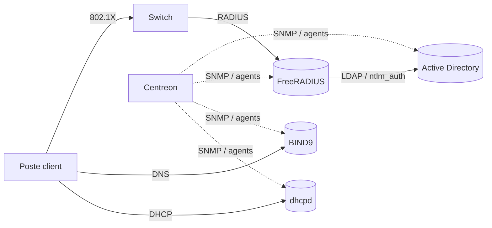

NetWiki est une **base de connaissances locale** pour architectes et administrateurs réseau. Chaque article est un simple fichier Markdown stocké sur votre disque : vous pouvez le lire, le modifier, le versionner avec Git ou le synchroniser sur un partage réseau.

> [!TIP] Raccourci essentiel
> Appuyez sur <kbd>Ctrl</kbd> + <kbd>K</kbd> n'importe où pour lancer la recherche plein texte. Elle tolère les fautes de frappe, ignore les accents et cherche aussi dans les blocs de code (`named.conf`, `Install-WindowsFeature`, `radtest`…).

## Organisation

Le contenu est classé **par fonction réseau** puis **par produit** :

| Catégorie | Services documentés |
| --- | --- |
| Annuaire, identité & secrets | [[01-active-directory/01-presentation\|Active Directory]], [[09-adfs/01-presentation-installation\|AD FS]], [[10-adlds/01-presentation-installation-exploitation\|AD LDS]], [[11-adrms/01-presentation-deploiement\|AD RMS]], [[02-openldap/01-presentation-installation\|OpenLDAP]], [[03-freeipa/01-presentation-installation\|FreeIPA]], [[04-kerberos/01-presentation-installation\|Kerberos]], [[05-keycloak/01-presentation-installation\|Keycloak]], [[06-authelia/01-presentation-configuration\|Authelia]], [[07-vault/01-presentation-installation\|Vault]], [[08-vaultwarden/01-presentation-installation\|Vaultwarden]] |
| DNS | [[01-bind9/01-presentation\|BIND9]], [[02-unbound/01-presentation-installation\|Unbound]], [[03-dnsmasq/01-presentation-installation\|dnsmasq]], [[04-powerdns/01-presentation\|PowerDNS]], [[05-dns-windows/01-installation-zones-strategies\|DNS Windows]] |
| DHCP & déploiement | [[01-isc-dhcp/01-presentation\|ISC DHCP (dhcpd)]], [[02-kea/01-presentation-installation\|Kea]], [[03-dhcp-windows/01-presentation-installation\|DHCP Windows]], [[04-wds/01-presentation-installation\|WDS]] |
| AAA & Authentification | [[01-freeradius/01-presentation\|FreeRADIUS]], [[02-nps/01-presentation-installation\|NPS]] |
| Serveurs web & applications | [[01-iis/01-presentation\|IIS]], [[02-apache/01-presentation\|Apache]], [[03-nginx/01-presentation\|Nginx]], [[04-caddy/01-presentation-installation\|Caddy]], [[05-php-fpm/01-presentation-installation-pools\|PHP-FPM]], [[06-nodejs/01-presentation-installation\|Node.js]], [[07-python/01-environnements-gunicorn-uvicorn\|Python]], [[08-ruby/01-ruby-puma-production\|Ruby]], [[09-openjdk/01-installation-exploitation\|OpenJDK]], [[10-tomcat/01-presentation-installation\|Tomcat]], [[11-wildfly/01-presentation-installation\|WildFly]] |
| Supervision & métriques | [[01-centreon/01-presentation\|Centreon]], [[02-prometheus/01-presentation-installation\|Prometheus]], [[03-grafana/01-presentation-installation\|Grafana]], [[04-zabbix/01-presentation-installation\|Zabbix]], [[05-nagios/01-presentation-installation\|Nagios]], [[06-icinga/01-presentation-installation\|Icinga 2]], [[07-netdata/01-presentation-installation\|Netdata]], [[08-checkmk/01-presentation-installation\|Checkmk]], [[09-telegraf/01-presentation-configuration\|Telegraf]], [[10-influxdb/01-presentation-installation\|InfluxDB]], [[11-prtg/01-presentation-installation\|PRTG]], [[12-snmp-windows/01-service-snmp\|SNMP Windows]] |
| Proxy, cache & répartition de charge | [[01-haproxy/01-presentation\|HAProxy]], [[02-squid/01-presentation\|Squid]], [[03-varnish/01-presentation-installation\|Varnish]], [[04-traefik/01-presentation-installation\|Traefik]], [[05-nginx-proxy-manager/01-presentation-installation-exploitation\|Nginx Proxy Manager]], [[06-dante/01-presentation-configuration\|Dante (SOCKS)]] |
| Accès distant & VPN | [[01-openssh/01-presentation\|OpenSSH (+ SFTP)]], [[02-openvpn/01-presentation\|OpenVPN]], [[03-wireguard/01-presentation-installation\|WireGuard]], [[04-strongswan/01-presentation\|strongSwan]], [[05-tailscale-headscale/01-presentation-installation\|Tailscale / Headscale]], [[06-zerotier/01-presentation-installation\|ZeroTier]], [[07-rras/01-presentation-vpn\|RRAS]], [[08-rds/01-presentation-architecture\|Bureau à distance (RDS)]], [[09-winrm/01-presentation-configuration\|WinRM]], [[10-windows-admin-center/01-presentation-installation\|Windows Admin Center]] |
| Fichiers, partage & stockage | [[01-samba/01-presentation\|Samba]], [[02-nfs/01-presentation\|NFS]], [[03-vsftpd/01-presentation-installation\|vsftpd]], [[04-proftpd/01-presentation-installation\|ProFTPD]], [[05-pure-ftpd/01-presentation-installation\|Pure-FTPd]], [[06-tftp/01-presentation-installation\|TFTP]], [[07-minio/01-presentation-installation\|MinIO]], [[08-nextcloud/01-presentation-installation\|Nextcloud]], [[09-owncloud/01-presentation-installation\|ownCloud]], [[10-seafile/01-presentation-installation\|Seafile]], [[11-syncthing/01-presentation-installation\|Syncthing]], [[12-webdav/01-presentation-serveurs\|WebDAV]], [[13-serveur-fichiers-windows/01-partages-ntfs-smb\|serveur de fichiers Windows]], [[14-dfs/01-espaces-noms\|DFS]], [[15-fsrm/01-quotas-filtrage-classification\|FSRM]], [[16-iscsi-mpio/01-cible-iscsi\|iSCSI / MPIO]], [[17-storage-replica/01-presentation-deploiement\|Storage Replica]], [[18-deduplication/01-deduplication\|déduplication]], [[19-filezilla-server/01-installation-configuration\|FileZilla Server]], [[20-cerberus-ftp/01-presentation-configuration\|Cerberus FTP]] |
| Messagerie & collaboration | [[01-postfix/01-presentation\|Postfix]], [[02-dovecot/01-presentation-installation\|Dovecot]], [[03-exim/01-presentation-installation\|Exim]], [[04-rspamd/01-presentation-installation\|Rspamd]], [[05-spamassassin/01-presentation-installation\|SpamAssassin]], [[06-mailman/01-presentation-installation\|Mailman 3]], [[07-mailpit/01-presentation-installation\|Mailpit]], [[08-radicale/01-installation-configuration\|Radicale]], [[09-joplin-server/01-installation-exploitation\|Joplin Server]], [[10-smtp-windows/01-relais-smtp\|relais SMTP Windows]] |
| Bases de données | [[01-mariadb-mysql/01-presentation\|MariaDB / MySQL]], [[02-postgresql/01-presentation\|PostgreSQL]], [[03-mongodb/01-presentation-installation\|MongoDB]], [[04-redis/01-presentation-installation\|Redis / Valkey]], [[05-memcached/01-presentation-installation\|Memcached]], [[06-sqlite/01-presentation-utilisation\|SQLite]], [[07-couchdb/01-presentation-installation\|CouchDB]], [[08-sql-server/01-presentation-installation\|SQL Server]], [[09-neo4j/01-presentation-installation\|Neo4j]] |
| Recherche, files de messages & IoT | [[01-elasticsearch/01-presentation-installation\|Elasticsearch]], [[02-opensearch/01-presentation-installation\|OpenSearch]], [[03-rabbitmq/01-presentation-installation\|RabbitMQ]], [[04-kafka/01-presentation-installation\|Kafka]], [[05-mosquitto/01-presentation-configuration\|Mosquitto]], [[06-emqx/01-presentation-installation\|EMQX]], [[07-msmq/01-presentation-exploitation\|MSMQ]] |
| Conteneurs & virtualisation | [[01-docker/01-presentation-installation\|Docker]], [[02-podman/01-presentation-installation\|Podman]], [[03-containerd/01-presentation-utilisation\|containerd]], [[04-kubernetes/01-presentation-architecture\|Kubernetes]], [[05-k3s/01-presentation-installation\|K3s]], [[06-minikube/01-installation-utilisation\|Minikube]], [[07-kind/01-installation-utilisation\|Kind]], [[08-portainer/01-presentation-installation\|Portainer]], [[09-hyper-v/01-presentation-installation\|Hyper-V]], [[10-conteneurs-windows/01-presentation-installation\|conteneurs Windows]], [[11-proxmox-ve/01-presentation-installation\|Proxmox VE]], [[12-virtualbox/01-installation-utilisation\|VirtualBox]], [[13-vmware-workstation/01-installation-utilisation\|VMware Workstation]] |
| DevOps & forges | [[01-git/01-presentation-installation\|Git]], [[02-gitlab/01-presentation-installation\|GitLab]], [[03-gitea/01-presentation-installation\|Gitea]], [[04-forgejo/01-presentation-installation\|Forgejo]], [[05-jenkins/01-presentation-installation\|Jenkins]], [[06-teamcity/01-presentation-installation\|TeamCity]], [[07-sonarqube/01-presentation-installation\|SonarQube]] |
| Journaux & SIEM | [[01-rsyslog/01-presentation-installation\|rsyslog]], [[02-logstash/01-presentation-installation\|Logstash]], [[03-fluent-bit/01-presentation-installation\|Fluent Bit]], [[04-graylog/01-presentation-installation\|Graylog]], [[05-wazuh/01-presentation-installation\|Wazuh]], [[06-splunk/01-presentation-installation\|Splunk]], [[07-eventlog-analyzer/01-presentation-installation\|EventLog Analyzer]], [[08-windows-event-collector/01-presentation-configuration\|collecteur d’événements Windows]] |
| Sécurité | [[01-fail2ban/01-presentation-configuration\|Fail2ban]], [[02-crowdsec/01-presentation-installation\|CrowdSec]], [[03-aide/01-installation-utilisation\|AIDE]], [[04-clamav/01-presentation-installation\|ClamAV]], [[05-suricata/01-presentation-installation\|Suricata]], [[06-snort/01-presentation-installation\|Snort]], [[07-zeek/01-presentation-installation\|Zeek]], [[08-lynis/01-installation-audit\|Lynis]], [[09-defender/01-antivirus-configuration\|Microsoft Defender]], [[10-pare-feu-windows/01-profils-regles\|pare-feu Windows]], [[11-bitlocker/01-presentation-activation\|BitLocker]] |
| Automatisation & configuration | [[01-ansible/01-presentation-installation\|Ansible]], [[02-puppet/01-presentation-installation\|Puppet / OpenVox]], [[03-salt/01-presentation-installation\|Salt]], [[04-terraform/01-presentation-installation\|Terraform / OpenTofu]], [[05-powershell-dsc/01-presentation-configurations\|PowerShell DSC]] |
| Infrastructure & services système | [[01-chrony/01-presentation-client\|Chrony]], [[02-ntpsec/01-presentation-configuration\|NTPsec]], [[03-impression/01-cups-presentation-installation\|CUPS et impression Windows]], [[04-wsus/01-presentation-installation\|WSUS]], [[05-clustering/01-cluster-basculement\|clustering et NLB]], [[06-ipam/01-presentation-deploiement\|IPAM]], [[07-services-tcpip-simples/01-presentation-risques\|services TCP/IP simples]] |
| Sauvegarde & restauration | [[01-restic/01-presentation-installation\|Restic]], [[02-borgbackup/01-presentation-installation\|BorgBackup]], [[03-bacula/01-presentation-architecture\|Bacula]], [[04-urbackup/01-presentation-installation\|UrBackup]], [[05-veeam/01-presentation-architecture\|Veeam]], [[06-nakivo/01-presentation-installation\|NAKIVO]], [[07-windows-server-backup/01-sauvegarde-restauration\|Sauvegarde Windows Server]] |
| Multimédia & services personnels | [[01-jellyfin/01-presentation-installation\|Jellyfin]], [[02-plex/01-presentation-installation-exploitation\|Plex]], [[03-navidrome/01-installation-configuration\|Navidrome]], [[04-icecast/01-installation-configuration\|Icecast]], [[05-nginx-rtmp/01-diffusion-direct\|Nginx RTMP]], [[06-bittorrent/01-transmission\|clients BitTorrent]], [[07-serveurs-jeux/01-minecraft\|serveurs de jeux]] |
| Outils de l'administrateur | [[01-acces-administration/01-putty\|accès (PuTTY, Termius, WinSCP)]], [[02-reseau-diagnostic/01-wireshark-capture\|réseau (Wireshark, Nmap, iPerf3, curl, Greenbone…)]], [[03-cybersecurite/01-nessus\|cybersécurité (Nessus, ZAP, Burp, KeePassXC…)]], [[04-developpement/01-vscode\|développement (VS Code, JetBrains, DBeaver, uv…)]], [[05-ia-productivite/01-chatgpt\|IA et productivité (Copilot, Ollama, n8n, BookStack…)]], [[06-support-parc/04-glpi-installation\|support et parc (GLPI, Intune, RustDesk…)]], [[07-disques-recuperation/01-gparted\|disques (GParted, Clonezilla, TestDisk)]] |
| Équipements réseau par constructeur | [[02-cisco-ios-bases/01-cli-fondamentaux\|Cisco (IOS, routeurs, Catalyst, ASA, Meraki)]], [[07-aruba/02-aos-cx-cli\|commutation (Aruba, Comware, Huawei, ALE, TP-Link, UniFi, Arista…)]], [[15-fortigate/01-acces-cli-gui\|pare-feu (FortiGate, Stormshield, Palo Alto, pfSense, Check Point…)]], [[23-juniper/01-junos-cli-commutation\|Juniper]], [[24-mikrotik/01-routeros-cli-winbox\|MikroTik]], [[27-mitel/01-reseau-telephonie-ip\|Mitel]], [[01-correspondance-commandes/01-administration-commutation\|correspondance des commandes]] |
| Téléphonie IP (ToIP) | [[23-telephonie-ip/01-fondamentaux/01-sip-sdp-rtp-codecs\|SIP, RTP, codecs, QoS, sécurité]], [[02-asterisk/01-presentation-installation\|Asterisk]], [[03-freepbx/01-installation-interface\|FreePBX]], [[04-freeswitch/01-presentation-installation\|FreeSWITCH]], [[06-3cx/01-installation-configuration\|3CX]], [[07-cisco-cme-cucm/01-cme-ios\|Cisco CME/CUCM]], [[08-alcatel-omnipcx/01-omnipcx-enterprise\|Alcatel OmniPCX]], [[09-mitel/01-mivoice-administration\|Mitel]], [[10-teams-phone/01-teams-phone-direct-routing\|Teams Phone]], [[12-sbc-passerelles/01-sbc\|SBC]], [[15-diagnostic-voip/01-sngrep-wireshark-sipp\|diagnostic VoIP]] |
| Aide-mémoires des commandes | [[00-aide-memoires\|217 aide-mémoires, un par service ou constructeur (commandes et exemples prêts à copier)]] |

Chaque service suit le même plan : **présentation → installation (Linux, Windows, macOS) → configuration de base → configurations avancées → sécurité → exploitation et dépannage**. La [[00-feuille-de-route|feuille de route]] liste tous les services prévus et leur état d'avancement.

## Navigation

- **Arborescence** ou **Liste A–Z** : bouton bascule en haut du panneau latéral. Le champ *Filtrer les titres…* restreint instantanément l'affichage.
- **Vue cartes** : cliquez sur un dossier pour afficher ses articles et sous-dossiers sous forme de cartes.
- **Favoris** : l'étoile en haut d'un article l'épingle dans le panneau latéral.
- **Historique** : <kbd>Alt</kbd> + <kbd>←</kbd> / <kbd>→</kbd> ou les boutons de la souris.
- **Clic droit** sur un élément de l'arborescence : créer, renommer, déplacer, dupliquer, exporter en PDF, supprimer.
- **Glisser-déposer** un article ou un dossier sur un autre dossier pour le déplacer.

## Raccourcis clavier

| Raccourci | Action |
| --- | --- |
| <kbd>Ctrl</kbd> + <kbd>K</kbd> | Recherche / palette de commandes (`>` pour les commandes, `#tag` pour filtrer) |
| <kbd>Ctrl</kbd> + <kbd>N</kbd> | Nouvel article |
| <kbd>Ctrl</kbd> + <kbd>E</kbd> | Modifier l'article affiché |
| <kbd>Ctrl</kbd> + <kbd>S</kbd> | Enregistrer (dans l'éditeur) |
| <kbd>Ctrl</kbd> + <kbd>B</kbd> | Afficher / masquer le panneau latéral |
| <kbd>Ctrl</kbd> + <kbd>,</kbd> | Paramètres |
| <kbd>Ctrl</kbd> + <kbd>+</kbd> / <kbd>-</kbd> / <kbd>0</kbd> | Zoom |
| <kbd>F5</kbd> | Recharger le wiki depuis le disque |

## Rédiger un article

L'éditeur affiche la source Markdown et un aperçu en direct. Les métadonnées (titre, description, étiquettes, icône) sont saisies dans les champs au-dessus de l'éditeur et enregistrées dans l'en-tête du fichier :

```yaml
---
title: Configuration NTP sur Cisco IOS
description: Synchroniser l'heure des équipements réseau.
tags: [ntp, cisco, temps]
icon: clock
---
```

### Mise en forme

```markdown
## Titre de section
**gras**, *italique*, `code en ligne`, ~~barré~~
- liste à puces
1. liste numérotée
- [ ] tâche à faire
[lien externe](https://www.isc.org)
[[Titre d'un autre article]]     ← lien wiki, résolu par titre ou chemin
    ← image (collez-la directement dans l'éditeur)
```

### Blocs de code

Indiquez le langage après les trois accents graves, éventuellement suivi d'un titre (le nom du fichier par exemple) :

````markdown
```named /etc/bind/named.conf.options
options {
    directory "/var/cache/bind";
};
```
````

Langages reconnus : `bash`, `powershell`, `named` (named.conf), `dns` (fichiers de zone), `dhcpd`, `radius` (FreeRADIUS), `cisco`, `xml`, `ini`, `yaml`, `json`, `sql`, `nginx`, `apache`, `perl`, `php`, `python`, `csharp`, `diff`…

### Encadrés

```markdown
> [!NOTE]
> Information complémentaire.

> [!TIP] Titre personnalisé
> Bonne pratique.

> [!WARNING]
> Point de vigilance.

> [!CAUTION]
> Action risquée.
```

> [!NOTE]
> Information complémentaire.

> [!IMPORTANT]
> À retenir absolument.

> [!WARNING]
> Point de vigilance.

> [!CAUTION]
> Action risquée ou destructive.

### Diagrammes

Les blocs `mermaid` sont dessinés automatiquement :



## Où sont stockées les données ?

Par défaut dans le dossier utilisateur de l'application (*Paramètres → Dossier des données → Ouvrir*). Vous pouvez choisir un autre dossier, par exemple un dépôt Git partagé par l'équipe. Les modifications faites en dehors de l'application (éditeur de texte, `git pull`) sont détectées et rechargées automatiquement.

> [!NOTE] Contenu d'origine
> Les articles livrés avec NetWiki sont copiés dans votre dossier au premier lancement. Vos modifications ne sont jamais écrasées par une mise à jour, et un article supprimé n'est pas recréé — sauf si vous utilisez *Paramètres → Restaurer le contenu d'origine*.
