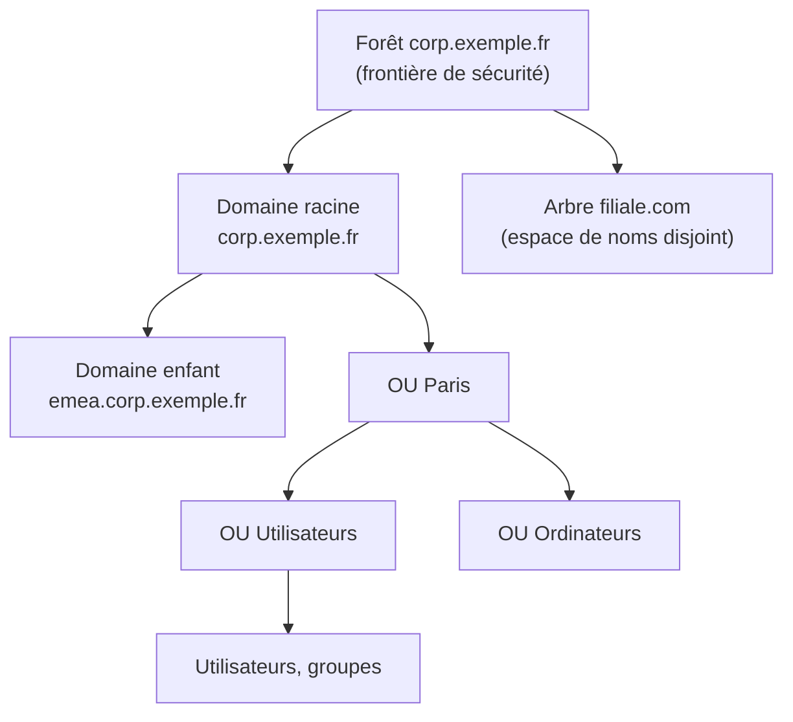
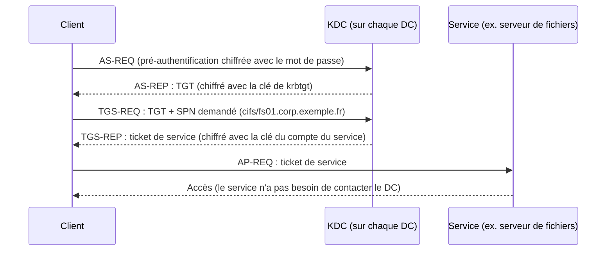

**Active Directory Domain Services (AD DS)** est le service d'annuaire de Microsoft. Il centralise les **identités** (utilisateurs, ordinateurs, groupes, comptes de service), l'**authentification** (Kerberos, NTLM), l'**autorisation** (groupes, ACL), et la **configuration** des postes et serveurs (stratégies de groupe). C'est aussi la source d'identité de nombreux services réseau : Wi-Fi 802.1X ([[01-freeradius/06-ldap-active-directory|FreeRADIUS]]/NPS), VPN, proxys, applications web ([[01-iis/05-authentification-autorisation|IIS]]), supervision.

## Structure logique



| Élément | Définition |
| --- | --- |
| **Forêt** | Ensemble d'un ou plusieurs domaines partageant un **schéma**, une **configuration** et un **catalogue global**. C'est la véritable **frontière de sécurité**. |
| **Arbre** | Domaines qui partagent un espace de noms DNS contigu (`corp.exemple.fr`, `emea.corp.exemple.fr`). |
| **Domaine** | Frontière de **réplication** et d'**administration** ; contient les objets et leur politique de mot de passe par défaut. |
| **Unité d'organisation (OU)** | Conteneur pour organiser les objets, **déléguer** l'administration et **lier des GPO**. |
| **Objet** | Instance d'une classe du schéma (user, computer, group, organizationalUnit, contact…) avec des attributs. |
| **Schéma** | Définition des classes et attributs, commun à toute la forêt (extensible : Exchange, LAPS…). |

> [!TIP]
> La recommandation actuelle est **une forêt, un domaine** pour la très grande majorité des organisations. Les domaines multiples ajoutent de la complexité sans apporter d'isolation de sécurité (seule la forêt en est une).

### Noms distinctifs (DN)

Chaque objet est identifié par son **DN** : `CN=Alice Martin,OU=Utilisateurs,OU=Paris,DC=corp,DC=exemple,DC=fr`.
Autres identifiants : `sAMAccountName` (`amartin`, ≤ 20 caractères, ouverture de session `CORP\amartin`), **UPN** (`alice.martin@exemple.fr`), **objectGUID** (immuable), **objectSID** (sécurité, change en cas de migration inter-domaines).

## Structure physique

| Élément | Rôle |
| --- | --- |
| **Contrôleur de domaine (DC)** | Serveur hébergeant une copie de l'annuaire (`NTDS.dit`), répondant en LDAP/Kerberos. Réplication **multi-maître**. |
| **RODC** | Contrôleur en lecture seule, pour les sites peu sûrs ; ne met en cache que les mots de passe autorisés. |
| **Catalogue global (GC)** | DC qui contient une copie partielle de tous les objets de la forêt (recherches, appartenance aux groupes universels). En forêt mono-domaine, **tous les DC devraient être GC**. |
| **Site** | Ensemble de sous-réseaux IP bien connectés ; optimise la réplication et oriente les clients vers le DC le plus proche. |
| **Lien de site** | Connexion logique entre sites avec un coût et une planification de réplication. |

## Partitions (contextes de nommage)

| Partition | Contenu | Réplication |
| --- | --- | --- |
| **Schema** | Classes et attributs | Toute la forêt |
| **Configuration** | Sites, services, topologie de réplication | Toute la forêt |
| **Domain** | Objets du domaine (utilisateurs, ordinateurs, groupes, OU) | Tous les DC du domaine |
| **DomainDnsZones** / **ForestDnsZones** | Zones DNS intégrées à AD | DC DNS du domaine / de la forêt |

## Rôles FSMO

Certaines opérations ne peuvent pas être multi-maîtres : elles sont confiées à un **maître d'opération** unique.

| Rôle | Portée | Fonction | Impact si indisponible |
| --- | --- | --- | --- |
| **Maître de schéma** | Forêt | Modifications du schéma | Extension du schéma impossible |
| **Maître d'attribution de noms de domaine** | Forêt | Ajout/suppression de domaines | Impossible d'ajouter un domaine |
| **Maître RID** | Domaine | Distribue des blocs de RID (500 par défaut) aux DC pour créer des SID | Création d'objets impossible quand un DC épuise son bloc |
| **Émulateur PDC** | Domaine | Référence de l'heure, changements de mot de passe prioritaires, verrouillages, édition des GPO par défaut | Problèmes d'heure (Kerberos), de verrouillage, de mot de passe |
| **Maître d'infrastructure** | Domaine | Met à jour les références inter-domaines | Sans effet si tous les DC sont GC ou mono-domaine |

Gestion des rôles : [[07-fsmo-maintenance]].

## Niveaux fonctionnels

Le niveau fonctionnel détermine les fonctionnalités disponibles et la version **minimale** des DC autorisés.

| Niveau | Fonctionnalités notables |
| --- | --- |
| 2008 R2 | Corbeille AD (activable), comptes de service gérés |
| 2012 / 2012 R2 | Revendications Kerberos (claims), **Protected Users** (protections côté DC), stratégies et silos d'authentification |
| **2016** | PAM (groupes à durée limitée), rotation automatique des secrets NTLM des comptes « carte à puce obligatoire » |
| **2025** | Nouveau format de base (pages de 32 Ko optionnelles), améliorations de sécurité (chiffrement LDAP, Kerberos) — DC en Windows Server 2025 uniquement |

> [!NOTE]
> Il n'existe **pas** de niveau fonctionnel 2019 ni 2022 : des DC Windows Server 2019/2022 fonctionnent au niveau 2016.

```powershell
Get-ADForest | Select-Object Name, ForestMode, SchemaMaster, DomainNamingMaster, GlobalCatalogs
Get-ADDomain | Select-Object DNSRoot, NetBIOSName, DomainMode, PDCEmulator, RIDMaster, InfrastructureMaster
```

## Authentification

### Kerberos (protocole par défaut)



- Exige une **heure synchronisée** (tolérance par défaut **5 minutes**) et une **résolution DNS** correcte.
- Les services sont identifiés par leur **SPN** (`HTTP/intranet.corp.exemple.fr`, `MSSQLSvc/sql01:1433`).
- Le compte **krbtgt** chiffre tous les TGT : sa compromission permet de forger des « golden tickets ».

### NTLM

Protocole hérité de défi/réponse, utilisé quand Kerberos n'est pas possible (accès par IP, alias sans SPN, poste hors domaine). Vulnérable au relais et au *pass-the-hash* : à **auditer puis restreindre** (voir [[09-securite-durcissement]]).

## Dépendance au DNS

AD DS **repose entièrement** sur le DNS : les clients trouvent les DC via des enregistrements **SRV** :

```text
_ldap._tcp.dc._msdcs.corp.exemple.fr              → tous les DC
_ldap._tcp.Paris._sites.dc._msdcs.corp.exemple.fr → DC du site Paris
_kerberos._tcp.corp.exemple.fr                    → KDC
_gc._tcp.corp.exemple.fr                          → catalogues globaux
<GUID-du-DC>._msdcs.corp.exemple.fr  (CNAME)      → réplication
```

Voir [[03-dns-integre]].

## Ports nécessaires (clients ↔ DC et DC ↔ DC)

| Port | Protocole | Usage |
| --- | --- | --- |
| 53 | TCP/UDP | DNS |
| 88 | TCP/UDP | Kerberos |
| 123 | UDP | NTP (W32Time) |
| 135 | TCP | RPC Endpoint Mapper |
| 137-139 | UDP/TCP | NetBIOS (hérité, à éviter) |
| 389 | TCP/UDP | LDAP (et ping LDAP UDP du *DC locator*) |
| 445 | TCP | SMB (SYSVOL, NETLOGON, GPO) |
| 464 | TCP/UDP | Changement de mot de passe Kerberos |
| 636 | TCP | LDAPS |
| 3268 / 3269 | TCP | Catalogue global / GC sur TLS |
| 9389 | TCP | Active Directory Web Services (module PowerShell, ADAC) |
| 49152-65535 | TCP | RPC dynamiques (réplication, NETLOGON, DFSR) |

> [!TIP]
> Pour les DC derrière un pare-feu, on peut **fixer les ports RPC** de la réplication AD (`HKLM\SYSTEM\CurrentControlSet\Services\NTDS\Parameters\TCP/IP Port`), de NETLOGON et de DFSR (`dfsrdiag staticrpc`) au lieu d'ouvrir toute la plage dynamique.

## Suite du parcours

1. [[02-installation|Planification et installation des contrôleurs de domaine]]
2. [[03-dns-integre|DNS intégré à Active Directory]]
3. [[04-utilisateurs-groupes-ou|OU, utilisateurs, groupes, comptes de service et délégation]]
4. [[05-gpo|Stratégies de groupe (GPO)]]
5. [[06-sites-replication|Sites, sous-réseaux et réplication]]
6. [[07-fsmo-maintenance|Rôles FSMO, heure et maintenance]]
7. [[08-sauvegarde-restauration|Sauvegarde, corbeille AD et restauration]]
8. [[09-securite-durcissement|Sécurité et durcissement]]
9. [[10-adcs-pki|Services de certificats (AD CS)]]
10. [[11-approbations-trusts|Relations d'approbation]]
11. [[12-depannage-commandes|Dépannage et mémo des commandes]]
