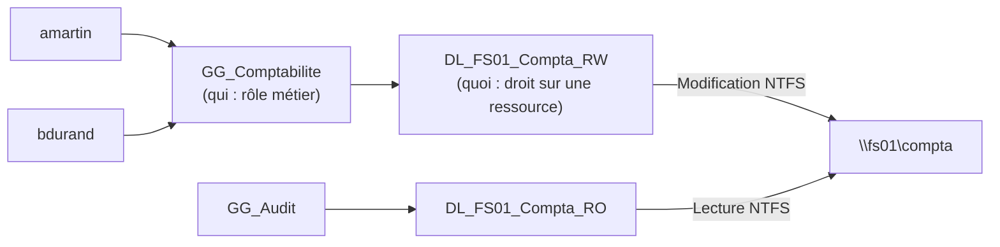

## Concevoir les unités d'organisation

Les OU servent à **déléguer** et à **appliquer des GPO**, pas à reproduire l'organigramme. Exemple de structure éprouvée :

```text
corp.exemple.fr
├── _Admin                         ← tier 0 : comptes et groupes d'administration (accès restreint)
│   ├── Comptes-T0
│   ├── Comptes-T1
│   ├── Comptes-T2
│   └── Groupes-Admin
├── Corp
│   ├── Utilisateurs
│   │   ├── Paris
│   │   └── Lyon
│   ├── Ordinateurs
│   │   ├── Postes
│   │   │   ├── Paris
│   │   │   └── Lyon
│   │   └── Portables
│   ├── Serveurs
│   │   ├── Fichiers
│   │   ├── Web
│   │   └── Applications
│   ├── Groupes
│   │   ├── Globaux (GG_)
│   │   └── Locaux-domaine (DL_)
│   ├── Comptes-de-service
│   └── Desactives
└── Domain Controllers             ← ne rien y déplacer d'autre
```

```powershell
$base = "DC=corp,DC=exemple,DC=fr"
New-ADOrganizationalUnit -Name "Corp" -Path $base -ProtectedFromAccidentalDeletion $true
"Utilisateurs","Ordinateurs","Serveurs","Groupes","Comptes-de-service","Desactives" | ForEach-Object {
  New-ADOrganizationalUnit -Name $_ -Path "OU=Corp,$base"
}
New-ADOrganizationalUnit -Name "Paris" -Path "OU=Utilisateurs,OU=Corp,$base"
```

### Rediriger les conteneurs par défaut

Les nouveaux ordinateurs joints et les utilisateurs créés sans emplacement atterrissent dans `CN=Computers` et `CN=Users`, où **aucune GPO ne peut être liée**. Redirigez-les :

```powershell
redircmp "OU=Postes,OU=Ordinateurs,OU=Corp,DC=corp,DC=exemple,DC=fr"
redirusr "OU=Utilisateurs,OU=Corp,DC=corp,DC=exemple,DC=fr"
```

## Utilisateurs

```powershell
$mdp = Read-Host -AsSecureString "Mot de passe initial"
New-ADUser -Name "Alice Martin" -GivenName Alice -Surname Martin `
  -SamAccountName amartin -UserPrincipalName alice.martin@exemple.fr `
  -EmailAddress alice.martin@exemple.fr -Title "Ingénieure réseau" -Department "DSI" `
  -Path "OU=Paris,OU=Utilisateurs,OU=Corp,DC=corp,DC=exemple,DC=fr" `
  -AccountPassword $mdp -ChangePasswordAtLogon $true -Enabled $true

# Modifier, désactiver, déverrouiller, réinitialiser
Set-ADUser amartin -Office "Paris - 3e étage" -Manager bdupont
Disable-ADAccount amartin
Unlock-ADAccount amartin
Set-ADAccountPassword amartin -Reset -NewPassword (Read-Host -AsSecureString) ; Set-ADUser amartin -ChangePasswordAtLogon $true
Move-ADObject (Get-ADUser amartin).DistinguishedName -TargetPath "OU=Desactives,OU=Corp,DC=corp,DC=exemple,DC=fr"
```

### Suffixe UPN

Pour que les utilisateurs se connectent avec `prenom.nom@exemple.fr` (adresse e-mail, Microsoft 365) alors que le domaine est `corp.exemple.fr` :

```powershell
Get-ADForest | Set-ADForest -UPNSuffixes @{Add="exemple.fr"}
```

### Import en masse depuis un CSV

```text utilisateurs.csv
Prenom;Nom;Login;Service;Site
Alice;Martin;amartin;DSI;Paris
Bruno;Durand;bdurand;Comptabilité;Lyon
```

```powershell
Import-Csv .\utilisateurs.csv -Delimiter ';' -Encoding UTF8 | ForEach-Object {
  $upn = ("{0}.{1}@exemple.fr" -f $_.Prenom, $_.Nom).ToLower()
  $pwd = ConvertTo-SecureString ([System.Web.Security.Membership]::GeneratePassword(16,3)) -AsPlainText -Force
  New-ADUser -Name "$($_.Prenom) $($_.Nom)" -GivenName $_.Prenom -Surname $_.Nom `
    -SamAccountName $_.Login -UserPrincipalName $upn -Department $_.Service `
    -Path "OU=$($_.Site),OU=Utilisateurs,OU=Corp,DC=corp,DC=exemple,DC=fr" `
    -AccountPassword $pwd -ChangePasswordAtLogon $true -Enabled $true
  Add-ADGroupMember -Identity "GG_$($_.Service)" -Members $_.Login
}
```

> [!NOTE]
> `[System.Web.Security.Membership]` nécessite `Add-Type -AssemblyName System.Web` sous Windows PowerShell 5.1 ; sous PowerShell 7, générez le mot de passe autrement (`Get-Random`, `RandomNumberGenerator`).

## Ordinateurs

```powershell
# Pré-créer le compte (permet de joindre sans droits étendus et de placer directement dans la bonne OU)
New-ADComputer -Name "PC-PAR-0042" -Path "OU=Paris,OU=Postes,OU=Ordinateurs,OU=Corp,DC=corp,DC=exemple,DC=fr"
# Joindre un poste au domaine (sur le poste)
Add-Computer -DomainName corp.exemple.fr -OUPath "OU=Paris,OU=Postes,OU=Ordinateurs,OU=Corp,DC=corp,DC=exemple,DC=fr" -Credential CORP\svc-join -Restart
# Réparer la relation d'approbation d'un poste
Test-ComputerSecureChannel -Repair -Credential CORP\admin-t2
```

> [!TIP]
> Par défaut, **tout utilisateur authentifié peut joindre 10 machines** au domaine (`ms-DS-MachineAccountQuota`). Passez cette valeur à 0 et déléguez la jonction à un compte/groupe dédié :
> ```powershell
> Set-ADDomain -Identity corp.exemple.fr -Replace @{"ms-DS-MachineAccountQuota"="0"}
> ```

## Groupes

### Types et portées

| Portée | Peut contenir | Utilisable pour des droits sur | Réplication |
| --- | --- | --- | --- |
| **Global (GG)** | Utilisateurs/ordinateurs/groupes globaux **du même domaine** | Toute la forêt et les domaines approuvés | Domaine |
| **Local de domaine (DL)** | Comptes et groupes globaux/universels de **n'importe quel domaine approuvé**, DL du même domaine | Ressources **du domaine** | Domaine |
| **Universel (UG)** | Comptes, globaux et universels de la forêt | Toute la forêt | Catalogue global |
| Local (machine) | Tout | La machine | — |

Types : **Sécurité** (ACL, GPO, et liste de diffusion si messagerie) ou **Distribution** (messagerie uniquement, pas de SID dans le jeton).

### Modèle AGDLP

**A**ccounts → **G**lobal → **D**omain **L**ocal → **P**ermissions :



- Les **utilisateurs** vont dans des groupes **globaux** représentant des rôles.
- Les **droits** sont donnés à des groupes **locaux de domaine** représentant une ressource + un niveau d'accès.
- Les globaux deviennent membres des locaux de domaine.
- On ne met jamais un utilisateur directement dans une ACL.

```powershell
New-ADGroup -Name "GG_Comptabilite" -GroupScope Global -GroupCategory Security -Path "OU=Globaux (GG_),OU=Groupes,OU=Corp,DC=corp,DC=exemple,DC=fr"
New-ADGroup -Name "DL_FS01_Compta_RW" -GroupScope DomainLocal -GroupCategory Security -Path "OU=Locaux-domaine (DL_),OU=Groupes,OU=Corp,DC=corp,DC=exemple,DC=fr" -Description "\\fs01\compta en modification"
Add-ADGroupMember DL_FS01_Compta_RW -Members GG_Comptabilite
Add-ADGroupMember GG_Comptabilite -Members amartin,bdurand
Get-ADGroupMember GG_Comptabilite -Recursive | Select-Object SamAccountName
Get-ADPrincipalGroupMembership amartin | Select-Object Name
```

> [!NOTE]
> L'appartenance aux groupes est calculée **à l'ouverture de session** (jeton Kerberos). Après un ajout, l'utilisateur doit se reconnecter (ou `klist purge` pour les accès réseau) pour obtenir le nouveau droit.

### Groupes à durée limitée (niveau 2016 + PAM)

```powershell
Enable-ADOptionalFeature 'Privileged Access Management Feature' -Scope ForestOrConfigurationSet -Target corp.exemple.fr
Add-ADGroupMember -Identity "Admins du domaine" -Members admin-t0-amartin -MemberTimeToLive (New-TimeSpan -Hours 2)
```

## Comptes de service gérés (gMSA)

Un **gMSA** est un compte de service dont le mot de passe (240 caractères) est **géré et renouvelé automatiquement** par AD, récupérable uniquement par les serveurs autorisés. Idéal pour les pools IIS, services Windows, tâches planifiées, SQL Server.

```powershell
# Une seule fois par forêt : clé racine KDS (attendre la réplication — 10 h en production)
Add-KdsRootKey -EffectiveImmediately
# Laboratoire uniquement : Add-KdsRootKey -EffectiveTime ((Get-Date).AddHours(-10))

New-ADGroup -Name "GS_Serveurs_Intranet" -GroupScope Global -Path "OU=Groupes,OU=Corp,DC=corp,DC=exemple,DC=fr"
Add-ADGroupMember GS_Serveurs_Intranet -Members "WEB01$","WEB02$"

New-ADServiceAccount -Name "gmsa-intranet" -DNSHostName "gmsa-intranet.corp.exemple.fr" `
  -PrincipalsAllowedToRetrieveManagedPassword "GS_Serveurs_Intranet" `
  -ServicePrincipalNames "HTTP/intranet.corp.exemple.fr" `
  -KerberosEncryptionType AES128,AES256

# Sur chaque serveur (après redémarrage ou klist purge -li 0x3e7 pour la nouvelle appartenance)
Install-ADServiceAccount gmsa-intranet
Test-ADServiceAccount gmsa-intranet        # True
```

Utilisation : identité `CORP\gmsa-intranet$` avec un mot de passe **vide** (pool IIS, service, tâche planifiée : `New-ScheduledTaskPrincipal -UserId "CORP\gmsa-intranet$" -LogonType Password`). Windows Server 2025 introduit aussi les **dMSA** (*delegated MSA*) pour migrer des comptes de service classiques.

## Délégation de contrôle

Donner à l'équipe support le droit de réinitialiser les mots de passe dans une OU, sans être administrateur du domaine :

1. Console *Utilisateurs et ordinateurs AD* → clic droit sur l'OU → **Délégation de contrôle**.
2. Groupe : `DL_Deleg_Paris_ResetMdp`.
3. Tâche : *Réinitialiser les mots de passe utilisateur et forcer leur changement à la prochaine ouverture de session*.

En ligne de commande :

```powershell
$ou = "OU=Paris,OU=Utilisateurs,OU=Corp,DC=corp,DC=exemple,DC=fr"
dsacls $ou /I:S /G "CORP\DL_Deleg_Paris_ResetMdp:CA;Reset Password;user"
dsacls $ou /I:S /G "CORP\DL_Deleg_Paris_ResetMdp:RPWP;pwdLastSet;user"
dsacls $ou /I:S /G "CORP\DL_Deleg_Paris_ResetMdp:RPWP;lockoutTime;user"
```

> [!WARNING]
> Les comptes membres des groupes protégés (Admins du domaine, Opérateurs de compte…) ont leurs ACL réécrites toutes les 60 minutes par **AdminSDHolder** : une délégation sur l'OU ne s'y applique pas. C'est voulu (voir [[09-securite-durcissement]]).

## Requêtes utiles

```powershell
# Comptes inactifs depuis 90 jours
Search-ADAccount -AccountInactive -TimeSpan 90.00:00:00 -UsersOnly | Where-Object Enabled | Select-Object Name, LastLogonDate
# Ordinateurs inactifs
Search-ADAccount -AccountInactive -TimeSpan 90.00:00:00 -ComputersOnly | Select-Object Name, LastLogonDate
# Comptes verrouillés
Search-ADAccount -LockedOut | Select-Object Name, LockedOut, LastBadPasswordAttempt
# Mots de passe qui n'expirent jamais
Get-ADUser -Filter 'PasswordNeverExpires -eq $true -and Enabled -eq $true' -Properties PasswordNeverExpires | Select-Object Name
# Membres (récursifs) des groupes à privilèges
"Admins du domaine","Administrateurs de l'entreprise","Administrateurs du schéma","Administrateurs" |
  ForEach-Object { [pscustomobject]@{ Groupe=$_; Membres=(Get-ADGroupMember $_ -Recursive).SamAccountName -join ', ' } }
# Filtre LDAP brut : utilisateurs désactivés
Get-ADUser -LDAPFilter "(userAccountControl:1.2.840.113556.1.4.803:=2)"
# Systèmes d'exploitation du parc
Get-ADComputer -Filter * -Properties OperatingSystem | Group-Object OperatingSystem | Sort-Object Count -Descending
```

> [!TIP]
> `LastLogonDate` (attribut `lastLogonTimestamp`) est répliqué avec un retard pouvant atteindre 14 jours : suffisant pour détecter des comptes inactifs, pas pour un audit précis (utiliser `lastLogon` sur chaque DC ou les journaux de sécurité).
