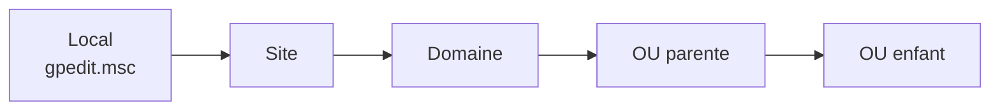

## Principes

Une **GPO** (*Group Policy Object*) est un ensemble de paramètres appliqué aux **ordinateurs** (au démarrage puis toutes les 90 ± 30 minutes) et/ou aux **utilisateurs** (à l'ouverture de session puis périodiquement). Elle est composée :

- d'un **conteneur** dans AD (`CN={GUID},CN=Policies,CN=System,DC=…`) : version, liens, filtres ;
- d'un **modèle** dans SYSVOL (`\\corp.exemple.fr\SYSVOL\corp.exemple.fr\Policies\{GUID}`) : fichiers `Registry.pol`, scripts, préférences.

### Ordre d'application : LSDOU



La **dernière** appliquée l'emporte en cas de conflit : une GPO liée à l'OU la plus proche de l'objet est prioritaire. Au sein d'un même conteneur, l'**ordre des liens** (1 = priorité la plus haute) départage.

| Mécanisme | Effet |
| --- | --- |
| **Bloquer l'héritage** (sur une OU) | Ignore les GPO des niveaux supérieurs… |
| **Appliqué / Enforced** (sur un lien) | …sauf celles-ci, qui ne peuvent être ni bloquées ni contredites par une GPO inférieure |
| **Lien désactivé** | La GPO n'est plus appliquée via ce lien |
| **Partie Ordinateur / Utilisateur désactivée** | Accélère le traitement |

> [!TIP]
> Évitez de multiplier *Bloquer l'héritage* et *Appliqué* : ils rendent le résultat difficile à prévoir. Préférez des GPO **petites et thématiques**, nommées clairement (`C_Postes_Securite_Pare-feu`, `U_Tous_Lecteurs-reseau`), liées au bon niveau.

## Filtrage

### Filtrage de sécurité

Par défaut une GPO s'applique à *Utilisateurs authentifiés*. Pour la cibler :

1. Retirer *Utilisateurs authentifiés* du filtrage de sécurité.
2. Ajouter le groupe cible (`GG_Compta` ou un groupe d'ordinateurs).
3. **Important** (depuis MS16-072) : laisser *Utilisateurs authentifiés* (ou *Ordinateurs du domaine*) avec le droit **Lecture** dans l'onglet *Délégation*, sinon les GPO utilisateur ne sont plus lues par les ordinateurs.

```powershell
Set-GPPermission -Name "U_Compta_Lecteurs" -TargetName "Utilisateurs authentifiés" -TargetType Group -PermissionLevel GpoRead -Replace
Set-GPPermission -Name "U_Compta_Lecteurs" -TargetName "GG_Comptabilite" -TargetType Group -PermissionLevel GpoApply
```

### Filtres WMI

Appliquer une GPO selon une caractéristique de la machine :

```text
SELECT * FROM Win32_OperatingSystem WHERE ProductType = "1" AND Version LIKE "10.0.2%"   -- postes Windows 11
SELECT * FROM Win32_OperatingSystem WHERE ProductType = "3"                              -- serveurs membres
SELECT * FROM Win32_ComputerSystem WHERE PCSystemType = 2                                -- portables
```

> [!NOTE]
> Les filtres WMI sont évalués à chaque rafraîchissement : un filtre lent (requêtes sur `Win32_Product`) ralentit tout le traitement. Le ciblage des **préférences** est souvent plus efficace.

## Mode de bouclage (loopback)

Applique les paramètres **utilisateur** en fonction de l'**ordinateur** (serveurs RDS, kiosques, salles de formation). Paramètre : *Configuration ordinateur → Stratégies → Modèles d'administration → Système → Stratégie de groupe → Configurer le mode de traitement par bouclage de la stratégie de groupe utilisateur*.

| Mode | Effet |
| --- | --- |
| **Fusion** | GPO utilisateur normales + GPO utilisateur de l'OU de l'ordinateur (prioritaires) |
| **Remplacer** | Seules les GPO utilisateur liées à l'OU de l'ordinateur s'appliquent |

## Magasin central ADMX

Les modèles d'administration (ADMX/ADML) sont, par défaut, lus localement sur le poste qui édite la GPO. Le **magasin central** garantit que tous les administrateurs utilisent les mêmes versions :

```powershell
$central = "\\corp.exemple.fr\SYSVOL\corp.exemple.fr\Policies\PolicyDefinitions"
New-Item -ItemType Directory $central -Force
# Copier les ADMX du dernier Windows (paquet « Administrative Templates (.admx) for Windows 11 » de Microsoft)
Copy-Item "C:\Windows\PolicyDefinitions\*" $central -Recurse -Force
# Ajouter les ADMX tiers : Microsoft Edge, Office, Google Chrome, Firefox, Windows LAPS…
```

## Préférences de stratégie de groupe (GPP)

Les **préférences** configurent des éléments que l'utilisateur peut modifier ensuite : lecteurs réseau, imprimantes, raccourcis, fichiers, registre, tâches planifiées, groupes locaux, alimentation…

**Ciblage au niveau de l'élément** (*Item-Level Targeting*) : chaque élément peut être conditionné (groupe de sécurité, plage IP, site AD, nom d'ordinateur, OS, variable d'environnement…).

Exemple : lecteur `S:` uniquement pour le groupe comptabilité à Paris → *Configuration utilisateur → Préférences → Paramètres Windows → Mappages de lecteurs* → Nouveau → Action **Mettre à jour**, `\\fs01\compta`, lettre `S:`, *Ciblage* : groupe `GG_Comptabilite` ET site `Paris`.

> [!CAUTION]
> Ne stockez **jamais** de mot de passe dans une préférence (comptes locaux, tâches, sources de données) : ils sont chiffrés avec une clé publiée par Microsoft (MS14-025) et lisibles par tout utilisateur du domaine dans SYSVOL. Utilisez Windows LAPS pour les comptes locaux.

## Exemples de GPO courantes

| GPO | Emplacement du paramètre |
| --- | --- |
| Politique de mot de passe et de verrouillage du domaine | **Default Domain Policy** → Configuration ordinateur → Stratégies → Paramètres Windows → Paramètres de sécurité → Stratégies de comptes |
| Pare-feu Windows | Configuration ordinateur → … → Pare-feu Windows Defender avec fonctions avancées de sécurité |
| Administrateurs locaux | Préférences → Groupes locaux (ou *Groupes restreints*) |
| Windows LAPS | Modèles d'administration → Système → LAPS |
| Wi-Fi / 802.1X | Paramètres de sécurité → Stratégies de réseau sans fil / câblé (voir [[01-freeradius/07-eap-peap-tls\|EAP]]) |
| Auto-inscription des certificats | Paramètres de sécurité → Stratégies de clé publique (voir [[10-adcs-pki]]) |
| Déploiement logiciel (MSI) | Paramètres du logiciel → Installation de logiciel |
| Windows Update / WSUS | Modèles d'administration → Composants Windows → Windows Update |
| Audit avancé | Paramètres de sécurité → Configuration avancée de la stratégie d'audit |
| BitLocker (clés sauvegardées dans AD) | Modèles d'administration → Composants Windows → Chiffrement de lecteur BitLocker |
| Redirection de dossiers | Configuration utilisateur → Paramètres Windows → Redirection de dossiers |
| Zones Intranet (SSO navigateur) | Modèles d'administration → Composants Windows → Internet Explorer → Page Sécurité |

> [!IMPORTANT]
> La politique de mot de passe **du domaine** ne s'applique que si elle est définie dans une GPO liée **à la racine du domaine** (en pratique la Default Domain Policy). Une politique de mot de passe liée à une OU n'affecte que les comptes **locaux** des machines de l'OU. Pour des politiques différenciées par groupe : stratégies de mot de passe affinées (FGPP, voir [[09-securite-durcissement]]).

## Gestion en PowerShell

```powershell
Import-Module GroupPolicy

New-GPO -Name "C_Postes_Securite_Base" -Comment "Durcissement des postes de travail"
New-GPLink -Name "C_Postes_Securite_Base" -Target "OU=Postes,OU=Ordinateurs,OU=Corp,DC=corp,DC=exemple,DC=fr" -LinkEnabled Yes -Order 1
Set-GPRegistryValue -Name "C_Postes_Securite_Base" -Key "HKLM\Software\Policies\Microsoft\Windows NT\DNSClient" -ValueName EnableMulticast -Type DWord -Value 0   # désactiver LLMNR
(Get-GPO "C_Postes_Securite_Base").GpoStatus = "UserSettingsDisabled"

Get-GPInheritance -Target "OU=Postes,OU=Ordinateurs,OU=Corp,DC=corp,DC=exemple,DC=fr"
Get-GPOReport -Name "C_Postes_Securite_Base" -ReportType Html -Path C:\Rapports\gpo.html
Get-GPO -All | Where-Object { -not ([xml](Get-GPOReport -Guid $_.Id -ReportType Xml)).GPO.LinksTo } | Select-Object DisplayName   # GPO non liées

# Sauvegarde / restauration / import
Backup-GPO -All -Path "\\nas01\sauvegardes\gpo\$(Get-Date -Format yyyyMMdd)"
Restore-GPO -Name "C_Postes_Securite_Base" -Path "\\nas01\sauvegardes\gpo\20260115"
Import-GPO -BackupGpoName "C_Postes_Securite_Base" -TargetName "C_Postes_Securite_Base_Test" -Path "\\nas01\sauvegardes\gpo\20260115" -CreateIfNeeded
```

> [!TIP]
> Les **Security Baselines** de Microsoft (outil *Security Compliance Toolkit*) fournissent des GPO de durcissement prêtes à importer (`LGPO`, `Baseline-ADImport.ps1`). Testez-les sur une OU pilote.

## Diagnostic

```powershell
gpupdate /force                         # appliquer immédiatement (ordinateur + utilisateur)
gpupdate /target:computer /force /boot  # avec redémarrage si nécessaire
gpresult /r                             # résumé : GPO appliquées et filtrées
gpresult /h C:\Temp\rsop.html /f        # rapport HTML complet (en administrateur pour la partie ordinateur)
Invoke-GPUpdate -Computer PC-PAR-0042 -Force -RandomDelayInMinutes 0     # à distance
Get-GPResultantSetOfPolicy -Computer PC-PAR-0042 -User CORP\amartin -ReportType Html -Path C:\Temp\rsop-distant.html
```

Console *Gestion des stratégies de groupe* → **Modélisation** (simulation) et **Résultats** (constat réel sur une machine).

| Symptôme / événement | Cause |
| --- | --- |
| GPO « Refusée (sécurité) » dans gpresult | Filtrage de sécurité ou droit de lecture manquant |
| GPO « Refusée (filtre WMI) » | Filtre WMI non satisfait |
| Événement **1058** / **1030** (Userenv/GroupPolicy) | SYSVOL inaccessible (DFSR, DNS, SMB), GPO incohérente entre AD et SYSVOL |
| Événement **1129** | Pas de connectivité vers un DC au démarrage |
| Paramètre non appliqué malgré une GPO correcte | Conflit (autre GPO prioritaire), paramètre nécessitant un redémarrage ou une nouvelle ouverture de session |
| Préférences non appliquées | Ciblage, mode *Créer* au lieu de *Mettre à jour*, extension côté client en erreur (journal *Application*) |

Journal détaillé côté client : *Observateur d'événements → Applications et services → Microsoft → Windows → GroupPolicy → Opérationnel*.
