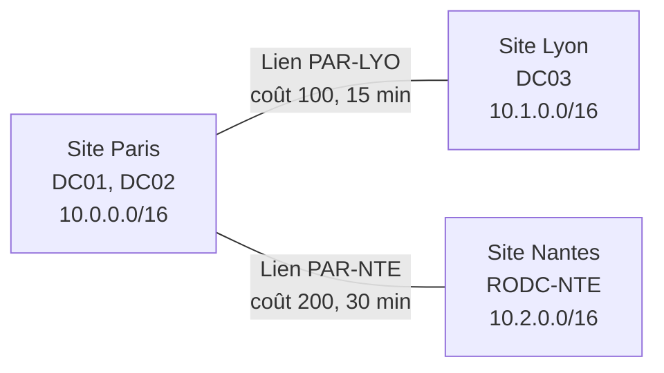

## Pourquoi déclarer les sites ?

| Effet | Détail |
| --- | --- |
| **Localisation des DC** | Un client trouve son site grâce à son **IP** (sous-réseaux) et contacte un DC local (`_ldap._tcp.<site>._sites.dc._msdcs`) |
| **Réplication optimisée** | Intra-site : rapide, non compressée, notification immédiate ; inter-sites : compressée et planifiée |
| **Services dépendant du site** | DFS Namespaces (cibles les plus proches), Exchange, SCCM, GPO liées à un site |

> [!WARNING]
> Un client dont l'IP n'appartient à **aucun** sous-réseau déclaré peut s'authentifier sur n'importe quel DC de la forêt, y compris à l'autre bout du monde (lenteurs d'ouverture de session, de GPO). Les DC le signalent par l'événement **5807** et le fichier `%SystemRoot%\debug\netlogon.log` (lignes `NO_CLIENT_SITE`).

## Créer la topologie



```powershell
# Renommer le site par défaut
Get-ADReplicationSite "Default-First-Site-Name" | Rename-ADObject -NewName "Paris"

New-ADReplicationSite -Name "Lyon"
New-ADReplicationSite -Name "Nantes"

New-ADReplicationSubnet -Name "10.0.0.0/16" -Site "Paris" -Location "Paris, siège"
New-ADReplicationSubnet -Name "10.1.0.0/16" -Site "Lyon"
New-ADReplicationSubnet -Name "10.2.0.0/16" -Site "Nantes"
New-ADReplicationSubnet -Name "192.168.200.0/24" -Site "Paris" -Description "VPN nomades"

New-ADReplicationSiteLink -Name "PAR-LYO" -SitesIncluded Paris,Lyon -Cost 100 -ReplicationFrequencyInMinutes 15 -InterSiteTransportProtocol IP
New-ADReplicationSiteLink -Name "PAR-NTE" -SitesIncluded Paris,Nantes -Cost 200 -ReplicationFrequencyInMinutes 30

# Déplacer un DC dans son site
Move-ADDirectoryServer -Identity DC03 -Site Lyon
```

| Paramètre du lien | Effet |
| --- | --- |
| **Coût** | Le KCC choisit le chemin de coût total le plus faible (refléter débit et fiabilité) |
| **Intervalle** | Fréquence de réplication (minimum 15 min) |
| **Planification** | Plages horaires autorisées (ex. hors journée sur un lien saturé) |
| **Notification de changement** | Désactivée par défaut en inter-sites ; activable pour une réplication quasi immédiate sur des liens rapides |

```powershell
# Activer la notification de changement sur un lien inter-sites (liens rapides seulement)
Set-ADReplicationSiteLink "PAR-LYO" -Replace @{options = 1}
```

> [!TIP]
> Par défaut tous les liens sont **pontés** (*Bridge all site links*) : la réplication est transitive. Désactivez le pontage (transport IP) uniquement si votre réseau n'est pas totalement routé, puis créez des **ponts de liens** explicites.

## Mécanique de la réplication

| Élément | Rôle |
| --- | --- |
| **USN** (*Update Sequence Number*) | Compteur local incrémenté à chaque modification ; chaque DC mémorise le dernier USN reçu de chaque partenaire (*high-watermark*) |
| **Vecteur de mise à jour (UTDV)** | Évite de recevoir deux fois la même modification par des chemins différents |
| **Métadonnées d'attribut** | Version, horodatage, DC d'origine : résolution des conflits (version la plus haute, puis horodatage, puis GUID) |
| **KCC** | *Knowledge Consistency Checker* : calcule automatiquement les objets de connexion (anneau bidirectionnel intra-site, ≤ 3 sauts) toutes les 15 min |
| **ISTG** | *Inter-Site Topology Generator* : un DC par site qui calcule les connexions inter-sites |
| **Serveur tête de pont** | DC qui réplique avec les autres sites (choisi automatiquement ; préférer le laisser automatique) |
| **Réplication urgente** | Verrouillages de compte, changements de RID, modifications de secrets LSA : déclenchées immédiatement ; les **changements de mot de passe** sont transmis en priorité à l'émulateur PDC |

```powershell
Get-ADReplicationConnection -Filter * | Select-Object Name, ReplicateFromDirectoryServer, ReplicateToDirectoryServer, AutoGenerated
Get-ADReplicationSite -Filter * -Properties InterSiteTopologyGenerator | Select-Object Name, InterSiteTopologyGenerator
repadmin /kcc *                         # forcer le recalcul de la topologie
repadmin /bridgeheads                   # têtes de pont
repadmin /istg                          # ISTG par site
```

## Surveiller et forcer la réplication : repadmin

```powershell
repadmin /replsummary                       # synthèse : plus grand delta et échecs par DC
repadmin /showrepl * /csv > repl.csv        # état détaillé de toutes les connexions
repadmin /showrepl DC03                     # partenaires entrants de DC03, dernière réussite, erreurs
repadmin /queue DC01                        # file d'attente de réplication entrante
repadmin /syncall /AdeP                     # forcer : A=toutes partitions, d=noms DN, e=inter-sites, P=pousser
repadmin /replicate DC03 DC01 "DC=corp,DC=exemple,DC=fr"   # répliquer une partition de DC01 vers DC03
repadmin /showobjmeta DC01 "CN=Alice Martin,OU=Paris,OU=Utilisateurs,OU=Corp,DC=corp,DC=exemple,DC=fr"   # qui a modifié quoi, quand
repadmin /showutdvec DC01 "DC=corp,DC=exemple,DC=fr"
repadmin /options DC03                      # IS_GC, DISABLE_OUTBOUND_REPL…
repadmin /showbackup *                      # date de la dernière sauvegarde de chaque partition
```

```powershell
Get-ADReplicationFailure -Target corp.exemple.fr -Scope Domain
Get-ADReplicationPartnerMetadata -Target DC03 | Select-Object Partner, Partition, LastReplicationSuccess, LastReplicationResult
Get-ADReplicationUpToDatenessVectorTable -Target DC01
```

> [!TIP]
> Test « traceur » simple : créez un objet (contact `test-repl-<date>`) sur un DC et vérifiez son apparition sur les autres (`Get-ADObject -Server DC03 -Filter "Name -eq 'test-repl-…'"`).

### Erreurs de réplication fréquentes

| Code | Signification | Piste |
| --- | --- | --- |
| **1722** | Serveur RPC non disponible | Pare-feu (135 + RPC dynamiques), DC éteint, DNS (CNAME `_msdcs`) |
| **1753** | Plus de points de terminaison dans le mappeur | Service NTDS / RPC, pare-feu |
| **8524** | Échec de résolution DNS du partenaire | Enregistrement `<GUID>._msdcs` absent : `dcdiag /test:dns`, redémarrer Netlogon |
| **8453** | Accès refusé à la réplication | Droits, compte ordinateur du DC |
| **8606** | Objets persistants (*lingering objects*) | Un DC hors ligne plus longtemps que la durée de vie des tombstones |
| **8614** | Le DC n'a pas répliqué depuis plus longtemps que la durée de vie des tombstones | Rétrograder de force / nettoyer et reconstruire le DC |
| **-2146893022** | Le principal cible est incorrect (Kerberos) | Mot de passe du compte ordinateur du DC désynchronisé : `netdom resetpwd` |
| **8456 / 8457** | Réplication désactivée (entrante/sortante) | USN rollback détecté (restauration de snapshot) — événement 2095 |

## SYSVOL et DFSR

**SYSVOL** (scripts, GPO) est répliqué par **DFS-R** (DFS Replication) entre les DC, séparément de la base AD.

```powershell
# État de la réplication SYSVOL
Get-DfsrState -ComputerName DC01 | Select-Object FileName, UpdateState, Inbound
dfsrdiag backlog /rgname:"Domain System Volume" /rfname:"SYSVOL Share" /smem:DC01 /rmem:DC03
dfsrdiag pollad /member:DC03
Get-WinEvent -LogName "DFS Replication" -MaxEvents 20 | Select-Object TimeCreated, Id, Message
```

| Événement DFSR | Signification |
| --- | --- |
| 4602 / 4604 | Réplication initiale de SYSVOL réussie |
| 4614 | Réplication initiale en attente (normal quelques minutes après une promotion) |
| 2212 | Arrêt incorrect de la base DFSR : réplication suspendue (reprise avec `wmic … ResumeReplication` selon le message) |
| 2213 | Récupération automatique désactivée après un arrêt incorrect — suivre la commande indiquée dans l'événement |
| 4012 | Le DC a été déconnecté trop longtemps (> `MaxOfflineTimeInDays`, 60 j) : réplication bloquée |

### Migration FRS → DFSR (domaines hérités de 2003/2008)

Windows Server 2019+ refuse d'être promu dans un domaine dont SYSVOL utilise encore **FRS**.

```powershell
dfsrmig /getglobalstate
dfsrmig /setglobalstate 1      # Préparé  — attendre que tous les DC atteignent l'état (dfsrmig /getmigrationstate)
dfsrmig /setglobalstate 2      # Redirigé
dfsrmig /setglobalstate 3      # Éliminé (irréversible)
```

## Réplication et RODC

- Un RODC ne réplique qu'en **entrant**, depuis un DC inscriptible de même domaine sous Windows Server 2008+.
- Placez un DC inscriptible dans le site le plus proche (coût le plus faible) du site du RODC.
- `repadmin /prp view RODC-NTE reveal` liste les comptes dont le mot de passe est en cache.
