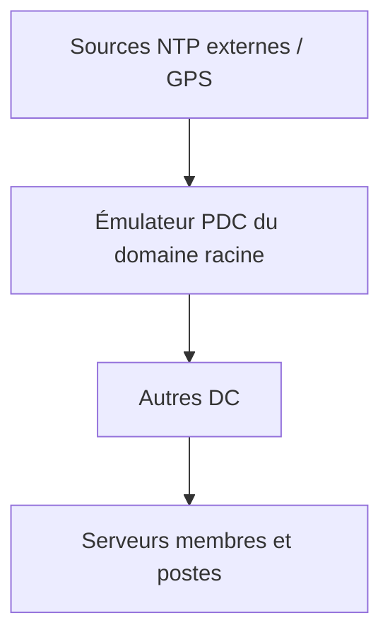

## Identifier les rôles

```powershell
netdom query fsmo
Get-ADForest | Select-Object SchemaMaster, DomainNamingMaster
Get-ADDomain | Select-Object PDCEmulator, RIDMaster, InfrastructureMaster
```

Placement recommandé (petit et moyen environnement) : **tous les rôles sur un même DC** bien sauvegardé, dans le site principal. Grande forêt : PDC émulateur dans le site central, éventuellement séparé.

## Transférer (DC source disponible)

```powershell
Move-ADDirectoryServerOperationMasterRole -Identity "DC02" -OperationMasterRole PDCEmulator, RIDMaster, InfrastructureMaster
Move-ADDirectoryServerOperationMasterRole -Identity "DC02" -OperationMasterRole SchemaMaster, DomainNamingMaster
# Les rôles sont aussi désignés par leur numéro : 0 PDC, 1 RID, 2 Infrastructure, 3 Schéma, 4 Noms de domaine
Move-ADDirectoryServerOperationMasterRole -Identity "DC02" -OperationMasterRole 0,1,2,3,4
```

## Saisir (DC source définitivement perdu)

```powershell
Move-ADDirectoryServerOperationMasterRole -Identity "DC02" -OperationMasterRole 0,1,2,3,4 -Force
```

> [!CAUTION]
> Un DC dont on a **saisi** les rôles ne doit **jamais** revenir sur le réseau : réinstallez-le. Saisissez le maître RID ou de schéma seulement si la perte est certaine (deux maîtres RID = SID dupliqués).

Équivalent ntdsutil :

```text
ntdsutil
roles
connections
connect to server DC02
quit
seize pdc
seize rid master
seize infrastructure master
seize schema master
seize naming master
quit
quit
```

## Service de temps (W32Time)

Kerberos tolère **5 minutes** d'écart. La hiérarchie par défaut :



```powershell
# Sur l'émulateur PDC du domaine racine
w32tm /config /manualpeerlist:"0.fr.pool.ntp.org,0x8 1.fr.pool.ntp.org,0x8 2.fr.pool.ntp.org,0x8" /syncfromflags:manual /reliable:yes /update
Restart-Service w32time
w32tm /resync /rediscover

# Sur tous les autres DC et membres (valeur par défaut)
w32tm /config /syncfromflags:domhier /update

# Vérifier
w32tm /query /status
w32tm /query /source
w32tm /query /peers
w32tm /monitor /domain:corp.exemple.fr
w32tm /stripchart /computer:0.fr.pool.ntp.org /samples:5 /dataonly
```

> [!TIP]
> Un **filtre WMI** dans une GPO dédiée au PDC (`SELECT * FROM Win32_ComputerSystem WHERE DomainRole = 5`) applique la configuration NTP au DC qui détient le rôle, même après un transfert. Désactivez la synchronisation de l'heure par l'hyperviseur (*Time Synchronization* Hyper-V / VMware Tools) sur les DC.

## Rétrograder un contrôleur de domaine

```powershell
# Retrait propre (le DC est en bonne santé et réplique)
Uninstall-ADDSDomainController -DemoteOperationMasterRole:$false -RemoveDnsDelegation -Credential (Get-Credential) -LocalAdministratorPassword (Read-Host -AsSecureString)
# Puis retirer le rôle
Uninstall-WindowsFeature AD-Domain-Services -IncludeManagementTools
```

Avant : transférer les rôles FSMO qu'il détient, retirer ses IP des configurations DNS clientes (DHCP, IP fixes), des redirecteurs, des NAS RADIUS/LDAP qui le visent directement.

### Retrait forcé et nettoyage des métadonnées

Si le DC est mort :

1. **Saisir** ses rôles FSMO sur un autre DC.
2. Dans *Utilisateurs et ordinateurs AD* → OU *Domain Controllers* → supprimer l'objet ordinateur du DC (cocher *Ce contrôleur de domaine est définitivement hors connexion…*) : le nettoyage des métadonnées est automatique depuis 2008. Équivalent : `ntdsutil "metadata cleanup" "remove selected server <DN>"`.
3. Supprimer l'objet serveur dans *Sites et services AD* (`Sites\<site>\Servers\<DC>`).
4. Nettoyer le DNS : enregistrements A, NS de chaque zone, SRV, CNAME `<GUID>._msdcs`.
5. Vérifier : `dcdiag /e`, `repadmin /replsummary`.

## Relever les niveaux fonctionnels

Prérequis : **tous** les DC (forêt / domaine) dans une version supportant le niveau cible.

```powershell
Get-ADDomainController -Filter * | Select-Object Name, OperatingSystem
Set-ADDomainMode -Identity corp.exemple.fr -DomainMode Windows2016Domain
Set-ADForestMode -Identity corp.exemple.fr -ForestMode Windows2016Forest
```

L'opération est irréversible dans la pratique (un abaissement n'est possible que dans des cas limités).

## Mettre à jour le schéma (nouvelle version de Windows Server, Exchange…)

Promouvoir un DC d'une nouvelle version exécute automatiquement `adprep`. Manuellement (support d'installation, dossier `support\adprep`) :

```powershell
.\adprep.exe /forestprep        # sur le maître de schéma, compte Admins du schéma + Admins de l'entreprise
.\adprep.exe /domainprep        # dans chaque domaine
# Vérifier la version du schéma
Get-ADObject (Get-ADRootDSE).schemaNamingContext -Properties objectVersion | Select-Object objectVersion
```

| `objectVersion` | Version du schéma |
| --- | --- |
| 69 | Windows Server 2012 R2 |
| 87 | Windows Server 2016 |
| 88 | Windows Server 2019 / 2022 |
| 91 | Windows Server 2025 |

> [!WARNING]
> Une extension de schéma est **définitive** (les attributs peuvent être désactivés, pas supprimés). Vérifiez la réplication (`repadmin /replsummary`) avant et sauvegardez l'état système du maître de schéma.

## Durée de vie des objets supprimés (tombstone)

```powershell
Get-ADObject "CN=Directory Service,CN=Windows NT,CN=Services,$((Get-ADRootDSE).configurationNamingContext)" -Properties tombstoneLifetime
```

Par défaut **180 jours** : un DC hors ligne plus longtemps ne doit pas être reconnecté (objets persistants). C'est aussi la durée de validité utile d'une sauvegarde.

## Maintenance de la base NTDS

Les services AD DS peuvent être **arrêtés** comme un service classique (sans redémarrer en DSRM) pour les opérations hors ligne.

```powershell
Stop-Service NTDS -Force
# Défragmentation hors ligne (récupère l'espace après des suppressions massives)
ntdsutil "activate instance ntds" files "compact to D:\NTDS-compact" quit quit
# Vérifier l'intégrité, puis remplacer la base
esentutl /g D:\NTDS-compact\ntds.dit
Copy-Item D:\NTDS\ntds.dit D:\NTDS\ntds.dit.old
Copy-Item D:\NTDS-compact\ntds.dit D:\NTDS\ntds.dit -Force
Remove-Item D:\NTDS\*.log
Start-Service NTDS
# Déplacer la base ou les journaux
ntdsutil "activate instance ntds" files "move db to E:\NTDS" "move logs to F:\NTDSLogs" quit quit
```

Réinitialiser le mot de passe **DSRM** (oublié ou à renouveler) :

```text
ntdsutil "set dsrm password" "reset password on server null" quit quit
```

## Remplacer les DC (migration vers une nouvelle version de Windows Server)

1. Installer les nouveaux serveurs, les promouvoir (DNS + GC) dans les bons sites.
2. Vérifier la réplication AD et DFSR (`dcdiag`, `repadmin`, `dfsrdiag backlog`).
3. Transférer les rôles FSMO, reconfigurer le NTP sur le nouveau PDC.
4. Mettre à jour DHCP (options DNS), IP fixes, redirecteurs, relais, équipements (LDAP/RADIUS/NTP).
5. Rétrograder les anciens DC un par un ; nettoyer DNS et sites.
6. Relever les niveaux fonctionnels une fois tous les anciens DC retirés.

> [!TIP]
> Pour garder une **adresse IP connue** (référencée partout dans des équipements), on peut, après rétrogradation de l'ancien DC, réattribuer son IP au nouveau DC (en le réenregistrant dans le DNS : `ipconfig /registerdns`, redémarrage de Netlogon).
