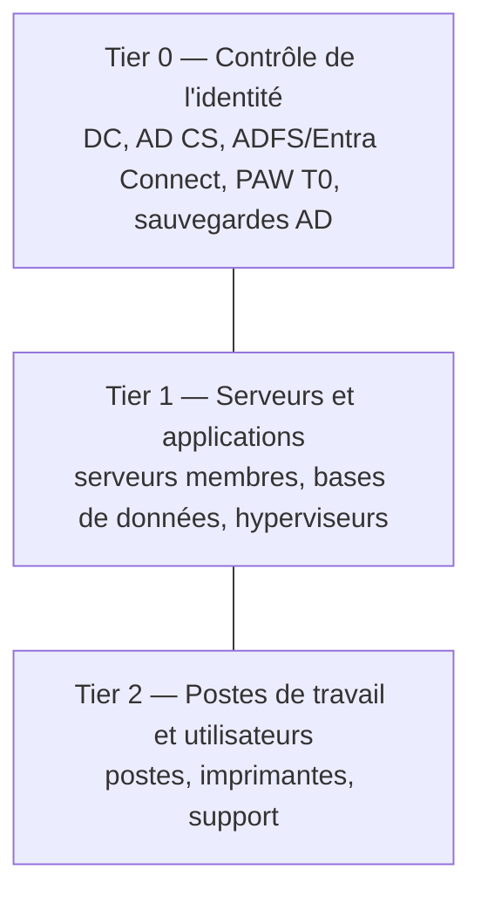

> [!IMPORTANT]
> Active Directory est la cible n°1 des rançongiciels : compromettre un compte **Admins du domaine** donne le contrôle de tout le système d'information. La sécurité d'AD repose avant tout sur **l'hygiène des comptes à privilèges**.

## Modèle d'administration en tiers



| Règle | Application |
| --- | --- |
| Un compte d'un tier ne se connecte **jamais** sur un niveau inférieur | Un admin T0 n'ouvre pas de session sur un poste T2 (ses identifiants y seraient volés) |
| Comptes séparés par tier | `amartin` (bureautique), `adm-t2-amartin`, `adm-t1-amartin`, `adm-t0-amartin` |
| **PAW** (*Privileged Access Workstation*) | Poste dédié, durci, sans messagerie ni navigation Internet pour administrer T0/T1 |
| Restrictions d'ouverture de session par GPO | *Refuser l'ouverture de session locale / via les services Bureau à distance / en tant que service / en tant que tâche* pour les groupes T0 sur les machines T1/T2 |
| Silos et stratégies d'authentification (niveau 2012 R2+) | Les comptes T0 ne peuvent obtenir un TGT que depuis les PAW/DC |

> [!NOTE]
> Microsoft a fait évoluer ce modèle vers l'**Enterprise Access Model** (plans de contrôle / gestion / données), mais le principe de cloisonnement reste le même et le modèle en tiers est toujours la référence opérationnelle (ANSSI).

## Groupes à privilèges

| Groupe | Recommandation |
| --- | --- |
| Admins du domaine / de l'entreprise / du schéma | **Vides** au quotidien (sauf comptes T0 nominatifs, peu nombreux). Administrateurs du schéma vide en permanence |
| Administrateurs (BUILTIN) | Contrôlé comme les Admins du domaine |
| Opérateurs de compte / de serveur / de sauvegarde / d'impression | **Vides** (privilèges sous-estimés : ils permettent de prendre le contrôle des DC) |
| DnsAdmins | Vide ou très restreint (exécution de code sur les DC) |
| Propriétaires créateurs de la stratégie de groupe | Restreint |

```powershell
# Inventaire récursif des groupes sensibles
$groupes = "Admins du domaine","Administrateurs de l'entreprise","Administrateurs du schéma","Administrateurs",
           "Opérateurs de compte","Opérateurs de serveur","Opérateurs de sauvegarde","Opérateurs d'impression","DnsAdmins"
foreach ($g in $groupes) {
  Get-ADGroupMember $g -Recursive | Select-Object @{n='Groupe';e={$g}}, SamAccountName, objectClass
}
# Objets protégés par AdminSDHolder (adminCount=1) — y compris les anciens membres oubliés
Get-ADUser -LDAPFilter "(adminCount=1)" | Select-Object SamAccountName
```

### AdminSDHolder

Toutes les 60 minutes, le processus **SDProp** (sur l'émulateur PDC) applique l'ACL de `CN=AdminSDHolder,CN=System` à tous les membres des groupes protégés : une délégation ou une ACL modifiée sur un compte administrateur est donc écrasée. Surveillez toute modification de l'ACL d'AdminSDHolder (technique de persistance classique).

### Protected Users

Les membres du groupe **Protected Users** (niveau 2012 R2+) : pas de NTLM, pas de DES/RC4 en Kerberos, pas de délégation, TGT limité à 4 heures, identifiants non mis en cache sur les postes.

```powershell
Add-ADGroupMember "Protected Users" -Members adm-t0-amartin, adm-t1-amartin
```

> [!WARNING]
> Ne placez **pas** dans Protected Users les comptes de service ni les comptes ordinateurs, et testez avant : les applications dépendant de NTLM ou de la délégation cessent de fonctionner pour ces comptes. Gardez un compte « bris de glace » hors du groupe.

Marquez aussi les comptes d'administration comme **« Le compte est sensible et ne peut pas être délégué »** :

```powershell
Get-ADUser -Filter 'SamAccountName -like "adm-*"' | Set-ADAccountControl -AccountNotDelegated $true
```

## Windows LAPS (mots de passe des administrateurs locaux)

Intégré à Windows depuis avril 2023 (Windows 10/11, Server 2019+). Chaque machine génère un mot de passe aléatoire pour son compte administrateur local, le **renouvelle** et le stocke (chiffré) dans AD.

```powershell
# 1. Étendre le schéma (une fois)
Update-LapsADSchema
# 2. Autoriser les machines d'une OU à écrire leur mot de passe
Set-LapsADComputerSelfPermission -Identity "OU=Ordinateurs,OU=Corp,DC=corp,DC=exemple,DC=fr"
# 3. Autoriser un groupe de support à lire les mots de passe
Set-LapsADReadPasswordPermission -Identity "OU=Postes,OU=Ordinateurs,OU=Corp,DC=corp,DC=exemple,DC=fr" -AllowedPrincipals "CORP\DL_LAPS_Lecture_Postes"
# 4. GPO : Modèles d'administration → Système → LAPS
#    « Configurer le répertoire de sauvegarde du mot de passe » = Active Directory
#    « Paramètres du mot de passe » = complexité, longueur 20, âge 30 jours
#    « Activer le chiffrement du mot de passe » = activé (niveau 2016+), lecteurs autorisés = groupe
# 5. Consulter / forcer la rotation
Get-LapsADPassword -Identity PC-PAR-0042 -AsPlainText
Reset-LapsPassword            # sur la machine
Invoke-LapsPolicyProcessing   # appliquer immédiatement
```

Windows LAPS peut aussi gérer le **mot de passe DSRM** des contrôleurs de domaine (*Activer la sauvegarde du mot de passe DSRM*).

## Stratégies de mot de passe

### Politique du domaine (Default Domain Policy)

Recommandations actuelles (ANSSI / NIST) : longueur minimale **12 à 14** caractères (phrases de passe), pas d'expiration forcée trop courte si le MFA et la détection de compromission sont en place, verrouillage modéré (10 tentatives / 10 minutes) pour éviter les dénis de service.

### Stratégies affinées (FGPP)

Politiques différentes par **groupe** (administrateurs, comptes de service) :

```powershell
New-ADFineGrainedPasswordPolicy -Name "PSO-Admins" -Precedence 10 `
  -MinPasswordLength 16 -ComplexityEnabled $true -PasswordHistoryCount 24 `
  -MaxPasswordAge 180.00:00:00 -MinPasswordAge 1.00:00:00 `
  -LockoutThreshold 5 -LockoutDuration 00:30:00 -LockoutObservationWindow 00:30:00 `
  -ReversibleEncryptionEnabled $false
Add-ADFineGrainedPasswordPolicySubject "PSO-Admins" -Subjects "GG_Admins_T0","GG_Admins_T1"
Get-ADUserResultantPasswordPolicy adm-t0-amartin
```

> [!TIP]
> Bloquez les mots de passe faibles ou compromis : **Entra Password Protection** (agent sur les DC, listes de mots interdits) ou des filtres tiers ; auditez régulièrement les hash avec des outils comme *DSInternals* (`Test-PasswordQuality`).

## Compte krbtgt

Le mot de passe de **krbtgt** chiffre tous les TGT. À réinitialiser :

- périodiquement (une ou deux fois par an) ;
- après le départ d'un administrateur du domaine ;
- **deux fois** (à 10-24 h d'intervalle, le temps de la réplication et de l'expiration des tickets) après une compromission avérée.

Utilisez le script Microsoft `New-KrbtgtKeys.ps1` (mode simulation, vérification de la réplication, réinitialisation).

## LDAP : signature, liaison de canal, LDAPS

| Mesure | Paramètre |
| --- | --- |
| **Signature LDAP** obligatoire | GPO DC : *Contrôleur de domaine : conditions requises pour la signature de serveur LDAP* = **Exiger la signature** |
| **Liaison de canal LDAP** (*channel binding*) | `HKLM\SYSTEM\CurrentControlSet\Services\NTDS\Parameters\LdapEnforceChannelBinding` = **2** (toujours) |
| **LDAPS** (636) | Certificat *Kerberos Authentication* / *Domain Controller Authentication* délivré par AD CS (auto-inscription des DC), ou certificat dans le magasin NTDS |

> [!WARNING]
> Avant d'exiger la signature, identifiez les clients qui font des **liaisons simples en clair** (imprimantes, applications, NAS, appliances) : activez la journalisation de diagnostic (`HKLM\…\NTDS\Diagnostics\16 LDAP Interface Events` = 2) et surveillez les événements **2887** (synthèse), **2889** (IP et compte de chaque liaison non signée). Migrez-les vers LDAPS.

Windows Server 2025 exige par défaut le chiffrement des nouvelles connexions LDAP (*LDAP sealing*) : les mêmes vérifications s'imposent.

## NTLM et protocoles hérités

```text
GPO : Sécurité réseau : niveau d'authentification LAN Manager = Envoyer uniquement les réponses NTLMv2. Refuser LM et NTLM
GPO : Sécurité réseau : ne pas stocker de valeurs de hachage de niveau LAN Manager = Activé
GPO : Sécurité réseau : Restreindre NTLM : auditer le trafic NTLM entrant / l'authentification NTLM dans ce domaine = Activer tout
```

1. **Auditer** l'usage de NTLM (journal *Microsoft-Windows-NTLM/Operational*, événements 4624 avec `Package = NTLM`).
2. Corriger les causes (accès par IP, SPN manquants, applications).
3. **Restreindre** progressivement (exceptions documentées).

Autres protocoles à désactiver : **SMBv1** (`Disable-WindowsOptionalFeature -Online -FeatureName SMB1Protocol`), **LLMNR** et **NetBIOS over TCP/IP** (empoisonnement Responder), **WPAD** automatique, **Print Spooler** sur les DC (`Stop-Service Spooler; Set-Service Spooler -StartupType Disabled`). Exiger la **signature SMB** sur les DC et serveurs.

## Kerberos

- Désactiver **RC4** et **DES** (types de chiffrement autorisés : AES128/AES256) — GPO *Sécurité réseau : configurer les types de chiffrement autorisés pour Kerberos*. Vérifier avant les comptes de service anciens (`msDS-SupportedEncryptionTypes`).
- **Kerberoasting** : tout utilisateur peut demander un ticket pour un compte de service avec SPN et casser son mot de passe hors ligne → comptes de service en **gMSA** (mot de passe de 240 caractères) ou mots de passe de plus de 25 caractères.
- **AS-REP roasting** : aucun compte ne doit avoir *Ne pas exiger de pré-authentification Kerberos* :

```powershell
Get-ADUser -Filter 'DoesNotRequirePreAuth -eq $true' | Select-Object SamAccountName
Get-ADUser -Filter 'ServicePrincipalName -like "*"' -Properties ServicePrincipalName, PasswordLastSet | Select-Object SamAccountName, PasswordLastSet
```

- Délégation **non contrainte** interdite hors DC : `Get-ADComputer -Filter 'TrustedForDelegation -eq $true'`.

## Audit et événements à surveiller

Activez la **configuration avancée de la stratégie d'audit** (GPO liée à l'OU *Domain Controllers*) : ouverture de session, gestion des comptes, modifications du service d'annuaire, Kerberos, changements de stratégie.

| ID | Événement | Pourquoi |
| --- | --- | --- |
| 4624 / 4625 | Ouverture de session réussie / échouée | Brute force, mouvements latéraux (type 3/10) |
| 4740 | Compte verrouillé | Origine du verrouillage (champ *Nom de l'ordinateur appelant*) |
| 4768 / 4769 / 4771 | TGT demandé / ticket de service / échec de pré-authentification | Kerberoasting (4769 avec chiffrement RC4 0x17), password spraying |
| 4720 / 4722 / 4725 / 4726 | Compte créé / activé / désactivé / supprimé | |
| 4728 / 4732 / 4756 | Ajout à un groupe global / local / universel | **Alerte** si groupe à privilèges |
| 4738 | Compte modifié | |
| 4662 | Opération sur un objet (ex. DCSync : réplication demandée par un non-DC) | Détection DCSync |
| 5136 | Modification d'un objet de l'annuaire | GPO, AdminSDHolder, ACL |
| 4794 | Tentative de définition du mot de passe DSRM | |
| 1102 | Journal d'audit effacé | |

Centralisez ces journaux dans un SIEM (Windows Event Forwarding, agents) et mettez en place des alertes sur les groupes à privilèges.

## Évaluer régulièrement

| Outil | Usage |
| --- | --- |
| **PingCastle** | Score de risque AD, rapport HTML (gratuit en usage interne) |
| **Purple Knight** | Indicateurs d'exposition et de compromission |
| **BloodHound / SharpHound** | Graphe des chemins d'attaque vers les Admins du domaine |
| **ORADAD** (ANSSI) | Collecte pour l'analyse par l'ANSSI / points de contrôle AD de l'ANSSI |
| **Microsoft Defender for Identity** | Détection en temps réel sur les DC |
| *Locksmith* / *Certify* / *Certipy* | Mauvaises configurations d'AD CS (voir [[10-adcs-pki]]) |

## Liste de contrôle

- [ ] Groupes à privilèges réduits au strict minimum, comptes nominatifs séparés par tier
- [ ] PAW pour l'administration T0, restrictions d'ouverture de session par GPO
- [ ] Protected Users + « compte sensible » pour les administrateurs
- [ ] Windows LAPS déployé sur tous les postes et serveurs (et DSRM)
- [ ] `ms-DS-MachineAccountQuota` = 0
- [ ] FGPP pour les administrateurs et comptes de service, gMSA partout où possible
- [ ] krbtgt réinitialisé (date < 180 jours)
- [ ] Signature LDAP + channel binding, LDAPS ; SMBv1, LLMNR, NBT-NS, Spooler sur DC désactivés
- [ ] NTLMv1 / LM interdits, NTLM audité ; RC4 désactivé
- [ ] Aucun compte sans pré-authentification Kerberos, pas de délégation non contrainte
- [ ] Audit avancé + SIEM + alertes sur les groupes sensibles
- [ ] Sauvegardes hors ligne testées, procédure de reprise de forêt documentée
- [ ] Rapport PingCastle trimestriel suivi
