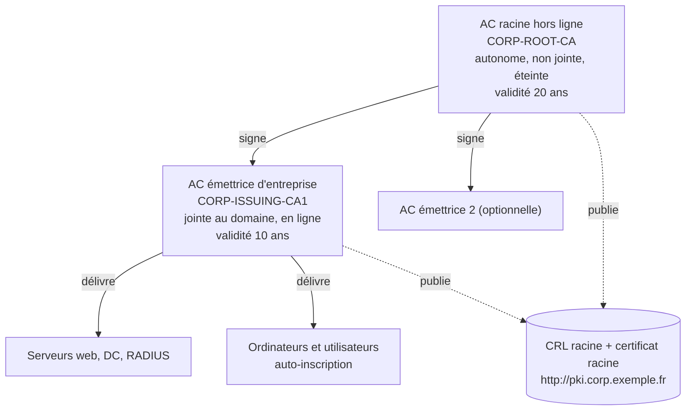

## Rôle d'AD CS

**Active Directory Certificate Services** délivre les certificats internes : HTTPS des intranets ([[01-iis/04-https-certificats|IIS]]), serveurs RADIUS et **802.1X EAP-TLS** ([[01-freeradius/07-eap-peap-tls|FreeRADIUS]]), LDAPS des contrôleurs de domaine, VPN, signature de code, cartes à puce, chiffrement EFS, S/MIME.

## Architecture recommandée : deux niveaux



| Composant | Rôle |
| --- | --- |
| **AC racine hors ligne** | Autonome (*Standalone*), jamais connectée au réseau ; ne sert qu'à signer les AC émettrices et sa CRL (tous les 6-12 mois) |
| **AC émettrice d'entreprise** | Intégrée à AD (*Enterprise*) : modèles, auto-inscription, publication dans AD |
| **Point de distribution HTTP** | Serveur web (IIS) publiant CRL et certificats d'AC (`http://pki.corp.exemple.fr/pki/`) — accessible par tous les clients |
| **OCSP** (optionnel) | Répondeur en ligne (*Online Responder*) pour la révocation en temps réel |

> [!WARNING]
> Une AC racine d'entreprise **en ligne** unique (installation « en un clic ») fonctionne, mais sa compromission est irréversible : toute la confiance du domaine devrait être reconstruite. Réservez ce schéma aux laboratoires.

## AC racine hors ligne

```ini C:\Windows\CAPolicy.inf (sur la racine, AVANT l'installation)
[Version]
Signature="$Windows NT$"

[Certsrv_Server]
RenewalKeyLength=4096
RenewalValidityPeriod=Years
RenewalValidityPeriodUnits=20
CRLPeriod=Months
CRLPeriodUnits=6
CRLDeltaPeriodUnits=0
LoadDefaultTemplates=0
AlternateSignatureAlgorithm=0

[BasicConstraintsExtension]
PathLength=1
Critical=Yes
```

```powershell
Install-WindowsFeature ADCS-Cert-Authority -IncludeManagementTools
Install-AdcsCertificationAuthority -CAType StandaloneRootCA -CACommonName "CORP-ROOT-CA" `
  -CADistinguishedNameSuffix "O=Exemple,C=FR" `
  -CryptoProviderName "RSA#Microsoft Software Key Storage Provider" -KeyLength 4096 -HashAlgorithmName SHA256 `
  -ValidityPeriod Years -ValidityPeriodUnits 20 -Force

# Points de publication intégrés aux certificats émis (CDP / AIA) : HTTP uniquement
certutil -setreg CA\DSConfigDN "CN=Configuration,DC=corp,DC=exemple,DC=fr"
Get-CACrlDistributionPoint | Where-Object Uri -notlike "C:\*" | Remove-CACrlDistributionPoint -Force
Add-CACrlDistributionPoint -Uri "http://pki.corp.exemple.fr/pki/<CaName><CRLNameSuffix><DeltaCRLAllowed>.crl" -AddToCertificateCdp -Force
Get-CAAuthorityInformationAccess | Where-Object Uri -notlike "C:\*" | Remove-CAAuthorityInformationAccess -Force
Add-CAAuthorityInformationAccess -Uri "http://pki.corp.exemple.fr/pki/<ServerDNSName>_<CaName><CertificateName>.crt" -AddToCertificateAia -Force
# Validité des certificats signés par la racine (AC émettrices)
certutil -setreg CA\ValidityPeriodUnits 10
certutil -setreg CA\ValidityPeriod "Years"
Restart-Service certsvc
certutil -crl
```

Copier `C:\Windows\System32\CertSrv\CertEnroll\*` (certificat racine `.crt` et CRL `.crl`) sur une clé USB pour publication.

## AC émettrice d'entreprise

```powershell
# Publier la racine dans AD et sur le serveur web
certutil -dspublish -f CORP-ROOT-CA.crt RootCA
certutil -dspublish -f CORP-ROOT-CA.crl CORP-ROOT-CA
Copy-Item CORP-ROOT-CA.crt, CORP-ROOT-CA.crl \\web-pki\pki$\

Install-WindowsFeature ADCS-Cert-Authority -IncludeManagementTools
Install-AdcsCertificationAuthority -CAType EnterpriseSubordinateCA -CACommonName "CORP-ISSUING-CA1" `
  -CryptoProviderName "RSA#Microsoft Software Key Storage Provider" -KeyLength 4096 -HashAlgorithmName SHA256 `
  -OutputCertRequestFile C:\CORP-ISSUING-CA1.req -Force
# → porter la requête sur la racine :  certreq -submit C:\CORP-ISSUING-CA1.req ; certutil -resubmit <ID> ; certreq -retrieve <ID> issuing.crt
# → revenir avec issuing.crt :
certutil -installcert C:\issuing.crt
Start-Service certsvc

# CDP/AIA de l'émettrice (HTTP + publication de la CRL sur le partage du serveur web)
Get-CACrlDistributionPoint | Where-Object Uri -notlike "C:\*" | Remove-CACrlDistributionPoint -Force
Add-CACrlDistributionPoint -Uri "http://pki.corp.exemple.fr/pki/<CaName><CRLNameSuffix><DeltaCRLAllowed>.crl" -AddToCertificateCdp -AddToFreshestCrl -Force
Add-CACrlDistributionPoint -Uri "\\web-pki\pki$\<CaName><CRLNameSuffix><DeltaCRLAllowed>.crl" -PublishToServer -PublishDeltaToServer -Force
Get-CAAuthorityInformationAccess | Where-Object Uri -notlike "C:\*" | Remove-CAAuthorityInformationAccess -Force
Add-CAAuthorityInformationAccess -Uri "http://pki.corp.exemple.fr/pki/<ServerDNSName>_<CaName><CertificateName>.crt" -AddToCertificateAia -Force
certutil -setreg CA\CRLPeriodUnits 1 ; certutil -setreg CA\CRLPeriod "Weeks"
certutil -setreg CA\CRLDeltaPeriodUnits 1 ; certutil -setreg CA\CRLDeltaPeriod "Days"
certutil -setreg CA\AuditFilter 127        # audit de toutes les opérations de l'AC
Restart-Service certsvc
certutil -crl
```

> [!NOTE]
> Sur le site web de publication (IIS), autorisez le **double échappement** dans le dossier `pki` (les CRL delta contiennent `+` dans leur nom) : `<requestFiltering allowDoubleEscaping="true" />`, et ajoutez les types MIME `.crl` (`application/pkix-crl`) et `.crt` (`application/pkix-cert`) si absents.

Vérifier toute la chaîne : `pkiview.msc` (*Enterprise PKI*) affiche l'état de chaque AIA/CDP (vert = OK).

## Modèles de certificats

Console `certtmpl.msc` → **dupliquer** un modèle existant (ne jamais modifier les modèles d'origine), puis dans `certsrv.msc` → *Modèles de certificats* → *Nouveau → Modèle de certificat à délivrer*.

| Besoin | Modèle de base | Réglages clés |
| --- | --- | --- |
| Serveur web / intranet | *Serveur Web* | Nom fourni dans la demande (SAN), droits d'inscription limités à un groupe de serveurs ou d'administrateurs, clé exportable si ferme |
| Serveur RADIUS / NPS | *Serveurs RAS et IAS* | Auto-inscription pour le groupe des serveurs RADIUS ; nom DNS construit depuis AD |
| **802.1X ordinateur (EAP-TLS)** | *Authentification de station de travail* | Auto-inscription pour *Ordinateurs du domaine* ; SAN DNS depuis AD |
| **802.1X utilisateur (EAP-TLS)** | *Utilisateur* (ou *Authentification de session*) | Auto-inscription pour un groupe ; UPN dans le SAN ; pas d'archivage de clé |
| Contrôleurs de domaine (LDAPS, Kerberos PKINIT) | *Authentification Kerberos* | Auto-inscription des DC (remplace *Domain Controller*) |
| Signature de code | *Signature de code* | Approbation d'un gestionnaire de certificats |

```powershell
# Publier un modèle sur l'AC
Add-CATemplate -Name "Corp-8021X-Ordinateur" -Force
Get-CATemplate
```

## Auto-inscription par GPO

GPO liée au domaine (ou aux OU concernées) : *Configuration ordinateur* **et** *Configuration utilisateur* → *Stratégies → Paramètres Windows → Paramètres de sécurité → Stratégies de clé publique* → **Client des services de certificats – Inscription automatique** :

- Modèle de configuration : **Activé**
- ☑ Renouveler les certificats expirés, mettre à jour les certificats en attente et supprimer les certificats révoqués
- ☑ Mettre à jour les certificats qui utilisent les modèles de certificats

Sur le modèle : onglet *Sécurité* → le groupe cible a **Lecture**, **Inscription** et **Inscription automatique**.

```powershell
gpupdate /force
certutil -pulse                     # déclencher l'auto-inscription
certutil -store My                  # certificats ordinateur
Get-ChildItem Cert:\CurrentUser\My
```

## Demander un certificat manuellement

```powershell
# Via l'AC d'entreprise, depuis un serveur joint
Get-Certificate -Template "Corp-ServeurWeb" -DnsName "intranet.corp.exemple.fr","intranet" -CertStoreLocation Cert:\LocalMachine\My -SubjectName "CN=intranet.corp.exemple.fr"
# Depuis une CSR générée ailleurs (Linux, appliance, FreeRADIUS)
certreq -submit -attrib "CertificateTemplate:Corp-ServeurWeb" -config "pki01.corp.exemple.fr\CORP-ISSUING-CA1" radius.csr radius.cer
```

## Exploitation

```powershell
certutil -view -restrict "NotAfter<=$(Get-Date (Get-Date).AddDays(30) -Format 'MM/dd/yyyy'),Disposition=20" -out "RequestID,CommonName,NotAfter,CertificateTemplate"   # certificats expirant sous 30 jours
certutil -revoke <NuméroDeSérie> 1          # révoquer (1 = clé compromise)
certutil -crl                               # publier immédiatement une nouvelle CRL
certutil -backup C:\Sauvegarde-AC -p "MotDePasse"   # sauvegarder base + clé privée de l'AC
certutil -url http://pki.corp.exemple.fr/pki/CORP-ISSUING-CA1.crl
certutil -verify -urlfetch moncert.cer      # vérifier chaîne + révocation de bout en bout
```

> [!CAUTION]
> Calendrier critique : la **CRL de la racine hors ligne** expire (ici tous les 6 mois). Si elle n'est pas republiée à temps, **tous** les certificats de la PKI deviennent invalides (échec 802.1X, LDAPS, VPN…). Planifiez un rappel et supervisez la date `Next Update` des CRL.

## Sécuriser AD CS

AD CS est un actif **tier 0** : qui contrôle l'AC peut émettre un certificat d'authentification au nom de n'importe quel administrateur.

| Vulnérabilité | Description | Correction |
| --- | --- | --- |
| **ESC1** | Modèle permettant au demandeur de fournir le sujet/SAN + EKU d'authentification client + inscription ouverte | Décocher *Fournir dans la demande* ou exiger l'approbation d'un gestionnaire |
| **ESC2 / ESC3** | Modèles « Any Purpose » ou *Agent d'inscription* trop ouverts | Restreindre les droits d'inscription |
| **ESC4** | ACL du modèle modifiable par des non-administrateurs | Corriger les ACL des modèles |
| **ESC6** | Indicateur `EDITF_ATTRIBUTESUBJECTALTNAME2` actif sur l'AC | `certutil -setreg policy\EditFlags -EDITF_ATTRIBUTESUBJECTALTNAME2` puis redémarrer certsvc |
| **ESC8** | Relais NTLM vers l'inscription web HTTP (`/certsrv`) | Désinstaller l'inscription web, ou HTTPS + EPA + désactivation NTLM |
| Mappage faible des certificats | Authentification Kerberos par certificat sans lien fort avec le compte | Mises à jour KB5014754 : mode **Full Enforcement** (`StrongCertificateBindingEnforcement = 2`) |

Outils d'audit : **Locksmith** (PowerShell, détection et correction), **Certify** / **Certipy** (énumération), PingCastle (section PKI).

## Supervision

- Service `CertSvc` démarré, file des demandes en attente.
- Dates d'expiration : certificat de l'AC émettrice (renouveler à mi-vie), CRL racine et émettrice (`Next Update`), certificats des serveurs critiques (RADIUS, LDAPS).
- Accessibilité HTTP des CDP/AIA depuis tous les réseaux (y compris VLAN invités si les certificats y sont vérifiés).
