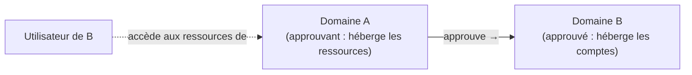

## Vocabulaire

Une **approbation** (*trust*) permet aux comptes d'un domaine (approuvé, *trusted*) d'accéder aux ressources d'un autre domaine (approuvant, *trusting*).



- **Sens** : l'accès va dans le sens **inverse** de l'approbation. Une approbation *unidirectionnelle sortante* depuis A = A fait confiance à B.
- **Transitivité** : si A approuve B et B approuve C, A approuve-t-il C ?

## Types

| Type | Création | Transitive | Sens | Usage |
| --- | --- | --- | --- | --- |
| **Parent-enfant** | Automatique | Oui | Bidirectionnelle | Domaines d'un même arbre |
| **Racine d'arbre** | Automatique | Oui | Bidirectionnelle | Nouvel arbre dans la forêt |
| **Forêt** | Manuelle | Oui (entre les deux forêts uniquement) | Uni/bi | Fusion, partenaire durable, forêt d'administration (ESAE/bastion) |
| **Externe** | Manuelle | Non | Uni/bi | Un domaine précis d'une autre forêt, ou domaine NT4 |
| **Raccourci** | Manuelle | Partiellement | Uni/bi | Accélérer l'authentification entre deux domaines éloignés d'une même forêt |
| **Domaine Kerberos** (*realm*) | Manuelle | Au choix | Uni/bi | Royaume Kerberos non Windows (MIT, FreeIPA) |

## Prérequis

1. **Résolution DNS croisée** : chaque forêt doit résoudre l'autre (redirecteurs conditionnels répliqués dans AD, ou zones secondaires).
2. **Connectivité** entre les DC des deux forêts : DNS 53, Kerberos 88, LDAP 389, SMB 445, RPC 135 + dynamiques, GC 3268, 464.
3. Heure synchronisée.
4. Compte administrateur dans chaque forêt (Admins de l'entreprise pour une approbation de forêt).

```powershell
# Dans la forêt corp.exemple.fr
Add-DnsServerConditionalForwarderZone -Name "partenaire.lan" -MasterServers 172.20.0.10,172.20.0.11 -ReplicationScope Forest
# Dans la forêt partenaire.lan
Add-DnsServerConditionalForwarderZone -Name "corp.exemple.fr" -MasterServers 10.0.10.11,10.0.10.12 -ReplicationScope Forest
Resolve-DnsName -Type SRV _ldap._tcp.dc._msdcs.partenaire.lan
```

## Créer une approbation de forêt

Console **Domaines et approbations Active Directory** (`domain.msc`) → clic droit sur le domaine racine → *Propriétés* → onglet **Approbations** → *Nouvelle approbation* :

1. Nom : `partenaire.lan`.
2. Type : **Approbation de forêt**.
3. Sens : bidirectionnelle ou unidirectionnelle (entrante / sortante).
4. Côtés : *Ce domaine et le domaine spécifié* (avec les identifiants de l'autre forêt) ou un seul côté avec un **mot de passe d'approbation** commun.
5. Niveau d'authentification : **à l'échelle de la forêt** ou **sélective** (voir plus bas).
6. Confirmer les approbations sortantes et entrantes.

En PowerShell (.NET), approbation bidirectionnelle de forêt :

```powershell
$local  = [System.DirectoryServices.ActiveDirectory.Forest]::GetCurrentForest()
$ctx    = New-Object System.DirectoryServices.ActiveDirectory.DirectoryContext('Forest','partenaire.lan','PARTENAIRE\admin-ent',(Read-Host "Mot de passe"))
$remote = [System.DirectoryServices.ActiveDirectory.Forest]::GetForest($ctx)
$local.CreateTrustRelationship($remote, 'Bidirectional')
```

Approbation **externe** avec netdom :

```powershell
netdom trust corp.exemple.fr /domain:filiale.lan /add /twoway /UserD:FILIALE\admin /PasswordD:* /UserO:CORP\admin-t0 /PasswordO:*
```

## Vérifier

```powershell
Get-ADTrust -Filter * | Select-Object Name, Direction, ForestTransitive, SelectiveAuthentication, SIDFilteringQuarantined, TrustType
netdom trust corp.exemple.fr /domain:partenaire.lan /verify
nltest /domain_trusts /all_trusts /v
nltest /sc_verify:partenaire.lan
nltest /dsgetdc:partenaire.lan
```

## Sécurité des approbations

### Filtrage SID (SID filtering)

Activé par défaut sur les approbations externes et de forêt : les SID d'autres domaines présents dans l'historique (`sIDHistory`) d'un compte de la forêt approuvée sont **ignorés**, ce qui empêche un administrateur de l'autre forêt de s'octroyer des droits chez vous.

> [!WARNING]
> Le désactiver temporairement (`netdom trust … /quarantine:no` ou `/enablesidhistory:yes`) n'est justifié que pendant une **migration** utilisant l'historique des SID (ADMT). Réactivez-le dès la fin.

### Authentification sélective

Par défaut (*authentification à l'échelle de la forêt*), **tous** les utilisateurs de la forêt approuvée sont traités comme *Utilisateurs authentifiés* chez vous — donc ont accès à toutes les ressources ouvertes à ce groupe. Avec l'**authentification sélective**, il faut accorder explicitement le droit **« Autorisé à s'authentifier »** (*Allowed to Authenticate*) sur les **objets ordinateurs** des serveurs accessibles.

```powershell
# Autoriser le groupe du partenaire à s'authentifier sur FS01 uniquement
$sid = (Get-ADGroup -Server partenaire.lan "GG_Projet_Commun").SID
dsacls "CN=FS01,OU=Fichiers,OU=Serveurs,OU=Corp,DC=corp,DC=exemple,DC=fr" /G "$($sid.Value):CA;Allowed to Authenticate"
```

### Bonnes pratiques

- Préférer les approbations **unidirectionnelles** et **sélectives** avec les partenaires.
- Une approbation n'est pas une frontière de confiance absolue : une forêt approuvée compromise peut servir de point d'appui. Limitez le périmètre, auditez les accès inter-forêts (événements 4769 avec un domaine de compte étranger).
- Documentez chaque approbation (propriétaire, date de revue, raison) et supprimez celles devenues inutiles.

## Routage des suffixes de noms

Dans une approbation de forêt, chaque forêt annonce ses **suffixes UPN et DNS**. En cas de conflit (même suffixe UPN `exemple.fr` dans les deux forêts), le suffixe est désactivé dans l'onglet *Routage des suffixes de noms* : l'authentification par UPN échoue alors pour ces comptes.

## Dépannage

| Symptôme | Piste |
| --- | --- |
| « Le domaine spécifié n'existe pas ou n'a pas pu être contacté » | DNS (redirecteur conditionnel), ports, `nltest /dsgetdc:` |
| L'approbation se vérifie mais l'accès est refusé | Authentification sélective sans droit « Autorisé à s'authentifier », ACL de la ressource, groupes locaux de domaine |
| Authentification lente | Kerberos qui échoue puis NTLM : vérifier SPN, ports 88, suffixes ; ajouter une approbation raccourci |
| `The trust relationship between the primary domain and the trusted domain failed` | Mot de passe d'approbation désynchronisé : `netdom trust … /reset` |
| Utilisateurs du partenaire invisibles dans le sélecteur d'objets | Port 3268 (GC) bloqué, sens de l'approbation |
