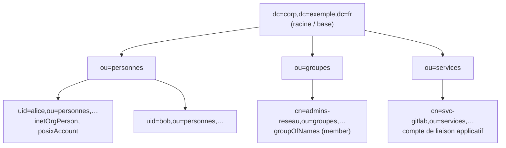

**OpenLDAP** fournit le serveur **slapd**, une implémentation libre et performante du protocole **LDAP**. Il sert d'annuaire d'entreprise pour les environnements Linux/Unix (comptes, groupes, sudo, automount), de référentiel d'authentification pour des applications (forges, wikis, VPN, RADIUS), ou d'annuaire technique (carnet d'adresses, équipements).

## Notions LDAP



| Notion | Description |
| --- | --- |
| **DIT** | Arborescence de l'annuaire |
| **DN** | Nom distingué, chemin complet d'une entrée (`uid=alice,ou=personnes,dc=corp,dc=exemple,dc=fr`) |
| Entrée | Ensemble d'attributs (`cn`, `mail`, `uidNumber`…) |
| **Classe d'objets** | Définit les attributs obligatoires et facultatifs (`inetOrgPerson`, `posixAccount`, `groupOfNames`) |
| Schéma | Ensemble de classes et d'attributs chargés |
| **LDIF** | Format texte d'import/modification des entrées |
| Liaison (*bind*) | Authentification auprès de l'annuaire (anonyme, simple avec mot de passe, SASL) |

| Port | Usage |
| --- | --- |
| 389 | LDAP (avec StartTLS) |
| **636** | LDAPS (TLS implicite) |
| `ldapi:///` | Socket Unix local (administration par l'identité du compte root) |

## Configuration dynamique : cn=config

Depuis la version 2.3, la configuration est stockée **dans l'annuaire lui-même** (base `cn=config`, fichiers dans `/etc/ldap/slapd.d/`) et se modifie **à chaud** par LDIF avec `ldapmodify`. N'éditez pas ces fichiers à la main.

```bash
sudo ldapsearch -Q -LLL -Y EXTERNAL -H ldapi:/// -b cn=config dn       # lister la configuration
```

## Installation

### Debian / Ubuntu

```bash
sudo apt install slapd ldap-utils
sudo dpkg-reconfigure slapd
# Questions : nom de domaine DNS → corp.exemple.fr (base dc=corp,dc=exemple,dc=fr), organisation, mot de passe admin
sudo systemctl status slapd
ldapsearch -x -H ldap://localhost -b dc=corp,dc=exemple,dc=fr -s base
```

### RHEL 9 et dérivées

RHEL 9 ne fournit plus le **serveur** OpenLDAP (seulement le client) : utilisez les paquets maintenus par **Symas** (dépôt « Symas OpenLDAP for Linux », installés sous `/opt/symas`) ou, dans l'écosystème Red Hat, **389 Directory Server** / [[03-freeipa/01-presentation-installation|FreeIPA]].

### Docker

Images communautaires (`bitnami/openldap`, `osixia/openldap`) pratiques pour les tests ; en production, préférez les paquets maintenus et une configuration maîtrisée.

## Structure de base

```ldif base.ldif
dn: ou=personnes,dc=corp,dc=exemple,dc=fr
objectClass: organizationalUnit
ou: personnes

dn: ou=groupes,dc=corp,dc=exemple,dc=fr
objectClass: organizationalUnit
ou: groupes

dn: ou=services,dc=corp,dc=exemple,dc=fr
objectClass: organizationalUnit
ou: services
```

```bash
ldapadd -x -H ldap://localhost -D cn=admin,dc=corp,dc=exemple,dc=fr -W -f base.ldif
```

## Outils

| Outil | Usage |
| --- | --- |
| `ldapsearch`, `ldapadd`, `ldapmodify`, `ldapdelete`, `ldappasswd`, `ldapwhoami` | Clients en ligne de commande |
| `slapcat` / `slapadd` | Export / import hors ligne (sauvegarde, restauration) |
| `slaptest` | Vérification de configuration |
| **Apache Directory Studio** | Client graphique (Windows, macOS, Linux) |
| LDAP Account Manager (LAM), phpLDAPadmin | Interfaces web d'administration |

## Suite du parcours

1. [[02-entrees-acl-tls|Comptes, groupes, mots de passe, ACL et TLS]]
2. [[03-replication-exploitation|Réplication, clients Linux et exploitation]]
