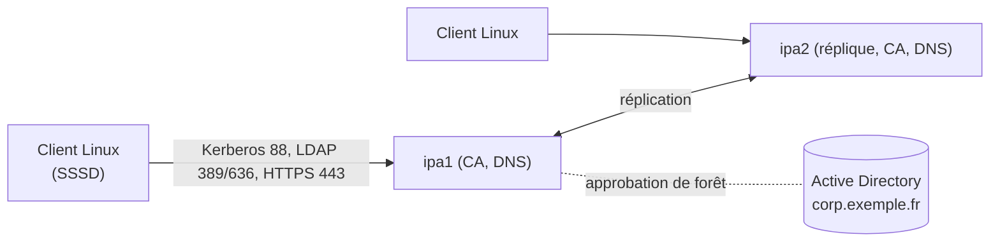

**FreeIPA** (version communautaire de **Red Hat Identity Management**) est pour les parcs **Linux** ce qu'Active Directory est pour Windows : comptes et groupes centralisés, **SSO Kerberos**, **politiques d'accès aux hôtes** (HBAC), règles **sudo**, clés SSH des utilisateurs et des hôtes, **certificats** (AC intégrée), DNS dynamique, et **approbations** avec Active Directory.

## Composants

| Composant | Rôle |
| --- | --- |
| **389 Directory Server** | Annuaire LDAP (comptes, groupes, politiques, configuration) |
| **Kerberos (MIT)** | Authentification unique, keytabs des services |
| **Dogtag** | Autorité de certification (certificats d'hôtes et de services, renouvellement par certmonger) |
| **BIND** + greffon LDAP | DNS intégré (facultatif), mises à jour dynamiques sécurisées |
| **SSSD** (clients) | Authentification, cache hors ligne, HBAC, sudo |
| Interface web / CLI `ipa` / API JSON-RPC | Administration |



## Cohabitation avec Active Directory

| Scénario | Approche |
| --- | --- |
| Parc Linux dans une entreprise Windows | FreeIPA dans un **domaine DNS distinct** (ex. `linux.exemple.fr`) avec une **approbation** vers AD : les comptes AD se connectent aux serveurs Linux, FreeIPA gère HBAC, sudo, certificats Linux |
| Peu de serveurs Linux | Jonction directe à AD avec SSSD/realmd peut suffire (voir [[01-active-directory/01-presentation\|Active Directory]]) |
| Environnement sans AD | FreeIPA comme annuaire principal |

> [!WARNING]
> N'utilisez **pas** le même domaine DNS ni le même royaume Kerberos que l'Active Directory existant : les enregistrements SRV et les royaumes entreraient en conflit.

## Prérequis

| Élément | Exigence |
| --- | --- |
| Système | RHEL 9/10, Rocky, Alma, CentOS Stream, Fedora (Debian/Ubuntu : **client** seulement) |
| Nom | FQDN fixe (`ipa1.linux.exemple.fr`), résolution directe et inverse cohérente |
| Heure | Synchronisée (chrony) |
| Ressources | 4 Go de RAM minimum (8 Go recommandés), 2 vCPU |
| Pare-feu | Services `freeipa-4`, `dns` (si DNS intégré) |

## Installation du premier serveur

```bash
sudo hostnamectl set-hostname ipa1.linux.exemple.fr
sudo dnf install ipa-server ipa-server-dns
sudo firewall-cmd --permanent --add-service={freeipa-4,dns} && sudo firewall-cmd --reload

sudo ipa-server-install \
  --domain=linux.exemple.fr --realm=LINUX.EXEMPLE.FR \
  --hostname=ipa1.linux.exemple.fr \
  --setup-dns --forwarder=10.0.10.53 --auto-reverse \
  --ds-password='MotDePasseDirectoryManager' --admin-password='MotDePasseAdmin' \
  --unattended
```

Sans DNS intégré, l'installateur affiche les enregistrements SRV/A à créer dans votre DNS. Pour une **sous-AC** de votre PKI d'entreprise : `--external-ca` (génère une CSR à faire signer, puis seconde étape avec `--external-cert-file`).

```bash
kinit admin
ipa user-find
ipactl status
```

Interface web : `https://ipa1.linux.exemple.fr/ipa/ui`.

## Répliques

```bash
# Sur ipa2 (inscrit comme client au préalable, puis promu)
sudo ipa-client-install --domain=linux.exemple.fr --principal=admin --unattended
sudo ipa-replica-install --setup-ca --setup-dns --forwarder=10.0.10.53
ipa server-role-find
ipa topologysegment-find domain
```

Déployez **au moins deux** serveurs avec le rôle CA (et DNS si utilisé), sur des sites ou hyperviseurs différents.

## Inscrire des clients

```bash
# RHEL / Rocky / Fedora
sudo dnf install ipa-client
sudo ipa-client-install --mkhomedir --enable-dns-updates --unattended --principal=admin --password='…'
# Debian / Ubuntu
sudo apt install freeipa-client
sudo ipa-client-install --mkhomedir --domain=linux.exemple.fr --server=ipa1.linux.exemple.fr
```

Pour une inscription automatisée (Ansible, images), créez l'hôte au préalable (`ipa host-add srv-web-01.linux.exemple.fr --random`) et utilisez le **mot de passe à usage unique** renvoyé.

## Ports

| Port | Usage |
| --- | --- |
| 80, 443 | Interface web, API, CA |
| 389, 636 | LDAP, LDAPS |
| 88, 464 (TCP/UDP) | Kerberos, kpasswd |
| 53 (TCP/UDP) | DNS (si intégré) |
| 123/UDP | NTP (clients vers serveurs selon la configuration) |

## Suite du parcours

1. [[02-politiques-hbac-sudo|Utilisateurs, HBAC, sudo, certificats et DNS]]
2. [[03-approbation-ad-exploitation|Approbation Active Directory et exploitation]]
