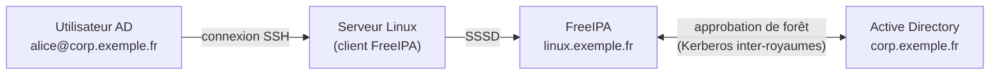

## Approbation avec Active Directory



```bash
sudo dnf install ipa-server-trust-ad
sudo ipa-adtrust-install --netbios-name=LINUX --add-sids
# Résolution DNS croisée : zone de redirection vers AD dans FreeIPA, et redirecteur conditionnel vers FreeIPA dans AD
ipa dnsforwardzone-add corp.exemple.fr --forwarder=10.0.10.11 --forward-policy=only
# Sur AD (PowerShell) : Add-DnsServerConditionalForwarderZone -Name linux.exemple.fr -MasterServers 10.0.30.11,10.0.30.12

ipa trust-add --type=ad corp.exemple.fr --admin Administrateur --password
ipa trust-show corp.exemple.fr
ipa idrange-find
```

| Élément | Rôle |
| --- | --- |
| **ID range** | Plage d'UID/GID calculés à partir des SID AD (`ipa-ad-trust`) ou lus dans AD (`ipa-ad-trust-posix` si `uidNumber` est renseigné) |
| **Groupe externe** | Contient des groupes AD ; imbriqué dans un groupe POSIX FreeIPA utilisé par HBAC et sudo |
| Vues d'identifiants | Surcharger pour certains hôtes l'UID, le shell, le répertoire d'un compte AD |

```bash
ipa group-add ad-admins-reseau-externe --external
ipa group-add-member ad-admins-reseau-externe --external 'CORP\GG_Linux_Admins'
ipa group-add admins-linux-ad
ipa group-add-member admins-linux-ad --groups=ad-admins-reseau-externe
# admins-linux-ad est ensuite utilisé dans les règles HBAC et sudo
ssh alice@corp.exemple.fr@netbox.linux.exemple.fr       # (ou nom court selon la configuration de SSSD)
```

## Sauvegarde et restauration

```bash
sudo ipa-backup                          # sauvegarde complète (serveur arrêté pendant l'opération)
sudo ipa-backup --data --online          # données seules, à chaud
ls /var/lib/ipa/backup/
sudo ipa-restore /var/lib/ipa/backup/ipa-full-2025-10-29-02-00-00
```

Une restauration complète remet le serveur dans l'état de la sauvegarde : avec plusieurs répliques, il est souvent préférable de **reconstruire** une réplique défaillante (`ipa server-del`, puis réinstallation) plutôt que de restaurer. Conservez la sauvegarde hors du serveur (elle contient les clés de l'AC).

## Santé

```bash
sudo ipa-healthcheck --output-type human --failures-only    # services, certificats, réplication, DNS, droits
ipactl status
sudo getcert list | grep -E 'status|expires'
ipa-replica-manage list -v $(hostname)
```

Planifiez `ipa-healthcheck` (minuteur fourni) et alertez sur les échecs.

## Certificats

Les certificats internes (LDAP, HTTP, PKI, agents) sont renouvelés automatiquement par **certmonger** avant expiration. Un serveur éteint longtemps ou une horloge déréglée peut laisser expirer des certificats : `getcert list` montre l'état ; `ipa-cert-fix` répare une AC aux certificats expirés.

## Mises à jour

- Mettre à jour les serveurs **un par un** (`dnf update`, puis `ipa-server-upgrade` est exécuté automatiquement).
- Garder des versions proches entre répliques ; mettre à jour les clients ensuite.
- Pour changer de version majeure de système, ajouter une nouvelle réplique sur le nouveau système, transférer les rôles (CA de renouvellement, CRL), puis retirer l'ancienne.

## Problèmes fréquents

| Symptôme | Cause | Solution |
| --- | --- | --- |
| `kinit: Clock skew too great` | Heure décalée | chrony sur clients et serveurs |
| Inscription d'un client impossible | DNS (SRV introuvables), nom d'hôte non qualifié | `dig SRV _ldap._tcp.linux.exemple.fr`, FQDN |
| Connexion refusée à un utilisateur | Règle HBAC | `ipa hbactest`, journaux SSSD (`/var/log/sssd/`, `debug_level`) |
| Utilisateur AD inconnu sur un client | Approbation, DNS croisé, cache SSSD | `ipa trust-show`, `sss_cache -E`, `id alice@corp.exemple.fr` |
| Service `pki-tomcatd` ne démarre pas | Certificats de l'AC expirés | `getcert list`, `ipa-cert-fix` |
| Réplication en échec | Réseau, conflit, certificat | `ipa-replica-manage list -v`, journaux 389 DS (`/var/log/dirsrv/`) |
| Interface web inaccessible | `httpd` arrêté, certificat | `ipactl status`, journaux Apache |
