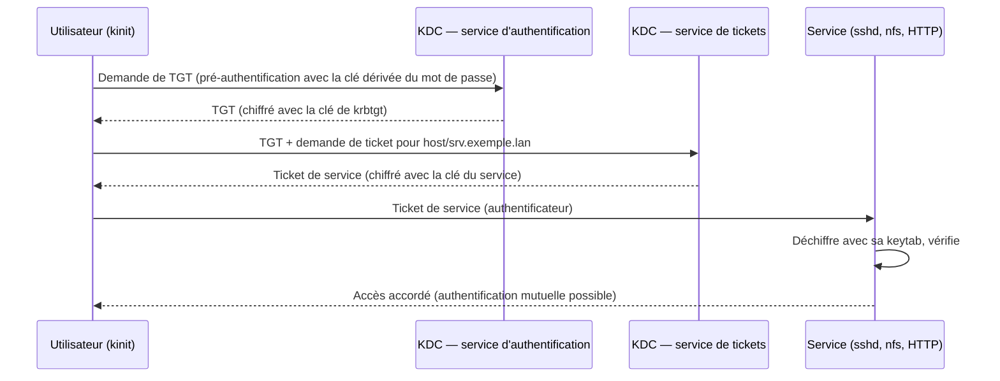

**Kerberos** est le protocole d'authentification unique des réseaux d'entreprise : un utilisateur prouve une fois son identité au **KDC** et obtient des **tickets** qui l'authentifient auprès des services (SSH, NFS, HTTP, LDAP, bases de données) sans renvoyer son mot de passe. Active Directory et FreeIPA en intègrent un ; le **KDC MIT** autonome sert lorsqu'on veut un royaume Kerberos indépendant (environnements Unix, laboratoires, calcul scientifique).

## Principe



| Notion | Description |
| --- | --- |
| **Royaume** | Domaine d'administration Kerberos, en majuscules (`EXEMPLE.LAN`) |
| **Principal** | Identité : `alice@EXEMPLE.LAN`, `host/srv.exemple.lan@EXEMPLE.LAN`, `HTTP/web.exemple.lan@…` |
| **KDC** | Centre de distribution de clés (AS + TGS) ; base des principaux et de leurs clés |
| **TGT** | Ticket d'obtention de tickets (durée de vie ~10 h, renouvelable) |
| **Keytab** | Fichier contenant les clés d'un ou plusieurs principaux de services (équivalent d'un mot de passe) |
| Horloge | Écart maximal de **5 minutes** entre clients, services et KDC |

## Ports

| Port | Usage |
| --- | --- |
| **88** TCP/UDP | KDC |
| 464 TCP/UDP | Changement de mot de passe (kpasswd) |
| 749 TCP | Administration (kadmind) |
| 754 TCP | Réplication (kpropd) |

## Installation

```bash
# Debian / Ubuntu
sudo apt install krb5-kdc krb5-admin-server krb5-user
# RHEL / Rocky / Alma
sudo dnf install krb5-server krb5-workstation
```

```ini /etc/krb5.conf
[libdefaults]
    default_realm = EXEMPLE.LAN
    dns_lookup_kdc = true
    dns_lookup_realm = false
    rdns = false
    ticket_lifetime = 10h
    renew_lifetime = 7d
    forwardable = true

[realms]
    EXEMPLE.LAN = {
        kdc = kdc1.exemple.lan
        kdc = kdc2.exemple.lan
        admin_server = kdc1.exemple.lan
    }

[domain_realm]
    .exemple.lan = EXEMPLE.LAN
    exemple.lan = EXEMPLE.LAN
```

```ini /etc/krb5kdc/kdc.conf (Debian ; RHEL : /var/kerberos/krb5kdc/kdc.conf)
[realms]
    EXEMPLE.LAN = {
        database_name = /var/lib/krb5kdc/principal
        acl_file = /etc/krb5kdc/kadm5.acl
        key_stash_file = /etc/krb5kdc/stash
        max_life = 10h 0m 0s
        max_renewable_life = 7d 0h 0m 0s
        master_key_type = aes256-cts-hmac-sha384-192
        supported_enctypes = aes256-cts-hmac-sha384-192:normal aes128-cts-hmac-sha256-128:normal aes256-cts-hmac-sha1-96:normal
    }
```

```bash
sudo kdb5_util create -s -r EXEMPLE.LAN          # base des principaux + fichier « stash » de la clé maître
echo '*/admin@EXEMPLE.LAN *' | sudo tee /etc/krb5kdc/kadm5.acl
sudo systemctl enable --now krb5-kdc krb5-admin-server      # RHEL : krb5kdc kadmin
```

Publiez les enregistrements DNS : `_kerberos._udp`, `_kerberos._tcp` (SRV vers les KDC), `_kerberos-adm._tcp`, `_kpasswd._udp`.

## Principaux et keytabs

```bash
sudo kadmin.local -q "addprinc alice"
sudo kadmin.local -q "addprinc alice/admin"
sudo kadmin.local -q "addprinc -randkey host/srv-web-01.exemple.lan"
sudo kadmin.local -q "addprinc -randkey nfs/nfs01.exemple.lan"

# Keytab d'un serveur (à créer sur le serveur, via kadmin authentifié)
kadmin -p alice/admin -q "ktadd -k /etc/krb5.keytab host/srv-web-01.exemple.lan"
sudo klist -k /etc/krb5.keytab
```

> [!IMPORTANT]
> Une keytab permet de se faire passer pour le service : droits **600**, propriétaire du service, jamais copiée dans un dépôt ou une image partagée. `ktadd` **renouvelle** la clé (nouveau numéro de version) : les anciennes keytabs deviennent invalides.

## Côté client

```bash
kinit alice                      # obtenir un TGT
klist                            # tickets en cache
kvno host/srv-web-01.exemple.lan # demander un ticket de service (test)
kdestroy
ssh -K srv-web-01.exemple.lan    # SSH avec GSSAPI (GSSAPIAuthentication yes)
```

Windows peut utiliser un royaume MIT (`ksetup /addkdc`, `ksetup /setrealm`), mais dans un parc Windows, Active Directory reste la référence.

## Suite

[[02-replication-depannage|Réplication, approbations, durcissement et dépannage]]
