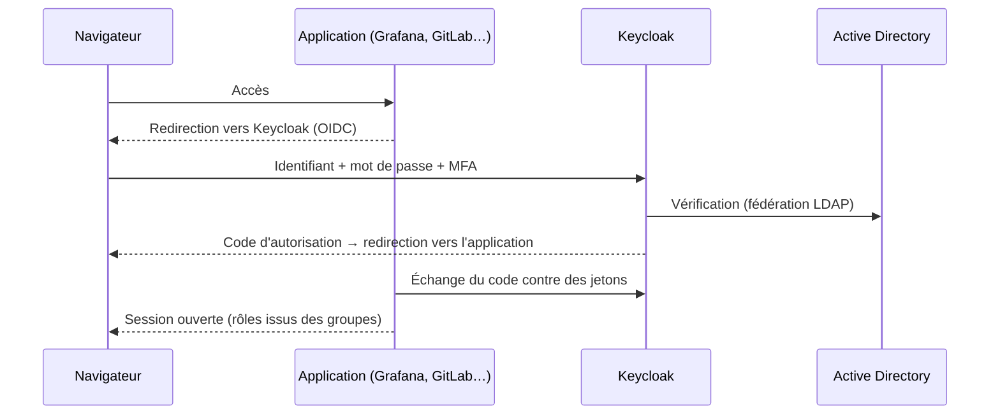

**Keycloak** (projet CNCF, Red Hat, Apache 2.0) centralise l'**authentification** des applications web, API et outils d'infrastructure : **SSO** par OpenID Connect ou SAML, **MFA** (OTP, WebAuthn/passkeys), fédération d'annuaires **LDAP/Active Directory**, connexion via d'autres fournisseurs (Entra ID, Google, ADFS), gestion des sessions et des rôles. Les applications délèguent la connexion à Keycloak et reçoivent des **jetons** signés.

## Concepts

| Notion | Description |
| --- | --- |
| **Royaume** (*realm*) | Espace isolé (utilisateurs, clients, configuration) ; `master` est réservé à l'administration de Keycloak |
| **Client** | Application qui utilise Keycloak (OIDC ou SAML), avec ses URL de redirection et secrets |
| Utilisateurs, **groupes**, **rôles** | Identités et autorisations (rôles de royaume ou de client) |
| **Fédération d'utilisateurs** | Lecture des comptes dans LDAP/AD (et Kerberos) |
| **Courtage d'identités** | Connexion via un fournisseur externe (Entra ID, Google, SAML) |
| **Flux d'authentification** | Étapes de connexion (mot de passe, OTP, WebAuthn, conditions) |
| *Client scopes*, *mappers* | Contenu des jetons (groupes, courriel, rôles) |



## Installation (archive)

```bash
sudo apt install openjdk-21-jre-headless              # Java 21
sudo useradd -r -m -d /opt/keycloak keycloak
curl -LO https://github.com/keycloak/keycloak/releases/download/26.3.3/keycloak-26.3.3.tar.gz
sudo tar -xzf keycloak-26.3.3.tar.gz -C /opt/keycloak --strip-components=1 && sudo chown -R keycloak: /opt/keycloak
```

```ini /opt/keycloak/conf/keycloak.conf
db=postgres
db-url=jdbc:postgresql://127.0.0.1:5432/keycloak
db-username=keycloak
db-password=MotDePasse

hostname=https://sso.corp.exemple.fr
# Keycloak derrière un reverse proxy qui termine TLS
http-enabled=true
http-host=127.0.0.1
http-port=8080
proxy-headers=xforwarded

health-enabled=true
metrics-enabled=true
```

```bash
sudo -u keycloak /opt/keycloak/bin/kc.sh build                 # optimisation pour la configuration choisie
sudo -u keycloak KC_BOOTSTRAP_ADMIN_USERNAME=admin-temp KC_BOOTSTRAP_ADMIN_PASSWORD='MotDePasseTemporaire' \
  /opt/keycloak/bin/kc.sh start --optimized
```

Le compte d'administration **temporaire** sert à créer un administrateur permanent (idéalement fédéré et protégé par MFA), puis doit être supprimé.

```ini /etc/systemd/system/keycloak.service
[Unit]
Description=Keycloak
After=network.target postgresql.service

[Service]
User=keycloak
ExecStart=/opt/keycloak/bin/kc.sh start --optimized
Restart=on-failure
LimitNOFILE=102400

[Install]
WantedBy=multi-user.target
```

## Docker

```bash
docker run -d --name keycloak -p 127.0.0.1:8080:8080 \
  -e KC_DB=postgres -e KC_DB_URL=jdbc:postgresql://db:5432/keycloak -e KC_DB_USERNAME=keycloak -e KC_DB_PASSWORD=… \
  -e KC_HOSTNAME=https://sso.corp.exemple.fr -e KC_HTTP_ENABLED=true -e KC_PROXY_HEADERS=xforwarded \
  -e KC_BOOTSTRAP_ADMIN_USERNAME=admin-temp -e KC_BOOTSTRAP_ADMIN_PASSWORD=… \
  quay.io/keycloak/keycloak:26.3 start
```

Kubernetes : **Keycloak Operator**.

## Ports

| Port | Usage |
| --- | --- |
| 8080 / 8443 | HTTP / HTTPS |
| 9000 | Gestion : `/health/ready`, `/health/live`, `/metrics` (à ne pas exposer publiquement) |
| 7800 | Communication du cluster (Infinispan, JGroups) |

Publiez Keycloak derrière un reverse proxy HTTPS ([[03-nginx/05-reverse-proxy-repartition|Nginx]], [[01-haproxy/01-presentation|HAProxy]]) qui transmet `X-Forwarded-For`, `X-Forwarded-Proto` et `X-Forwarded-Host` ; limitez l'accès à `/admin` aux réseaux d'administration.

## Suite du parcours

1. [[02-federation-clients-mfa|Fédération AD, clients OIDC/SAML et MFA]]
2. [[03-exploitation-depannage|Haute disponibilité, exploitation et dépannage]]
