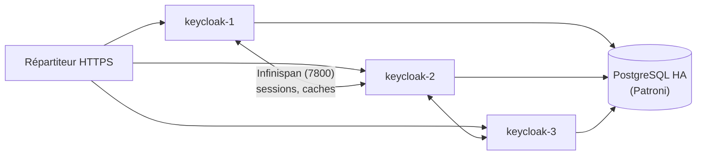

## Haute disponibilité



- Plusieurs nœuds Keycloak forment un **cluster** : caches et sessions distribués par **Infinispan** ; les versions récentes utilisent par défaut la découverte par la base (*jdbc-ping*), sans multicast.
- La base **PostgreSQL** doit être hautement disponible ([[02-postgresql/06-replication-haute-disponibilite|Patroni]]).
- Le répartiteur peut utiliser l'affinité de session (cookie `AUTH_SESSION_ID`), recommandée pour les performances.

```ini keycloak.conf (cluster)
cache=ispn
cache-stack=jdbc-ping
```

## Configuration as code

| Méthode | Usage |
| --- | --- |
| Export/import de royaume (`kc.sh export` / `import`) | Migration, sauvegarde logique, environnements de test |
| **keycloak-config-cli** | Applique un royaume décrit en YAML/JSON (idempotent, CI/CD) |
| **Terraform** (fournisseur `keycloak/keycloak`) | Clients, rôles, fédérations, flux versionnés dans Git |

```bash
sudo systemctl stop keycloak
sudo -u keycloak /opt/keycloak/bin/kc.sh export --dir /srv/export-keycloak --realm infra --users realm_file
sudo systemctl start keycloak
```

## Sauvegarde

La **base de données** contient tout (royaumes, clients, utilisateurs locaux, identifiants, sessions hors ligne) : `pg_dump` régulier. Sauvegardez aussi `conf/` (keycloak.conf, magasins de confiance, keytabs) et les thèmes personnalisés.

## Mises à jour

1. Lire le guide de mise à jour (changements de configuration, de thèmes, d'API).
2. Sauvegarder la base.
3. Arrêter tous les nœuds (ou mise à jour progressive si la version le permet), déployer la nouvelle version, `kc.sh build`, démarrer : les migrations de base sont automatiques.
4. Vérifier les flux de connexion des applications critiques.

## Supervision et audit

| Source | Usage |
| --- | --- |
| `/health/ready`, `/health/live` (port 9000) | Sondes du répartiteur et de Kubernetes |
| `/metrics` | Métriques Prometheus (connexions, erreurs, JVM, base) |
| **Événements utilisateurs** (*Realm settings → Events*) | Connexions, échecs, MFA, réinitialisations : à activer et à exporter (SIEM) |
| Événements d'administration | Modifications de configuration (avec représentation) |

## Sécurité

- [ ] Console `/admin` accessible uniquement depuis le réseau d'administration (filtrage par le proxy)
- [ ] Royaume `master` réservé à quelques administrateurs, avec MFA ; administrateurs des autres royaumes via des rôles délégués (`realm-management`)
- [ ] Clients confidentiels quand c'est possible ; secrets renouvelés ; URL de redirection **exactes** (pas de joker large)
- [ ] Protection contre le force brute activée ; durées de session raisonnables
- [ ] Mises à jour de sécurité suivies

## Erreurs fréquentes

| Message / symptôme | Cause | Solution |
| --- | --- | --- |
| `Invalid parameter: redirect_uri` | URL de redirection non déclarée dans le client | Ajouter l'URL exacte (schéma, port, chemin) |
| `HTTPS required` | Accès en HTTP alors que le royaume exige HTTPS, en-têtes du proxy absents | `proxy-headers=xforwarded`, en-têtes `X-Forwarded-Proto` |
| Liens et redirections vers `localhost:8080` | `hostname` non défini | `hostname=https://sso.corp.exemple.fr` |
| `Cookie not found. Please make sure cookies are enabled` | Cookies bloqués, domaine/chemin incohérents derrière le proxy | Configuration du proxy, même nom d'hôte |
| Utilisateurs AD absents | Filtre LDAP, Users DN, certificat LDAPS | *Test connection* / *Test authentication*, synchronisation manuelle |
| Jeton refusé par l'application (`iss` invalide) | Émetteur différent (URL publique / interne) | Même `hostname` partout |
| `Token is not active` / jetons expirés | Horloges décalées | NTP sur Keycloak et les applications |
| En-têtes HTTP trop grands | Trop de groupes dans le jeton | Limiter les groupes transmis (mapper filtré, rôles de client) |
