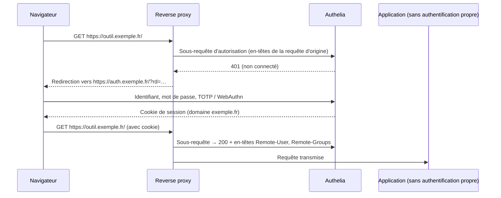

**Authelia** (Apache 2.0) ajoute une **authentification unique avec MFA** devant des applications qui n'en ont pas (interfaces d'administration, outils internes, tableaux de bord), sans les modifier : le **reverse proxy** (Nginx, Traefik, Caddy, HAProxy) demande à Authelia, pour chaque requête, si l'utilisateur est autorisé. Authelia est aussi un fournisseur **OpenID Connect** certifié.



## Installation

```bash
# Docker (le plus courant)
docker run -d --name authelia -p 127.0.0.1:9091:9091 -v /srv/authelia:/config authelia/authelia:4.39
# Debian / Ubuntu : dépôt apt.authelia.com puis « apt install authelia »
authelia crypto hash generate argon2 --password 'MotDePasseAlice'      # hachage pour la base fichier
```

## configuration.yml

```yaml /srv/authelia/configuration.yml
server:
  address: tcp://0.0.0.0:9091/

log:
  level: info

theme: auto

identity_validation:
  reset_password:
    jwt_secret: "{{ secret \"/config/secrets/jwt\" }}"

totp:
  issuer: exemple.fr

webauthn:
  display_name: Exemple
  enable_passkey_login: true

authentication_backend:
  ldap:
    implementation: activedirectory
    address: ldaps://dc1.corp.exemple.fr
    base_dn: DC=corp,DC=exemple,DC=fr
    user: CN=svc_authelia,OU=Services,DC=corp,DC=exemple,DC=fr
    password: "{{ secret \"/config/secrets/ldap\" }}"
    additional_users_dn: OU=Utilisateurs
    additional_groups_dn: OU=Groupes

definitions:
  network:
    interne:
      - 10.0.0.0/8

access_control:
  default_policy: deny
  rules:
    - domain: "wiki.exemple.fr"
      policy: one_factor
      networks: [ interne ]
    - domain: "grafana.exemple.fr"
      policy: two_factor
      subject: [ "group:GG_Supervision" ]
    - domain: "*.admin.exemple.fr"
      policy: two_factor
      subject: [ "group:GG_Admins" ]
    - domain: "app.exemple.fr"
      resources: [ "^/api/public/.*$" ]
      policy: bypass

session:
  secret: "{{ secret \"/config/secrets/session\" }}"
  cookies:
    - domain: exemple.fr
      authelia_url: https://auth.exemple.fr
      inactivity: 1h
      expiration: 12h
      remember_me: 1M
  redis:
    host: redis
    port: 6379

regulation:
  max_retries: 5
  find_time: 10m
  ban_time: 30m

storage:
  encryption_key: "{{ secret \"/config/secrets/stockage\" }}"
  postgres:
    address: tcp://db:5432
    database: authelia
    username: authelia
    password: "{{ secret \"/config/secrets/db\" }}"

notifier:
  smtp:
    address: submission://relais.corp.exemple.fr:587
    sender: "Authelia <auth@exemple.fr>"
```

| Section | Rôle |
| --- | --- |
| `authentication_backend` | Fichier d'utilisateurs (petits environnements) ou **LDAP/AD** |
| `access_control` | Règles évaluées dans l'ordre : `bypass`, `one_factor`, `two_factor`, `deny` |
| `session` | Cookie valable pour le **domaine parent** de toutes les applications protégées ; Redis pour plusieurs instances |
| `regulation` | Bannissement après trop d'échecs |
| `storage` | Préférences, inscriptions MFA (SQLite pour un nœud unique) ; `encryption_key` à conserver |
| `notifier` | Courriels (enrôlement MFA, réinitialisation) ; `filesystem` pour les tests |

Les secrets se passent par fichiers (gabarits `{{ secret … }}`, qui nécessitent la variable d'environnement `X_AUTHELIA_CONFIG_FILTERS=template`, ou variables `AUTHELIA_…_FILE`), jamais en clair dans un dépôt.

```bash
docker exec authelia authelia validate-config --config /config/configuration.yml
```

## Suite

[[02-proxy-oidc-exploitation|Intégration aux reverse proxys, OIDC et exploitation]]
