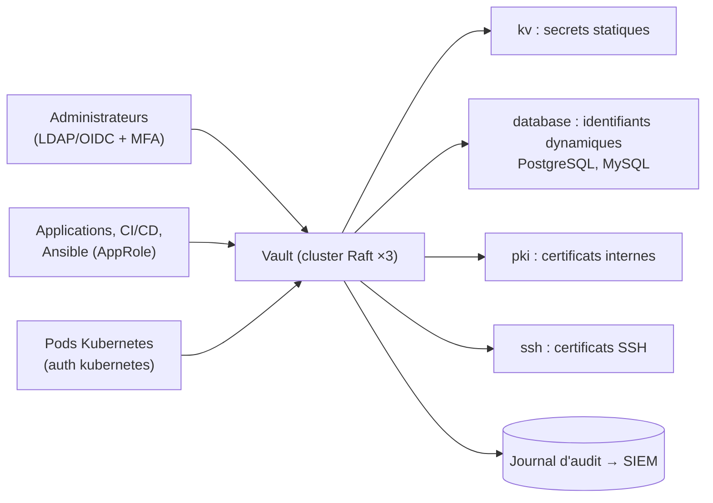

**Vault** centralise et protège les **secrets** : mots de passe, clés d'API, certificats, identifiants de bases de données, clés SSH. Au-delà d'un coffre chiffré, il délivre des secrets **dynamiques** (identifiants créés à la demande et révoqués à expiration), sert d'**autorité de certification** (PKI), signe des **certificats SSH**, chiffre des données pour les applications (*transit*) et trace chaque accès.

## Concepts

| Notion | Description |
| --- | --- |
| **Scellement** | Au démarrage, Vault est **scellé** : il ne peut pas déchiffrer ses données tant que la clé maîtresse n'est pas reconstituée |
| **Clés de descellement** | Partage de Shamir (ex. 5 parts, 3 nécessaires), ou **descellement automatique** (KMS cloud, HSM, autre Vault) |
| **Stockage** | **Raft intégré** (recommandé, haute disponibilité native) |
| **Méthodes d'authentification** | LDAP/AD, OIDC, AppRole (applications), Kubernetes, certificats TLS, userpass |
| **Moteurs de secrets** | `kv` (clé-valeur versionné), `database`, `pki`, `ssh`, `transit`, clouds… |
| **Politiques** | Droits par chemin (HCL), attachés aux jetons |
| **Jetons** | Résultat d'une authentification, avec durée de vie (TTL) |
| **Audit** | Journal de chaque requête (valeurs sensibles hachées) |



## Licence : Vault ou OpenBao ?

Depuis 2023, Vault est sous **Business Source License** (BSL 1.1) : utilisation interne libre, mais restrictions pour les offres concurrentes. **OpenBao** (Linux Foundation, MPL 2.0) est un fork communautaire **compatible** (commande `bao`, mêmes concepts et API) pour qui exige une licence libre.

## Installation

```bash
# Debian / Ubuntu : dépôt HashiCorp
wget -O - https://apt.releases.hashicorp.com/gpg | sudo gpg --dearmor -o /usr/share/keyrings/hashicorp-archive-keyring.gpg
echo "deb [signed-by=/usr/share/keyrings/hashicorp-archive-keyring.gpg] https://apt.releases.hashicorp.com $(lsb_release -cs) main" \
  | sudo tee /etc/apt/sources.list.d/hashicorp.list
sudo apt update && sudo apt install vault
# RHEL
sudo dnf config-manager --add-repo https://rpm.releases.hashicorp.com/RHEL/hashicorp.repo && sudo dnf install vault
```

| Plate-forme | Installation |
| --- | --- |
| Windows | `winget install Hashicorp.Vault` (binaire ; service via NSSM ou `sc.exe`) |
| macOS | `brew tap hashicorp/tap && brew install hashicorp/tap/vault` |
| Kubernetes | Chart Helm `hashicorp/vault` (mode HA Raft, injecteur d'agents) |

## vault.hcl

```hcl /etc/vault.d/vault.hcl
ui            = true
disable_mlock = true          # recommandé avec le stockage Raft

storage "raft" {
  path    = "/opt/vault/data"
  node_id = "vault1"
  retry_join { leader_api_addr = "https://vault2.corp.exemple.fr:8200" }
  retry_join { leader_api_addr = "https://vault3.corp.exemple.fr:8200" }
}

listener "tcp" {
  address            = "0.0.0.0:8200"
  cluster_address    = "0.0.0.0:8201"
  tls_cert_file      = "/opt/vault/tls/vault1.crt"
  tls_key_file       = "/opt/vault/tls/vault1.key"
  tls_client_ca_file = "/opt/vault/tls/ca.crt"
}

api_addr     = "https://vault1.corp.exemple.fr:8200"
cluster_addr = "https://vault1.corp.exemple.fr:8201"
```

```bash
sudo systemctl enable --now vault
export VAULT_ADDR=https://vault1.corp.exemple.fr:8200 VAULT_CACERT=/opt/vault/tls/ca.crt
vault status
```

## Initialiser et desceller

```bash
vault operator init -key-shares=5 -key-threshold=3
# → 5 clés de descellement + jeton root initial : à remettre à 5 personnes différentes (coffres, gestionnaire de mots de passe)
vault operator unseal        # ×3, avec trois clés différentes (sur chaque nœud)
vault login                  # jeton root initial : configurer l'authentification, puis révoquer le jeton root
```

> [!IMPORTANT]
> Sans le seuil de clés de descellement, les données sont **définitivement perdues**. Répartissez les clés entre plusieurs personnes et lieux. Le jeton root ne doit servir qu'à l'amorçage ; régénérez-en un temporairement si nécessaire (`vault operator generate-root`).

### Descellement automatique

Avec un KMS (Azure Key Vault, AWS KMS, GCP KMS), un HSM (PKCS#11, édition Enterprise) ou un autre Vault (*transit*), les nœuds se descellent seuls au redémarrage :

```hcl
seal "azurekeyvault" {
  tenant_id  = "…"
  vault_name = "kv-scellement"
  key_name   = "vault-unseal"
}
```

Les clés produites par `init` deviennent alors des **clés de récupération**.

## Suite du parcours

1. [[02-secrets-authentification|Secrets, authentification et politiques]]
2. [[03-pki-ssh-exploitation|PKI, certificats SSH, haute disponibilité et exploitation]]
