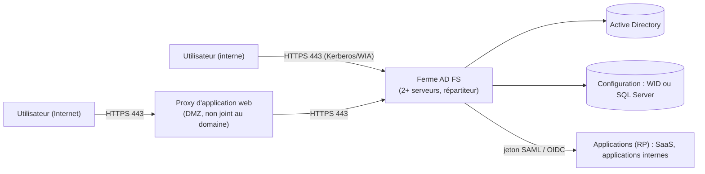

**AD FS** (*Active Directory Federation Services*) permet aux utilisateurs d'Active Directory de s'authentifier **une fois** puis d'accéder à des applications web internes, partenaires ou SaaS **sans** que ces applications aient accès à l'annuaire : AD FS émet des **jetons** signés contenant des **revendications** (identité, groupes, attributs).

> [!NOTE]
> **Positionnement.** Microsoft recommande de migrer les applications vers **Microsoft Entra ID** (accès conditionnel, MFA, pas d'infrastructure à maintenir) ; AD FS reste supporté dans Windows Server 2025 et utile pour des contraintes sur site (applications internes, souveraineté, partenaires SAML). Pour un fournisseur d'identité libre, voir [[05-keycloak/01-presentation-installation|Keycloak]].

## Notions

| Notion | Description |
| --- | --- |
| **Fournisseur d'identité** (IdP) | AD FS : authentifie l'utilisateur contre AD et émet le jeton |
| **Partie de confiance** (*Relying Party Trust*, RP) | Application qui accepte les jetons d'AD FS |
| **Approbation de fournisseur de revendications** (*Claims Provider Trust*) | Autre IdP dont AD FS accepte les jetons (partenaire, autre forêt) ; AD est le fournisseur par défaut |
| **Revendication** (*claim*) | Information du jeton : UPN, e-mail, groupes, rôle |
| **Règles de revendication** | Transformation des attributs AD en revendications émises vers chaque RP |
| Protocoles | **SAML 2.0**, **WS-Federation** (applications .NET, SharePoint), **OpenID Connect / OAuth 2.0** (groupes d'applications) |

## Architecture



| Composant | Rôle |
| --- | --- |
| Serveurs AD FS (ferme) | Membres du domaine, au moins deux derrière un répartiteur ; nom de service unique (`sts.exemple.fr`) |
| Base de configuration | **WID** (jusqu'à 30 serveurs, réplication du principal) ou **SQL Server** (fonctions avancées : résolution d'artefacts SAML, détection de relecture) |
| **Proxy d'application web** (WAP) | Reverse proxy en DMZ pour l'accès externe (rôle *Accès à distance*), pré-authentification |
| Compte de service | **gMSA** (compte de service géré de groupe) recommandé |

## Certificats

| Certificat | Usage |
| --- | --- |
| **Communication de service** (SSL) | Certificat public pour `sts.exemple.fr` (et `certauth.sts.exemple.fr` pour l'authentification par certificat), sur AD FS et WAP |
| **Signature de jetons** | Signe les jetons ; autosigné et renouvelé automatiquement par défaut (*AutoCertificateRollover*) — les RP doivent récupérer les métadonnées à jour |
| Déchiffrement de jetons | Pour les jetons chiffrés reçus |

## Installation

```powershell
# Prérequis : clé racine KDS pour les gMSA (une fois par forêt, effective après 10 h)
Add-KdsRootKey -EffectiveImmediately      # puis attendre 10 h (réplication) ; en laboratoire : -EffectiveTime ((Get-Date).AddHours(-10))
# Le gMSA est créé par Install-AdfsFarm s'il n'existe pas (droits requis), ou au préalable :
New-ADServiceAccount -Name gmsa-adfs -DNSHostName sts.exemple.fr -PrincipalsAllowedToRetrieveManagedPassword "GG-Serveurs-ADFS"

Install-WindowsFeature ADFS-Federation -IncludeManagementTools
$cert = (Get-ChildItem Cert:\LocalMachine\My | Where-Object Subject -like "CN=sts.exemple.fr*").Thumbprint
Install-AdfsFarm -CertificateThumbprint $cert -FederationServiceName "sts.exemple.fr" -FederationServiceDisplayName "Connexion Exemple" `
  -GroupServiceAccountIdentifier "CORP\gmsa-adfs$" -OverwriteConfiguration

# Serveurs supplémentaires
Add-AdfsFarmNode -CertificateThumbprint $cert -GroupServiceAccountIdentifier "CORP\gmsa-adfs$" -PrimaryComputerName srv-adfs-01.corp.exemple.fr

# Proxy d'application web (serveur en DMZ)
Install-WindowsFeature Web-Application-Proxy -IncludeManagementTools
Install-WebApplicationProxy -FederationServiceName "sts.exemple.fr" -CertificateThumbprint $cert -FederationServiceTrustCredential (Get-Credential CORP\admin-adfs)
```

DNS : `sts.exemple.fr` vers le répartiteur des serveurs AD FS en **interne**, vers le WAP en **externe** (DNS split-brain). Le SPN `HOST/sts.exemple.fr` doit être porté par le compte de service (Kerberos interne).

## Tester

- Métadonnées : `https://sts.exemple.fr/FederationMetadata/2007-06/FederationMetadata.xml`
- Page de test (à activer temporairement) : `Set-AdfsProperties -EnableIdPInitiatedSignonPage $true` → `https://sts.exemple.fr/adfs/ls/idpinitiatedsignon.aspx`
- `Get-AdfsProperties`, `Get-AdfsSslCertificate`, `Get-AdfsCertificate`

Suite : [[02-approbations-securite-exploitation|approbations, sécurité et exploitation]].
