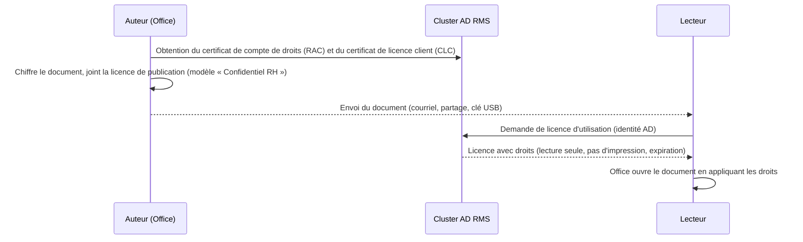

**AD RMS** protège des **documents** et **messages** au-delà du réseau : le fichier est chiffré et embarque une **stratégie** (qui peut lire, modifier, imprimer, copier, transférer, jusqu'à quelle date). Même copié sur une clé USB ou transféré par erreur, il reste illisible pour une personne non autorisée.

> [!IMPORTANT]
> **Statut.** AD RMS est toujours présent dans Windows Server mais **n'évolue plus** ; la solution de Microsoft est **Microsoft Purview Information Protection** (étiquettes de confidentialité, service *Azure Rights Management*). Les nouveaux projets doivent partir de Purview ; AD RMS concerne les environnements existants ou totalement déconnectés du cloud (avec **HYOK** / *Double Key Encryption* comme alternatives côté Purview).

## Fonctionnement



| Élément | Rôle |
| --- | --- |
| **Cluster AD RMS** | Un ou plusieurs serveurs (rôle `ADRMS`) derrière une URL unique (`rms.corp.exemple.fr`) |
| Base de configuration et de journalisation | **SQL Server** (obligatoire en production) |
| **Clé de cluster** | Protège toutes les licences ; stockée dans la base (protégée par mot de passe) ou un HSM — **à sauvegarder** |
| Point de connexion de service (SCP) | Publié dans AD : les clients découvrent le cluster |
| **Modèles de stratégie de droits** | Droits prédéfinis par l'administrateur (Confidentiel, Lecture seule…) |

## Prérequis et installation

- Serveurs membres du domaine, **SQL Server**, certificat **SSL** pour l'URL du cluster (HTTPS)
- Compte de service de domaine dédié (non administrateur)
- Groupe d'utilisateurs avec **adresse e-mail** renseignée dans AD (identité RMS)

```powershell
Install-WindowsFeature ADRMS, ADRMS-Server -IncludeManagementTools
# Configuration : assistant du Gestionnaire de serveur (« Effectuer une configuration supplémentaire ») :
# nouveau cluster, base SQL, compte de service, mode de stockage de la clé de cluster (mot de passe), site web IIS,
# adresse du cluster https://rms.corp.exemple.fr, certificat SSL, nom du certificat de licence serveur, enregistrement du SCP
```

Console : `Gestion des services AD RMS` (`adrmsadmin.msc`). Ajoutez un second serveur au cluster pour la disponibilité (même base, répartiteur sur l'URL).

## Modèles et usage

| Modèle | Droits typiques |
| --- | --- |
| Confidentiel — interne | Lecture/modification pour *Tous les employés*, pas de transfert vers l'extérieur |
| Confidentiel — RH | Lecture pour `GG-RH`, pas d'impression ni de copie |
| Lecture seule — 30 jours | Lecture, expiration du contenu après 30 jours |

Publication des modèles : *Modèles de stratégie de droits → Créer un modèle distribué* ; les clients Office les récupèrent automatiquement (tâche planifiée `AD RMS Rights Policy Template Management`) ou via un partage.

| Intégration | Fonction |
| --- | --- |
| **Office** (Word, Excel, PowerPoint, Outlook) | *Fichier → Protéger le document → Restreindre l'accès*, modèles |
| **Exchange** | Règles de transport appliquant la protection, *Ne pas transférer* dans Outlook, journalisation |
| **SharePoint** | IRM sur les bibliothèques (protection au téléchargement) |
| **FSRM** | Tâches de gestion de fichiers appliquant RMS selon la classification ([[15-fsrm/01-quotas-filtrage-classification\|FSRM]]) |

## Sécurité et exploitation

- [ ] **Sauvegarder** la base SQL **et** le mot de passe/HSM de la clé de cluster : leur perte rend **tous** les documents protégés illisibles
- [ ] Rôle *Super utilisateur* (déchiffrement de tout contenu : enquêtes, récupération) **désactivé** par défaut, activé ponctuellement, audité
- [ ] HTTPS uniquement, certificat valide ; URL publiée à l'extérieur seulement si des utilisateurs nomades ou partenaires en ont besoin
- [ ] Journalisation SQL des licences émises (qui a ouvert quoi) conservée selon la politique

## Migration vers Purview

Microsoft fournit une procédure de migration **AD RMS → Azure Information Protection / Purview** : export de la **clé de domaine de publication approuvée** (TPD) et des modèles, import dans le locataire (*Azure RMS*), redirection des clients (registre/GPO de redirection d'URL) pour que les anciens documents restent lisibles, puis décommissionnement du cluster. Planifiez-la avant que les clients Office ne cessent de prendre en charge AD RMS dans votre configuration.

## Problèmes fréquents

| Symptôme | Cause | Solution |
| --- | --- | --- |
| Office : « Impossible de se connecter au serveur RMS » | SCP absent, URL non résolue, certificat SSL | Enregistrer le SCP, DNS, certificat approuvé |
| Utilisateur sans droits malgré le groupe | Adresse e-mail absente dans AD, cache de groupe AD RMS | Renseigner `mail`, attendre l'expiration du cache (ou le vider) |
| Modèles absents dans Office | Distribution des modèles | Tâche planifiée du client, partage de modèles |
| Documents illisibles après sinistre | Clé de cluster ou base non restaurées | Restaurer SQL + clé ; d'où l'importance de la sauvegarde |
