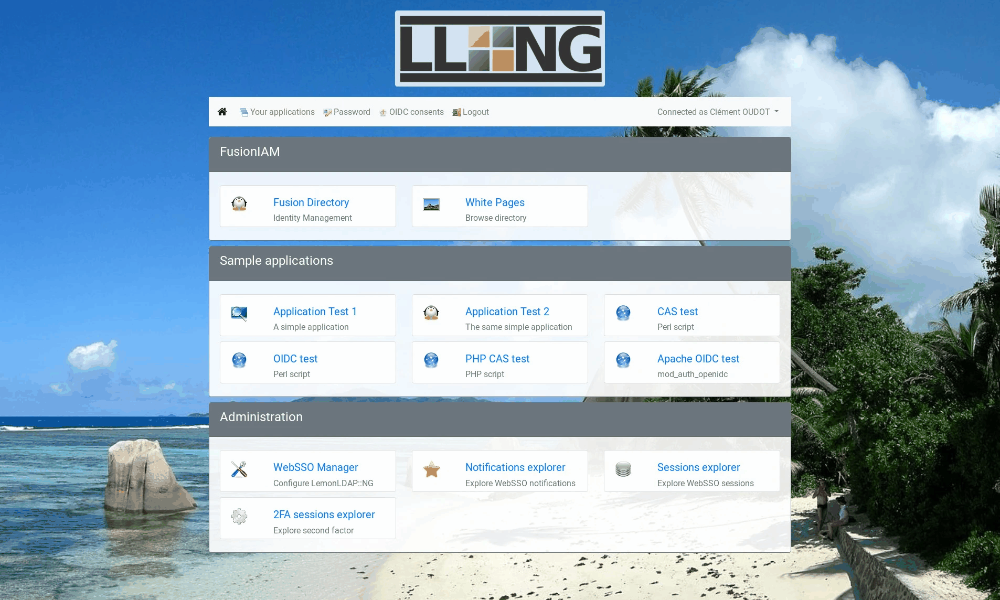
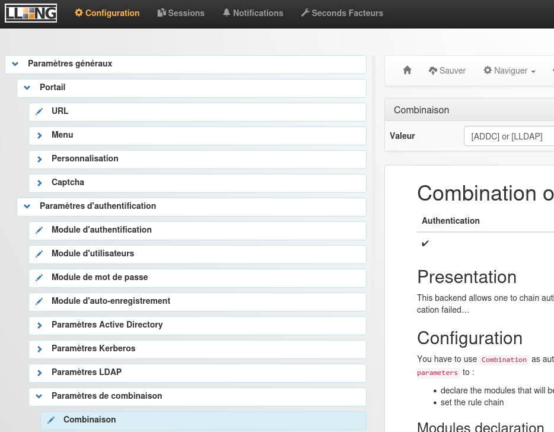
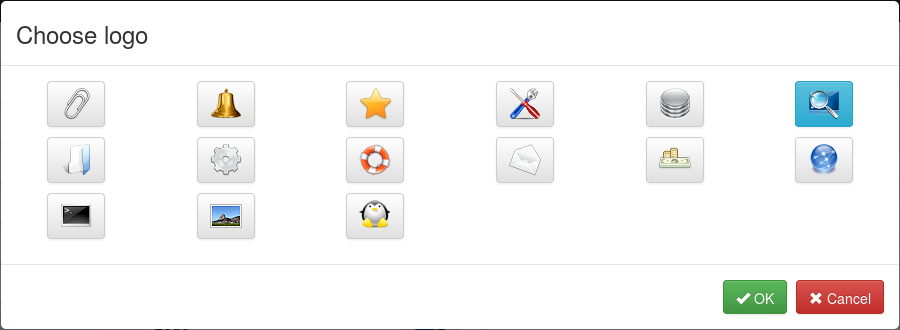

## Portail

`https://auth.corp.exemple.fr` : formulaire de connexion (ou choix du mode : AD, Kerberos, autre IdP), **menu des applications** autorisées, gestion des seconds facteurs (*2FA Manager*), changement de mot de passe, notifications à accepter.

")

## Manager

`https://manager.corp.exemple.fr` (accès réservé aux administrateurs par règle) :

| Section | Contenu |
| --- | --- |
| **Configuration** | Arbre : *General Parameters* (authentification, portail, sessions, journaux, MFA), *Variables*, *Virtual Hosts* (règles et en-têtes), *SAML/OIDC/CAS service* et partenaires |
| Sessions | Sessions actives, recherche, suppression (déconnexion forcée) |
| Notifications | Messages à faire accepter (charte) |
| Second factors | Appareils MFA enregistrés par utilisateur |

Chaque enregistrement crée une **nouvelle version** de configuration, comparable et restaurable (*Browse* les versions).

<!-- CAPTURE: LemonLDAP::NG — Manager, explorateur de sessions | _assets/lemonldap-manager-sessions.png -->

## Correspondance Manager ↔ ligne de commande

| Action | Manager | Commande |
| --- | --- | --- |
| Lire un paramètre | Arbre de configuration | `/usr/share/lemonldap-ng/bin/lemonldap-ng-cli get portal` |
| Modifier un paramètre | Enregistrer | `lemonldap-ng-cli -yes 1 set ldapServer ldaps://dc01.corp.exemple.fr` |
| Supprimer les sessions d'un utilisateur | Sessions | `lemonldap-ng-sessions search --where uid=alice` puis `delete` |
