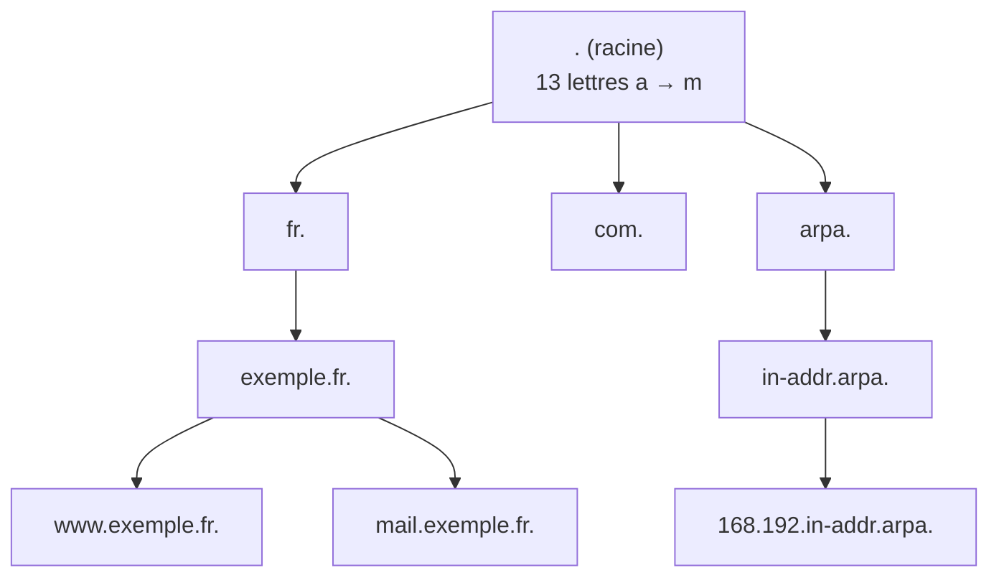
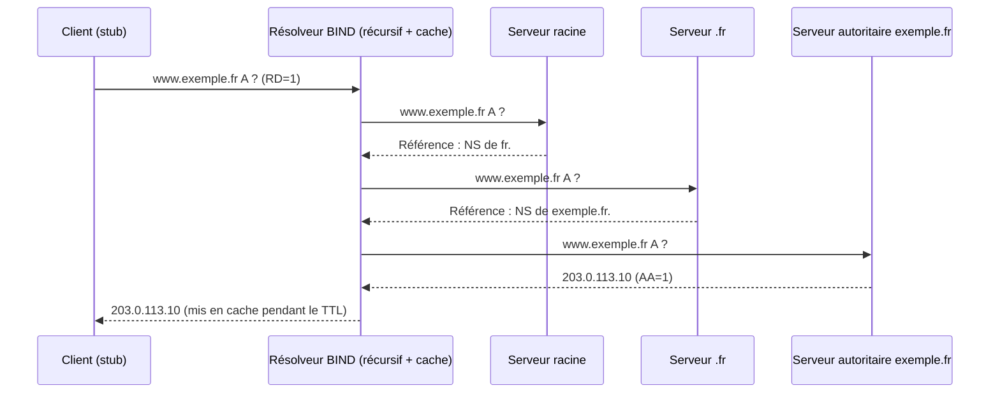
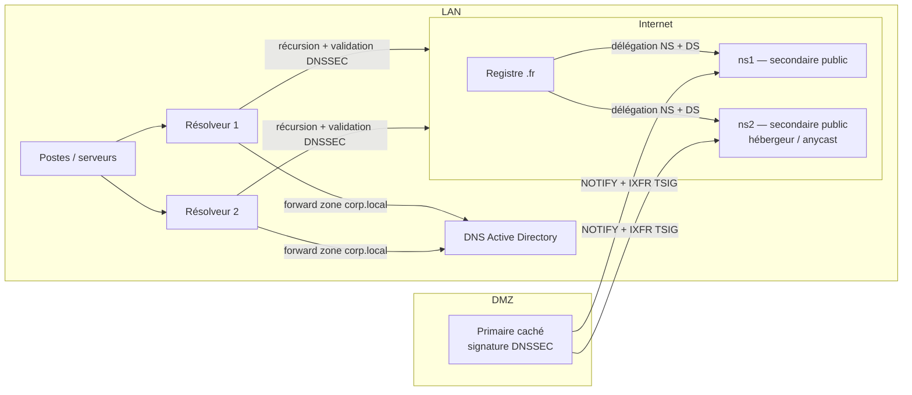

**BIND** (*Berkeley Internet Name Domain*), maintenu par l'**ISC** (Internet Systems Consortium), est l'implémentation DNS la plus répandue et la référence des RFC. Le démon s'appelle `named`. BIND peut jouer tous les rôles : résolveur récursif avec cache, serveur autoritaire primaire ou secondaire, redirecteur, serveur de zones dynamiques et signées DNSSEC.

## Rappels DNS

### Hiérarchie



Chaque nœud de l'arbre est un **domaine** ; une **zone** est la partie de l'arbre gérée par un même ensemble de serveurs autoritaires. Une zone **délègue** un sous-domaine à d'autres serveurs via des enregistrements **NS** (et des enregistrements de colle — *glue* — si les serveurs sont dans le sous-domaine).

### Résolution



- **Requête récursive** (client → résolveur) : « donne-moi la réponse finale ».
- **Requête itérative** (résolveur → autoritaires) : chaque serveur renvoie la réponse ou une **référence** vers des serveurs plus proches.
- Le résolveur met en **cache** chaque réponse pendant son **TTL** (*Time To Live*), y compris les réponses négatives (NXDOMAIN) pendant le TTL négatif défini dans le SOA.

### Indicateurs d'une réponse

| Indicateur | Signification |
| --- | --- |
| `qr` | C'est une réponse |
| `aa` | *Authoritative Answer* : le serveur fait autorité pour la zone |
| `rd` | *Recursion Desired* : le client demande la récursion |
| `ra` | *Recursion Available* : le serveur accepte la récursion |
| `ad` | *Authenticated Data* : réponse validée DNSSEC |
| `cd` | *Checking Disabled* : le client demande de ne pas valider DNSSEC |
| `tc` | Réponse tronquée : le client doit réessayer en TCP |

### Codes de retour (RCODE)

| RCODE | Sens |
| --- | --- |
| `NOERROR` | Succès (éventuellement sans réponse : *NODATA*) |
| `NXDOMAIN` | Le nom n'existe pas |
| `SERVFAIL` | Échec du serveur (zone non chargée, validation DNSSEC échouée, autoritaires injoignables) |
| `REFUSED` | Requête refusée par la politique (ACL `allow-query`, récursion interdite) |
| `FORMERR` / `NOTIMP` | Requête mal formée / opération non supportée |

## Types d'enregistrements principaux

| Type | Rôle | Exemple |
| --- | --- | --- |
| `SOA` | Début d'autorité : serveur primaire, contact, numéro de série, timers | voir [[04-zones-autoritaires]] |
| `NS` | Serveurs autoritaires de la zone | `@ IN NS ns1.exemple.fr.` |
| `A` / `AAAA` | Adresse IPv4 / IPv6 | `www IN A 203.0.113.10` |
| `CNAME` | Alias vers un nom canonique (exclusif : aucun autre type sur le même nom) | `intranet IN CNAME web01` |
| `MX` | Serveur de messagerie avec priorité | `@ IN MX 10 mail` |
| `TXT` | Texte libre : SPF, DKIM, DMARC, validations | `@ IN TXT "v=spf1 mx -all"` |
| `SRV` | Localisation d'un service (Active Directory, SIP, XMPP) | `_ldap._tcp IN SRV 0 100 389 dc01` |
| `PTR` | Résolution inverse (IP → nom) | `10 IN PTR www.exemple.fr.` |
| `CAA` | Autorités de certification autorisées | `@ IN CAA 0 issue "letsencrypt.org"` |
| `DS`, `DNSKEY`, `RRSIG`, `NSEC`/`NSEC3` | DNSSEC | voir [[07-dnssec]] |
| `SSHFP`, `TLSA` | Empreintes SSH, DANE | |
| `HTTPS` / `SVCB` | Paramètres de connexion (ALPN, ECH, indices d'adresses) | `@ IN HTTPS 1 . alpn="h2,h3"` |

## Rôles d'un serveur BIND

| Rôle | Description | Directive clé |
| --- | --- | --- |
| **Résolveur récursif / cache** | Répond aux clients internes en interrogeant Internet | `recursion yes; allow-recursion { … };` |
| **Redirecteur (forwarder)** | Transmet les requêtes à d'autres résolveurs au lieu de partir de la racine | `forwarders { … };` |
| **Autoritaire primaire** | Détient la copie maîtresse d'une zone (fichier ou zone dynamique) | `zone … { type primary; };` |
| **Autoritaire secondaire** | Copie la zone depuis le primaire par transfert (AXFR/IXFR) | `zone … { type secondary; primaries { … }; };` |
| **Primaire caché** (*hidden primary*) | Primaire non publié dans les NS ; seuls les secondaires répondent au public | |
| **Stub / static-stub / forward zone** | Redirection conditionnelle d'un domaine précis | `type forward;`, `type static-stub;` |

> [!IMPORTANT]
> **Séparez les rôles** : un serveur autoritaire exposé sur Internet ne doit **pas** faire de récursion ouverte (amplification DDoS, empoisonnement de cache). En interne, des résolveurs récursifs dédiés, éventuellement avec des zones locales.

## Architecture type d'entreprise



## Versions

| Branche | Statut | Remarques |
| --- | --- | --- |
| 9.16 | Fin de vie (2023) | Encore présente sur d'anciennes distributions |
| **9.18** | ESV (support étendu) | Debian 12, Ubuntu 22.04/24.04 ; RHEL 9 livre 9.16 par défaut et propose le paquet `bind9.18`. DoT/DoH, `dnssec-policy` mûr |
| **9.20** | Stable (ESV suivante) | Debian 13. Nouvelle base de données QP-trie, `inline-signing` déplacé dans `dnssec-policy`, suppression d'options obsolètes |

```bash
named -V          # version, options de compilation (DoH, GeoIP, LMDB…)
```

> [!NOTE]
> Depuis 9.18 les termes `master`/`slave` sont remplacés par **`primary`/`secondary`** et `masters` par **`primaries`**. Les anciens mots-clés restent acceptés mais sont dépréciés.

## Outils fournis

| Outil | Paquet (Debian / RHEL) | Usage |
| --- | --- | --- |
| `named` | bind9 / bind | Le serveur |
| `rndc` | bind9 / bind | Contrôle du serveur à chaud (rechargement, cache, signature…) |
| `named-checkconf` | bind9-utils / bind | Vérifie la syntaxe de `named.conf` (`-z` charge aussi les zones) |
| `named-checkzone` / `named-compilezone` | bind9-utils / bind | Vérifie / convertit un fichier de zone |
| `dig` | bind9-dnsutils / bind-utils | Client de diagnostic DNS |
| `delv` | bind9-dnsutils / bind-utils | Diagnostic de validation DNSSEC |
| `host`, `nslookup` | bind9-dnsutils / bind-utils | Clients simples |
| `nsupdate` | bind9-dnsutils / bind-utils | Mises à jour dynamiques (RFC 2136) |
| `tsig-keygen`, `rndc-confgen` | bind9 / bind | Génération de clés TSIG et de la clé rndc |
| `dnssec-keygen`, `dnssec-signzone`, `dnssec-dsfromkey` | bind9-utils / bind | Gestion manuelle DNSSEC |
| `named-journalprint`, `named-rrchecker` | bind9-utils / bind | Lecture des journaux `.jnl`, vérification d'enregistrements |

## Ports

| Port | Protocole | Usage |
| --- | --- | --- |
| 53 | UDP + **TCP** | Requêtes DNS (TCP obligatoire : réponses volumineuses, DNSSEC, transferts de zone) |
| 853 | TCP | DNS over TLS (DoT) |
| 443 | TCP | DNS over HTTPS (DoH) |
| 953 | TCP | Canal de contrôle `rndc` (localhost) |
| 8053 (au choix) | TCP | Canal de statistiques XML/JSON |

## Suite du parcours

1. [[02-installation|Installation et arborescence]]
2. [[03-cache-recursif-forwarders|Résolveur récursif, cache et redirecteurs]]
3. [[04-zones-autoritaires|Zones autoritaires et enregistrements]]
4. [[05-primaire-secondaire-transferts|Primaire / secondaire, transferts et TSIG]]
5. [[06-vues-split-horizon-acl|Vues (split-horizon) et ACL]]
6. [[07-dnssec|DNSSEC : signature et validation]]
7. [[08-ddns-nsupdate|Mises à jour dynamiques (DDNS)]]
8. [[09-securite-rpz-dot-doh|Sécurité, RPZ, DoT/DoH et performances]]
9. [[10-rndc-logs-depannage|rndc, journalisation et dépannage]]
