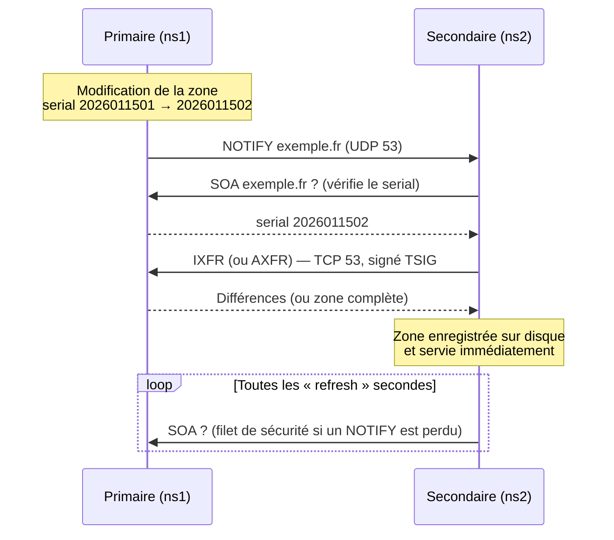

## Principe



| Mécanisme | Rôle |
| --- | --- |
| **NOTIFY** (RFC 1996) | Le primaire prévient immédiatement les secondaires d'un changement |
| **AXFR** | Transfert complet de la zone |
| **IXFR** (RFC 1995) | Transfert incrémental (seulement les différences) — nécessite un journal (zone dynamique, `ixfr-from-differences`) |
| **SOA refresh/retry/expire** | Vérification périodique et durée de vie de la copie si le primaire est injoignable |
| **TSIG** (RFC 8945) | Signature HMAC des transferts et des NOTIFY avec une clé partagée |

## Créer une clé TSIG

```bash
tsig-keygen -a hmac-sha256 xfer-exemple > /etc/bind/keys/xfer-exemple.key
chmod 640 /etc/bind/keys/xfer-exemple.key && chown root:bind /etc/bind/keys/xfer-exemple.key
cat /etc/bind/keys/xfer-exemple.key
```

```named
key "xfer-exemple" {
    algorithm hmac-sha256;
    secret "x8Vq4Kz9mN2pL7rT3wY6bA1cD5eF0gH8iJ2kL4mN6oP=";
};
```

Copiez **le même fichier** sur le primaire et sur chaque secondaire (canal sécurisé : scp, Ansible Vault).

## Configuration du primaire

```named /etc/bind/named.conf.local (primaire ns1 — 10.0.20.53)
include "/etc/bind/keys/xfer-exemple.key";

// Signer tout ce qu'on envoie au secondaire avec la clé
server 10.0.20.54 {
    keys { "xfer-exemple"; };
};

zone "exemple.fr" {
    type primary;
    file "/etc/bind/zones/db.exemple.fr";
    notify yes;
    also-notify { 10.0.20.54; };               // secondaires non listés dans les NS (ou primaire caché)
    allow-transfer { key "xfer-exemple"; };     // seul un détenteur de la clé peut transférer
    ixfr-from-differences yes;                  // calcule des IXFR même pour une zone éditée à la main
};
```

## Configuration du secondaire

```named /etc/bind/named.conf.local (secondaire ns2 — 10.0.20.54)
include "/etc/bind/keys/xfer-exemple.key";

server 10.0.20.53 {
    keys { "xfer-exemple"; };
};

// Liste de primaires réutilisable
primaries "primaires-exemple" {
    10.0.20.53 key "xfer-exemple";
};

zone "exemple.fr" {
    type secondary;
    file "/var/cache/bind/secondary/db.exemple.fr";   // RHEL : "slaves/db.exemple.fr"
    primaries { primaires-exemple; };
    allow-notify { 10.0.20.53; };
    allow-transfer { none; };
};
```

> [!NOTE]
> Depuis BIND 9.9, les zones secondaires sont stockées au **format binaire** (`masterfile-format raw`) pour un chargement plus rapide. Pour lire le fichier : `named-compilezone -f raw -F text -o - exemple.fr /var/cache/bind/secondary/db.exemple.fr`. Pour garder le texte : `masterfile-format text;` dans la zone.

### Vérifier la réplication

```bash
# Comparer les serials
dig @10.0.20.53 exemple.fr SOA +short
dig @10.0.20.54 exemple.fr SOA +short
# État vu par le secondaire
sudo rndc zonestatus exemple.fr
# Forcer un transfert
sudo rndc refresh exemple.fr      # vérifie le serial, transfère si plus récent
sudo rndc retransfer exemple.fr   # transfert complet AXFR inconditionnel
# Envoyer un NOTIFY depuis le primaire
sudo rndc notify exemple.fr
# Tester un transfert à la main avec la clé
dig @10.0.20.53 exemple.fr AXFR -k /etc/bind/keys/xfer-exemple.key
dig @10.0.20.53 exemple.fr AXFR          # sans clé : « Transfer failed. » attendu
```

Journaux attendus (canal `xfer-in` / `xfer-out`) :

```text
zone exemple.fr/IN: Transfer started.
transfer of 'exemple.fr/IN' from 10.0.20.53#53: connected using 10.0.20.54#40213 TSIG xfer-exemple
zone exemple.fr/IN: transferred serial 2026011502: TSIG 'xfer-exemple'
transfer of 'exemple.fr/IN' from 10.0.20.53#53: Transfer completed: 1 messages, 42 records, 1530 bytes, 0.002 secs
```

## Primaire caché (hidden primary)

Le primaire n'apparaît **pas** dans les enregistrements NS : il n'est interrogé que par les secondaires. Avantages : il peut rester dans un réseau protégé, porter la signature DNSSEC et les mises à jour dynamiques, sans être exposé aux requêtes publiques.

```named
zone "exemple.fr" {
    type primary;
    file "/var/lib/bind/db.exemple.fr";
    notify explicit;                              // NOTIFY uniquement vers also-notify (pas vers les NS)
    also-notify { 198.51.100.53 key "xfer-exemple"; 203.0.113.54 key "xfer-exemple"; };
    allow-transfer { key "xfer-exemple"; };
    allow-query { 127.0.0.1; 198.51.100.53; 203.0.113.54; };
};
```

## Zones catalogue (BIND 9.16+, format v2 en 9.18)

Problème : chaque nouvelle zone doit être déclarée sur **tous** les secondaires. Une **zone catalogue** (RFC 9432) est une zone spéciale qui liste les zones membres : les secondaires la transfèrent et créent/suppriment automatiquement les zones.

```named
// Sur le primaire
zone "catalogue.exemple.fr" {
    type primary;
    file "/var/lib/bind/db.catalogue";
    allow-transfer { key "xfer-exemple"; };
    also-notify { 10.0.20.54; };
    allow-update { localhost; };   // pour l'éditer avec nsupdate (ou rndc addzone + catalog-zones)
};
```

```dns /var/lib/bind/db.catalogue
$TTL 3600
@               IN SOA invalid. invalid. ( 1 3600 600 2147483646 0 )
@               IN NS  invalid.
version         IN TXT "2"
; un identifiant unique arbitraire par zone membre
z1.zones        IN PTR exemple.fr.
z2.zones        IN PTR exemple.com.
z3.zones        IN PTR 20.0.10.in-addr.arpa.
```

```named
// Sur chaque secondaire : une seule déclaration pour toutes les zones
options {
    catalog-zones {
        zone "catalogue.exemple.fr"
            default-primaries { 10.0.20.53 key "xfer-exemple"; }
            zone-directory "/var/cache/bind/catalog"
            in-memory no;
    };
};

zone "catalogue.exemple.fr" {
    type secondary;
    file "/var/cache/bind/secondary/db.catalogue";
    primaries { 10.0.20.53 key "xfer-exemple"; };
};
```

Ajouter une zone devient : créer la zone sur le primaire, puis ajouter une ligne `PTR` dans le catalogue (avec incrément du serial ou via `nsupdate`).

```bash
nsupdate -l <<'EOF'
zone catalogue.exemple.fr
update add z4.zones.catalogue.exemple.fr 3600 IN PTR exemple.net.
send
EOF
```

## Ajouter des zones à chaud (rndc addzone)

```named
options { allow-new-zones yes; };
```

```bash
sudo rndc addzone exemple.net '{ type primary; file "/var/lib/bind/db.exemple.net"; };'
sudo rndc showzone exemple.net
sudo rndc delzone exemple.net
```

Les zones ajoutées ainsi sont stockées dans une base `.nzd` (LMDB) du répertoire de travail, pas dans `named.conf`.

## Interopérabilité avec Windows DNS / Active Directory

| Scénario | Configuration |
| --- | --- |
| BIND secondaire d'une zone AD | Sur le DNS Windows : *Propriétés de la zone → Transferts de zone → Autoriser vers les serveurs suivants* (IP du BIND). TSIG n'est **pas** supporté par Windows : filtrez par IP. Côté BIND : `type secondary; primaries { 10.0.10.11; 10.0.10.12; };` |
| Windows secondaire d'une zone BIND | Sur BIND : `allow-transfer { 10.0.10.11; 10.0.10.12; };` (sans clé). Sur Windows : nouvelle zone secondaire → IP du primaire BIND |
| Résolution simple du domaine AD | Préférez une zone `forward` (voir [[03-cache-recursif-forwarders]]) : les enregistrements SRV dynamiques d'AD changent souvent |

## Paramètres de transfert utiles

```named
options {
    transfers-in 20;            // transferts entrants simultanés (défaut 10)
    transfers-out 20;
    transfers-per-ns 4;
    max-transfer-time-in 120;   // minutes
    notify-source 10.0.20.53;   // IP source des NOTIFY (multi-homing)
    transfer-source 10.0.20.54; // IP source des transferts entrants
    serial-query-rate 50;       // requêtes SOA/s des secondaires
    try-tcp-refresh yes;
};
```

> [!WARNING]
> `allow-transfer { any; };` publie l'intégralité de votre zone (noms internes, plan d'adressage). C'est une fuite d'information classique relevée dans les audits : limitez **toujours** les transferts par clé TSIG ou par IP.
