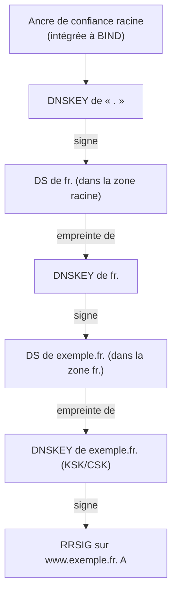

## Concepts

DNSSEC ajoute des **signatures cryptographiques** aux réponses DNS pour garantir leur **authenticité** et leur **intégrité** (pas leur confidentialité). Un résolveur validant rejette (SERVFAIL) une réponse falsifiée.

| Enregistrement | Rôle |
| --- | --- |
| `DNSKEY` | Clés publiques de la zone |
| `RRSIG` | Signature d'un ensemble d'enregistrements (RRset) |
| `DS` | Empreinte de la KSK de la zone fille, publiée **dans la zone parente** |
| `NSEC` / `NSEC3` | Preuve signée de non-existence (NXDOMAIN / NODATA) |
| `CDS` / `CDNSKEY` | Publication par la zone fille de son DS souhaité (automatisation chez le parent, RFC 8078) |

| Clé | Rôle |
| --- | --- |
| **KSK** (*Key Signing Key*) | Signe uniquement le RRset DNSKEY ; son empreinte est le DS publié chez le parent. Roulement rare (chaque année ou jamais). |
| **ZSK** (*Zone Signing Key*) | Signe tous les autres enregistrements. Roulement fréquent (mois). |
| **CSK** (*Combined Signing Key*) | Une seule clé qui joue les deux rôles (politique par défaut de BIND). |

### Chaîne de confiance



## Signer une zone avec dnssec-policy (KASP)

Depuis BIND 9.16, la directive **`dnssec-policy`** automatise tout : génération des clés, signature, re-signature, roulements, publication des CDS/CDNSKEY.

### Politique par défaut

```named
zone "exemple.fr" {
    type primary;
    file "/var/lib/bind/db.exemple.fr";      // dossier inscriptible : BIND écrit la version signée
    dnssec-policy default;
    inline-signing yes;                       // conserve le fichier source intact ; produit db.exemple.fr.signed
    key-directory "/var/lib/bind/keys";
};
```

La politique `default` : **une CSK ECDSAP256SHA256** sans roulement automatique, NSEC, signatures valides 14 jours, re-signées tous les 5 jours.

> [!NOTE]
> En **BIND 9.20**, `inline-signing` devient une option de `dnssec-policy` (activée par défaut pour les zones non dynamiques). La directive au niveau de la zone reste acceptée en 9.18.

### Politique personnalisée

```named /etc/bind/named.conf.options
dnssec-policy "standard" {
    keys {
        ksk key-directory lifetime unlimited algorithm ecdsap256sha256;
        zsk key-directory lifetime P90D algorithm ecdsap256sha256;
    };
    dnskey-ttl PT1H;
    max-zone-ttl P1D;
    publish-safety PT1H;
    retire-safety PT1H;
    purge-keys P90D;
    signatures-refresh P5D;
    signatures-validity P14D;
    signatures-validity-dnskey P14D;
    zone-propagation-delay PT5M;
    parent-ds-ttl P1D;
    parent-propagation-delay PT1H;
    nsec3param iterations 0 optout no salt-length 0;   // NSEC3 selon la RFC 9276
    // cdnskey yes; cds-digest-types { 2; };          // 9.18.x+ : contrôle des CDS publiés
};
```

| Paramètre | Signification |
| --- | --- |
| `lifetime` | Durée de vie d'une clé avant roulement automatique (`unlimited` = pas de roulement) |
| `algorithm` | `ecdsap256sha256` (13) recommandé ; `ed25519` (15) ; `rsasha256` (8) pour compatibilité |
| `max-zone-ttl` | TTL maximal autorisé dans la zone (utilisé pour calculer les délais de roulement) |
| `*-safety`, `*-propagation-delay` | Marges de sécurité pour les caches lors des roulements |
| `nsec3param` | Active NSEC3 au lieu de NSEC (empêche l'énumération triviale de la zone) |

> [!TIP]
> La RFC 9276 recommande **0 itération et pas de sel** pour NSEC3 : les itérations n'apportent quasiment pas de sécurité et coûtent cher aux résolveurs (BIND 9.18+ refuse de valider au-delà de 150 itérations).

## Publier le DS chez le registre

```bash
# Afficher le DS à transmettre (SHA-256 = digest type 2)
sudo rndc dnssec -status exemple.fr
dig @localhost exemple.fr DNSKEY +multi | grep -i "key id"
dig @localhost exemple.fr CDS +short           # BIND publie le DS souhaité
# Ou à partir du fichier de clé
dnssec-dsfromkey -2 /var/lib/bind/keys/Kexemple.fr.+013+12345.key
```

1. Dans l'interface du **registraire** (OVH, Gandi, Afnic via bureau d'enregistrement…), ajouter le DS (*key tag*, algorithme 13, type de condensé 2, condensé) ou la DNSKEY selon ce qui est demandé.
2. Attendre la publication dans la zone parente : `dig fr. DS` → `dig exemple.fr DS @d.nic.fr`.
3. Informer BIND que le DS est publié pour qu'il poursuive les roulements :

```bash
sudo rndc dnssec -checkds published exemple.fr
# ou automatiquement : BIND interroge les serveurs du parent si « parental-agents » est défini
```

```named
zone "exemple.fr" {
    ...
    parental-agents { 192.134.4.1; };   // serveurs à interroger pour vérifier le DS (exemple)
    checkds explicit;
};
```

> [!CAUTION]
> Ne **supprimez jamais** une clé, ne changez pas d'algorithme et ne désactivez pas DNSSEC sans procédure : si le DS publié chez le parent ne correspond plus à aucune DNSKEY, **toute la zone devient injoignable** (SERVFAIL) pour les résolveurs validants pendant le TTL du DS.

### Désactiver DNSSEC proprement

1. Retirer le DS chez le registraire.
2. Attendre l'expiration du TTL du DS (souvent 1 jour) + marge.
3. Remplacer `dnssec-policy standard;` par `dnssec-policy insecure;` (BIND retire les clés progressivement), puis `none` une fois les clés retirées.

## Roulements de clés

Avec `dnssec-policy`, les roulements de ZSK sont **entièrement automatiques** (pré-publication). Le roulement de KSK nécessite la mise à jour du DS chez le parent (automatique si le registre supporte CDS/CDNSKEY, sinon manuel).

```bash
sudo rndc dnssec -status exemple.fr            # état de chaque clé et prochaine action
sudo rndc dnssec -rollover -key 12345 exemple.fr   # forcer un roulement
sudo rndc signing -list exemple.fr             # clés utilisées pour signer
```

## Zones dynamiques signées

Une zone avec `allow-update` / `update-policy` et `dnssec-policy` est signée directement (sans `inline-signing`) : chaque mise à jour `nsupdate` ou DHCP est signée à la volée.

## Validation côté résolveur

```named
options {
    dnssec-validation auto;       // utilise l'ancre de la racine intégrée (et la met à jour, RFC 5011)
};
```

| Valeur | Effet |
| --- | --- |
| `auto` | Valide avec l'ancre de confiance de la racine intégrée — **recommandé** |
| `yes` | Valide uniquement avec les ancres déclarées dans `trust-anchors` |
| `no` | Pas de validation |

Ancre de confiance pour un domaine interne signé, non délégué depuis Internet :

```named
trust-anchors {
    "corp.interne." initial-ds 34567 13 2 "A1B2C3...";
};
```

Exceptions (domaines dont la signature est cassée et que vous ne contrôlez pas) :

```bash
sudo rndc nta -lifetime 1d domaine-casse.fr     # Negative Trust Anchor temporaire
sudo rndc nta -dump
```

## Diagnostic

```bash
dig @localhost exemple.fr SOA +dnssec +multi        # RRSIG présentes ?
dig @9.9.9.9 exemple.fr A +dnssec | grep flags      # « ad » = validé par un résolveur public
delv @localhost www.exemple.fr A                    # « ; fully validated »
delv @localhost www.exemple.fr A +rtrace +vtrace    # trace détaillée de la validation
dig exemple.fr DS +trace                            # DS chez le parent
dig +cd @9.9.9.9 www.exemple.fr                     # contourne la validation : si ça répond avec +cd mais SERVFAIL sans → problème DNSSEC
```

Outils en ligne : **DNSViz** (graphe de la chaîne de confiance), Verisign DNSSEC Debugger, Zonemaster (Afnic).

| Symptôme | Cause probable |
| --- | --- |
| SERVFAIL partout, OK avec `+cd` | DS chez le parent ne correspond à aucune DNSKEY, signatures expirées |
| Signatures expirées | `named` arrêté longtemps, horloge système fausse (vérifier NTP !), répertoire non inscriptible |
| `ad` absent mais réponse OK | Zone non signée ou résolveur non validant |
| Erreurs « no valid signature found » dans les journaux | Problème chez la zone distante ou résolveur intermédiaire qui supprime les RRSIG |

> [!IMPORTANT]
> L'**heure système** est critique pour DNSSEC : une horloge décalée de quelques heures rend les signatures « pas encore valides » ou « expirées ». Synchronisez tous les serveurs DNS en NTP.
