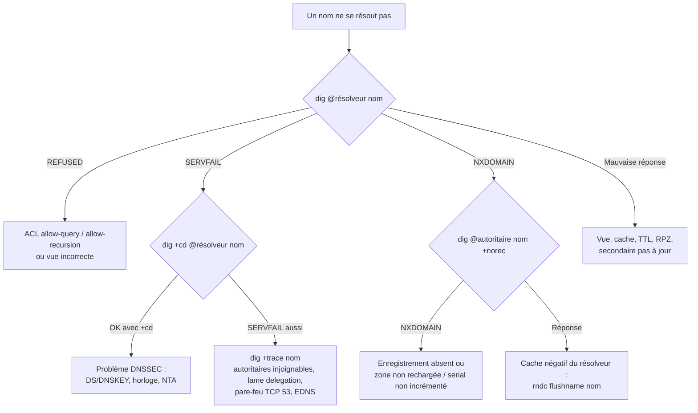

## rndc — contrôle à chaud

| Commande | Effet |
| --- | --- |
| `rndc status` | Version, nombre de zones, requêtes récursives en cours, état |
| `rndc reload` | Recharge `named.conf` et toutes les zones modifiées |
| `rndc reload <zone> [classe [vue]]` | Recharge une zone |
| `rndc reconfig` | Recharge la configuration et les **nouvelles** zones uniquement |
| `rndc refresh <zone>` | Secondaire : vérifie le SOA du primaire |
| `rndc retransfer <zone>` | Secondaire : force un AXFR |
| `rndc notify <zone>` | Primaire : renvoie un NOTIFY |
| `rndc zonestatus <zone>` | Détail d'une zone (serial, fichiers, dynamique, signée, timers) |
| `rndc freeze` / `thaw [<zone>]` | Suspendre / reprendre les mises à jour dynamiques (édition manuelle) |
| `rndc sync [-clean] [<zone>]` | Écrire le journal dans le fichier de zone |
| `rndc flush [<vue>]` | Vider le cache |
| `rndc flushname <nom>` / `flushtree <nom>` | Vider un nom / un sous-arbre du cache |
| `rndc dumpdb [-all\|-cache\|-zones]` | Exporter le cache / les zones dans `named_dump.db` |
| `rndc stats` | Écrire les statistiques dans `named.stats` |
| `rndc querylog [on\|off]` | Activer / désactiver la journalisation des requêtes |
| `rndc trace [niveau]` / `notrace` | Niveau de débogage |
| `rndc addzone` / `delzone` / `modzone` / `showzone` | Gestion des zones à chaud (`allow-new-zones yes`) |
| `rndc dnssec -status <zone>` | État des clés DNSSEC |
| `rndc dnssec -rollover -key <id> <zone>` | Forcer un roulement |
| `rndc dnssec -checkds published\|withdrawn <zone>` | Signaler la publication du DS |
| `rndc signing -list <zone>` | Clés de signature |
| `rndc nta <domaine>` | Ancre de confiance négative (ignorer DNSSEC temporairement) |
| `rndc secroots` | Ancres de confiance chargées |
| `rndc recursing` | Liste des requêtes récursives en cours (`named.recursing`) |
| `rndc tsig-list` | Clés TSIG chargées |
| `rndc validation [on\|off\|status]` | Activer / désactiver la validation DNSSEC |
| `rndc stop` / `halt` | Arrêter (stop enregistre les journaux, halt non) |

> [!TIP]
> `rndc` peut piloter un serveur distant : `rndc -s 10.0.20.54 -k /etc/bind/rndc-ns2.key status` (ouvrir `controls` sur cette IP avec une clé dédiée et un filtrage strict).

## Journalisation

Par défaut BIND journalise dans **syslog** (journal systemd). Une configuration dédiée facilite l'exploitation :

```named /etc/bind/named.conf.logging
logging {
    channel general_log {
        file "/var/log/named/general.log" versions 10 size 50m;
        severity info;
        print-time yes;
        print-severity yes;
        print-category yes;
    };
    channel query_log {
        file "/var/log/named/queries.log" versions 10 size 200m;
        severity info;
        print-time yes;
    };
    channel security_log {
        file "/var/log/named/security.log" versions 5 size 20m;
        severity dynamic;
        print-time yes;
        print-category yes;
    };
    channel xfer_log {
        file "/var/log/named/xfer.log" versions 5 size 20m;
        severity info;
        print-time yes;
    };
    channel dnssec_log {
        file "/var/log/named/dnssec.log" versions 5 size 20m;
        severity info;
        print-time yes;
    };

    category default        { general_log; };
    category general        { general_log; };
    category config         { general_log; };
    category queries        { query_log; };
    category query-errors   { query_log; };
    category security       { security_log; };
    category client         { security_log; };
    category update         { security_log; };
    category update-security{ security_log; };
    category rate-limit     { security_log; };
    category rpz            { security_log; };
    category xfer-in        { xfer_log; };
    category xfer-out       { xfer_log; };
    category notify         { xfer_log; };
    category dnssec         { dnssec_log; };
    category lame-servers   { null; };     // bruit inutile
    category edns-disabled  { null; };
};
```

```bash
sudo mkdir -p /var/log/named && sudo chown bind:bind /var/log/named   # RHEL : named:named
# AppArmor (Debian/Ubuntu) : autoriser l'écriture
echo '/var/log/named/** rw,' | sudo tee -a /etc/apparmor.d/local/usr.sbin.named
sudo systemctl reload apparmor
```

| Sévérité | Usage |
| --- | --- |
| `critical`, `error`, `warning`, `notice`, `info` | Niveaux syslog classiques |
| `debug [n]` | Débogage de niveau n |
| `dynamic` | Suit le niveau fixé par `rndc trace` |

| Catégorie | Contenu |
| --- | --- |
| `queries` | Chaque requête reçue (si `querylog yes` ou `rndc querylog on`) |
| `query-errors` | Requêtes en échec (SERVFAIL…) avec la raison |
| `security` | Requêtes refusées (ACL) |
| `xfer-in` / `xfer-out` / `notify` | Transferts de zone |
| `update` / `update-security` | Mises à jour dynamiques acceptées / refusées |
| `dnssec` | Signature, validation, clés |
| `lame-servers` | Délégations incorrectes chez des tiers (bruyant) |
| `resolver` | Problèmes de résolution récursive |

> [!WARNING]
> La journalisation de toutes les requêtes (`queries`) sur un résolveur chargé produit des **gigaoctets par jour** et coûte en performances. Activez-la ponctuellement (`rndc querylog on`) ou utilisez **dnstap** vers un collecteur.

## Aide-mémoire dig

```bash
dig www.exemple.fr                          # requête A via le résolveur du système
dig @10.0.20.53 www.exemple.fr AAAA         # serveur et type précis
dig exemple.fr MX +short                    # réponse brève
dig -x 10.0.20.10                           # inverse (PTR)
dig exemple.fr SOA +norec @ns1.exemple.fr   # sans récursion : le serveur fait-il autorité ? (drapeau aa)
dig www.exemple.fr +trace                   # résolution itérative depuis la racine
dig exemple.fr NS +nssearch                 # SOA de chaque NS : serials identiques ?
dig exemple.fr AXFR @ns1 -k cle.key         # transfert de zone
dig www.exemple.fr +dnssec +multi           # enregistrements DNSSEC
dig www.exemple.fr +tcp                     # forcer TCP
dig www.exemple.fr +noedns / +bufsize=512   # tester la compatibilité EDNS
dig +nocmd +noall +answer +ttlid www.exemple.fr   # sortie compacte avec TTL
dig @10.0.20.53 +stats +time=2 +tries=1 www.exemple.fr   # temps de réponse, délai court
dig -f liste.txt +short                      # requêtes en lot
```

```bash
delv www.exemple.fr                          # validation DNSSEC détaillée
host -t SRV _ldap._tcp.corp.local            # client simple
nslookup -type=SOA exemple.fr 10.0.20.53     # Windows / multiplateforme
named-checkconf -pz                          # affiche la configuration effective normalisée
```

## Méthode de diagnostic



## Erreurs fréquentes

| Message | Cause | Solution |
| --- | --- | --- |
| `zone exemple.fr/IN: not loaded due to errors` | Erreur dans le fichier de zone | `named-checkzone` et lire la ligne indiquée |
| `has no NS records` / `has no SOA record` | Zone incomplète | Ajouter SOA + NS au sommet |
| `CNAME and other data` | CNAME sur un nom portant d'autres types | Remplacer par un A ou renommer |
| `ignoring out-of-zone data` | Enregistrement hors de la zone (point final oublié ou en trop) | Vérifier les noms absolus/relatifs |
| `zone serial unchanged. zone may fail to transfer to secondaries` | Fichier modifié sans incrément du serial | Incrémenter le serial |
| `refused notify from non-primary` | `allow-notify` / `primaries` incohérents | Ajouter l'IP source du NOTIFY |
| `Transfer failed: REFUSED` / `NOTAUTH` | `allow-transfer` ou clé TSIG incorrecte | Vérifier la clé des deux côtés, l'IP source |
| `bad zone transfer request: … zone not loaded` | Zone en erreur sur le primaire | Corriger le primaire |
| `permission denied` | Droits/AppArmor/SELinux sur le fichier ou le dossier | `ls -lZ`, `aa-status`, `ausearch -m avc` |
| `address already in use` | Autre service sur le port 53 (systemd-resolved, dnsmasq) | `ss -lntup 'sport = :53'` |
| `no valid RRSIG resolving …` / `broken trust chain` | Échec de validation DNSSEC | Voir [[07-dnssec]], `rndc nta` si zone tierce cassée |
| `lame server resolving …` | Délégation incorrecte chez un tiers | Ignorer (`category lame-servers { null; }`) |
| `clients-per-query increased` / `recursive-clients soft limit exceeded` | Charge élevée ou attaque | Augmenter les limites, chercher la source |
| `timed out resolving` avec forwarders | Redirecteurs injoignables ou filtrant EDNS/TCP | Tester `dig @forwarder +dnssec +tcp` |

## Commandes système utiles

```bash
ss -lntup | grep -E ':53|:853|:953'          # écoutes
sudo tcpdump -ni any port 53 -vv              # capture des échanges DNS
sudo journalctl -u named --since "10 min ago"
sudo named -g -d 3 -u bind                     # lancer au premier plan en mode debug (service arrêté)
```

## Sauvegarde

À sauvegarder : `/etc/bind` (ou `/etc/named*`), les zones dynamiques **après** `rndc sync`, le dossier des clés DNSSEC (`key-directory`, **critique** : sans les clés privées, la zone signée devient invalide), et la base `.nzd` si `rndc addzone` est utilisé.
