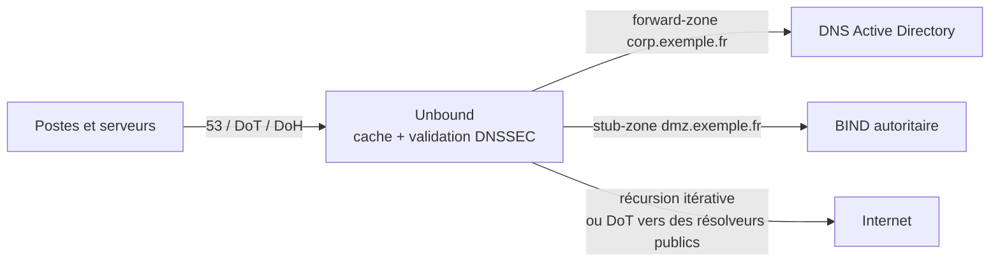

**Unbound**, développé par **NLnet Labs**, est un résolveur DNS **récursif, cache et validant DNSSEC**. Il ne fait **pas** serveur autoritaire complet (pas de transferts de zone sortants, pas de mises à jour dynamiques) : il se concentre sur la résolution, avec un code compact, rapide et sûr. C'est le résolveur par défaut de FreeBSD, OPNsense, pfSense, et le moteur de nombreux services DNS publics et filtrants.

## Où le placer ?



| Besoin | Outil adapté |
| --- | --- |
| Résolveur récursif interne, rapide et validant | **Unbound** |
| Serveur autoritaire (zones, primaire/secondaire, DNSSEC signé) | [[01-bind9/01-presentation\|BIND9]], [[04-powerdns/01-presentation\|PowerDNS]], NSD, Knot |
| DNS + DHCP + PXE léger pour petit réseau | [[03-dnsmasq/01-presentation-installation\|dnsmasq]] |
| Filtrage publicitaire avec interface | Pi-hole ou AdGuard Home (souvent couplés à Unbound) |

## Unbound face à BIND (en résolveur)

| Critère | Unbound | BIND (récursif) |
| --- | --- | --- |
| Périmètre | Résolveur uniquement | Résolveur + autoritaire |
| Empreinte, surface d'attaque | Réduites | Plus large |
| DNSSEC | Validation activée en quelques lignes | Idem (`dnssec-validation auto`) |
| DoT / DoH en écoute | Oui (DoH depuis 1.12) | Oui (9.18+) |
| RPZ | Oui (1.10+) | Oui |
| Zones locales simples | `local-zone` / `local-data` | Zones complètes |
| Vues | Oui (`view:`) | Oui |

## Installation

### Debian / Ubuntu

```bash
sudo apt install unbound unbound-anchor dns-root-data
systemctl status unbound
```

> [!WARNING]
> Sur Ubuntu, `systemd-resolved` occupe déjà `127.0.0.53:53`. Unbound écoute par défaut sur `127.0.0.1` : pas de conflit, mais pour en faire le résolveur du serveur lui-même, désactivez le *stub listener* (`DNSStubListener=no` dans `/etc/systemd/resolved.conf`) et pointez `/etc/resolv.conf` vers `127.0.0.1`.

### RHEL / Rocky / Alma

```bash
sudo dnf install unbound
sudo systemctl enable --now unbound
sudo firewall-cmd --permanent --add-service=dns && sudo firewall-cmd --reload
```

### Windows

NLnet Labs publie un installateur Windows (`unbound-<version>-setup_64.exe`) : il installe le service **Unbound** dans `C:\Program Files\Unbound\` avec `service.conf`.

```powershell
Get-Service unbound
& "C:\Program Files\Unbound\unbound-checkconf.exe" "C:\Program Files\Unbound\service.conf"
New-NetFirewallRule -DisplayName "Unbound DNS" -Direction Inbound -Protocol UDP -LocalPort 53 -Action Allow -RemoteAddress 10.0.0.0/8
New-NetFirewallRule -DisplayName "Unbound DNS TCP" -Direction Inbound -Protocol TCP -LocalPort 53 -Action Allow -RemoteAddress 10.0.0.0/8
```

### macOS

```bash
brew install unbound
sudo brew services start unbound        # configuration : $(brew --prefix)/etc/unbound/unbound.conf
```

### Docker

```bash
docker run -d --name unbound --restart unless-stopped -p 53:53/udp -p 53:53/tcp \
  -v /srv/unbound/unbound.conf:/opt/unbound/etc/unbound/unbound.conf:ro \
  mvance/unbound:latest
```

## Fichiers (Linux)

| Élément | Debian / Ubuntu | RHEL |
| --- | --- | --- |
| Configuration | `/etc/unbound/unbound.conf` + `unbound.conf.d/*.conf` | `/etc/unbound/unbound.conf` + `conf.d/`, `local.d/` |
| Ancre DNSSEC de la racine | `/var/lib/unbound/root.key` | `/var/lib/unbound/root.key` |
| Indications de racine | `/usr/share/dns/root.hints` (paquet dns-root-data) | intégrées |
| Clés de contrôle | `/etc/unbound/unbound_server.key`, `unbound_control.key` | idem |

```bash
sudo unbound-anchor -a /var/lib/unbound/root.key      # créer / mettre à jour l'ancre (RFC 5011)
sudo unbound-control-setup                            # générer les clés du canal de contrôle
```

## Structure de la configuration

Le fichier est découpé en **clauses** (`server:`, `remote-control:`, `forward-zone:`, `stub-zone:`, `auth-zone:`, `view:`, `rpz:`), suivies d'options indentées `nom: valeur`.

```unbound /etc/unbound/unbound.conf.d/resolveur.conf
server:
    interface: 0.0.0.0
    interface: ::0
    access-control: 127.0.0.0/8 allow
    access-control: 10.0.0.0/8 allow
    access-control: 0.0.0.0/0 refuse
    auto-trust-anchor-file: "/var/lib/unbound/root.key"
    hide-identity: yes
    hide-version: yes

remote-control:
    control-enable: yes
    control-interface: 127.0.0.1
```

```bash
sudo unbound-checkconf                       # « no errors in /etc/unbound/unbound.conf »
sudo systemctl restart unbound
dig @127.0.0.1 www.nlnetlabs.nl +dnssec | grep flags      # « ad » attendu
dig @127.0.0.1 dnssec-failed.org                          # SERVFAIL attendu (signature volontairement cassée)
```

## Suite du parcours

1. [[02-resolveur-dnssec|Résolveur, cache, DNSSEC et performances]]
2. [[03-zones-locales-redirections|Zones locales, redirections, RPZ et vues]]
3. [[04-dot-doh-securite|DNS over TLS / HTTPS et sécurité]]
4. [[05-exploitation-unbound-control|Exploitation avec unbound-control et dépannage]]
