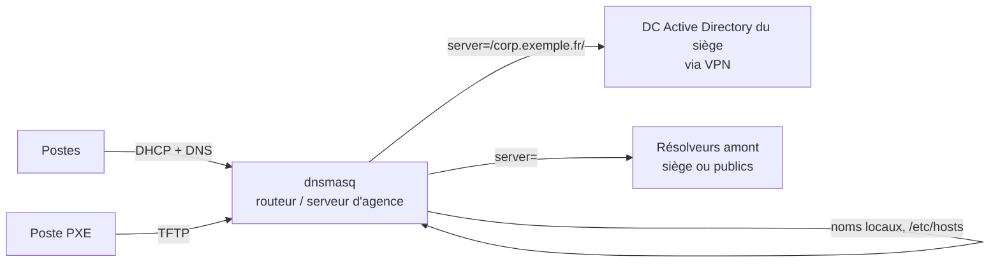

**dnsmasq** est un petit serveur tout-en-un qui fournit **DNS** (cache, relais, noms locaux), **DHCP** (IPv4, IPv6, annonces de routeur) et **TFTP** pour le démarrage réseau **PXE**. Il équipe une immense quantité de box, routeurs (OpenWrt), pare-feu, hyperviseurs (libvirt), et sert d'outil rapide pour les laboratoires et les petits sites.

## Cas d'usage

| Usage | Pourquoi dnsmasq |
| --- | --- |
| Petit site / agence sans Active Directory | DNS + DHCP en un seul service, configuration de quelques lignes |
| Laboratoire, maquettes, réseaux de test | Noms locaux depuis `/etc/hosts`, DHCP immédiat |
| **Serveur PXE** à côté d'un DHCP existant | Mode **proxy DHCP** : il ne fournit que les informations de démarrage |
| Cache DNS local d'un serveur ou d'un poste | Léger, configuration simple |
| Développement (macOS) | Résoudre `*.test` vers `127.0.0.1` |
| Réseaux de virtualisation | libvirt, Proxmox (SDN) l'utilisent en interne |

## Limites

| Limite | Alternative |
| --- | --- |
| Pas de récursion complète (il **relaie** vers des résolveurs amont) | [[02-unbound/01-presentation-installation\|Unbound]], [[01-bind9/01-presentation\|BIND]] |
| Pas de zones autoritaires complètes ni de transferts de zone | BIND, [[04-powerdns/01-presentation\|PowerDNS]] |
| Pas de failover DHCP entre deux serveurs | [[01-isc-dhcp/06-failover\|ISC DHCP]], Kea, DHCP Windows |
| Volumétrie importante | Résolveur et DHCP dédiés |

## Architecture d'une petite agence



## Installation

### Debian / Ubuntu

```bash
sudo apt install dnsmasq
systemctl status dnsmasq
```

> [!WARNING]
> Sur Ubuntu (et de nombreuses distributions de bureau), **systemd-resolved** écoute sur `127.0.0.53:53` et **NetworkManager** peut lancer sa propre instance de dnsmasq. Pour un dnsmasq serveur :
> ```bash
> sudo sed -i 's/^#\?DNSStubListener=.*/DNSStubListener=no/' /etc/systemd/resolved.conf
> sudo systemctl restart systemd-resolved
> sudo ln -sf /run/systemd/resolve/resolv.conf /etc/resolv.conf
> ```
> ou bien faire écouter dnsmasq uniquement sur l'interface du réseau servi (`interface=` + `bind-interfaces`).

### RHEL / Rocky / Alma

```bash
sudo dnf install dnsmasq
sudo systemctl enable --now dnsmasq
sudo firewall-cmd --permanent --add-service=dns --add-service=dhcp --add-service=tftp && sudo firewall-cmd --reload
```

### macOS (développement)

```bash
brew install dnsmasq
echo 'address=/test/127.0.0.1' >> $(brew --prefix)/etc/dnsmasq.conf
sudo brew services start dnsmasq
sudo mkdir -p /etc/resolver && echo "nameserver 127.0.0.1" | sudo tee /etc/resolver/test
scutil --dns | grep -A3 "domain   : test"
ping -c1 monprojet.test         # → 127.0.0.1
```

Le fichier `/etc/resolver/<domaine>` de macOS redirige un domaine précis vers un serveur, sans toucher au DNS du système.

### Windows

Pas de version native : utiliser WSL2, Docker ou une VM. Sous Windows, les rôles **DNS** et **DHCP** intégrés jouent ce rôle.

### Docker

```bash
docker run -d --name dnsmasq --restart unless-stopped --network host --cap-add NET_ADMIN \
  -v /srv/dnsmasq/dnsmasq.conf:/etc/dnsmasq.conf:ro \
  -v /srv/dnsmasq/dnsmasq.d:/etc/dnsmasq.d:ro \
  dockurr/dnsmasq
```

Le **réseau hôte** est indispensable pour le DHCP (diffusions).

## Fichiers

| Élément | Debian / Ubuntu | RHEL |
| --- | --- | --- |
| Configuration | `/etc/dnsmasq.conf` + `/etc/dnsmasq.d/*.conf` | `/etc/dnsmasq.conf` + `/etc/dnsmasq.d/` |
| Baux DHCP | `/var/lib/misc/dnsmasq.leases` | `/var/lib/dnsmasq/dnsmasq.leases` |
| Noms locaux | `/etc/hosts` (+ `addn-hosts=`) | idem |
| Options par défaut | `/etc/default/dnsmasq` | — |

La configuration est une liste d'options `clé=valeur` (les mêmes que les options en ligne de commande `--clé=valeur`). Une option peut être répétée.

```bash
sudo dnsmasq --test                  # « dnsmasq: syntax check OK. »
sudo systemctl restart dnsmasq       # la configuration n'est relue qu'au redémarrage
```

## Configuration de départ (petit réseau)

```ini /etc/dnsmasq.d/agence.conf
# Interface servie
interface=ens224
bind-interfaces
listen-address=127.0.0.1

# DNS
domain-needed
bogus-priv
no-resolv
server=10.0.10.53
server=10.0.10.54
domain=agence.exemple.fr
local=/agence.exemple.fr/
expand-hosts
cache-size=10000

# DHCP
dhcp-authoritative
dhcp-range=192.168.30.100,192.168.30.199,255.255.255.0,12h
dhcp-option=option:router,192.168.30.1
dhcp-option=option:ntp-server,192.168.30.1
```

## Suite du parcours

1. [[02-dns|DNS : cache, relais, noms locaux, filtrage]]
2. [[03-dhcp|DHCP : plages, réservations, options, étiquettes, IPv6]]
3. [[04-pxe-tftp|PXE et TFTP (y compris proxy DHCP et iPXE)]]
4. [[05-exploitation-depannage|Exploitation et dépannage]]
