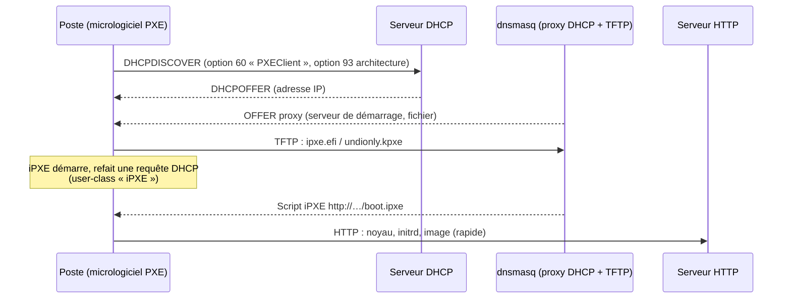

## Principe du démarrage PXE



## Serveur TFTP intégré

```ini /etc/dnsmasq.d/pxe.conf
enable-tftp
tftp-root=/srv/tftp
tftp-secure                    # ne servir que les fichiers appartenant à l'utilisateur de dnsmasq
tftp-no-blocksize              # (à retirer si les clients supportent l'option blksize : plus rapide)
```

```bash
sudo mkdir -p /srv/tftp && sudo chown dnsmasq: /srv/tftp      # Debian : utilisateur « dnsmasq »
sudo apt install ipxe pxelinux syslinux-common
sudo cp /usr/lib/ipxe/{undionly.kpxe,ipxe.efi} /srv/tftp/
```

## Cas 1 : dnsmasq est aussi le serveur DHCP

```ini
dhcp-range=192.168.30.100,192.168.30.199,12h

# Détection de l'architecture (option 93)
dhcp-match=set:bios,option:client-arch,0
dhcp-match=set:efi-x86_64,option:client-arch,7
dhcp-match=set:efi-x86_64,option:client-arch,9
dhcp-match=set:efi-arm64,option:client-arch,11
dhcp-userclass=set:ipxe,iPXE

# 1er passage : charger iPXE selon l'architecture
dhcp-boot=tag:bios,tag:!ipxe,undionly.kpxe
dhcp-boot=tag:efi-x86_64,tag:!ipxe,ipxe.efi
dhcp-boot=tag:efi-arm64,tag:!ipxe,ipxe-arm64.efi
# 2e passage (iPXE) : script HTTP
dhcp-boot=tag:ipxe,http://deploiement.agence.exemple.fr/boot.ipxe
```

| `client-arch` (option 93) | Plateforme |
| --- | --- |
| 0 | BIOS x86 |
| 6 | UEFI IA32 |
| 7 / 9 | UEFI x64 |
| 10 / 11 | UEFI ARM 32 / 64 bits |
| 16 | UEFI HTTP Boot x64 |

## Cas 2 : proxy DHCP à côté d'un DHCP existant

Le DHCP en place (Windows Server, ISC DHCP, box, pare-feu) **continue d'attribuer les adresses** ; dnsmasq ne répond qu'aux clients PXE avec les informations de démarrage. Aucune modification du DHCP existant (pas d'options 66/67).

```ini /etc/dnsmasq.d/proxy-pxe.conf
port=0                                   # désactiver la partie DNS
dhcp-range=192.168.30.0,proxy            # mode proxy sur ce réseau
log-dhcp

dhcp-userclass=set:ipxe,iPXE
dhcp-match=set:efi-x86_64,option:client-arch,7
dhcp-match=set:efi-x86_64,option:client-arch,9

pxe-prompt="Démarrage réseau",3
pxe-service=tag:!ipxe,x86PC,"iPXE (BIOS)",undionly.kpxe
pxe-service=tag:!ipxe,x86-64_EFI,"iPXE (UEFI)",ipxe.efi
pxe-service=tag:ipxe,x86PC,"Menu",http://deploiement.agence.exemple.fr/boot.ipxe
pxe-service=tag:ipxe,x86-64_EFI,"Menu",http://deploiement.agence.exemple.fr/boot.ipxe

enable-tftp
tftp-root=/srv/tftp
```

> [!NOTE]
> Le mode proxy repose sur les **diffusions** : dnsmasq doit être sur le même segment que les postes, ou le relais DHCP du VLAN doit **aussi** pointer vers lui (`ip helper-address <IP dnsmasq>` en plus du serveur DHCP principal).

## Menu iPXE

```text /var/www/deploiement/boot.ipxe
#!ipxe
dhcp
set base http://deploiement.agence.exemple.fr

menu Démarrage réseau - Exemple
item debian   Installer Debian 12 (préconfiguré)
item rocky    Installer Rocky Linux 9 (kickstart)
item winpe    Windows PE (déploiement Windows)
item netboot  netboot.xyz (outils et distributions)
item shell    Shell iPXE
item local    Démarrer sur le disque local
choose --default local --timeout 15000 cible && goto ${cible}

:debian
kernel ${base}/debian/linux auto=true priority=critical url=${base}/debian/preseed.cfg
initrd ${base}/debian/initrd.gz
boot

:rocky
kernel ${base}/rocky9/vmlinuz inst.repo=${base}/rocky9/ inst.ks=${base}/rocky9/ks.cfg ip=dhcp
initrd ${base}/rocky9/initrd.img
boot

:winpe
kernel ${base}/wimboot
initrd ${base}/winpe/BCD         BCD
initrd ${base}/winpe/boot.sdi    boot.sdi
initrd ${base}/winpe/boot.wim    boot.wim
boot

:netboot
chain --autofree https://boot.netboot.xyz

:shell
shell

:local
sanboot --no-describe --drive 0x80 || exit
```

Les fichiers sont servis par un simple serveur HTTP ([[03-nginx/03-server-blocks-locations|Nginx]], Apache) : bien plus rapide que TFTP pour les images volumineuses.

## Démarrage PXELINUX classique (BIOS)

```bash
sudo cp /usr/lib/PXELINUX/pxelinux.0 /usr/lib/syslinux/modules/bios/{ldlinux.c32,menu.c32,libutil.c32} /srv/tftp/
sudo mkdir -p /srv/tftp/pxelinux.cfg
```

```text /srv/tftp/pxelinux.cfg/default
DEFAULT menu.c32
PROMPT 0
TIMEOUT 100
MENU TITLE Démarrage réseau
LABEL local
  MENU LABEL Disque local
  LOCALBOOT 0
LABEL debian
  MENU LABEL Installer Debian 12
  KERNEL debian/linux
  APPEND initrd=debian/initrd.gz auto=true priority=critical url=http://deploiement.agence.exemple.fr/debian/preseed.cfg
```

## Coexistence avec WDS / MECM

Pour le déploiement Windows, **WDS** ou **MECM (SCCM)** font souvent office de serveur PXE. dnsmasq peut :

- chaîner vers WDS : `pxe-service=x86-64_EFI,"WDS",boot\\x64\\wdsmgfw.efi,10.0.10.40` (le serveur TFTP désigné est alors WDS) ;
- ou proposer **wimboot + WinPE** depuis iPXE (menu ci-dessus), indépendamment de WDS.

## Dépannage PXE

```bash
sudo journalctl -u dnsmasq -f            # avec log-dhcp : architecture détectée, tags, fichier proposé
sudo tcpdump -ni ens224 port 67 or port 68 or port 69 or port 4011 -vv
tftp 192.168.30.2 -c get ipxe.efi        # tester le TFTP depuis un autre poste (paquet tftp-hpa)
```

| Symptôme | Cause |
| --- | --- |
| `PXE-E53: No boot filename received` | Aucune offre PXE : dnsmasq absent du segment / relais, tag d'architecture non reconnu |
| Le poste UEFI reçoit le fichier BIOS | `client-arch` mal détecté (vérifier dans `log-dhcp`) |
| `TFTP open timeout` / `PXE-E32` | Pare-feu UDP 69 (et ports dynamiques de données), `tftp-root`, droits (`tftp-secure`) |
| Boucle iPXE (recharge iPXE indéfiniment) | Pas de distinction `tag:ipxe` : le 2e passage doit recevoir le script, pas `ipxe.efi` |
| Secure Boot refuse iPXE | Binaire iPXE non signé : utiliser **shim + GRUB signés** des distributions, ou désactiver Secure Boot pour le déploiement |
| Lenteur extrême | Gros fichiers en TFTP : passer en HTTP via iPXE |
