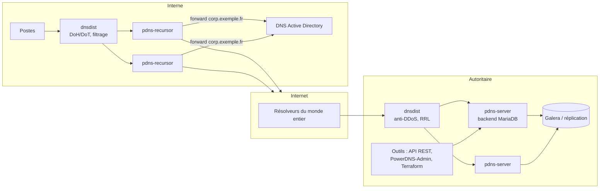

**PowerDNS** est une suite DNS open source (éditée par Open-Xchange) composée de **trois produits distincts** :

| Produit | Paquet | Rôle |
| --- | --- | --- |
| **PowerDNS Authoritative Server** | `pdns-server` | Serveur **autoritaire** : les zones sont stockées dans un **backend** (MySQL/MariaDB, PostgreSQL, fichiers BIND, LMDB, SQLite…) et pilotables par une **API REST** |
| **PowerDNS Recursor** | `pdns-recursor` | **Résolveur** récursif validant DNSSEC, scriptable en Lua, RPZ |
| **dnsdist** | `dnsdist` | **Répartiteur de charge et pare-feu DNS** : devant des autoritaires ou des résolveurs, limitation de débit, DoT/DoH, routage par règles |

Contrairement à BIND, autoritaire et récursif sont **deux logiciels séparés** : on ne les mélange pas dans un même processus.

## Architecture type

## Points forts

| Atout | Détail |
| --- | --- |
| **Backends SQL** | Les zones sont des lignes en base : modifications instantanées, sans rechargement ni fichier de zone |
| **API REST** | Création de zones et d'enregistrements depuis un portail, un IPAM, Terraform, cert-manager / Let's Encrypt DNS-01 |
| **DNSSEC en ligne** | Signature à la volée, gestion des clés en base, très simple à activer |
| **Réplication native** | Les serveurs partagent la base (réplication SQL) au lieu de transferts de zone |
| **Enregistrements Lua** | Réponses dynamiques : bascule selon la disponibilité d'un service, géolocalisation, pondération |
| **dnsdist** | Protection et répartition DNS de niveau opérateur |

## PowerDNS ou BIND ?

| Critère | PowerDNS Authoritative | [[01-bind9/01-presentation\|BIND9]] |
| --- | --- | --- |
| Stockage des zones | Base de données (ou fichiers BIND) | Fichiers / zones dynamiques |
| Modifications | API, SQL, `pdnsutil` (immédiates) | Édition + rechargement, ou `nsupdate` |
| Hébergement de milliers de zones | **Très adapté** | Possible (zones catalogue) |
| Récursion | Logiciel séparé (Recursor) | Même démon |
| Vues (split-horizon) | Non natif (deux instances, ou Lua) | **Natif** |
| Écosystème d'interfaces web | PowerDNS-Admin, nombreux outils | Moins |

## Versions

| Produit | Branches récentes |
| --- | --- |
| Authoritative | 4.9, **5.0** (2025) |
| Recursor | 5.x (configuration **YAML** `recursor.yml`, l'ancien format reste lu) |
| dnsdist | 1.9, **2.0** (configuration YAML possible en plus du Lua) |

Les dépôts officiels `repo.powerdns.com` fournissent des paquets par branche pour Debian, Ubuntu, RHEL et dérivés.

## Ports

| Service | Port |
| --- | --- |
| Autoritaire, Recursor, dnsdist | UDP/TCP 53 |
| API / serveur web de l'autoritaire | TCP 8081 (127.0.0.1 par défaut) |
| API / serveur web du Recursor | TCP 8082 |
| Console / API de dnsdist | TCP 5199 (console), 8083 (web) |
| DoT / DoH (dnsdist, Recursor récent en sortie) | 853 / 443 |

## Suite du parcours

1. [[02-installation-backends|Installation et backends (MariaDB, PostgreSQL, BIND, LMDB)]]
2. [[03-zones-api|Gestion des zones : pdnsutil, API REST, interfaces web]]
3. [[04-dnssec-replication|DNSSEC, réplication et enregistrements Lua]]
4. [[05-recursor|PowerDNS Recursor]]
5. [[06-dnsdist-exploitation|dnsdist et exploitation]]
