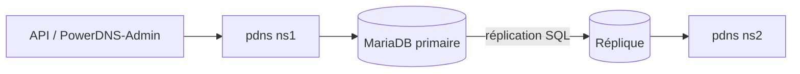

## DNSSEC en ligne

PowerDNS signe les réponses **à la volée** : les clés sont stockées dans le backend, aucune re-signature de fichier n'est nécessaire.

```bash
sudo pdnsutil secure-zone exemple.fr                 # crée une clé (ECDSAP256SHA256 / CSK par défaut)
sudo pdnsutil set-nsec3 exemple.fr '1 0 0 -'        # NSEC3 : hachage SHA-1, opt-out 0, 0 itération, pas de sel (RFC 9276)
sudo pdnsutil rectify-zone exemple.fr
sudo pdnsutil show-zone exemple.fr                  # clés, DS à transmettre au registre
sudo pdnsutil export-zone-ds exemple.fr             # uniquement les DS
```

Le paramètre `default-ksk-algorithm` / `default-zsk-algorithm` de `pdns.conf` permet de changer l'algorithme par défaut (`ecdsa256`, `ed25519`).

```bash
# Vérifications
dig @127.0.0.1 exemple.fr DNSKEY +dnssec +multi
dig @127.0.0.1 www.exemple.fr A +dnssec | grep RRSIG
delv @9.9.9.9 www.exemple.fr        # après publication du DS chez le registre : « fully validated »
```

Publication du DS chez le registre et précautions : voir [[01-bind9/07-dnssec|DNSSEC avec BIND]] (mêmes principes). Avec `PUBLISH-CDS`/`PUBLISH-CDNSKEY` (métadonnées), les registres compatibles mettent à jour le DS automatiquement.

### Roulement de clés

```bash
sudo pdnsutil add-zone-key exemple.fr zsk inactive ecdsa256     # nouvelle clé, inactive
sudo pdnsutil activate-zone-key exemple.fr <ID>                 # l'activer (après pré-publication d'un TTL)
sudo pdnsutil deactivate-zone-key exemple.fr <ancien ID>
sudo pdnsutil remove-zone-key exemple.fr <ancien ID>            # après expiration des signatures en cache
```

> [!CAUTION]
> Ne désactivez pas DNSSEC (`disable-dnssec`) tant que le DS est publié chez le registre : la zone deviendrait **injoignable** pour les résolveurs validants. Retirez d'abord le DS, attendez son TTL, puis désactivez.

### Zones présignées

Pour héberger une zone signée ailleurs (transfert depuis un primaire qui signe), positionnez `PRESIGNED` : PowerDNS sert alors les RRSIG reçus tels quels.

## Réplication

### Option 1 : réplication par la base (zones Native)

Chaque serveur PowerDNS lit une base répliquée (MariaDB Galera, réplication primaire/réplique MySQL, PostgreSQL en streaming). Aucun transfert DNS : un enregistrement ajouté par l'API est visible sur tous les serveurs dès la réplication SQL.



Les serveurs de lecture peuvent utiliser un compte SQL en **lecture seule**.

### Option 2 : primaire / secondaire par transferts

```ini /etc/powerdns/pdns.conf (primaire ns1)
primary=yes
allow-axfr-ips=10.0.20.54/32,198.51.100.53/32
also-notify=10.0.20.54
default-soa-edit=INCEPTION-INCREMENT      # serial cohérent avec la signature
```

```bash
sudo pdnsutil set-kind exemple.fr primary
```

```ini /etc/powerdns/pdns.conf (secondaire ns2)
secondary=yes
autosecondary=yes                 # créer automatiquement les zones notifiées par un primaire autorisé
allow-notify-from=10.0.20.53/32
```

```bash
# Sur le secondaire : déclarer le primaire comme « autoprimaire » (création automatique des zones)
sudo pdnsutil add-autoprimary 10.0.20.53 ns2.exemple.fr
# Ou déclarer une zone secondaire à la main
sudo pdnsutil create-secondary-zone exemple.fr 10.0.20.53
sudo pdns_control retrieve exemple.fr        # forcer un transfert
```

> [!NOTE]
> Depuis 4.5, `master`/`slave` sont devenus `primary`/`secondary` dans les paramètres et commandes (`supermaster` → `autoprimary`). Les anciens noms restent acceptés dans les versions 4.x.

Un secondaire PowerDNS peut recevoir des zones d'un primaire **BIND** ou **Windows DNS**, et inversement : le protocole (NOTIFY/AXFR/IXFR) est standard.

### TSIG

```bash
sudo pdnsutil generate-tsig-key xfer-exemple hmac-sha256         # affiche le secret
sudo pdnsutil activate-tsig-key exemple.fr xfer-exemple primary  # sur le primaire
sudo pdnsutil import-tsig-key xfer-exemple hmac-sha256 '<secret>' # sur le secondaire
sudo pdnsutil activate-tsig-key exemple.fr xfer-exemple secondary
```

### Zones catalogue (4.7+)

Un *producer* publie la liste des zones, les *consumers* les créent et suppriment automatiquement (RFC 9432, compatible BIND) :

```bash
sudo pdnsutil create-zone catalogue.exemple.fr && sudo pdnsutil set-kind catalogue.exemple.fr producer
sudo pdnsutil set-catalog exemple.fr catalogue.exemple.fr          # inscrire une zone
# Sur le consumer :
sudo pdnsutil create-secondary-zone catalogue.exemple.fr 10.0.20.53 && sudo pdnsutil set-kind catalogue.exemple.fr consumer
```

## Enregistrements Lua : réponses dynamiques

```ini /etc/powerdns/pdns.conf
enable-lua-records=yes          # ou par zone : pdnsutil set-meta exemple.fr ENABLE-LUA-RECORDS 1
lua-health-checks-interval=5
```

```bash
# Ne répondre qu'avec les serveurs dont le port 443 répond (bascule automatique)
sudo pdnsutil add-record exemple.fr www LUA 30 "A \"ifportup(443, {'203.0.113.10', '203.0.113.11'})\""

# Vérification HTTP (code 200 sur /health), sinon serveur de secours
sudo pdnsutil add-record exemple.fr app LUA 30 "A \"ifurlup('https://app.exemple.fr/health', {{'203.0.113.20', '203.0.113.21'}, {'198.51.100.20'}})\""

# Répartition pondérée (80/20)
sudo pdnsutil add-record exemple.fr canari LUA 30 "A \"pickwrandom({{80, '203.0.113.30'}, {20, '203.0.113.31'}})\""

# Réponse selon le réseau du client (split-horizon simple)
sudo pdnsutil add-record exemple.fr intranet LUA 60 "A \"ifelse(netmask({'10.0.0.0/8'}), '10.0.20.15', '203.0.113.15')\""
```

| Fonction | Comportement |
| --- | --- |
| `ifportup(port, ips)` | IP dont le port TCP répond |
| `ifurlup(url, groupes)` | IP dont l'URL répond (groupes = priorités) |
| `pickrandom`, `pickwrandom`, `pickclosest` | Choix aléatoire, pondéré, le plus proche (GeoIP) |
| `country`, `continent`, `netmask` | Conditions sur l'origine du client (EDNS Client Subnet ou IP du résolveur) |
| `createReverse`, `createForward` | Génération automatique de PTR / A pour de grands réseaux |

> [!TIP]
> Gardez des **TTL courts** (30-60 s) sur les enregistrements Lua de bascule, sinon les résolveurs conservent l'IP en panne. Les vérifications de santé sont faites par chaque serveur PowerDNS : assurez-vous qu'ils voient les services comme les clients.
