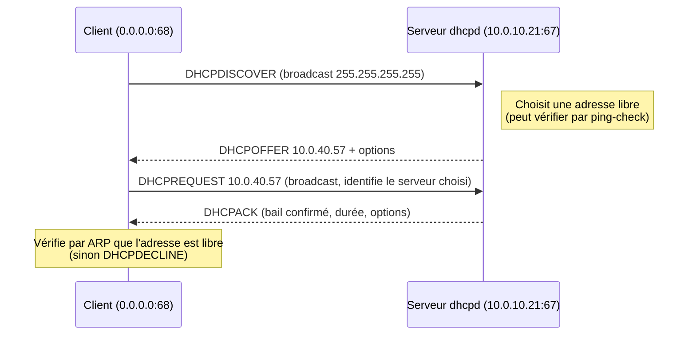
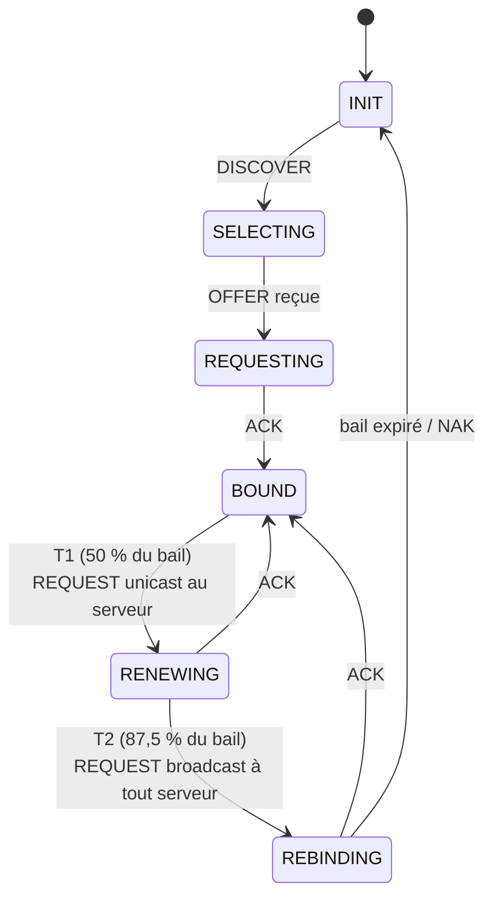

**ISC DHCP** est l'implémentation de référence du protocole DHCP (*Dynamic Host Configuration Protocol*) publiée par l'Internet Systems Consortium. Le paquet fournit le serveur `dhcpd` (IPv4 et IPv6), l'agent relais `dhcrelay` et historiquement le client `dhclient`.

> [!WARNING] Fin de maintenance
> L'ISC a annoncé la **fin de maintenance d'ISC DHCP fin 2022** (dernière version 4.4.3-P1). Le logiciel reste fonctionnel et présent sur de nombreux parcs, mais il ne reçoit plus de correctifs et disparaît des distributions récentes (RHEL 10 ne le fournit plus). Pour un nouveau déploiement, l'ISC recommande **Kea** — voir [[09-exploitation-securite-kea|exploitation et migration vers Kea]].

## Le protocole DHCPv4

DHCP fonctionne en **UDP** : le serveur écoute sur le port **67**, le client sur le port **68**. Le client n'ayant pas encore d'adresse, les premiers échanges se font en **diffusion** (broadcast).

### Obtention d'un bail : DORA



### Messages

| Message | Émetteur | Rôle |
| --- | --- | --- |
| `DHCPDISCOVER` | Client | Recherche de serveurs |
| `DHCPOFFER` | Serveur | Proposition d'adresse |
| `DHCPREQUEST` | Client | Acceptation d'une offre, renouvellement ou vérification après redémarrage |
| `DHCPACK` | Serveur | Confirmation du bail |
| `DHCPNAK` | Serveur | Refus (adresse incorrecte pour ce réseau, bail inconnu d'un serveur `authoritative`) |
| `DHCPDECLINE` | Client | L'adresse est déjà utilisée (conflit détecté par ARP) |
| `DHCPRELEASE` | Client | Libération anticipée du bail |
| `DHCPINFORM` | Client | Demande d'options seules (adresse configurée manuellement) |

### Cycle de vie d'un bail



| Temporisation | Valeur par défaut | Effet |
| --- | --- | --- |
| Durée du bail | `default-lease-time` (serveur) | Durée de validité de l'adresse |
| **T1** (option 58) | 50 % du bail | Le client tente de renouveler auprès de **son** serveur |
| **T2** (option 59) | 87,5 % du bail | Le client accepte un renouvellement de **n'importe quel** serveur |

### Relais DHCP

Les diffusions ne traversent pas les routeurs. Sur chaque VLAN sans serveur DHCP, un **agent relais** (routeur, commutateur L3 avec `ip helper-address`, ou `dhcrelay`) capte les diffusions et les retransmet en **unicast** au serveur, en indiquant dans le champ **`giaddr`** son adresse sur le VLAN d'origine. Le serveur choisit alors le `subnet` qui contient `giaddr`. Voir [[05-relais-multi-reseaux]].

## Options DHCP courantes

| Code | Nom ISC | Contenu |
| --- | --- | --- |
| 1 | `subnet-mask` | Masque (déduit du `netmask` du subnet) |
| 3 | `routers` | Passerelle(s) par défaut |
| 6 | `domain-name-servers` | Serveurs DNS |
| 12 | `host-name` | Nom de l'hôte |
| 15 | `domain-name` | Suffixe DNS |
| 28 | `broadcast-address` | Adresse de diffusion |
| 42 | `ntp-servers` | Serveurs NTP |
| 43 | `vendor-encapsulated-options` | Options propriétaires (contrôleurs Wi-Fi, téléphones) |
| 44 | `netbios-name-servers` | WINS (historique) |
| 51 | `dhcp-lease-time` | Durée du bail |
| 60 | `vendor-class-identifier` | Envoyée par le client : type d'équipement |
| 61 | `dhcp-client-identifier` | Identifiant du client |
| 66 | `tftp-server-name` | Serveur TFTP (téléphones, PXE) |
| 67 | `bootfile-name` | Fichier de démarrage |
| 81 | `fqdn` | Nom complet et délégation des mises à jour DNS |
| 82 | `agent.*` (relay agent information) | Ajoutée par le relais : port et équipement d'origine |
| 93 | `arch` (à définir) | Architecture du client PXE (BIOS, UEFI x64, ARM…) |
| 119 | `domain-search` | Liste de suffixes de recherche |
| 121 | `classless-static-routes` (à définir) | Routes statiques |
| 150 | `voip-tftp-server` (à définir) | TFTP des téléphones Cisco |
| 252 | `wpad` (à définir) | Découverte automatique de proxy |

## Composants d'ISC DHCP

| Composant | Rôle |
| --- | --- |
| `dhcpd` | Serveur DHCPv4 (`-4`, défaut) ou DHCPv6 (`-6`) |
| `dhcpd.conf` / `dhcpd6.conf` | Configuration |
| `dhcpd.leases` / `dhcpd6.leases` | Base des baux (fichier texte en ajout continu, réécrit périodiquement) |
| `dhcrelay` | Agent relais |
| `omshell` | Client OMAPI : interrogation et modification à chaud (baux, hôtes, état du failover) |
| `dhclient` | Client DHCP (remplacé par NetworkManager / systemd-networkd sur la plupart des distributions) |
| `keama` | Outil de migration de la configuration vers Kea |

## Structure de dhcpd.conf

```dhcpd
# Paramètres globaux
option domain-name "exemple.fr";
default-lease-time 86400;
authoritative;

# Déclarations : sous-réseaux, réseaux partagés, groupes, hôtes, classes, pools
shared-network "VLAN40" {
    subnet 10.0.40.0 netmask 255.255.255.0 {
        range 10.0.40.100 10.0.40.199;
        option routers 10.0.40.1;
    }
}
host imprimante-rdc {
    hardware ethernet 00:11:22:33:44:55;
    fixed-address 10.0.40.20;
}
```

Les paramètres sont **hérités** du niveau le plus large au plus précis : global → `shared-network` → `subnet` → `pool` → `group` → `class` → `host`. La valeur la plus spécifique l'emporte.

## Suite du parcours

1. [[02-installation|Installation]]
2. [[03-configuration-base|Configuration de base]]
3. [[04-reservations-classes-options|Réservations, classes et options avancées (PXE, VoIP, Wi-Fi, option 82)]]
4. [[05-relais-multi-reseaux|Relais DHCP et réseaux multiples]]
5. [[06-failover|Haute disponibilité (failover)]]
6. [[07-ddns-bind|Mise à jour DNS dynamique avec BIND]]
7. [[08-dhcpv6|DHCPv6]]
8. [[09-exploitation-securite-kea|Exploitation, sécurité et migration vers Kea]]
