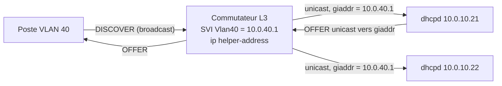

## Principe



1. Le client diffuse sa requête sur son VLAN.
2. Le relais (l'interface routée du VLAN) la capte, renseigne **`giaddr`** avec **sa propre adresse sur ce VLAN** et l'envoie en unicast (UDP 67) à chaque serveur configuré.
3. Le serveur sélectionne le `subnet` qui **contient `giaddr`** et répond au relais, qui transmet au client.

> [!IMPORTANT]
> Le serveur doit avoir une déclaration `subnet` pour **chaque réseau relayé**, sinon il journalise `DHCPDISCOVER from … via 10.0.40.1: unknown network segment` et ne répond pas. Il doit aussi pouvoir **router** vers chaque `giaddr` (route de retour).

## Configuration des relais

### Cisco IOS / IOS-XE

```cisco
interface Vlan40
 description Postes de travail
 ip address 10.0.40.1 255.255.255.0
 ip helper-address 10.0.10.21
 ip helper-address 10.0.10.22
!
! Par défaut ip helper-address relaie aussi d'autres diffusions UDP (TFTP, DNS, NetBIOS, TACACS…)
! Limiter au DHCP :
no ip forward-protocol udp tftp
no ip forward-protocol udp nameserver
no ip forward-protocol udp domain
no ip forward-protocol udp netbios-ns
no ip forward-protocol udp netbios-dgm
no ip forward-protocol udp tacacs
!
! Option 82 ajoutée par le relais (avec DHCP snooping)
ip dhcp relay information option
```

Pour une SVI dans une **VRF** : `ip helper-address vrf <nom> 10.0.10.21` (ou `global` si le serveur est dans la table globale).

### Cisco NX-OS

```cisco
feature dhcp
interface Vlan40
  ip dhcp relay address 10.0.10.21
  ip dhcp relay address 10.0.10.22
```

### Aruba CX / HPE

```cisco
interface vlan 40
    ip address 10.0.40.1/24
    ip helper-address 10.0.10.21
    ip helper-address 10.0.10.22
```

### Juniper (Junos)

```text
set forwarding-options dhcp-relay server-group SRV-DHCP 10.0.10.21
set forwarding-options dhcp-relay server-group SRV-DHCP 10.0.10.22
set forwarding-options dhcp-relay group VLAN40 active-server-group SRV-DHCP
set forwarding-options dhcp-relay group VLAN40 interface irb.40
```

### Fortinet FortiGate

```text
config system interface
    edit "vlan40"
        set dhcp-relay-service enable
        set dhcp-relay-ip "10.0.10.21" "10.0.10.22"
    next
end
```

### pfSense / OPNsense

*Services → DHCP Relay* : activer, choisir les interfaces et indiquer les serveurs de destination (le serveur DHCP local doit être désactivé sur ces interfaces).

### Linux : dhcrelay

```bash
sudo apt install isc-dhcp-relay        # RHEL : dhcp-relay (service dhcrelay)
```

```bash /etc/default/isc-dhcp-relay
SERVERS="10.0.10.21 10.0.10.22"
INTERFACES=""                 # laisser vide et utiliser OPTIONS pour séparer amont/aval
OPTIONS="-iu ens192 -id ens224.40 -id ens224.50 -a -m replace"
```

| Option | Rôle |
| --- | --- |
| `-iu <if>` | Interface **amont** (vers les serveurs) |
| `-id <if>` | Interface **aval** (vers les clients) |
| `-a` | Ajouter l'option 82 |
| `-m append\|replace\|forward\|discard` | Que faire d'une option 82 déjà présente |
| `-c <n>` | Nombre maximal de sauts de relais |
| `-6 -l <if> -u <srv>%<if>` | Mode DHCPv6 (interfaces basses / hautes) |

## Déclarer les réseaux côté serveur

```dhcpd
# Réseau du serveur (obligatoire pour qu'il écoute, même sans plage)
subnet 10.0.10.0 netmask 255.255.255.0 { }

subnet 10.0.40.0 netmask 255.255.255.0 {
    range 10.0.40.100 10.0.40.199;
    option routers 10.0.40.1;
}
subnet 10.0.50.0 netmask 255.255.254.0 {
    range 10.0.50.10 10.0.51.250;
    option routers 10.0.50.1;
}
```

## Plusieurs sous-réseaux sur un même segment : shared-network

Quand un VLAN porte **plusieurs plages IP** (adressage secondaire sur la SVI, extension d'un /24 saturé), le serveur doit savoir qu'elles partagent le même lien physique :

```dhcpd
shared-network "VLAN40-postes" {
    option domain-name-servers 10.0.10.53, 10.0.10.54;

    subnet 10.0.40.0 netmask 255.255.255.0 {
        range 10.0.40.100 10.0.40.250;
        option routers 10.0.40.1;
    }
    subnet 10.0.41.0 netmask 255.255.255.0 {
        range 10.0.41.10 10.0.41.250;
        option routers 10.0.41.1;
    }
}
```

```cisco
interface Vlan40
 ip address 10.0.40.1 255.255.255.0
 ip address 10.0.41.1 255.255.255.0 secondary
 ip helper-address 10.0.10.21
```

> [!NOTE]
> Le relais ne renseigne que l'adresse **primaire** (`10.0.40.1`) dans `giaddr`. Sans `shared-network`, le serveur n'utiliserait jamais la plage `10.0.41.0/24`. Avec, il pioche dans les deux plages quand la première est pleine.

### Sélection fine (option 118 / link-selection)

Certains relais (RFC 3527 / RFC 3011) indiquent le sous-réseau souhaité via la sous-option 5 de l'option 82 ou l'option 118, indépendamment de `giaddr` — utile dans les architectures VRF / MPLS. ISC DHCP la prend en compte automatiquement.

## Dépannage du relais

| Symptôme (journal dhcpd) | Cause |
| --- | --- |
| Rien dans les journaux | Pas de `ip helper-address`, ACL/pare-feu bloquant UDP 67, mauvaise IP de serveur |
| `unknown network segment` | Aucun `subnet` ne contient `giaddr` |
| `no free leases` | Plage épuisée → agrandir, réduire la durée des baux, `shared-network` |
| OFFER envoyée mais client sans adresse | Route de retour vers `giaddr` absente, pare-feu stateless bloquant la réponse, RPF |
| Client obtient une adresse d'un autre VLAN | `ip helper-address` sur la mauvaise SVI, VLAN natif mal configuré |
| `DHCPREQUEST … wrong network` + NAK | Client déplacé de VLAN : comportement normal d'un serveur `authoritative` |

```bash
# Sur le serveur : voir les requêtes relayées (port 67, giaddr dans le détail)
sudo tcpdump -ni ens192 -vvv udp port 67 or udp port 68
```

```cisco
! Sur un Cisco
debug ip dhcp server packet
show ip dhcp relay information trusted-sources
show ip dhcp snooping binding
```
