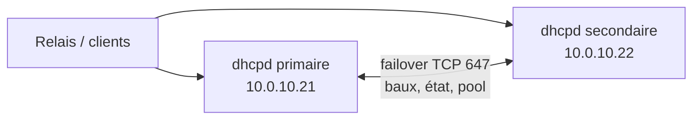

## Principe

Deux serveurs `dhcpd` partagent **les mêmes pools** et se synchronisent en continu (TCP 647). Chaque serveur répond à environ la moitié des clients (répartition par hachage de la MAC). Si l'un tombe, l'autre continue à **renouveler** tous les baux existants et, après une période de sécurité, à distribuer toutes les adresses libres.



> [!NOTE]
> Le failover ne concerne que les **plages dynamiques** (`pool` avec `failover peer`). Les réservations (`host`) doivent simplement être **présentes à l'identique** sur les deux serveurs.

## Paramètres clés

| Paramètre | Où | Rôle |
| --- | --- | --- |
| `primary` / `secondary` | Chaque serveur | Rôle dans la relation |
| `address` / `port` | Chaque serveur | Adresse et port d'écoute locaux du failover |
| `peer address` / `peer port` | Chaque serveur | Partenaire |
| `max-response-delay` | Les deux | Secondes sans nouvelles avant de considérer la communication interrompue |
| `max-unacked-updates` | Les deux | Mises à jour envoyées sans accusé de réception |
| `mclt` | **Primaire uniquement** | *Maximum Client Lead Time* : marge maximale dont un serveur peut prolonger un bail au-delà de ce que connaît le partenaire |
| `split` | **Primaire uniquement** | Répartition des clients (0-256) ; 128 = 50/50 ; 256 = tout au primaire |
| `load balance max seconds` | Les deux | Au-delà de ce délai d'attente du client (champ `secs`), un serveur répond même si ce n'est pas « son » client |
| `auto-partner-down` | Les deux (4.4+) | Délai après lequel passer seul en partner-down automatiquement (0 = jamais) |

> [!IMPORTANT]
> Les horloges des deux serveurs doivent être **synchronisées (NTP)** : un décalage provoque des refus de connexion du failover et des baux incohérents.

## Configuration

### Partie commune (fichier inclus sur les deux serveurs)

```dhcpd /etc/dhcp/dhcpd.pools.conf
subnet 10.0.40.0 netmask 255.255.255.0 {
    option routers 10.0.40.1;
    pool {
        failover peer "dhcp-ha";
        range 10.0.40.100 10.0.40.249;
    }
}

subnet 10.0.50.0 netmask 255.255.254.0 {
    option routers 10.0.50.1;
    pool {
        failover peer "dhcp-ha";
        range 10.0.50.10 10.0.51.250;
    }
}

include "/etc/dhcp/reservations.conf";
```

### Serveur primaire (10.0.10.21)

```dhcpd /etc/dhcp/dhcpd.conf
authoritative;
default-lease-time 28800;
max-lease-time 86400;
option domain-name-servers 10.0.10.53, 10.0.10.54;

failover peer "dhcp-ha" {
    primary;
    address 10.0.10.21;
    port 647;
    peer address 10.0.10.22;
    peer port 647;
    max-response-delay 60;
    max-unacked-updates 10;
    mclt 3600;
    split 128;
    load balance max seconds 3;
}

# OMAPI pour piloter le failover
omapi-port 7911;
key omapi_key {
    algorithm hmac-md5;            # algorithme historiquement supporté par omshell
    secret "VHJlc1NlY3JldE9tYXBpQ2xlQmFzZTY0QUNoYW5nZXI=";
};
omapi-key omapi_key;

subnet 10.0.10.0 netmask 255.255.255.0 { }
include "/etc/dhcp/dhcpd.pools.conf";
```

### Serveur secondaire (10.0.10.22)

```dhcpd /etc/dhcp/dhcpd.conf
authoritative;
default-lease-time 28800;
max-lease-time 86400;
option domain-name-servers 10.0.10.53, 10.0.10.54;

failover peer "dhcp-ha" {
    secondary;
    address 10.0.10.22;
    port 647;
    peer address 10.0.10.21;
    peer port 647;
    max-response-delay 60;
    max-unacked-updates 10;
    load balance max seconds 3;
}

omapi-port 7911;
key omapi_key {
    algorithm hmac-md5;            # algorithme historiquement supporté par omshell
    secret "VHJlc1NlY3JldE9tYXBpQ2xlQmFzZTY0QUNoYW5nZXI=";
};
omapi-key omapi_key;

subnet 10.0.10.0 netmask 255.255.255.0 { }
include "/etc/dhcp/dhcpd.pools.conf";
```

> [!TIP]
> Synchronisez `dhcpd.pools.conf` et `reservations.conf` entre les deux serveurs par Git + Ansible, ou par un script `rsync` + `dhcpd -t` + redémarrage, **jamais** à la main sur un seul nœud.

Sur les relais, déclarez **les deux serveurs** (`ip helper-address 10.0.10.21` et `ip helper-address 10.0.10.22`).

## Démarrage et vérification

```bash
sudo dhcpd -t -cf /etc/dhcp/dhcpd.conf
sudo systemctl restart isc-dhcp-server
journalctl -u isc-dhcp-server | grep -i failover
```

Journaux attendus :

```text
failover peer dhcp-ha: I move from recover to startup
failover peer dhcp-ha: peer moves from unknown-state to startup
failover peer dhcp-ha: I move from startup to normal
balancing pool 55d5a0 10.0.40.0/24  total 150  free 120  backup 30  lts 45  max-own (+/-)15
```

## États du failover

| État | Signification | Comportement |
| --- | --- | --- |
| `startup` | Démarrage, recherche du partenaire | Ne distribue rien pendant quelques secondes |
| `normal` | Les deux serveurs communiquent | Répartition selon `split` |
| `communications-interrupted` | Partenaire injoignable | Chaque serveur renouvelle ses clients et ceux du partenaire, mais n'attribue de **nouvelles** adresses que dans sa propre réserve |
| `partner-down` | Le partenaire est déclaré arrêté | Après la MCLT, le serveur restant utilise **toutes** les adresses libres |
| `recover` / `recover-wait` / `recover-done` | Resynchronisation après une panne longue | Le serveur qui revient récupère la base du partenaire |
| `potential-conflict` / `conflict-done` | Les deux se croyaient seuls | Résolution des baux en double |
| `paused` / `shutdown` | Arrêt propre annoncé | |

> [!WARNING]
> En `communications-interrupted`, la réserve d'adresses libres de chaque serveur peut s'épuiser (surtout sur des réseaux à forte rotation : Wi-Fi invités). Si la panne du partenaire est **certaine et longue**, passez le serveur survivant en **partner-down** manuellement.

## Passer en partner-down avec omshell

```bash
omshell <<'EOF'
server 127.0.0.1
port 7911
key omapi_key VHJlc1NlY3JldE9tYXBpQ2xlQmFzZTY0QUNoYW5nZXI=
connect
new failover-state
set name = "dhcp-ha"
open
set local-state = 1
update
EOF
```

`local-state = 1` correspond à *partner-down*. Limitez l'OMAPI au poste local ou au réseau d'administration (pare-feu sur TCP 7911) : quiconque possède la clé peut modifier les baux. Le serveur attendra encore la durée **MCLT** avant d'utiliser les adresses du partenaire.

> [!CAUTION]
> Ne déclarez **jamais** partner-down si le partenaire tourne encore (coupure réseau entre les deux seulement) : les deux serveurs distribueraient les mêmes adresses → conflits d'IP.

### Automatisation (4.4+)

```dhcpd
failover peer "dhcp-ha" {
    ...
    auto-partner-down 3600;   # passe seul en partner-down après 1 h de communication interrompue
}
```

## Procédures de maintenance

### Redémarrer un nœud

Redémarrage simple : l'autre nœud continue en `communications-interrupted`, puis les deux repassent en `normal` automatiquement.

### Remplacer / réinstaller un nœud

1. Sur le nœud restant : passer en `partner-down`.
2. Réinstaller le nœud, copier la configuration, démarrer avec un fichier de baux **vide**.
3. Il passe en `recover`, récupère tous les baux du partenaire, puis `recover-done` → `normal`.

### Ajouter une plage

Modifier `dhcpd.pools.conf` sur les deux serveurs, tester avec `dhcpd -t`, redémarrer le secondaire puis le primaire. Les nouvelles adresses sont réparties automatiquement (`balancing pool …`).

## Supervision

- État `normal` sur les deux nœuds (journaux, ou script OMAPI).
- Taux d'occupation des pools : `dhcpd-pools` (voir [[09-exploitation-securite-kea]]).
- Port TCP 647 joignable entre les nœuds.

## Alternatives

| Solution | Principe |
| --- | --- |
| **Plages séparées** (règle 80/20) | Deux serveurs indépendants, chacun avec une partie de la plage. Simple, pas de synchronisation, mais un serveur seul ne couvre qu'une partie des adresses. |
| **Cluster actif/passif** (Pacemaker, keepalived + fichier de baux répliqué) | Un seul `dhcpd` actif à la fois, adresse virtuelle. |
| **Kea High Availability** | Hook `libdhcp_ha` : modes *load-balancing*, *hot-standby*, *passive-backup*, API REST. Voir [[09-exploitation-securite-kea]]. |
