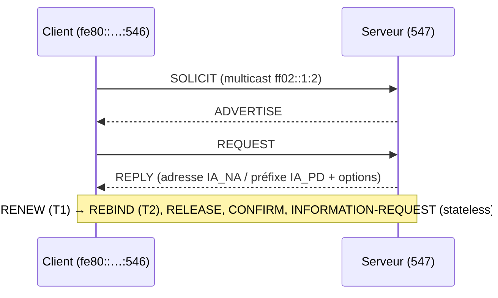

## Rappels : comment un hôte IPv6 obtient sa configuration

En IPv6, la **passerelle par défaut n'est jamais fournie par DHCPv6** : elle provient toujours des **annonces de routeur (RA)**. Les drapeaux des RA indiquent au client ce qu'il doit demander au DHCPv6.

| Mode | Drapeaux RA | Adresse | DNS |
| --- | --- | --- | --- |
| **SLAAC seul** | M=0, O=0 | Auto-générée (préfixe RA + identifiant) | Option RDNSS des RA (RFC 8106) |
| **SLAAC + DHCPv6 stateless** | M=0, O=1 | SLAAC | DHCPv6 (Information-Request) |
| **DHCPv6 stateful** | M=1 (A=0 dans le préfixe) | Attribuée par DHCPv6 | DHCPv6 |
| **Délégation de préfixe (PD)** | — | Le routeur client obtient un préfixe entier (/56, /60) | |

> [!WARNING]
> **Android ne supporte pas DHCPv6 stateful** pour l'adressage : sur un réseau où les terminaux mobiles sont présents, conservez SLAAC (A=1) et utilisez DHCPv6 en mode stateless pour les options, ou fournissez le DNS via RDNSS.

### Échange DHCPv6 (SARR)



Les clients sont identifiés par leur **DUID** (*DHCP Unique Identifier*), et non par leur adresse MAC.

## Annonces de routeur

### Sur un routeur Cisco

```cisco
interface Vlan40
 ipv6 address 2001:DB8:40::1/64
 ipv6 nd managed-config-flag            ! M=1 : adresses par DHCPv6
 ipv6 nd other-config-flag              ! O=1 : options par DHCPv6
 ipv6 nd prefix 2001:DB8:40::/64 no-autoconfig   ! A=0 : pas de SLAAC
 ipv6 dhcp relay destination 2001:DB8:10::21
```

### Sur Linux avec radvd

```nginx /etc/radvd.conf
interface ens224.40 {
    AdvSendAdvert on;
    AdvManagedFlag on;
    AdvOtherConfigFlag on;
    prefix 2001:db8:40::/64 {
        AdvOnLink on;
        AdvAutonomous off;
    };
    RDNSS 2001:db8:10::53 2001:db8:10::54 { };
};
```

## Configuration de dhcpd en IPv6

Debian : renseigner `INTERFACESv6="ens192"` dans `/etc/default/isc-dhcp-server` (service `isc-dhcp-server6` selon la version). RHEL : service `dhcpd6`.

```dhcpd /etc/dhcp/dhcpd6.conf
default-lease-time 43200;
preferred-lifetime 27000;
option dhcp-renewal-time 21600;          # T1
option dhcp-rebinding-time 34560;        # T2
allow leasequery;
authoritative;
log-facility local7;

option dhcp6.name-servers 2001:db8:10::53, 2001:db8:10::54;
option dhcp6.domain-search "exemple.fr", "corp.exemple.fr";
option dhcp6.sntp-servers 2001:db8:10::123;

# Réseau du serveur (nécessaire pour écouter)
subnet6 2001:db8:10::/64 { }

# VLAN 40 — adressage stateful
subnet6 2001:db8:40::/64 {
    range6 2001:db8:40::1000 2001:db8:40::1fff;
    range6 2001:db8:40::/64 temporary;     # adresses temporaires (IA_TA)
}

# Délégation de préfixes à des routeurs clients (/56 pris dans 2001:db8:100::/40)
subnet6 2001:db8:50::/64 {
    range6 2001:db8:50::100 2001:db8:50::1ff;
    prefix6 2001:db8:100:: 2001:db8:1ff:ff00:: /56;
}
```

### Réservations

```dhcpd
host srv-web-v6 {
    host-identifier option dhcp6.client-id 00:01:00:01:2b:3c:4d:5e:00:50:56:aa:bb:01;
    fixed-address6 2001:db8:40::10;
}

# Réservation d'un préfixe délégué
host routeur-agence-12 {
    host-identifier option dhcp6.client-id 00:03:00:01:00:11:22:33:44:55;
    fixed-prefix6 2001:db8:112::/48;
}
```

> [!TIP]
> Pour connaître le DUID d'un client : `ipconfig /all` sous Windows (*DUID du client DHCPv6*), `/var/lib/dhcp/dhclient6.leases` ou `networkctl status` sous Linux, ou le journal `dhcpd` lors de la première requête. Depuis 4.3, `host-identifier v6relopt` et `hardware ethernet` (via l'option 79 du relais) permettent aussi d'identifier par MAC.

### Mode stateless uniquement

```dhcpd
subnet6 2001:db8:60::/64 {
    # Pas de range6 : le serveur ne répond qu'aux INFORMATION-REQUEST (options)
}
```

## Démarrage

```bash
sudo dhcpd -6 -t -cf /etc/dhcp/dhcpd6.conf
sudo systemctl restart isc-dhcp-server        # Debian (gère v4 et v6) — ou isc-dhcp-server6
sudo systemctl restart dhcpd6                 # RHEL
sudo cat /var/lib/dhcp/dhcpd6.leases
```

## Relais DHCPv6

Le relais encapsule la requête dans un message **RELAY-FORW** et indique l'adresse du lien (`link-address`) permettant au serveur de choisir le `subnet6`.

```bash
# dhcrelay en mode IPv6 : -l interface côté clients, -u serveur%interface amont
sudo dhcrelay -6 -l ens224.40 -u 2001:db8:10::21%ens192
```

```cisco
interface Vlan40
 ipv6 dhcp relay destination 2001:DB8:10::21
 ipv6 dhcp relay destination 2001:DB8:10::22
```

## Différences notables avec DHCPv4

| Aspect | DHCPv4 | DHCPv6 |
| --- | --- | --- |
| Ports | UDP 67/68 | UDP 547 (serveur) / 546 (client) |
| Découverte | Broadcast | Multicast `ff02::1:2` |
| Identifiant client | MAC / option 61 | DUID (+ IAID) |
| Passerelle | Option 3 | **Annonces de routeur uniquement** |
| Failover ISC | Oui | **Non** (utiliser deux serveurs avec des plages distinctes, ou Kea HA) |
| DDNS | Oui | Oui (`ddns-domainname`, mêmes principes) |
| Plusieurs adresses par client | Non | Oui (IA_NA multiples, IA_TA, IA_PD) |
