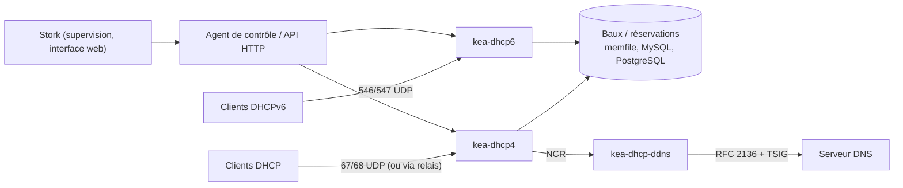

**Kea** (ISC, MPL 2.0) succède à **ISC DHCP** (`dhcpd`), dont la maintenance a pris fin en 2022 (voir [[01-isc-dhcp/09-exploitation-securite-kea|migration depuis ISC DHCP]]). Kea apporte une configuration **JSON** rechargeable à chaud, une **API REST** de gestion, des baux et réservations en **base de données**, une haute disponibilité intégrée et des greffons (*hooks*).

## Architecture



| Composant | Rôle |
| --- | --- |
| `kea-dhcp4` / `kea-dhcp6` | Serveurs DHCPv4 et DHCPv6 (processus séparés) |
| `kea-dhcp-ddns` (D2) | Mises à jour DNS dynamiques |
| `kea-ctrl-agent` | API REST HTTP(S) vers les démons (à partir de Kea 3.0, les démons peuvent exposer eux-mêmes une socket de contrôle HTTP, l'agent devenant facultatif) |
| Greffons (*hooks*) | Haute disponibilité, commandes de baux, réservations en ligne, journal des baux, classes avancées… |
| **Stork** | Tableau de bord et gestion graphique (ISC) |

**Plateformes** : Linux, FreeBSD, macOS (Homebrew). Pas de version Windows : sous Windows, utilisez le [[03-dhcp-windows/01-presentation-installation|serveur DHCP Windows]].

## Stockage des baux

| Backend | Usage |
| --- | --- |
| `memfile` | Fichier CSV local (`/var/lib/kea/kea-leases4.csv`), simple et rapide ; HA par le greffon `ha` |
| `mysql` / `postgresql` | Baux et/ou réservations partagés, intégration à d'autres outils ; base à rendre hautement disponible elle-même |

## Installation

```bash
# Debian / Ubuntu (paquets de la distribution)
sudo apt install kea-dhcp4-server kea-dhcp6-server kea-dhcp-ddns-server kea-ctrl-agent kea-admin

# Dépôts ISC (versions récentes, Debian/Ubuntu/RHEL) — choisir la branche (ex. kea-3-0)
curl -1sLf 'https://dl.cloudsmith.io/public/isc/kea-3-0/setup.deb.sh' | sudo -E bash
sudo apt install isc-kea-dhcp4-server isc-kea-ctrl-agent
# RHEL : setup.rpm.sh puis : sudo dnf install isc-kea

# macOS
brew install kea
```

| Distribution | Fichier de configuration | Service |
| --- | --- | --- |
| Debian / Ubuntu (paquets de la distribution) | `/etc/kea/kea-dhcp4.conf` | `kea-dhcp4-server` |
| Paquets ISC / RHEL | `/etc/kea/kea-dhcp4.conf` | `isc-kea-dhcp4-server` / `kea-dhcp4` |

## Configuration de base (DHCPv4)

```kea /etc/kea/kea-dhcp4.conf
{
  "Dhcp4": {
    "interfaces-config": {
      "interfaces": [ "eth0" ],
      "dhcp-socket-type": "raw"
    },

    "control-socket": {
      "socket-type": "unix",
      "socket-name": "kea4-ctrl-socket"
    },

    "lease-database": {
      "type": "memfile",
      "persist": true,
      "lfc-interval": 3600
    },

    "valid-lifetime": 28800,
    "renew-timer": 14400,
    "rebind-timer": 25200,

    "option-data": [
      { "name": "domain-name-servers", "data": "10.0.10.53, 10.0.10.54" },
      { "name": "domain-name", "data": "corp.exemple.fr" },
      { "name": "domain-search", "data": "corp.exemple.fr" },
      { "name": "ntp-servers", "data": "10.0.10.123" }
    ],

    "subnet4": [
      {
        "id": 10,
        "subnet": "10.0.10.0/24",
        "pools": [ { "pool": "10.0.10.100 - 10.0.10.199" } ],
        "option-data": [ { "name": "routers", "data": "10.0.10.1" } ]
      },
      {
        "id": 20,
        "subnet": "10.0.20.0/24",
        "pools": [ { "pool": "10.0.20.50 - 10.0.20.250" } ],
        "option-data": [ { "name": "routers", "data": "10.0.20.1" } ],
        "valid-lifetime": 3600
      }
    ],

    "loggers": [
      {
        "name": "kea-dhcp4",
        "output-options": [ { "output": "/var/log/kea/kea-dhcp4.log", "maxsize": 10485760, "maxver": 5 } ],
        "severity": "INFO"
      }
    ]
  }
}
```

| Paramètre | Rôle |
| --- | --- |
| `interfaces` | Interfaces d'écoute (`eth0`, `eth0/10.0.10.5`, `*`) |
| `dhcp-socket-type` | `raw` (clients directement connectés) ou `udp` (uniquement via relais) |
| `id` | Identifiant **stable** du sous-réseau (les baux y sont rattachés : ne jamais renuméroter) |
| `valid-lifetime` | Durée du bail (s) ; `renew-timer` (T1) et `rebind-timer` (T2) |
| `option-data` | Options à tous les niveaux : global, classe, réseau partagé, sous-réseau, pool, réservation |

> [!NOTE]
> Kea accepte les commentaires `//`, `/* */` et `#` dans ses fichiers JSON, ainsi que l'inclusion de fichiers (`<?include "/etc/kea/sous-reseaux4.json"?>`).

## Vérifier et démarrer

```bash
sudo kea-dhcp4 -t /etc/kea/kea-dhcp4.conf          # test de syntaxe et de cohérence
sudo systemctl enable --now kea-dhcp4-server
sudo ss -lunp | grep ':67'
journalctl -u kea-dhcp4-server -f
sudo tail -f /var/lib/kea/kea-leases4.csv
```

Pare-feu : 67/UDP entrant (et 547/UDP pour DHCPv6). Sur un hôte avec plusieurs VLAN, une interface (ou sous-interface) par réseau servi, ou des **relais** sur les routeurs.

Suite : [[02-reservations-classes-relais|réservations, classes, relais et DHCPv6]].
