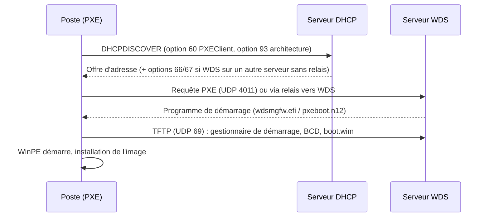

Les **Services de déploiement Windows** (WDS) fournissent un serveur **PXE** et **TFTP** qui démarre les postes sur un environnement **WinPE** (image de démarrage), puis installe une **image** Windows. WDS est souvent couplé à une solution d'orchestration (Configuration Manager, outils tiers) qui ajoute pilotes, applications et séquences de tâches.

> [!IMPORTANT]
> **État du rôle.** Depuis Windows 11 et Windows Server 2022, l'utilisation directe du `boot.wim` des **médias d'installation** pour un déploiement par WDS est bloquée/dépréciée : utilisez une image de démarrage **WinPE personnalisée** (ADK) ou un outil d'orchestration. Microsoft **MDT** n'est plus maintenu. WDS reste pertinent comme **serveur PXE** ; pour les postes modernes, **Windows Autopilot** (Intune) ou **Configuration Manager** sont les voies recommandées, et iPXE est une alternative libre (voir [[03-dnsmasq/04-pxe-tftp|PXE avec dnsmasq]]).

## Chaîne de démarrage PXE



## Installation

```powershell
Install-WindowsFeature WDS -IncludeManagementTools
# Intégré à AD (serveur membre) — dossier sur un volume dédié (pas le volume système)
wdsutil /Initialize-Server /RemInst:"D:\RemoteInstall"
# Autonome (sans AD)
wdsutil /Initialize-Server /RemInst:"D:\RemoteInstall" /Standalone
# Répondre à tous les clients (connus et inconnus) ; exiger une approbation administrative pour les inconnus
wdsutil /Set-Server /AnswerClients:All
wdsutil /Set-Server /AutoAddPolicy /Policy:AdminApproval
```

Ports : **67/68** (si DHCP sur le même serveur), **69/UDP** (TFTP), **4011/UDP** (PXE), 64001–65000/UDP (TFTP en multidiffusion et données), 135 et RPC (administration).

## Cohabitation avec le DHCP

| Situation | Configuration |
| --- | --- |
| DHCP et WDS sur **le même serveur** | WDS : *Ne pas écouter sur les ports DHCP* + *Configurer l'option DHCP 60 à PXEClient* (`wdsutil /Set-Server /UseDhcpPorts:No /DhcpOption60:Yes`) |
| DHCP et WDS sur **des serveurs différents**, même sous-réseau | Rien de particulier : WDS répond aux requêtes PXE diffusées |
| **Autres VLAN** (cas courant) | **Ajouter l'adresse du serveur WDS comme relais DHCP** (`ip helper-address`) sur chaque VLAN client, en plus du serveur DHCP — méthode recommandée |
| Options 66/67 | Possibles mais à éviter : un seul fichier de démarrage pour BIOS et UEFI ; sinon utiliser des **stratégies DHCP** par architecture (voir [[03-dhcp-windows/02-basculement-strategies-exploitation\|stratégies DHCP Windows]]) |

```cisco Relais vers DHCP et WDS
interface Vlan40
 ip helper-address 10.0.10.67
 ip helper-address 10.0.10.69
```

## BIOS et UEFI

| Mode | Fichier servi par WDS |
| --- | --- |
| BIOS (x86/x64) | `boot\x64\pxeboot.n12` (ou `pxeboot.com` : appui sur F12) |
| **UEFI x64** | `boot\x64\wdsmgfw.efi` puis `bootmgfw.efi` |
| UEFI avec **Secure Boot** | Images signées ; maintenir le gestionnaire de démarrage à jour (révocations de certificats de démarrage 2023–2026) |

Le **démarrage sécurisé** et les révocations successives du gestionnaire de démarrage (*BlackLotus*, certificats Microsoft UEFI CA 2011 → 2023) imposent de régénérer les images de démarrage avec un ADK récent et des fichiers de démarrage à jour.

## Approbation des clients

```powershell
wdsutil /Get-AutoAddDevices /DeviceType:PendingDevices
wdsutil /Approve-AutoAddDevices /RequestId:12 /MachineName:PC-COMPTA-07 /OU:"OU=Postes,DC=corp,DC=exemple,DC=fr"
```

Pré-créer les comptes (préparation des ordinateurs, GUID/MAC) et exiger l'approbation évite qu'un poste quelconque démarre une installation sur le réseau.

Suite : [[02-images-deploiement-depannage|images, déploiement et dépannage]].
