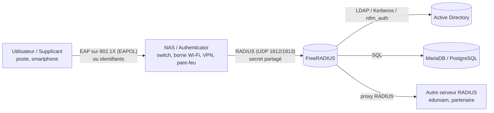
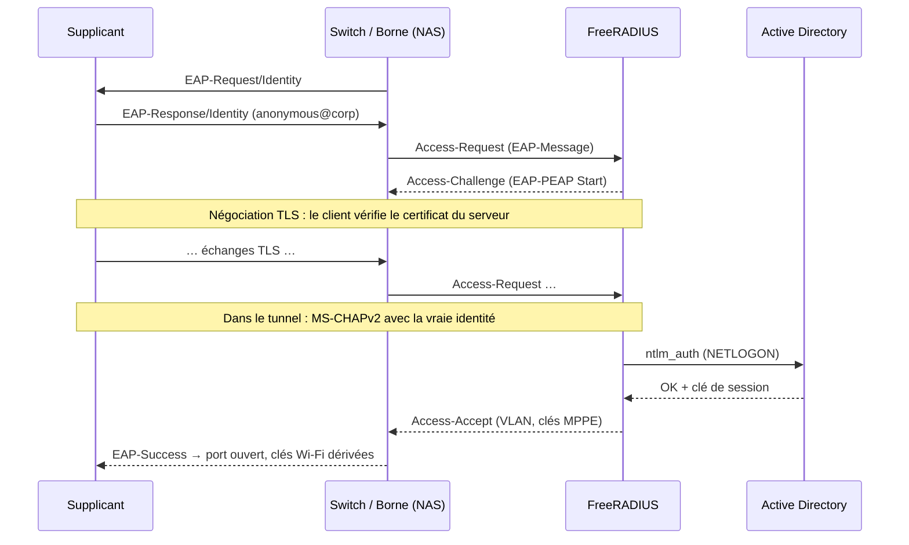

**FreeRADIUS** est le serveur RADIUS libre le plus déployé au monde (FAI, universités/eduroam, entreprises). Il assure l'**AAA** pour les équipements réseau : Wi-Fi WPA2/WPA3-Entreprise, 802.1X filaire, VPN, administration des commutateurs et pare-feu, hotspots.

## AAA

| Fonction | Question | Exemple RADIUS |
| --- | --- | --- |
| **Authentication** | Qui es-tu ? | Vérifier le mot de passe ou le certificat |
| **Authorization** | Qu'as-tu le droit de faire ? | Attribuer un VLAN, une ACL, un niveau de privilège, une durée de session |
| **Accounting** | Qu'as-tu fait ? | Début/fin de session, octets échangés, adresse IP attribuée |

## Acteurs

- **Supplicant** : le client (Windows, macOS, Android, iOS, wpa_supplicant).
- **NAS** (*Network Access Server*) ou *authenticator* : l'équipement qui contrôle l'accès et dialogue en RADIUS.
- **Serveur RADIUS** : décide de l'acceptation et des attributs renvoyés.

## Le protocole

RADIUS (RFC 2865 / 2866) fonctionne en **UDP**. Le NAS et le serveur partagent un **secret** qui sert à masquer le mot de passe PAP et à authentifier les réponses (*Response Authenticator*).

| Port | Usage |
| --- | --- |
| UDP **1812** | Authentification / autorisation |
| UDP **1813** | Comptabilité (accounting) |
| UDP 1645 / 1646 | Anciens ports (certains équipements Cisco) |
| UDP **3799** | Change of Authorization / Disconnect (CoA, RFC 5176) — du serveur vers le NAS |
| TCP **2083** | RadSec (RADIUS sur TLS, RFC 6614) |

### Paquets

| Code | Paquet | Sens |
| --- | --- | --- |
| 1 | Access-Request | NAS → serveur |
| 2 | Access-Accept | serveur → NAS |
| 3 | Access-Reject | serveur → NAS |
| 11 | Access-Challenge | serveur → NAS (EAP, OTP : la conversation continue) |
| 4 / 5 | Accounting-Request / Response | NAS ↔ serveur |
| 12 / 13 | Status-Server / Status-Client | Sondes de santé |
| 40 / 41 / 42 | Disconnect-Request / ACK / NAK | serveur → NAS |
| 43 / 44 / 45 | CoA-Request / ACK / NAK | serveur → NAS |

### Attributs

Chaque paquet transporte des **attributs** (type-longueur-valeur), définis dans des **dictionnaires** (`/usr/share/freeradius/dictionary*`).

| Attribut | Rôle |
| --- | --- |
| `User-Name` | Identifiant de l'utilisateur ou de l'équipement |
| `User-Password` | Mot de passe PAP (masqué avec le secret) |
| `NAS-IP-Address` / `NAS-Identifier` | Identité du NAS |
| `NAS-Port`, `NAS-Port-Id`, `NAS-Port-Type` | Port physique / type (Ethernet = 15, Wireless-802.11 = 19, Virtual = 5) |
| `Called-Station-Id` | MAC de la borne + SSID (`AA-BB-CC-DD-EE-FF:Corp`) ou MAC du port |
| `Calling-Station-Id` | **MAC du client** |
| `Service-Type` | Login, Framed, Call-Check (MAB), Administrative… |
| `Framed-IP-Address` | IP du client (accounting, VPN) |
| `EAP-Message`, `Message-Authenticator` | Transport EAP, intégrité du paquet (HMAC-MD5) |
| `Tunnel-Type`, `Tunnel-Medium-Type`, `Tunnel-Private-Group-Id` | **VLAN dynamique** |
| `Filter-Id` | Nom d'ACL / de rôle à appliquer |
| `Session-Timeout`, `Idle-Timeout` | Durée de session |
| `Class` | Valeur opaque renvoyée ensuite dans l'accounting |
| `Reply-Message` | Message affiché à l'utilisateur |

Les **VSA** (*Vendor-Specific Attributes*, attribut 26) transportent des attributs propres à un constructeur : `Cisco-AVPair`, `Aruba-User-Role`, `Fortinet-Group-Name`, `Juniper-Local-User-Name`, `MS-MPPE-Recv-Key`…

## Méthodes d'authentification

| Méthode | Principe | Sécurité |
| --- | --- | --- |
| **PAP** | Mot de passe envoyé (masqué par le secret) | Correcte **uniquement** dans un tunnel TLS (EAP-TTLS) ou sur un réseau de confiance |
| **CHAP** | Défi/réponse MD5 | Exige le mot de passe en clair côté serveur |
| **MS-CHAPv2** | Défi/réponse basé sur le hash NT | Cassable hors tunnel ; utilisé à l'intérieur de PEAP |
| **EAP-MD5** | Défi MD5 | Obsolète, pas de clés Wi-Fi |
| **PEAP-MSCHAPv2** | Tunnel TLS (certificat serveur) + MS-CHAPv2 | Très répandu (Windows natif) ; dépend de la validation du certificat par le client |
| **EAP-TTLS (PAP/MSCHAPv2)** | Tunnel TLS + méthode interne | Permet PAP vers LDAP ; natif sur les OS récents |
| **EAP-TLS** | Certificat client + certificat serveur | **Le plus sûr** ; nécessite une PKI ([[01-active-directory/10-adcs-pki\|AD CS]]) |
| **EAP-TEAP**, **EAP-FAST** | Tunnels avec chaînage machine + utilisateur | Selon versions/équipements |

### Compatibilité stockage du mot de passe / méthode

| Stockage côté serveur | PAP | CHAP | MS-CHAPv2 (PEAP) | EAP-TTLS/PAP |
| --- | --- | --- | --- | --- |
| Clair (`Cleartext-Password`) | ✔ | ✔ | ✔ | ✔ |
| Hash NT (`NT-Password`) | ✔ | ✘ | ✔ | ✔ |
| Hash crypt / SHA2 / bcrypt (`Crypt-Password`, `SSHA2-512-Password`…) | ✔ | ✘ | ✘ | ✔ |
| Annuaire LDAP (bind) | ✔ | ✘ | ✘ (sauf attribut NT exposé) | ✔ |
| Active Directory (ntlm_auth / winbind) | ✔ | ✘ | ✔ | ✔ |

> [!IMPORTANT]
> Ce tableau explique la plupart des échecs de déploiement : **PEAP-MSCHAPv2 ne fonctionne pas contre un LDAP générique** qui ne stocke que des hash crypt. Avec Active Directory, il faut passer par Samba (`ntlm_auth`/winbind) ; sinon choisir EAP-TTLS/PAP ou EAP-TLS.

## Déroulement d'une authentification 802.1X (PEAP)

## Pourquoi FreeRADIUS ?

- Gratuit, très performant (des milliers d'authentifications par seconde), stable.
- Toutes les méthodes EAP, tous les dictionnaires constructeurs.
- Sources multiples : fichiers, SQL, LDAP, AD, REST, Perl/Python, Redis, cache.
- Langage de politique **unlang** pour des règles très fines.
- Proxy, répartition de charge, RadSec, CoA.

Alternatives : Microsoft **NPS** (intégré à Windows Server, simple avec AD), Cisco **ISE**, Aruba **ClearPass**, Fortinet **FortiNAC**, **PacketFence** (NAC libre basé sur FreeRADIUS).

## Versions

| Branche | Statut |
| --- | --- |
| **3.2.x** | Stable recommandée (Debian 12/13, Ubuntu 24.04, RHEL 9). Correctifs BlastRADIUS dès 3.2.5 |
| 3.0.x | Ancienne stable, encore sur des distributions anciennes |
| 4.x | En développement (syntaxe différente) — ne pas utiliser en production |

## Suite du parcours

1. [[02-installation|Installation et arborescence]]
2. [[03-configuration-base|Configuration de base : clients, utilisateurs, tests]]
3. [[04-architecture-unlang|Architecture, serveurs virtuels et unlang]]
4. [[05-sql|Base SQL (MariaDB / PostgreSQL)]]
5. [[06-ldap-active-directory|LDAP et Active Directory]]
6. [[07-eap-peap-tls|EAP : PEAP, TTLS, EAP-TLS et certificats]]
7. [[08-8021x-vlan-dynamique-mab|802.1X, VLAN dynamique et MAB]]
8. [[09-administration-equipements|Authentification des administrateurs d'équipements]]
9. [[10-accounting-proxy-realms|Accounting, proxy, realms et CoA]]
10. [[11-securite-depannage|Sécurité, performances et dépannage]]
