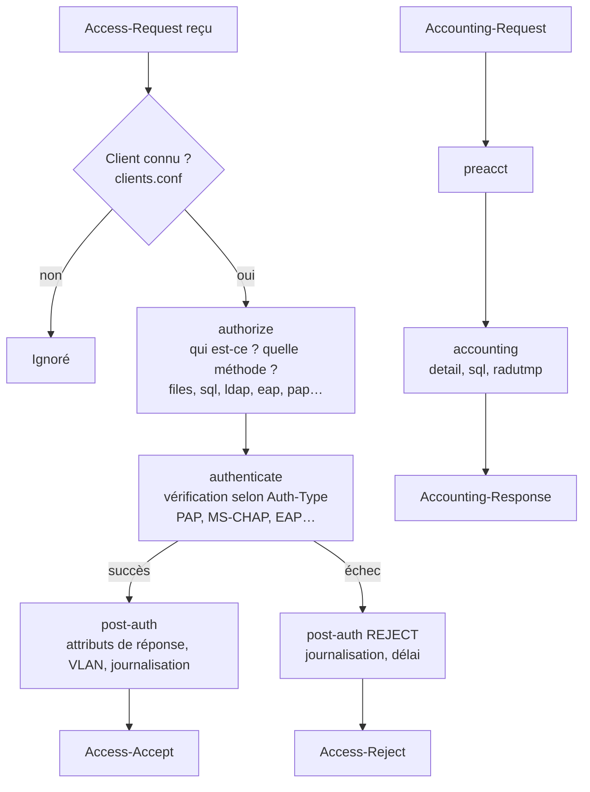

## Le parcours d'une requête



| Section | Rôle |
| --- | --- |
| `authorize` | Rassembler les informations : trouver l'utilisateur (files, sql, ldap), son mot de passe de référence, ses groupes ; choisir la méthode (`Auth-Type`) |
| `authenticate` | Vérifier les identifiants avec le module correspondant à `Auth-Type` |
| `post-auth` | Après décision : ajouter des attributs (VLAN), journaliser, sous-section `Post-Auth-Type REJECT` pour les refus |
| `preacct` / `accounting` | Normaliser puis enregistrer les données de comptabilité |
| `session` | Vérifier les sessions simultanées (`Simultaneous-Use`) |
| `pre-proxy` / `post-proxy` | Avant l'envoi / après la réponse d'un serveur distant |

## Modules et codes de retour

Chaque module appelé dans une section renvoie un **code** qui détermine la suite :

| Code | Signification |
| --- | --- |
| `ok` | Le module a fait son travail avec succès |
| `updated` | Le module a ajouté/modifié des attributs |
| `noop` | Le module n'avait rien à faire |
| `notfound` | Utilisateur / donnée introuvable |
| `reject` | Refus explicite (arrête la section) |
| `fail` | Erreur (base injoignable…) — arrête la section |
| `userlock` | Compte verrouillé |
| `invalid` | Configuration ou requête invalide |
| `handled` | Le module a répondu lui-même (ex. EAP : Access-Challenge) |

On peut modifier le comportement d'un appel :

```radius
authorize {
    ldap {
        fail = 1          # si LDAP échoue, continuer comme si de rien n'était (priorité 1)
        notfound = return # si l'utilisateur n'existe pas, sortir de la section
    }
}
```

### Redondance et répartition

```radius
authorize {
    redundant {          # essaie sql1, puis sql2 si sql1 renvoie fail
        sql1
        sql2
    }
    load-balance {       # choisit un module au hasard
        ldap_dc1
        ldap_dc2
    }
    redundant-load-balance {   # au hasard, avec bascule en cas d'échec
        ldap_dc1
        ldap_dc2
    }
}
```

Plusieurs instances d'un même module se déclarent avec un nom : `ldap ldap_dc1 { server = 'dc1.corp.local' … }`.

## Serveurs virtuels

Un **serveur virtuel** (fichier dans `sites-enabled/`) est un ensemble complet de sections. Il est sélectionné par l'adresse/port d'écoute (`listen`), par le client (`virtual_server` dans `clients.conf`) ou par un autre module (EAP → `inner-tunnel`).

| Site livré | Usage |
| --- | --- |
| `default` | Requêtes de tous les clients (écoute 1812/1813) |
| `inner-tunnel` | Authentification **à l'intérieur** des tunnels PEAP/TTLS |
| `status` | Réponses Status-Server (supervision) sur le port 18121 |
| `tls` | RadSec (RADIUS sur TLS) |
| `coa` | Réception de CoA (proxy) |
| `check-eap-tls` | Vérifications supplémentaires des certificats EAP-TLS |
| `dynamic-clients` | Clients chargés à la volée (SQL…) |

### Exemple : un serveur virtuel dédié au Wi-Fi

```radius sites-available/wifi
server wifi {
    authorize {
        filter_username
        preprocess
        eap {
            ok = return
        }
    }
    authenticate {
        eap
    }
    post-auth {
        # VLAN selon le SSID (Called-Station-Id = "AA-BB-CC-DD-EE-FF:Corp-Invites")
        if (&Called-Station-Id =~ /:Corp-Invites$/i) {
            update reply {
                &Tunnel-Type := VLAN
                &Tunnel-Medium-Type := IEEE-802
                &Tunnel-Private-Group-Id := "50"
            }
        }
        update {
            &reply: += &session-state:
        }
        Post-Auth-Type REJECT {
            attr_filter.access_reject
            eap
            remove_reply_message_if_eap
        }
    }
}
```

Le client `wlc` de `clients.conf` porte `virtual_server = wifi`.

## unlang : le langage de politique

### Références d'attributs

| Syntaxe | Liste |
| --- | --- |
| `&User-Name` ou `&request:User-Name` | Requête reçue |
| `&reply:Session-Timeout` | Réponse à envoyer |
| `&control:Auth-Type` | Attributs de contrôle internes (mot de passe de référence, Auth-Type…) |
| `&session-state:…` | Conservé entre les paquets d'une même conversation EAP |
| `&outer.request:…` / `&outer.session-state:…` | Depuis l'inner-tunnel, la requête externe |
| `&proxy-request:` / `&proxy-reply:` | Paquets échangés avec un serveur distant |
| `&User-Name[1]`, `&Class[*]` | Instance précise / toutes les instances |

### Conditions

```radius
if (&User-Name =~ /^host\/(.+)\.corp\.local$/i) {
    # authentification machine : capture disponible en %{1}
    update control {
        &Tmp-String-0 := "%{1}"
    }
}
elsif (&NAS-Port-Type == Wireless-802.11) {
    ...
}
else {
    ...
}

if (!&Calling-Station-Id) { reject }                       # attribut absent
if (&Framed-IP-Address < 10.0.0.0) { ... }                 # comparaison typée
if ((&Service-Type == Call-Check) && (&NAS-Port-Type == Ethernet)) { ... }
if (ldap) { ... }                                          # code de retour du module
if (ok || updated) { ... }                                 # code de retour de l'appel précédent
if ("%{sql:SELECT COUNT(*) FROM radcheck WHERE username='%{User-Name}'}" > 0) { ... }
```

### update

```radius
update reply {
    &Reply-Message := "Bonjour %{User-Name}"     # remplacer
    &Class += "profil-employe"                   # ajouter une instance
    &Filter-Id !* ANY                            # supprimer
}
update control {
    &Auth-Type := Accept                         # accepter sans vérification (MAB par liste)
}
update request {
    &Stripped-User-Name := "%{tolower:%{User-Name}}"
}
```

### switch / case

```radius
switch &NAS-Port-Type {
    case Wireless-802.11 {
        update reply { &Session-Timeout := 28800 }
    }
    case Ethernet {
        update reply { &Session-Timeout := 86400 }
    }
    case {
        # défaut
    }
}
```

### Expansions utiles

| Expansion | Résultat |
| --- | --- |
| `%{User-Name}` | Valeur d'un attribut |
| `%{%{Stripped-User-Name}:-%{User-Name}}` | Valeur par défaut si vide |
| `%{tolower:%{User-Name}}`, `%{toupper:…}` | Casse |
| `%{md5:…}`, `%{sha256:…}`, `%{base64:…}` | Hachage / encodage |
| `%{expr:%{Session-Timeout} * 2}` | Calcul |
| `%{sql:SELECT …}` / `%{ldap:ldap:///…}` | Requête dans un module |
| `%{exec:/usr/local/bin/script %{User-Name}}` | Commande externe (avec module `exec`) |
| `%{Client-Shortname}`, `%{Client-IP-Address}` | Infos sur le NAS |
| `%l` / `%t` | Horodatage |
| `%{1}` … `%{8}` | Captures de la dernière regex |

### Contrôle de flux

```radius
reject        # refuser immédiatement
ok            # renvoyer ok
return        # quitter la section
noop
handled
foreach &Class { ... "%{Foreach-Variable-0}" ... }
```

## Politiques réutilisables (policy.d)

```radius policy.d/corp
# Utilisable dans n'importe quelle section en écrivant simplement « corp_vlan_par_groupe »
corp_vlan_par_groupe {
    if (&LDAP-Group == "GG-Reseau-Admins") {
        update reply {
            &Tunnel-Type := VLAN
            &Tunnel-Medium-Type := IEEE-802
            &Tunnel-Private-Group-Id := "10"
        }
    }
    elsif (&LDAP-Group == "GG-Employes") {
        update reply {
            &Tunnel-Type := VLAN
            &Tunnel-Medium-Type := IEEE-802
            &Tunnel-Private-Group-Id := "40"
        }
    }
    else {
        reject
    }
}
```

Politiques livrées utiles : `filter_username` (refuse les noms malformés), `rewrite_calling_station_id` (normalise les MAC), `split_username_nai`, `forbid_eap`, `permit_only_eap`, `deny_realms`.

## Exemples de règles fréquentes

### Limiter un SSID / un NAS à un groupe

```radius
post-auth {
    if ((&Called-Station-Id =~ /:Corp-Admin$/i) && !(&LDAP-Group == "GG-Reseau-Admins")) {
        reject
    }
}
```

### Restreindre les horaires de connexion

Le module `logintime` (activé par défaut dans `authorize`) interprète l'attribut de contrôle `Login-Time` :

```radius mods-config/files/authorize
prestataire1 Cleartext-Password := "Pass", Login-Time := "Wk0700-1900,Sa0800-1200"
```

En SQL, la même valeur s'ajoute dans `radgroupcheck` pour tout un groupe (`attribute = 'Login-Time'`, `op = ':='`).

Hors de la plage, la requête est refusée ; dans la plage, `Session-Timeout` est ajusté pour que la session se termine à l'heure limite.

### Refuser les comptes machine sur le Wi-Fi invités

```radius
authorize {
    if ((&User-Name =~ /^host\//) && (&Called-Station-Id =~ /:Corp-Invites$/i)) {
        reject
    }
}
```

### Journaliser chaque décision dans un fichier lisible

```radius
post-auth {
    linelog_access        # instance du module linelog (mods-available/linelog)
}
```

```radius mods-available/linelog (extrait)
linelog linelog_access {
    filename = ${logdir}/acces.log
    format = "%t %{Client-Shortname} %{User-Name} %{Calling-Station-Id} %{reply:Tunnel-Private-Group-Id} %{reply:Packet-Type}"
}
```

> [!TIP]
> Dans `radiusd -X`, chaque ligne `(n) if (...) -> TRUE/FALSE` montre l'évaluation de vos conditions : c'est le meilleur moyen de mettre au point une politique.
