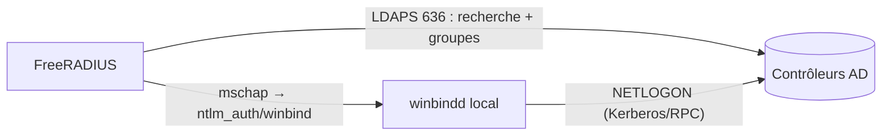

## Deux mécanismes complémentaires

| Besoin | Mécanisme |
| --- | --- |
| Rechercher l'utilisateur, lire ses **groupes** et attributs | Module **`ldap`** (rlm_ldap) |
| Vérifier un mot de passe en **PAP / EAP-TTLS-PAP** | Module `ldap` (bind avec le mot de passe de l'utilisateur) |
| Vérifier un mot de passe en **MS-CHAPv2 / PEAP** contre AD | **Samba winbind + `ntlm_auth`** (le mot de passe n'est jamais disponible côté RADIUS) |



## Module LDAP

### Compte de service

Créez dans AD un compte **sans privilège** (lecture de l'annuaire suffit), mot de passe long, non expirant ou géré par un coffre : `svc-radius`.

### Configuration

```radius mods-available/ldap
ldap {
    server = 'ldaps://dc01.corp.local'
    server = 'ldaps://dc02.corp.local'
    port = 636

    identity = 'CN=svc-radius,OU=Comptes de service,DC=corp,DC=local'
    password = 'MotDePasseDuCompteDeService'
    base_dn = 'DC=corp,DC=local'

    sasl { }

    update {
        control:Password-With-Header += 'userPassword'
        # control:NT-Password := 'ntPassword'       # annuaires Samba/OpenLDAP exposant le hash NT
        reply:Reply-Message := 'radiusReplyMessage'
        control: += 'radiusControlAttribute'
        request: += 'radiusRequestAttribute'
        reply: += 'radiusReplyAttribute'
    }

    user {
        base_dn = "${..base_dn}"
        # sAMAccountName, sans le domaine (Stripped-User-Name rempli par la politique de realm)
        filter = "(&(objectClass=user)(sAMAccountName=%{%{Stripped-User-Name}:-%{User-Name}})(!(userAccountControl:1.2.840.113556.1.4.803:=2)))"
        scope = 'sub'
    }

    group {
        base_dn = "${..base_dn}"
        filter = '(objectClass=group)'
        scope = 'sub'
        name_attribute = cn
        # Appartenance directe via memberOf de l'utilisateur
        membership_attribute = 'memberOf'
        # Appartenance imbriquée (groupes dans des groupes) : règle LDAP_MATCHING_RULE_IN_CHAIN
        membership_filter = "(member:1.2.840.113556.1.4.1941:=%{control:LDAP-UserDn})"
        cacheable_name = 'yes'
        cacheable_dn = 'no'
    }

    options {
        chase_referrals = no      # indispensable avec AD (sinon délais sur les références)
        rebind = yes
        res_timeout = 10
        srv_timelimit = 3
        net_timeout = 1
        idle = 60
        probes = 3
        interval = 3
        ldap_debug = 0x0000
    }

    tls {
        start_tls = no            # ldaps:// déjà chiffré
        ca_file = /etc/ssl/certs/corp-ca.pem
        require_cert = 'demand'
    }

    pool {
        start = ${thread[pool].start_servers}
        min = ${thread[pool].min_spare_servers}
        max = ${thread[pool].max_servers}
        spare = ${thread[pool].max_spare_servers}
        uses = 0
        retry_delay = 30
        lifetime = 0
        idle_timeout = 60
    }
}
```

```bash
cd /etc/freeradius/3.0
sudo ln -s ../mods-available/ldap mods-enabled/ldap && sudo chgrp -h freerad mods-enabled/ldap
# Tester la recherche avec le compte de service
ldapsearch -H ldaps://dc01.corp.local -D 'CN=svc-radius,OU=Comptes de service,DC=corp,DC=local' -W \
  -b 'DC=corp,DC=local' '(sAMAccountName=alice)' memberOf
```

> [!NOTE]
> Le filtre `(!(userAccountControl:1.2.840.113556.1.4.803:=2))` exclut les **comptes désactivés**. La règle `1.2.840.113556.1.4.1941` (*in chain*) résout l'imbrication des groupes, mais elle est coûteuse sur les très grands annuaires.

### Utiliser LDAP dans les sites

```radius sites-enabled/default (extrait)
authorize {
    filter_username
    preprocess
    suffix                 # sépare utilisateur@domaine
    ntdomain               # sépare DOMAINE\utilisateur
    eap { ok = return }
    -ldap                  # recherche de l'utilisateur et des groupes
    if ((ok || updated) && User-Password && !control:Auth-Type) {
        update control { &Auth-Type := ldap }   # PAP : vérifier par bind LDAP
    }
    pap
}
authenticate {
    Auth-Type PAP { pap }
    Auth-Type LDAP { ldap }
    mschap
    eap
}
```

### Autoriser par groupe

```radius sites-enabled/inner-tunnel (post-auth)
post-auth {
    if (LDAP-Group == "GG-WiFi-Employes") {
        update outer.session-state {
            &Tunnel-Type := VLAN
            &Tunnel-Medium-Type := IEEE-802
            &Tunnel-Private-Group-Id := "40"
        }
    }
    elsif (LDAP-Group == "GG-WiFi-Prestataires") {
        update outer.session-state {
            &Tunnel-Type := VLAN
            &Tunnel-Medium-Type := IEEE-802
            &Tunnel-Private-Group-Id := "45"
        }
    }
    else {
        reject
    }
}
```

`LDAP-Group == "nom"` déclenche une vérification d'appartenance (cache par requête). Le nom peut aussi être un DN complet. Pour PEAP/TTLS, appelez `-ldap` dans la section `authorize` de **`inner-tunnel`** : c'est là que la vraie identité de l'utilisateur est connue (l'identité externe est souvent anonyme). Les attributs placés dans `outer.session-state` sont recopiés dans l'Access-Accept final par le `post-auth` du site `default` (`update { &reply: += &session-state: }`).

## Active Directory avec PEAP-MSCHAPv2 : Samba winbind

### 1. Installer et joindre le domaine

```bash
sudo apt install samba winbind krb5-user libnss-winbind libpam-winbind
# RHEL : dnf install samba-winbind samba-winbind-clients krb5-workstation
```

```ini /etc/samba/smb.conf
[global]
    workgroup = CORP
    realm = CORP.LOCAL
    security = ads
    kerberos method = secrets and keytab
    winbind use default domain = yes
    winbind refresh tickets = yes
    idmap config * : backend = tdb
    idmap config * : range = 10000-999999
    # Désactiver les services de fichiers non utilisés
    load printers = no
    printing = bsd
    printcap name = /dev/null
    disable spoolss = yes
```

```ini /etc/krb5.conf
[libdefaults]
    default_realm = CORP.LOCAL
    dns_lookup_realm = false
    dns_lookup_kdc = true
    rdns = false
```

```bash
sudo timedatectl set-ntp true                     # Kerberos : l'heure doit être synchronisée avec les DC
sudo net ads join -U administrateur               # ou un compte délégué pour joindre des ordinateurs
sudo systemctl enable --now winbind
wbinfo -t                                         # « checking the trust secret … succeeded »
wbinfo -u | head                                  # liste des utilisateurs
wbinfo -a 'alice%Mot2Passe!'                      # test d'authentification
```

> [!IMPORTANT]
> Le serveur RADIUS doit utiliser les **DNS de l'Active Directory** (ou un résolveur qui redirige `corp.local` vers eux) : la jonction et winbind s'appuient sur les enregistrements SRV `_ldap._tcp.dc._msdcs.corp.local`.

### 2. Droits de FreeRADIUS sur winbind

```bash
sudo usermod -aG winbindd_priv freerad      # RHEL : groupe « wbpriv », utilisateur radiusd
ls -ld /var/lib/samba/winbindd_privileged
sudo systemctl restart freeradius
```

### 3. Tester ntlm_auth

```bash
ntlm_auth --request-nt-key --domain=CORP --username=alice --password='Mot2Passe!'
# NT_STATUS_OK: The operation completed successfully. (0x0)
sudo -u freerad ntlm_auth --request-nt-key --domain=CORP --username=alice --password='Mot2Passe!'   # avec le compte du service
```

### 4. Configurer le module mschap

```radius mods-available/mschap
mschap {
    use_mppe = yes
    require_encryption = yes
    require_strong = yes
    with_ntdomain_hack = yes

    # Méthode historique : appel du programme ntlm_auth
    ntlm_auth = "/usr/bin/ntlm_auth --allow-mschapv2 --request-nt-key --username=%{mschap:User-Name:-None} --domain=%{%{mschap:NT-Domain}:-CORP} --challenge=%{%{mschap:Challenge}:-00} --nt-response=%{%{mschap:NT-Response}:-00}"
    ntlm_auth_timeout = 10

    # Méthode recommandée (plus rapide, sans fork) si FreeRADIUS est compilé avec libwbclient :
    # winbind_username = "%{mschap:User-Name}"
    # winbind_domain = "CORP"

    pool {
        start = ${thread[pool].start_servers}
        min = 0
        max = ${thread[pool].max_servers}
        spare = ${thread[pool].max_spare_servers}
        uses = 0
        retry_delay = 30
        lifetime = 86400
        cleanup_interval = 300
        idle_timeout = 600
    }
}
```

Test MS-CHAPv2 de bout en bout :

```bash
radtest -t mschap alice 'Mot2Passe!' 127.0.0.1 0 testing123
eapol_test -c peap-test.conf -a 127.0.0.1 -s testing123
```

## Authentification des machines

Les postes Windows peuvent s'authentifier **avant l'ouverture de session** (identité `host/PC01.corp.local`) pour que les GPO, scripts et mises à jour fonctionnent dès le démarrage.

- En PEAP-MSCHAPv2, `ntlm_auth` valide le compte machine `PC01$` : ajoutez une règle qui transforme `host/pc01.corp.local` en `pc01$`.
- En **EAP-TLS** (recommandé), la machine présente son certificat issu de l'auto-inscription AD CS.

```radius policy.d/corp-machines
corp_machine_auth {
    if (&User-Name =~ /^host\/([^.]+)\./i) {
        update request {
            &Stripped-User-Name := "%{tolower:%{1}}$"
        }
        update control {
            &Tmp-String-1 := "machine"
        }
    }
}
```

Pour vérifier qu'un compte machine appartient à un groupe (ex. « Ordinateurs du domaine ») : recherche LDAP avec `(sAMAccountName=%{Stripped-User-Name})` puis `LDAP-Group`.

## Limites à connaître

> [!WARNING]
> **Windows Defender Credential Guard** (activé par défaut sur Windows 11 Entreprise 22H2+) bloque l'authentification unique avec les identifiants de session en **MS-CHAPv2** (PEAP-MSCHAPv2, EAP-TTLS/MSCHAPv2) : les utilisateurs doivent ressaisir leur mot de passe. La solution pérenne est **EAP-TLS** (certificats utilisateurs/machines) ou PEAP-EAP-TLS. Voir [[07-eap-peap-tls]].

| Problème | Piste |
| --- | --- |
| `NT_STATUS_WRONG_PASSWORD` | Mot de passe, ou NTLM restreint sur les DC (*Network security: Restrict NTLM*) |
| `NT_STATUS_NO_SUCH_USER` | Domaine incorrect (`--domain`), utilisateur avec suffixe UPN non retiré |
| `Reading winbind reply failed` / `could not obtain winbind separator` | winbind arrêté ou droits sur `winbindd_privileged` |
| `NT_STATUS_ACCOUNT_LOCKED_OUT` / `NT_STATUS_PASSWORD_EXPIRED` | Compte verrouillé / mot de passe expiré (renvoyer un message clair) |
| Lenteurs | Pool `ntlm_auth` saturé → passer à `winbind_username/winbind_domain` |
| Jonction perdue (`wbinfo -t` échoue) | Mot de passe du compte ordinateur désynchronisé : `net ads join` à nouveau ; vérifier l'heure |
