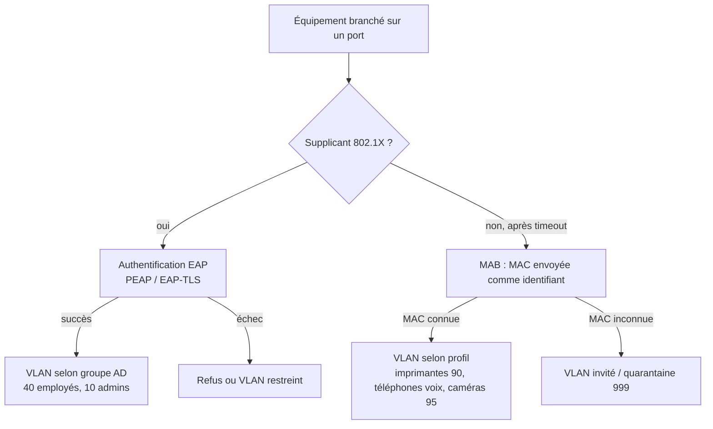

## Scénario type



## Attributs de VLAN dynamique

| Attribut | Valeur | Remarque |
| --- | --- | --- |
| `Tunnel-Type` | `VLAN` (13) | Obligatoire |
| `Tunnel-Medium-Type` | `IEEE-802` (6) | Obligatoire |
| `Tunnel-Private-Group-Id` | `"40"` ou un **nom** de VLAN (`"EMPLOYES"`) | Selon l'équipement ; texte |
| `Filter-Id` | `"ACL-EMPLOYES.in"` | ACL nommée locale à appliquer |
| `Cisco-AVPair` | `"ip:inacl#10=permit ip any 10.0.0.0 0.255.255.255"` | ACL téléchargeable (dACL) |
| `Cisco-AVPair` | `"device-traffic-class=voice"` | Autoriser un téléphone sur le VLAN voix |
| `Aruba-User-Role` | `"employe"` | Rôle Aruba (contrôleur ou CX) |
| `Session-Timeout` + `Termination-Action = RADIUS-Request` | `28800` | Réauthentification périodique |

### Renvoyer le VLAN depuis le tunnel (PEAP/TTLS)

```radius sites-enabled/inner-tunnel (post-auth)
post-auth {
    if (LDAP-Group == "GG-Reseau-Admins") {
        update outer.session-state {
            &Tunnel-Type := VLAN
            &Tunnel-Medium-Type := IEEE-802
            &Tunnel-Private-Group-Id := "10"
        }
    }
    elsif (LDAP-Group == "GG-Employes") {
        update outer.session-state {
            &Tunnel-Type := VLAN
            &Tunnel-Medium-Type := IEEE-802
            &Tunnel-Private-Group-Id := "40"
        }
    }
}
```

```radius sites-enabled/default (post-auth, présent dans la configuration livrée)
post-auth {
    ...
    update {
        &reply: += &session-state:
    }
    ...
}
```

En EAP-TLS, il n'y a pas de tunnel interne : définissez les attributs directement dans `update reply { }` du `post-auth` du site `default` (en fonction de `TLS-Client-Cert-*` ou d'une recherche LDAP).

## MAC Authentication Bypass (MAB)

Les équipements sans supplicant (imprimantes, caméras, badgeuses, téléphones anciens, IoT) sont identifiés par leur **adresse MAC**. Le commutateur envoie un Access-Request dont `User-Name` (et souvent `User-Password`) **est la MAC**.

> [!WARNING]
> Une MAC se **falsifie** en une commande. Le MAB ne doit donner accès qu'à un VLAN **restreint** et filtré (imprimantes ne pouvant parler qu'au serveur d'impression, caméras qu'à l'enregistreur), jamais au VLAN des postes. Complétez par du profilage (DHCP, LLDP/CDP) si possible.

### Format des MAC selon les équipements

| Équipement | `User-Name` envoyé (par défaut) | `Service-Type` |
| --- | --- | --- |
| Cisco IOS/IOS-XE | `aabbccddeeff` | `Call-Check` |
| Aruba / HPE | `aabbccddeeff` (configurable) | `Call-Check` ou `Framed-User` |
| Juniper | `aabbccddeeff` | `Call-Check` |
| Contrôleurs Wi-Fi | variable (`aa-bb-cc-dd-ee-ff`, `aa:bb:…`) | `Call-Check` |

D'où l'intérêt de **normaliser** la MAC à partir de `Calling-Station-Id` (politique livrée `rewrite_calling_station_id` → format `AA-BB-CC-DD-EE-FF`).

### Liste des MAC autorisées

```radius mods-available/files (ajout d'une instance)
files authorized_macs {
    key = "%{Calling-Station-Id}"
    usersfile = ${confdir}/mods-config/files/authorized_macs
}
```

```radius mods-config/files/authorized_macs
# Imprimantes
00-1B-A9-12-34-56
        Reply-Message := "Imprimante RDC",
        Tunnel-Type := VLAN, Tunnel-Medium-Type := IEEE-802, Tunnel-Private-Group-Id := "90"

# Caméra du hall
00-40-8C-11-22-33
        Reply-Message := "Caméra hall",
        Tunnel-Type := VLAN, Tunnel-Medium-Type := IEEE-802, Tunnel-Private-Group-Id := "95"

# Tous les téléphones d'un constructeur (préfixe OUI) : utiliser plutôt une règle unlang (voir plus bas)
```

```radius sites-enabled/default (authorize, avant eap)
authorize {
    filter_username
    preprocess

    # MAB : Service-Type Call-Check et User-Name = MAC
    if (&Service-Type == Call-Check) {
        rewrite_calling_station_id
        authorized_macs
        if (ok) {
            update control {
                &Auth-Type := Accept
            }
            return
        }
        # Équipements reconnus par préfixe constructeur (OUI)
        if (&Calling-Station-Id =~ /^(80-5E-C0|00-15-65)-/i) {          # téléphones Yealink
            update reply {
                &Cisco-AVPair += "device-traffic-class=voice"
            }
            update control { &Auth-Type := Accept }
            return
        }
        # MAC inconnue : VLAN invité (ou « reject » pour refuser)
        update reply {
            &Tunnel-Type := VLAN
            &Tunnel-Medium-Type := IEEE-802
            &Tunnel-Private-Group-Id := "999"
        }
        update control { &Auth-Type := Accept }
        return
    }

    eap { ok = return }
    ...
}
```

> [!TIP]
> Gérez la liste des MAC en **SQL** (table dédiée ou `radcheck` avec `Auth-Type := Accept`) alimentée par l'inventaire/CMDB : plus de redémarrage de FreeRADIUS à chaque nouvel équipement.

## Commutateur Cisco IOS-XE

```cisco
aaa new-model
!
radius server RADIUS-1
 address ipv4 10.0.10.31 auth-port 1812 acct-port 1813
 key 0 SecretSwitchsAcces
 automate-tester username sonde-radius probe-on
radius server RADIUS-2
 address ipv4 10.0.10.32 auth-port 1812 acct-port 1813
 key 0 SecretSwitchsAcces
 automate-tester username sonde-radius probe-on
!
aaa group server radius NAC
 server name RADIUS-1
 server name RADIUS-2
 deadtime 10
 ip radius source-interface Vlan10
!
aaa authentication dot1x default group NAC
aaa authorization network default group NAC
aaa accounting dot1x default start-stop group NAC
aaa accounting update newinfo periodic 1440
!
! CoA (changement d'autorisation / déconnexion depuis le serveur)
aaa server radius dynamic-author
 client 10.0.10.31 server-key SecretSwitchsAcces
 client 10.0.10.32 server-key SecretSwitchsAcces
!
radius-server attribute 6 on-for-login-auth
radius-server attribute 8 include-in-access-req
radius-server attribute 25 access-request include
radius-server attribute 31 mac format ietf upper-case
radius-server dead-criteria time 5 tries 3
radius-server vsa send authentication
radius-server vsa send accounting
!
dot1x system-auth-control
!
interface GigabitEthernet1/0/10
 description Prise bureau 2.14
 switchport mode access
 switchport access vlan 999
 switchport voice vlan 60
 authentication host-mode multi-domain
 authentication order dot1x mab
 authentication priority dot1x mab
 authentication port-control auto
 authentication periodic
 authentication timer reauthenticate server
 authentication event fail action next-method
 authentication event server dead action authorize vlan 40
 authentication event server dead action authorize voice
 authentication event server alive action reinitialize
 authentication violation restrict
 mab
 dot1x pae authenticator
 dot1x timeout tx-period 7
 dot1x max-reauth-req 2
 spanning-tree portfast
```

| Commande | Rôle |
| --- | --- |
| `host-mode single-host` / `multi-domain` / `multi-auth` / `multi-host` | Un appareil / un poste + un téléphone / chaque appareil authentifié individuellement / le premier ouvre le port à tous |
| `order dot1x mab` | Essayer 802.1X puis MAB (délai : `tx-period` × (`max-reauth-req` + 1)) |
| `event server dead action authorize vlan` | **Mode dégradé** si aucun RADIUS ne répond |
| `timer reauthenticate server` | Utilise le `Session-Timeout` envoyé par RADIUS |
| `attribute 31 mac format` | Format de `Calling-Station-Id` |

> [!NOTE]
> Les versions récentes d'IOS-XE proposent la syntaxe **IBNS 2.0** (`access-session`, `policy-map type control subscriber`) plus souple ; `authentication convert-to new-style` convertit l'ancienne configuration.

### Déploiement progressif : mode monitor / low-impact

1. **Monitor mode** : `authentication open` sur les ports → tout le trafic passe, mais les authentifications sont journalisées. Corriger les échecs.
2. **Low-impact** : `authentication open` + ACL de port pré-authentification (DHCP, DNS, PXE autorisés), puis dACL après succès.
3. **Closed mode** : retrait de `authentication open`.

### Vérifications côté switch

```cisco
show access-session interface Gi1/0/10 details
show authentication sessions interface Gi1/0/10 details
show aaa servers
test aaa group NAC alice Mot2Passe! new-code
debug radius authentication
```

## Aruba CX / HPE (exemple)

```cisco
radius-server host 10.0.10.31 key plaintext SecretSwitchsAcces
radius-server host 10.0.10.32 key plaintext SecretSwitchsAcces
aaa group server radius NAC
    server 10.0.10.31
    server 10.0.10.32
aaa authentication port-access dot1x authenticator
    radius server-group NAC
    enable
aaa authentication port-access mac-auth
    radius server-group NAC
    enable
interface 1/1/10
    aaa authentication port-access client-limit 3
    aaa authentication port-access auth-precedence dot1x mac-auth
    aaa authentication port-access dot1x authenticator
        enable
    aaa authentication port-access mac-auth
        enable
```

## Wi-Fi (contrôleurs et bornes)

- Déclarer chaque contrôleur (ou chaque borne en mode autonome) dans `clients.conf`.
- SSID en **WPA2/WPA3-Entreprise**, serveurs RADIUS d'authentification et d'accounting, **AAA override** (Cisco) / *Override VLAN* activé pour accepter le VLAN renvoyé.
- `Called-Station-Id` contient le SSID (`…:Corp`) : utile pour différencier les politiques par SSID.
- Activer le *fast roaming* (802.11r / OKC / PMK caching) : il réduit les réauthentifications complètes.

## Change of Authorization (CoA)

Le serveur peut forcer une **réauthentification** ou une **déconnexion** d'une session (changement de groupe, poste compromis) :

```bash
# Réauthentification (Cisco) d'une session identifiée par la MAC
echo 'Calling-Station-Id = "AA-BB-CC-DD-EE-FF", Cisco-AVPair = "subscriber:command=reauthenticate"' | radclient -x 10.0.1.21:1700 coa SecretSwitchsAcces
# Déconnexion
echo 'Calling-Station-Id = "AA-BB-CC-DD-EE-FF"' | radclient -x 10.0.1.21:3799 disconnect SecretSwitchsAcces
```

(Port CoA : 1700 sur Cisco IOS par défaut, 3799 selon la RFC et d'autres constructeurs.)
