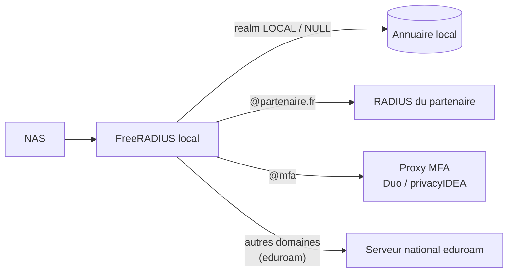

## Accounting

Le NAS envoie des **Accounting-Request** au port 1813 :

| `Acct-Status-Type` | Moment |
| --- | --- |
| `Start` | Début de session |
| `Interim-Update` | Périodiquement (IP obtenue, compteurs d'octets) |
| `Stop` | Fin de session (avec `Acct-Terminate-Cause`) |
| `Accounting-On` / `Accounting-Off` | Redémarrage / arrêt du NAS : toutes ses sessions sont closes |

Attributs utiles : `Acct-Session-Id`, `Acct-Unique-Session-Id` (calculé par FreeRADIUS), `Acct-Session-Time`, `Acct-Input-Octets`/`Acct-Output-Octets` (+ `Gigawords`), `Framed-IP-Address`, `Calling-Station-Id`, `NAS-Port-Id`.

### Destinations

```radius sites-enabled/default (accounting)
preacct {
    preprocess
    acct_unique          # calcule Acct-Unique-Session-Id
    suffix
}
accounting {
    detail               # fichier texte par NAS et par jour : ${radacctdir}/<NAS>/detail-AAAAMMJJ
    -sql                 # table radacct (voir l'article SQL)
    unix                 # wtmp (rarement utile)
    exec
    attr_filter.accounting_response
}
```

> [!TIP]
> Les sessions **avec IP et MAC** issues de l'accounting permettent de répondre à la question « qui avait l'adresse 10.0.40.57 le 12 mars à 14 h 05 ? » — exigence fréquente des RSSI et des réquisitions judiciaires. Configurez des **Interim-Update** (ex. toutes les 15 min à 24 h) sur les NAS pour récupérer l'IP attribuée.

### Rejouer / transférer l'accounting (detail + robust-proxy-accounting)

Le fichier `detail` sert aussi de **file d'attente** : un serveur virtuel `buffered-sql` lit les fichiers detail et les insère dans SQL, ce qui découple la réponse au NAS de la disponibilité de la base (`sites-available/buffered-sql`).

## Proxy et realms

Un **realm** est la partie domaine de l'identifiant (`alice@partenaire.fr`, `PARTENAIRE\alice`). FreeRADIUS peut **relayer** les requêtes d'un realm vers un autre serveur RADIUS.



### proxy.conf

```radius proxy.conf
proxy server {
    default_fallback = no
}

home_server partenaire1 {
    type = auth+acct
    ipaddr = 192.0.2.10
    port = 1812
    secret = "Secret-Partenaire"
    require_message_authenticator = yes
    response_window = 20
    zombie_period = 40
    revive_interval = 120
    status_check = status-server
    check_interval = 30
    check_timeout = 4
    num_answers_to_alive = 3
}

home_server partenaire2 {
    type = auth+acct
    ipaddr = 192.0.2.11
    port = 1812
    secret = "Secret-Partenaire"
    status_check = status-server
}

home_server_pool pool_partenaire {
    type = fail-over          # ou load-balance, client-balance, keyed-balance
    home_server = partenaire1
    home_server = partenaire2
}

realm partenaire.fr {
    auth_pool = pool_partenaire
    acct_pool = pool_partenaire
    nostrip                   # transmettre « alice@partenaire.fr » sans retirer le domaine
}

# Realms traités localement
realm corp.exemple.fr {
}
realm LOCAL {
}
realm NULL {                  # identifiants sans domaine
}

# Tout le reste (eduroam : vers les serveurs de fédération nationale)
# realm "~.+$" {
#     auth_pool = eduroam_flr
#     nostrip
# }
```

Dans `sites-enabled/default`, le module `suffix` (ou `ntdomain`) découpe l'identité et positionne `Proxy-To-Realm`. Forcer ou interdire le proxy :

```radius
authorize {
    suffix
    if (&Realm == "partenaire.fr" && &NAS-Port-Type != Wireless-802.11) {
        reject                                   # ce partenaire n'est accepté qu'en Wi-Fi
    }
    update control {
        &Proxy-To-Realm := "partenaire.fr"       # forcer un realm
    }
}
```

> [!NOTE]
> En PEAP/TTLS, l'**identité externe** (`anonymous@partenaire.fr`) sert au routage vers le bon serveur ; la vraie identité reste chiffrée dans le tunnel jusqu'au serveur du partenaire, qui seul la voit.

### eduroam (principes)

- Le serveur institutionnel (IdP/SP) relaie vers les **FLR** (Federation Level RADIUS) de la fédération nationale (RENATER en France) les identités dont le realm n'est pas local.
- Exigences : `Operator-Name`, `Chargeable-User-Identity`, filtrage des attributs renvoyés (VLAN interne interdit vers l'extérieur), journalisation avec conservation légale, EAP uniquement.
- Les fédérations fournissent des modèles de configuration FreeRADIUS complets (`sites-available/eduroam`, `eduroam-inner-tunnel`).

## MFA par proxy RADIUS

Pour ajouter un second facteur aux VPN ou à l'administration des équipements :

| Solution | Principe |
| --- | --- |
| **Duo Authentication Proxy** | Le NAS (ou FreeRADIUS) envoie à Duo Proxy, qui vérifie le mot de passe (AD/RADIUS) puis envoie un push |
| **privacyIDEA** | FreeRADIUS appelle l'API via `rlm_perl` (plugin fourni) ou `rlm_rest` |
| **Microsoft Entra ID (NPS extension)** | NPS + extension MFA ; FreeRADIUS peut relayer vers NPS |
| **OTP local** (TOTP) | `rlm_totp` (3.2) : `TOTP-Secret` stocké par utilisateur, code ajouté au mot de passe |

```radius
# Exemple : relayer vers le proxy MFA les connexions VPN
authorize {
    if (&Client-Shortname == "vpn-gateway") {
        update control { &Proxy-To-Realm := "mfa" }
    }
}
```

## RadSec (RADIUS sur TLS)

RADIUS/UDP ne chiffre que le mot de passe PAP et repose sur MD5. **RadSec** (RFC 6614, TCP 2083) encapsule RADIUS dans TLS avec authentification mutuelle par certificats — recommandé pour les liaisons sur Internet (eduroam, bornes Wi-Fi cloud, sites distants).

```bash
sudo ln -s ../sites-available/tls /etc/freeradius/3.0/sites-enabled/tls
```

```radius sites-available/tls (extrait — écoute)
listen {
    ipaddr = *
    port = 2083
    type = auth+acct
    proto = tcp
    virtual_server = default
    clients = radsec
    tls {
        private_key_file = ${certdir}/radius.key
        certificate_file = ${certdir}/radius-chain.pem
        ca_file = ${certdir}/radsec-ca.pem
        require_client_cert = yes
        tls_min_version = "1.2"
    }
}
clients radsec {
    client borne-cloud {
        ipaddr = 0.0.0.0/0
        proto = tls
        secret = radsec              # secret fixe imposé par la RFC
    }
}
```

> [!TIP]
> Pour relier des NAS qui ne parlent qu'UDP à un serveur RadSec distant, utilisez un relais **radsecproxy** local.

## Status-Server

```bash
sudo ln -s ../sites-available/status /etc/freeradius/3.0/sites-enabled/status
# Statistiques internes (requêtes, rejets, files d'attente)
echo "Message-Authenticator = 0x00, FreeRADIUS-Statistics-Type = All, Response-Packet-Type = Access-Accept" \
  | radclient -x 127.0.0.1:18121 status adminsecret
```

Utilisé par les NAS et les `home_server` pour détecter un serveur vivant, et par la supervision (plugin Centreon `apps::freeradius::plugin`, mode `statistics`).

## Envoyer des CoA / Disconnect

```bash
# Déconnecter une session sur un contrôleur Wi-Fi
cat <<'EOF' | radclient -x 10.0.80.10:3799 disconnect Secret-WLC-Different
User-Name = "alice"
Calling-Station-Id = "AA-BB-CC-DD-EE-FF"
Acct-Session-Id = "5F1A2B3C/aa:bb:cc:dd:ee:ff/1234"
EOF
```

FreeRADIUS peut aussi **originer automatiquement** des CoA (sous-section `update coa { … }` dans un `post-auth` ou `accounting`) ou relayer des CoA reçus via `sites-available/coa` et `home_server` de type `coa`.
