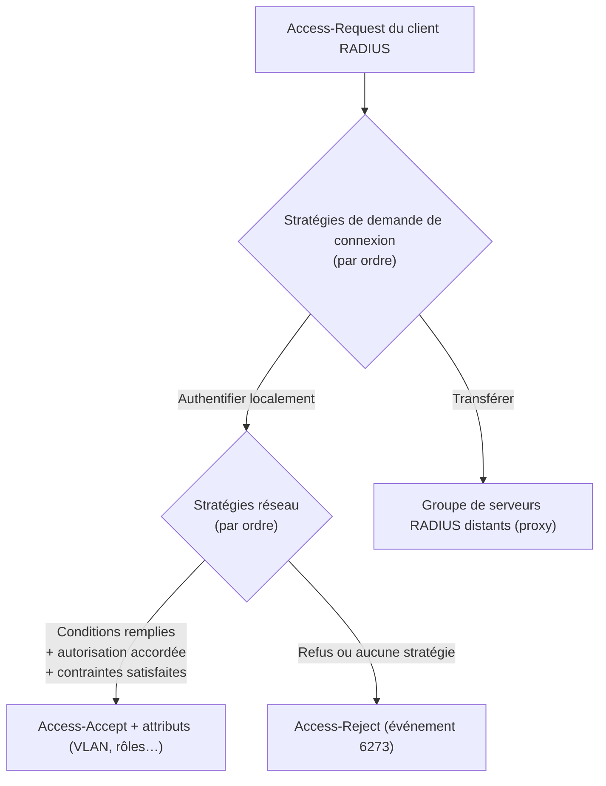

**NPS** (*Network Policy Server*) est l'implémentation **RADIUS** de Windows Server. Il authentifie les utilisateurs et les ordinateurs **contre Active Directory** pour le Wi-Fi et le filaire en **802.1X**, les **VPN** et l'**administration** des routeurs, commutateurs et pare-feu. Les concepts RADIUS (Access-Request, attributs, EAP) sont détaillés dans [[01-freeradius/01-presentation|FreeRADIUS]].

## Installation

```powershell
Install-WindowsFeature NPAS -IncludeManagementTools
# Enregistrer NPS dans AD : ajout au groupe « Serveurs RAS et IAS » (lecture des propriétés de connexion des comptes)
netsh nps add registeredserver domain=corp.exemple.fr server=srv-nps-01.corp.exemple.fr
# Console : nps.msc
```

Ports : **1812/UDP** (authentification), **1813/UDP** (comptabilité) — règles de pare-feu créées automatiquement.

## Clients RADIUS

```powershell
New-NpsRadiusClient -Name "wlc-siege" -Address 10.0.99.20 -SharedSecret "SecretRadiusTresLongEtAleatoire" -VendorName "RADIUS Standard"
New-NpsRadiusClient -Name "commutateurs-acces" -Address 10.0.99.0/24 -SharedSecret "AutreSecretTresLong"
Get-NpsRadiusClient
```

Un secret **différent et long** (≥ 22 caractères aléatoires) par type d'équipement ; les plages d'adresses simplifient la gestion des commutateurs.

> [!IMPORTANT]
> **Blast-RADIUS (CVE-2024-3596)** : une attaque sur l'intégrité des réponses RADIUS non protégées. Exigez l'attribut **Message-Authenticator** des clients (*Les messages Access-Request doivent contenir l'attribut Message-Authenticator*, paramètre `requireMsgAuth` par client et mise à jour de NPS) et mettez à jour les équipements ; privilégiez EAP (qui l'inclut toujours) et un réseau d'administration dédié pour RADIUS.

## Traitement d'une demande



| Élément | Rôle |
| --- | --- |
| **Stratégie de demande de connexion** | Où traiter : localement ou transférer à un autre serveur RADIUS ; conditions (type de port NAS, adresse du client, domaine de l'utilisateur) |
| **Stratégie réseau** | Qui a accès : **conditions** (groupes Windows, type de port NAS, identifiant de la station), **contraintes** (méthodes EAP, horaires, délai d'inactivité), **paramètres** (attributs renvoyés) |
| Propriétés de connexion du compte | Onglet *Appel entrant* : « Contrôler l'accès via la stratégie réseau NPS » (défaut) |

Les stratégies sont évaluées **dans l'ordre** ; la première dont les conditions correspondent s'applique (accorder ou refuser). Placez les stratégies spécifiques en premier et gardez les stratégies par défaut (refus) en dernier.

## Exemple : stratégie Wi-Fi d'entreprise

| Onglet | Réglage |
| --- | --- |
| Conditions | *Groupes Windows* : `CORP\GG-WiFi-Corp` (utilisateurs) **ou** `CORP\Ordinateurs du domaine` ; *Type de port NAS* : Sans fil – IEEE 802.11 |
| Contraintes | *Méthodes d'authentification* : **EAP-TLS** (Carte à puce ou autre certificat) ou PEAP (EAP-MSCHAPv2) ; décocher les méthodes moins sûres (MS-CHAP v1, PAP, CHAP) |
| Paramètres | Attributs standard pour le VLAN dynamique (voir l'article suivant) |

Le certificat **serveur** NPS (modèle *Serveur RAS et IAS* d'AD CS) doit être approuvé par les clients — voir [[01-active-directory/10-adcs-pki|AD CS et PKI]].

## Proxy RADIUS

```text Stratégie de demande de connexion « Partenaire »
Conditions : Nom d'utilisateur correspond à « .*@partenaire\.fr$ »
Paramètres : Transférer les demandes vers le groupe de serveurs distants « RADIUS-Partenaire »
             Attribut : retirer le suffixe @partenaire.fr avant transfert (si requis)
```

## Comptabilité

*Comptabilité → Configurer la comptabilité* : fichier texte local (`C:\Windows\System32\LogFiles\IN*.log`, format IAS ou DTS XML) ou base **SQL Server** (procédure stockée `report_event`), avec option d'arrêter les authentifications si la journalisation échoue (exigence de traçabilité).

## Exporter et importer

```powershell
Export-NpsConfiguration -Path D:\Sauvegardes\nps-config.xml
Import-NpsConfiguration -Path D:\Sauvegardes\nps-config.xml        # sur le second serveur NPS
# ou : netsh nps export filename="D:\nps.xml" exportPSK=YES
```

Déployez **au moins deux** serveurs NPS (déclarés comme primaire et secondaire sur chaque équipement) et synchronisez leur configuration par export/import planifié.

Suite : [[02-8021x-vpn-equipements-depannage|802.1X, VPN, équipements et dépannage]].
