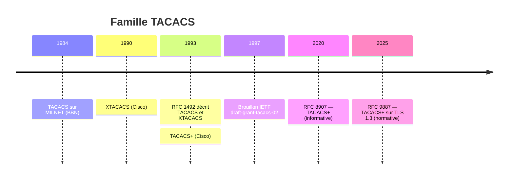
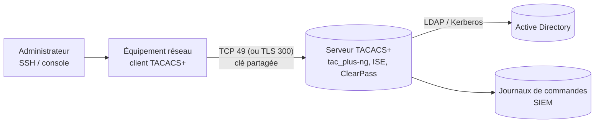

**TACACS** (*Terminal Access Controller Access-Control System*) désigne une famille de protocoles d'**AAA** (authentification, autorisation, comptabilité) née pour contrôler l'accès aux serveurs de terminaux. Aujourd'hui, seul **TACACS+** est utilisé. C'est la référence pour l'**administration des équipements réseau** : qui peut se connecter à un routeur, un commutateur ou un pare-feu, avec quels droits, et quelles commandes il a tapées.

> [!NOTE]
> Le nom est trompeur : **TACACS+ n'est pas une extension de TACACS**. C'est un protocole entièrement différent, incompatible avec TACACS et XTACACS, conçu par Cisco en reprenant seulement le nom.

## Les trois protocoles

| | TACACS | XTACACS | TACACS+ |
| --- | --- | --- | --- |
| Origine | BBN, réseau MILNET (1984) | Cisco (1990) | Cisco (1993) |
| Normalisation | RFC 1492 (1993, informative) | Décrit dans la RFC 1492 | Brouillon Cisco (1997), puis **RFC 8907** (2020) ; TLS 1.3 : **RFC 9887** |
| Transport | UDP (ou TCP) port **49** | UDP port **49** | **TCP** port **49** ; TLS : TCP **300** |
| Fonctions AAA | Authentification seulement | Authentification, autorisation minimale, comptabilité | Authentification, autorisation, comptabilité **séparées** |
| Confidentialité | Mot de passe **en clair** | Mot de passe **en clair** | Corps du paquet **masqué** (MD5) ; vrai chiffrement avec TLS |
| Autorisation par commande | Non | Non | **Oui** |
| Statut | Obsolète | Obsolète, retiré des équipements | Utilisé partout |

Le détail de chacun se trouve dans :

- [[04-tacacs/02-protocole-tacacs-xtacacs|TACACS et XTACACS]] : les protocoles historiques ;
- [[04-tacacs/03-protocole-tacacs-plus|Le protocole TACACS+]] : paquets, échanges, attributs ;
- [[04-tacacs/04-tacacs-plus-tls|TACACS+ sur TLS 1.3]] : la sécurisation moderne.

## Chronologie

- **1984** : BBN conçoit TACACS pour authentifier les utilisateurs des serveurs de terminaux (*TAC*) qui donnent accès au réseau militaire MILNET.
- **1990** : Cisco étend le protocole avec **XTACACS** (*Extended TACACS*), qui ajoute des messages pour la comptabilité et quelques informations d'autorisation.
- **1993** : la **RFC 1492**, rédigée par C. Finseth, documente TACACS et XTACACS tels qu'implémentés. La même année, Cisco publie **TACACS+**.
- **1997** : Cisco soumet le brouillon `draft-grant-tacacs-02`. Il ne devient pas une RFC mais sert de référence pendant plus de vingt ans.
- **2020** : la **RFC 8907** décrit enfin TACACS+ tel que déployé. Elle a un statut informatif, car le protocole existait déjà, et ses faiblesses de sécurité sont reconnues.
- **2025** : la **RFC 9887** normalise **TACACS+ sur TLS 1.3**, qui remplace le masquage MD5 par un vrai chiffrement.

## À quoi sert TACACS+ aujourd'hui

1. **Authentification** : l'administrateur se connecte avec son compte personnel (souvent celui de l'Active Directory), pas avec un compte partagé `admin`.
2. **Autorisation** : selon son groupe, il obtient un niveau de privilège, un rôle, ou une liste de commandes autorisées. Chaque commande peut être soumise au serveur avant exécution.
3. **Comptabilité** : chaque connexion, chaque commande et chaque changement de configuration est journalisé avec le nom de l'utilisateur, l'équipement et l'heure.

## TACACS+ ou RADIUS ?

| Critère | TACACS+ | RADIUS |
| --- | --- | --- |
| Usage principal | **Administration des équipements** (*device administration*) | **Accès réseau** (802.1X, Wi-Fi, VPN) |
| Transport | TCP 49 (fiable, connexion) | UDP 1812/1813 |
| Confidentialité | Tout le corps du paquet est masqué | Seul le mot de passe PAP est masqué |
| Séparation AAA | Trois échanges indépendants : le serveur d'autorisation peut différer de celui d'authentification | Authentification et autorisation dans la même réponse |
| Autorisation par commande | **Oui**, chaque commande est soumise | Non (niveau de privilège ou profil global) |
| Journalisation des commandes | **Oui**, nativement | Limitée |
| EAP / 802.1X | Non | **Oui** |
| Normalisation | RFC 8907 (informative), RFC 9887 | RFC 2865/2866 (standard) |
| Prise en charge | Équipements réseau, pare-feu, quelques systèmes | Quasiment universelle |

Les deux protocoles cohabitent souvent : **RADIUS** pour les utilisateurs qui se connectent au réseau (voir [[01-freeradius/01-presentation|FreeRADIUS]]), **TACACS+** pour les administrateurs qui configurent les équipements. RADIUS peut aussi servir à l'administration (voir [[01-freeradius/09-administration-equipements|administration des équipements avec RADIUS]]), mais sans contrôle commande par commande.

## Pages de cette section

| Page | Contenu |
| --- | --- |
| [[04-tacacs/02-protocole-tacacs-xtacacs\|TACACS et XTACACS]] | Format des paquets RFC 1492, types de requêtes, codes de raison, configuration historique Cisco |
| [[04-tacacs/03-protocole-tacacs-plus\|Protocole TACACS+]] | En-tête, masquage, authentification, autorisation, comptabilité, paires attribut-valeur |
| [[04-tacacs/04-tacacs-plus-tls\|TACACS+ sur TLS]] | RFC 9887, port 300, certificats, migration |
| [[04-tacacs/05-serveurs\|Serveurs TACACS+]] | tac_plus-ng, tac_plus, tacquito, Cisco ISE, ClearPass, FortiAuthenticator… |
| [[04-tacacs/06-tac-plus-ng\|tac_plus-ng]] | Installation, configuration, utilisateurs, profils, règles, LDAP/AD |
| [[04-tacacs/07-tac-plus-shrubbery\|tac_plus (Shrubbery)]] | Le serveur historique et sa syntaxe |
| [[04-tacacs/08-equipements-cisco\|Équipements Cisco]] | IOS / IOS XE, NX-OS, IOS XR, ASA |
| [[04-tacacs/09-equipements-autres\|Autres constructeurs et Linux]] | Juniper, Arista, HPE/Aruba, Huawei, Fortinet, Palo Alto, Linux (PAM) |
| [[04-tacacs/10-politiques-autorisation\|Politiques d'autorisation]] | Rôles, privilèges, listes de commandes, secours local |
| [[04-tacacs/11-journalisation\|Journalisation et supervision]] | Comptabilité, format des journaux, SIEM, supervision |
| [[04-tacacs/12-securite-depannage\|Sécurité et dépannage]] | Faiblesses, durcissement, débogage, erreurs courantes |
| [[04-tacacs/90-aide-memoire\|Aide-mémoire]] | Commandes et valeurs essentielles |

## Références

- RFC 1492 — *An Access Control Protocol, Sometimes Called TACACS* (C. Finseth, 1993).
- RFC 8907 — *The Terminal Access Controller Access-Control System Plus (TACACS+) Protocol* (2020).
- RFC 9887 — *TACACS+ over TLS 1.3* (2025).
- `draft-grant-tacacs-02` — le brouillon Cisco de 1997, historique.
