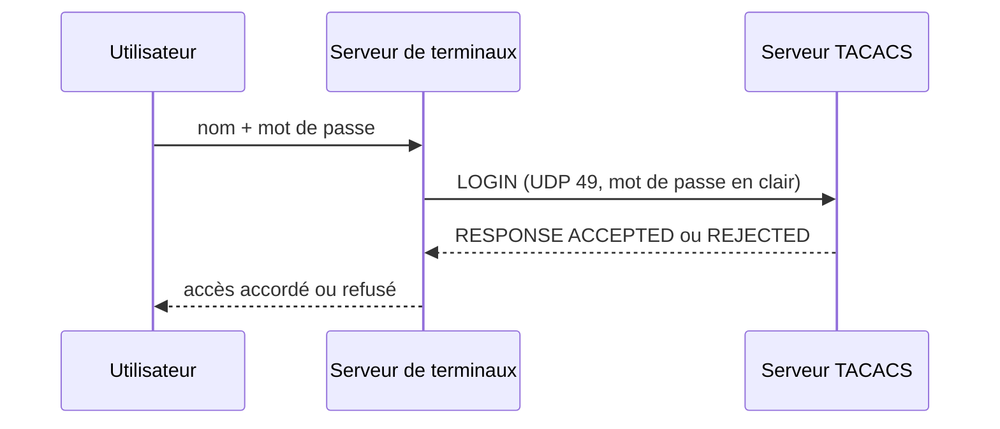

TACACS et XTACACS sont **obsolètes**. On ne les rencontre plus que dans de très vieux réseaux, des sujets d'examen ou des captures historiques. Les connaître aide à comprendre l'origine de TACACS+ et à reconnaître une configuration héritée à migrer.

> [!WARNING]
> TACACS et XTACACS transportent le **mot de passe en clair** sur UDP, sans aucune authentification des réponses. Ne les déployez jamais. Cisco a retiré leur prise en charge des versions récentes d'IOS au profit de TACACS+.

## TACACS (1984)

Le protocole d'origine fait une seule chose : **vérifier un couple utilisateur / mot de passe**. Le serveur de terminaux (le client TACACS) envoie une requête, le serveur répond « accepté » ou « refusé ».

- Transport : **UDP port 49** (la RFC autorise aussi TCP, rarement utilisé).
- Pas de secret partagé, pas de chiffrement, pas de contrôle d'intégrité.
- Le serveur ne fait qu'authentifier : pas d'autorisation ni de journalisation des sessions.



### Paquet simple

La RFC 1492 décrit un format « simple », identifié par le champ version à `0` :

| Octets | Champ | Rôle |
| --- | --- | --- |
| 1 | `version` | `0` pour le format simple |
| 1 | `type` | Type de requête (`1` = LOGIN, `2` = RESPONSE) |
| 2 | `nonce` | Valeur choisie par le client, recopiée dans la réponse pour l'associer à la requête |
| 1 | `username length` | Longueur du nom d'utilisateur |
| 1 | `password length` | Longueur du mot de passe |
| n | `username` puis `password` | En clair |

Dans la réponse, deux octets s'ajoutent : `response` (`1` = ACCEPTED, `2` = REJECTED) et `reason`.

## XTACACS (1990)

Cisco étend TACACS pour que le serveur soit informé de ce que fait l'utilisateur : connexions sortantes, passage en mode privilégié, déconnexion, sessions SLIP. Le serveur peut ainsi **journaliser** l'activité (ancêtre de la comptabilité) et prendre quelques décisions d'**autorisation** (accepter ou refuser une connexion vers un hôte).

### Paquet étendu

Le champ version vaut `128` (`0x80`). L'en-tête est plus long :

| Octets | Champ | Rôle |
| --- | --- | --- |
| 1 | `version` | `128` pour le format étendu |
| 1 | `type` | Type de requête (voir ci-dessous) |
| 2 | `nonce` | Association requête/réponse |
| 1 | `username length` | Longueur du nom |
| 1 | `password length` | Longueur du mot de passe |
| 1 | `response` | Rempli par le serveur : ACCEPTED ou REJECTED |
| 1 | `reason` | Raison du refus ou de la fin de session |
| 4 | `result1` | Résultat renvoyé par le serveur (par exemple une liste d'accès à appliquer) |
| 4 | `destination address` | Adresse IP de destination (requêtes CONNECT, SLIP) |
| 2 | `destination port` | Port TCP de destination |
| 2 | `line` | Ligne (port) du serveur de terminaux utilisée |
| 4 | `result2` | Résultat complémentaire |
| 2 | `result3` | Résultat complémentaire |
| n | données | Nom puis mot de passe, en clair |

### Types de requêtes

| Valeur | Type | Signification |
| --- | --- | --- |
| 1 | LOGIN | Authentification d'un utilisateur à la connexion |
| 2 | RESPONSE | Réponse du serveur |
| 3 | CHANGE | Changement de mot de passe |
| 4 | FOLLOW | Le serveur renvoie le client vers un autre serveur |
| 5 | CONNECT | L'utilisateur ouvre une connexion sortante (Telnet, rlogin) vers une destination |
| 6 | SUPERUSER | Demande du mode privilégié (`enable`) |
| 7 | LOGOUT | Fin de session (journalisation) |
| 8 | RELOAD | Le serveur de terminaux a redémarré |
| 9 | SLIPON | Début d'une session SLIP |
| 10 | SLIPOFF | Fin d'une session SLIP |
| 11 | SLIPADDR | Demande d'autorisation d'une adresse SLIP |

### Codes de raison

| Valeur | Raison | Signification |
| --- | --- | --- |
| 0 | NONE | Aucune raison particulière |
| 1 | EXPIRING | Le mot de passe expire bientôt (accepté) |
| 2 | PASSWORD | Mot de passe incorrect |
| 3 | DENIED | Accès refusé par la politique |
| 4 | QUIT | Fin de session demandée par l'utilisateur |
| 5 | IDLE | Fin de session pour inactivité |
| 6 | DROP | Perte de la porteuse ou de la ligne |
| 7 | BAD | Format de requête invalide |

## Configuration héritée sur Cisco IOS

Sur d'anciennes versions d'IOS (12.x et antérieures), on rencontre ces commandes. Elles servent surtout à **reconnaître** une configuration à migrer :

```cisco
! TACACS / XTACACS historique (sans aaa new-model)
tacacs-server host 10.0.1.10
tacacs-server extended            ! active XTACACS
tacacs-server retransmit 2
tacacs-server timeout 5
tacacs-server last-resort password ! si le serveur ne répond pas, accepter le mot de passe enable
enable use-tacacs                 ! mode privilégié vérifié par TACACS
tacacs-server notify connect      ! informer le serveur des connexions sortantes
tacacs-server notify enable
tacacs-server notify logout
!
line vty 0 4
 login tacacs
```

| Commande | Rôle |
| --- | --- |
| `login tacacs` | Les lignes utilisent TACACS pour l'authentification (sans le modèle AAA) |
| `tacacs-server extended` | Passe en XTACACS |
| `tacacs-server notify …` | Envoie au serveur les messages CONNECT, SUPERUSER, LOGOUT (journalisation XTACACS) |
| `tacacs-server last-resort` | Comportement si aucun serveur ne répond |
| `enable use-tacacs` | Vérifie le passage en mode privilégié auprès du serveur |

## Migrer vers TACACS+

1. **Installer un serveur TACACS+** (voir [[04-tacacs/05-serveurs|serveurs TACACS+]]) et reprendre les comptes, idéalement en liant le serveur à l'annuaire.
2. **Activer le modèle AAA** sur l'équipement (`aaa new-model`) et déclarer le serveur avec une **clé partagée** propre à l'équipement ou au groupe d'équipements.
3. **Remplacer `login tacacs`** par `login authentication <liste>` sur les lignes, et `enable use-tacacs` par `aaa authentication enable default group <groupe> enable`.
4. **Ajouter l'autorisation et la comptabilité** : niveau de privilège renvoyé par le serveur, autorisation et journalisation des commandes.
5. **Supprimer les anciennes commandes** `tacacs-server extended`, `tacacs-server notify`, `tacacs-server last-resort`.

La configuration complète est détaillée dans [[04-tacacs/08-equipements-cisco|Équipements Cisco]].

> [!TIP]
> Dans une capture Wireshark, le filtre `tacacs` affiche TACACS et XTACACS (UDP), et `tacplus` affiche TACACS+ (TCP). Un trafic UDP sur le port 49 trahit un protocole hérité à éliminer.
