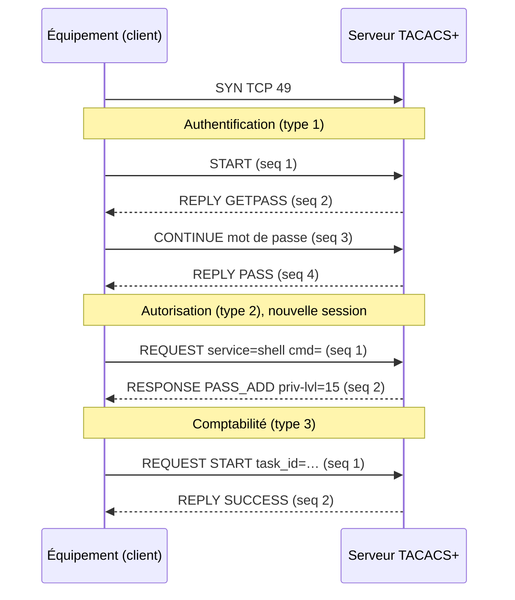

TACACS+ sépare strictement les trois fonctions **AAA** : chaque fonction a ses propres paquets, et l'équipement peut les confier à des serveurs différents. Ce découpage permet par exemple d'authentifier l'utilisateur une seule fois, puis de soumettre chacune de ses commandes à une autorisation et une journalisation.

## Transport et session

- **TCP, port 49.** Le transport fiable évite les retransmissions applicatives de RADIUS et signale immédiatement un serveur arrêté (connexion refusée).
- Une **session** correspond à un échange complet (une authentification, une autorisation ou un enregistrement de comptabilité). Elle est identifiée par un `session_id` aléatoire de 4 octets.
- Les paquets d'une session sont numérotés par `seq_no` : le client envoie les numéros **impairs** (1, 3, 5…), le serveur les numéros **pairs** (2, 4, 6…). La session se termine si le numéro atteint 255.
- Par défaut, une connexion TCP par session. En mode **single-connection**, client et serveur conservent une seule connexion pour plusieurs sessions, ce qui réduit la charge pour l'autorisation des commandes (option `single-connection` côté équipement, voir [[04-tacacs/08-equipements-cisco|Cisco]]).



## En-tête commun (12 octets)

```text
 0                   1                   2                   3
 0 1 2 3 4 5 6 7 8 9 0 1 2 3 4 5 6 7 8 9 0 1 2 3 4 5 6 7 8 9 0 1
+-------+-------+---------------+---------------+---------------+
|major  | minor |     type      |    seq_no     |     flags     |
|version|version|               |               |               |
+-------+-------+---------------+---------------+---------------+
|                          session_id                           |
+---------------------------------------------------------------+
|                            length                             |
+---------------------------------------------------------------+
```

| Champ | Taille | Valeurs |
| --- | --- | --- |
| `major_version` | 4 bits | `0xc` (TACACS+) |
| `minor_version` | 4 bits | `0x0` par défaut ; `0x1` pour l'authentification PAP, CHAP et MS-CHAP |
| `type` | 1 octet | `0x01` authentification, `0x02` autorisation, `0x03` comptabilité |
| `seq_no` | 1 octet | Commence à 1, incrémenté à chaque paquet |
| `flags` | 1 octet | `0x01` **UNENCRYPTED** (corps non masqué), `0x04` **SINGLE_CONNECT** |
| `session_id` | 4 octets | Aléatoire, identique pour toute la session |
| `length` | 4 octets | Longueur du corps, sans l'en-tête |

## Masquage du corps

Le corps de chaque paquet est **masqué** (la RFC parle d'*obfuscation*, pas de chiffrement) par un OU exclusif avec un flux pseudo-aléatoire dérivé de la **clé partagée** :

```text
MD5_1 = MD5( session_id || clé || version || seq_no )
MD5_2 = MD5( session_id || clé || version || seq_no || MD5_1 )
…
MD5_n = MD5( session_id || clé || version || seq_no || MD5_n-1 )

pad        = MD5_1 || MD5_2 || … (tronqué à la longueur du corps)
corps_émis = corps_clair XOR pad
```

- Le récepteur refait le même calcul pour retrouver le corps en clair.
- Si la clé est fausse, le corps décodé est incohérent : le serveur le détecte et ferme la connexion (message « bad secret » ou « invalid packet » dans les journaux).
- Le flag `UNENCRYPTED` désactive le masquage. Il ne doit servir qu'au débogage, ou avec TLS où il est obligatoire (voir [[04-tacacs/04-tacacs-plus-tls|TACACS+ sur TLS]]).

> [!WARNING]
> Ce masquage repose sur MD5 et ne fournit **ni intégrité, ni protection contre le rejeu, ni confidentialité persistante**. Un attaquant qui capture le trafic peut tenter une attaque par dictionnaire hors ligne sur la clé. Protégez le trafic TACACS+ (VRF de gestion, ACL, TLS) et utilisez des clés longues. Voir [[04-tacacs/12-securite-depannage|Sécurité et dépannage]].

## Authentification

### START (client → serveur)

| Champ | Valeurs |
| --- | --- |
| `action` | `0x01` LOGIN, `0x02` CHPASS (changement de mot de passe), `0x04` SENDAUTH |
| `priv_lvl` | Niveau de privilège demandé, de `0` à `15` (`1` = utilisateur, `15` = root) |
| `authen_type` | `0x01` ASCII, `0x02` PAP, `0x03` CHAP, `0x05` MS-CHAP, `0x06` MS-CHAPv2 |
| `authen_service` | `0x00` NONE, `0x01` LOGIN, `0x02` ENABLE, `0x03` PPP, `0x05` PT, `0x06` RCMD, `0x07` X25, `0x08` NASI, `0x09` FWPROXY |
| `user` | Nom d'utilisateur (peut être vide : le serveur le demandera) |
| `port` | Ligne ou interface de l'équipement : `tty0`, `vty2`, `console`… |
| `rem_addr` | Adresse du client distant (l'adresse IP de l'administrateur) |
| `data` | Mot de passe (PAP), défi et réponse (CHAP)… selon le type |

### REPLY (serveur → client)

| Statut | Valeur | Signification |
| --- | --- | --- |
| PASS | `0x01` | Authentification réussie |
| FAIL | `0x02` | Échec (mauvais mot de passe, compte inconnu) |
| GETDATA | `0x03` | Le serveur demande une donnée : le champ `server_msg` contient l'invite à afficher |
| GETUSER | `0x04` | Le serveur demande le nom d'utilisateur |
| GETPASS | `0x05` | Le serveur demande le mot de passe (le flag `NOECHO` masque la saisie) |
| RESTART | `0x06` | Recommencer avec un autre type d'authentification |
| ERROR | `0x07` | Erreur côté serveur |
| FOLLOW | `0x21` | Renvoi vers un autre serveur (déconseillé, ignoré par la plupart des clients) |

Le champ `server_msg` peut contenir un message affiché à l'utilisateur : bannière, « mot de passe expiré », invite d'OTP.

### CONTINUE (client → serveur)

Réponse du client à GETUSER, GETPASS ou GETDATA : il transmet la saisie de l'utilisateur dans `user_msg`. Le flag `ABORT` (`0x01`) interrompt la session.

### Type ASCII : la connexion interactive

C'est le cas le plus courant pour une connexion SSH ou console : le serveur **pilote le dialogue**. Il peut demander un mot de passe, puis un code OTP, puis afficher un message, sans que l'équipement connaisse la méthode utilisée.

```text
Équipement → START   action=LOGIN type=ASCII service=LOGIN user=alice port=vty0 rem_addr=10.0.5.20
Serveur    → REPLY   GETPASS "Password: " (NOECHO)
Équipement → CONTINUE "MotDePasse"
Serveur    → REPLY   GETDATA "Code OTP : "
Équipement → CONTINUE "482913"
Serveur    → REPLY   PASS "Bienvenue alice"
```

Avec SSH, l'équipement a souvent déjà le mot de passe : il l'envoie directement en PAP, ou en ASCII avec le nom d'utilisateur pré-rempli.

### Mode enable

Le passage en mode privilégié (`enable`) est une authentification avec `authen_service = ENABLE` et `priv_lvl = 15`. Le serveur peut vérifier un mot de passe enable propre à l'utilisateur ou à son groupe.

## Autorisation

### REQUEST (client → serveur)

| Champ | Rôle |
| --- | --- |
| `authen_method` | Comment l'utilisateur s'est authentifié : `0x06` TACACSPLUS, `0x05` LOCAL, `0x01` NONE, `0x10` RADIUS, `0x02` KRB5, `0x03` LINE, `0x04` ENABLE, `0x08` GUEST… |
| `priv_lvl`, `authen_type`, `authen_service` | Contexte de la session |
| `user`, `port`, `rem_addr` | Identité et origine |
| `args` | Liste de **paires attribut-valeur** décrivant ce qui est demandé |

Exemples de requêtes :

```text
# Ouverture du shell (exec) après la connexion
service=shell
cmd*

# Autorisation de la commande "show running-config"
service=shell
cmd=show
cmd-arg=running-config
cmd-arg=<cr>

# Commande de configuration "interface GigabitEthernet1/0/1"
service=shell
cmd=interface
cmd-arg=GigabitEthernet1/0/1
cmd-arg=<cr>
```

### RESPONSE (serveur → client)

| Statut | Valeur | Signification |
| --- | --- | --- |
| PASS_ADD | `0x01` | Autorisé ; les attributs renvoyés **s'ajoutent** à ceux de la requête |
| PASS_REPL | `0x02` | Autorisé ; les attributs renvoyés **remplacent** ceux de la requête |
| FAIL | `0x10` | Refusé |
| ERROR | `0x11` | Erreur côté serveur |
| FOLLOW | `0x21` | Renvoi vers un autre serveur |

Pour l'ouverture du shell, le serveur renvoie typiquement `priv-lvl=15` (Cisco), `shell:roles="network-admin"` (NX-OS) ou `local-user-name=super` (Juniper). Pour une commande, une réponse `PASS_ADD` sans attribut suffit à l'autoriser.

## Comptabilité

### REQUEST (client → serveur)

| Flag | Valeur | Usage |
| --- | --- | --- |
| START | `0x02` | Début d'une tâche (connexion, commande longue) |
| STOP | `0x04` | Fin d'une tâche, avec durée et motif |
| WATCHDOG | `0x08` | Mise à jour intermédiaire d'une tâche en cours |

Un enregistrement **START + STOP** encadre une session ; une commande est généralement enregistrée par un seul **STOP**. Les attributs décrivent la tâche :

```text
task_id=342
start_time=1762165800
timezone=UTC
service=shell
priv-lvl=15
cmd=configure terminal <cr>
```

### REPLY (serveur → client)

| Statut | Valeur |
| --- | --- |
| SUCCESS | `0x01` |
| ERROR | `0x02` |
| FOLLOW | `0x21` |

## Paires attribut-valeur

Un attribut s'écrit `nom=valeur` (**obligatoire** : si le client ne le comprend pas, il doit refuser l'autorisation) ou `nom*valeur` (**facultatif** : le client peut l'ignorer).

### Attributs normalisés (RFC 8907)

| Attribut | Rôle |
| --- | --- |
| `service` | Service demandé : `shell` (exec), `ppp`, `arap`, `tty-daemon`, `connection`, `system`, `firewall`, ou propre au constructeur (`junos-exec`, `fortigate`, `PaloAlto`…) |
| `protocol` | Protocole pour `service=ppp` ou `connection` : `ip`, `lcp`, `ipx`, `telnet`, `ssh`… |
| `cmd` | Commande du shell à autoriser (vide pour l'ouverture du shell) |
| `cmd-arg` | Un argument de la commande (répété ; `<cr>` marque la fin) |
| `priv-lvl` | Niveau de privilège de 0 à 15 |
| `acl` | Liste d'accès appliquée à la session (lignes vty) |
| `inacl`, `outacl` | ACL en entrée / sortie (PPP) |
| `addr`, `addr-pool` | Adresse ou pool d'adresses du client (PPP) |
| `autocmd` | Commande exécutée automatiquement à l'ouverture du shell |
| `noescape`, `nohangup` | Empêche le caractère d'échappement, garde la ligne ouverte |
| `timeout` | Durée maximale de session (minutes) |
| `idletime` | Délai d'inactivité (minutes) |
| `callback-dialstring`, `callback-line`, `callback-rotary`, `nocallback-verify` | Rappel (accès commuté, historique) |
| `remote_user`, `remote_host` | Utilisateur et hôte distants (rlogin) |

### Attributs de comptabilité

| Attribut | Rôle |
| --- | --- |
| `task_id` | Identifiant unique de la tâche, commun au START et au STOP |
| `start_time`, `stop_time` | Horodatages en secondes depuis l'Epoch |
| `elapsed_time` | Durée en secondes |
| `timezone` | Fuseau horaire |
| `event` | Événement système (`net_acct`, `cmd_acct`, `conn_acct`, `shell_acct`, `sys_acct`, `clock_change`) |
| `reason` | Motif de fin |
| `bytes`, `bytes_in`, `bytes_out` | Volumes |
| `paks`, `paks_in`, `paks_out` | Nombre de paquets |
| `err_msg` | Message d'erreur |

### Attributs propres aux constructeurs

| Constructeur | Exemple |
| --- | --- |
| Cisco IOS / IOS XE | `priv-lvl=15`, `autocmd=show version` |
| Cisco NX-OS, MDS | `shell:roles="network-admin vdc-admin"` |
| Cisco IOS XR | `task="rwx:bgp,#netadmin"` ou groupes d'utilisateurs |
| Juniper Junos | `service=junos-exec` avec `local-user-name=super`, `allow-commands`, `deny-commands` |
| Arista EOS | `priv-lvl=15`, rôle EOS via `roles` |
| Fortinet | `service=fortigate` avec `admin_prof=super_admin`, `memberof=…` |
| Palo Alto | `service=PaloAlto` avec `PaloAlto-Admin-Role=…`, `PaloAlto-Admin-Access-Domain=…` |
| F5 BIG-IP | `service=ppp`, `protocol=ip`, `F5-LTM-User-Role=…` |

Les détails par équipement sont dans [[04-tacacs/08-equipements-cisco|Équipements Cisco]] et [[04-tacacs/09-equipements-autres|Autres constructeurs]].

## Décoder une capture

Wireshark dissèque TACACS+ (filtre `tacplus`). Pour lire le corps masqué, indiquez la clé dans **Préférences → Protocols → TACPLUS → TACACS+ Encryption Key**. Les champs `tacplus.type`, `tacplus.session_id` et les attributs (`tacplus.avpair`) deviennent alors lisibles.

```bash
# Capturer le trafic TACACS+ sur le serveur
sudo tcpdump -i eth0 -w tacacs.pcap 'tcp port 49'
```
