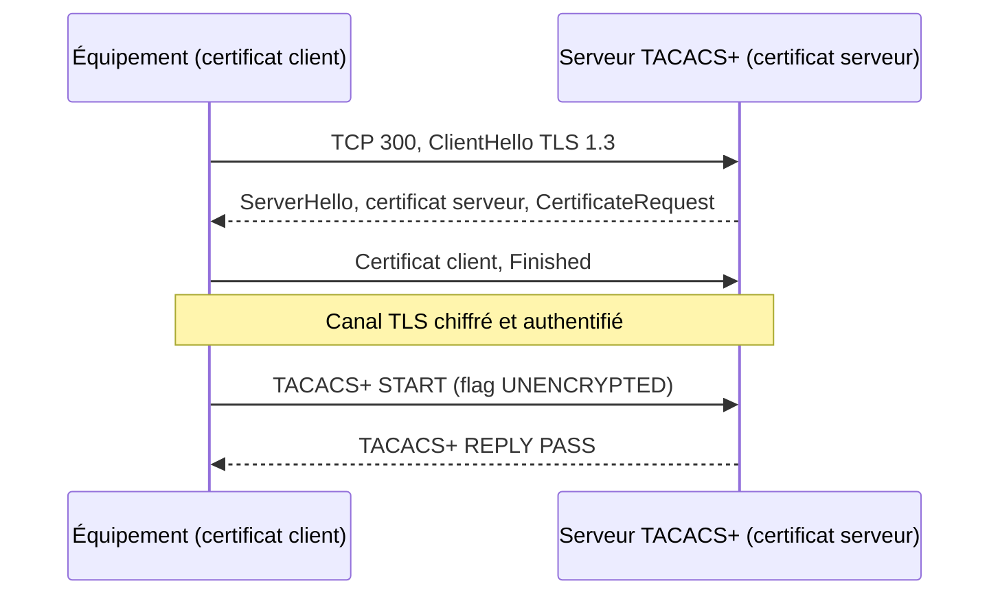

Le masquage MD5 de TACACS+ (voir [[04-tacacs/03-protocole-tacacs-plus|le protocole]]) ne protège pas réellement les échanges. La **RFC 9887**, publiée en 2025 sur la voie des standards, définit le transport de TACACS+ dans **TLS 1.3**. Le protocole TACACS+ lui-même ne change pas : seuls le transport et la protection changent.

## Ce qui change

| | TACACS+ classique | TACACS+ sur TLS |
| --- | --- | --- |
| Port | TCP **49** | TCP **300** (service `tacacss`) |
| Protection | Masquage MD5 avec la clé partagée | **Chiffrement et intégrité TLS 1.3** |
| Masquage du corps | Obligatoire | **Interdit** : le flag `UNENCRYPTED` doit être positionné |
| Authentification du serveur | Implicite (connaissance de la clé) | **Certificat X.509** ou clé prépartagée TLS (PSK) |
| Authentification du client | Implicite (clé) + adresse IP | **Certificat client** ou PSK |
| Protection contre le rejeu | Aucune | Assurée par TLS |
| Versions TLS | — | **TLS 1.3 uniquement** ; pas de données précoces (0-RTT) |

Points imposés par la RFC :

- Le serveur TLS **ne doit pas** accepter de TACACS+ non chiffré sur le port TLS, et un client configuré en TLS **ne doit pas** se rabattre sur le port 49 en cas d'échec.
- Les paquets TACACS+ circulent avec le flag `UNENCRYPTED` (`0x01`) ; un paquet masqué reçu dans TLS est une erreur et la connexion est fermée.
- La clé partagée historique n'est plus utilisée.
- L'identité du serveur est vérifiée à partir du certificat (nom DNS ou adresse IP dans le *subjectAltName*), et l'identité du client de la même façon côté serveur.

## Modes d'authentification

| Mode | Principe | Quand l'utiliser |
| --- | --- | --- |
| **Certificats** (recommandé) | Chaque équipement a un certificat client émis par l'AC interne ; le serveur présente un certificat serveur | Parc géré avec une PKI (voir les pages PKI du wiki) et des certificats renouvelés automatiquement |
| **Clés prépartagées TLS (PSK)** | Une clé PSK et une identité PSK par équipement | Petit parc, équipements sans PKI ; plus simple mais à renouveler manuellement |



## Prise en charge

La RFC est récente : la prise en charge arrive progressivement.

- **Serveurs** : `tac_plus-ng` gère TLS (compilé avec OpenSSL). Les serveurs commerciaux (Cisco ISE, Aruba ClearPass…) l'ajoutent selon leurs versions.
- **Équipements** : vérifiez les notes de version de votre constructeur (recherchez « TACACS+ over TLS » ou « RFC 9887 »). Tant qu'un équipement ne le gère pas, il reste en TACACS+ classique sur un réseau de gestion protégé.

> [!TIP]
> Un même serveur peut écouter sur **49** (équipements anciens) et sur **300** (équipements compatibles). Migrez équipement par équipement, puis fermez le port 49 quand tout le parc est passé en TLS.

## Serveur tac_plus-ng en TLS

`tac_plus-ng` doit être compilé avec la prise en charge TLS (OpenSSL ou LibreSSL présent au `./configure`). La syntaxe ci-dessous correspond aux versions récentes : vérifiez-la avec `man tac_plus-ng` ou la documentation fournie dans les sources (`tac_plus-ng/tac_plus-ng.html`).

```tacplus /usr/local/etc/tac_plus-ng.cfg
id = spawnd {
    listen = { port = 49 }                  # TACACS+ classique, le temps de la migration
    listen = { port = 300 tls = yes }       # TACACS+ sur TLS (RFC 9887)
}

id = tac_plus-ng {
    tls cert-file = /etc/tac_plus-ng/tls/serveur.crt
    tls key-file  = /etc/tac_plus-ng/tls/serveur.key
    tls cafile    = /etc/tac_plus-ng/tls/ac-interne.crt   # AC qui signe les certificats des équipements

    device commutateurs {
        address = 10.0.10.0/24
        key = "Cle-Classique-Port-49"       # ignorée pour les connexions TLS
    }
    # … utilisateurs, profils et règles comme en TACACS+ classique
}
```

Préparer les certificats avec l'AC interne :

```bash
# Clé et demande de certificat du serveur (nom DNS = celui configuré sur les équipements)
openssl req -new -newkey ec -pkeyopt ec_paramgen_curve:P-256 -nodes \
  -keyout serveur.key -out serveur.csr \
  -subj "/CN=tacacs1.exemple.lan" \
  -addext "subjectAltName=DNS:tacacs1.exemple.lan,IP:10.0.1.10"
# Faire signer serveur.csr par l'AC interne, puis :
sudo install -m 600 -o root serveur.key /etc/tac_plus-ng/tls/
sudo install -m 644 serveur.crt ac-interne.crt /etc/tac_plus-ng/tls/
```

## Tester

```bash
# Vérifier que le serveur répond en TLS 1.3 et présente le bon certificat
openssl s_client -connect tacacs1.exemple.lan:300 -tls1_3 \
  -CAfile ac-interne.crt -cert equipement.crt -key equipement.key </dev/null

# Résultat attendu : "Protocol : TLSv1.3" et "Verify return code: 0 (ok)"
```

Côté équipement, les commandes de débogage TACACS+ habituelles (voir [[04-tacacs/12-securite-depannage|dépannage]]) s'appliquent ; les erreurs TLS apparaissent en plus dans les journaux PKI ou SSL de l'équipement.

## Plan de migration

1. **Inventorier** les équipements et noter ceux qui gèrent TACACS+ sur TLS.
2. **Préparer la PKI** : AC interne, modèle de certificat client pour les équipements, renouvellement (SCEP, EST ou ACME selon les équipements).
3. **Ouvrir le port 300** sur le serveur en parallèle du port 49, et dans les ACL du réseau de gestion.
4. **Basculer** les équipements compatibles un par un, en gardant un compte local de secours.
5. **Surveiller** l'expiration des certificats (serveur et clients) : un certificat expiré bloque toutes les connexions d'administration.
6. **Fermer le port 49** quand il n'a plus de client.
