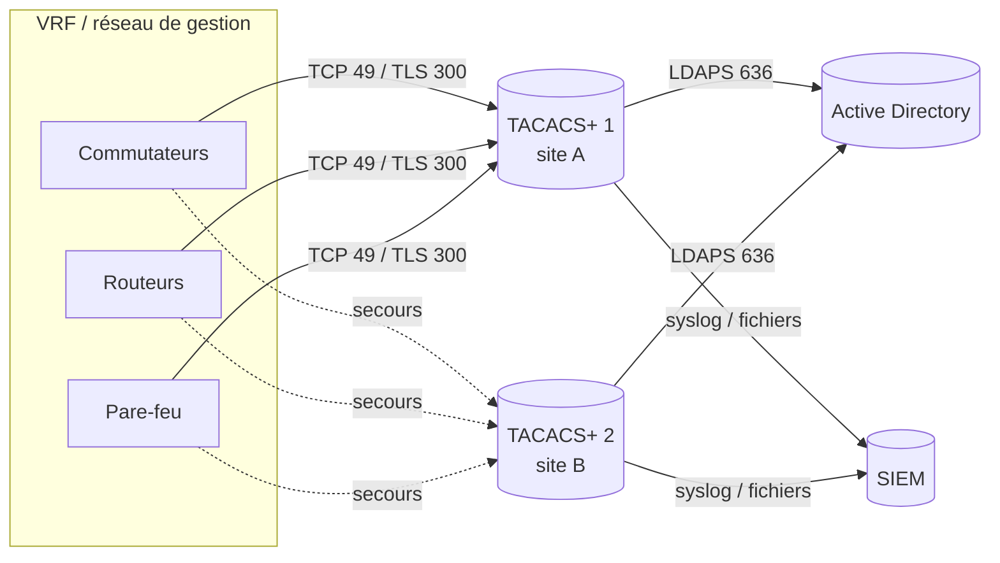

## Comparatif

| Serveur | Licence | Plates-formes | Points forts | Limites |
| --- | --- | --- | --- | --- |
| **tac_plus-ng** (Marc Huber) | Libre | Linux, BSD, macOS | Très complet : règles scriptées, profils, LDAP/AD via MAVIS, RADIUS en back-end, TLS (RFC 9887), haute performance | Pas d'interface graphique, syntaxe propre à apprendre |
| **tac_plus** (Shrubbery, dérivé de Cisco F4.0.4) | Libre | Linux, BSD | Syntaxe simple et très répandue dans la documentation, PAM | Développement ralenti, pas de TLS, règles limitées |
| **tacquito** (Meta) | Libre (Apache 2.0) | Linux (Go) | Écrit en Go, configuration YAML, pensé pour l'automatisation et les grands parcs | Communauté plus réduite, documentation surtout dans le code |
| **Cisco ISE** (Device Administration) | Commerciale (licence Device Admin) | Appliance ou VM | Interface graphique, jeux de commandes et profils shell, intégration AD, 802.1X sur la même plate-forme | Coût, lourdeur, licence spécifique |
| **Aruba ClearPass Policy Manager** | Commerciale | Appliance ou VM | Profils d'application TACACS+, intégration AD, NAC | Coût |
| **FortiAuthenticator** | Commerciale | Appliance ou VM | Intégré à l'écosystème Fortinet, MFA FortiToken | Fonctions TACACS+ moins riches qu'ISE |
| **TACACS.net** | Gratuite (version limitée) | Windows | Installation simple sous Windows, lien AD | Fonctions et mises à jour limitées |
| Cisco Secure ACS | Commerciale | Appliance | — | **Fin de vie**, remplacé par ISE |

> [!TIP]
> Pour un déploiement libre aujourd'hui, partez sur **tac_plus-ng** : c'est le serveur libre le plus actif et le seul à gérer TACACS+ sur TLS. Gardez **tac_plus (Shrubbery)** pour les installations existantes. Voir [[04-tacacs/06-tac-plus-ng|tac_plus-ng]] et [[04-tacacs/07-tac-plus-shrubbery|tac_plus (Shrubbery)]].

## Critères de choix

| Besoin | Orientation |
| --- | --- |
| Parc multi-constructeurs, équipe à l'aise en ligne de commande | tac_plus-ng |
| Configuration déjà gérée par Ansible, Git, revues de code | tac_plus-ng ou tacquito (fichiers texte versionnés) |
| Équipe qui veut une interface graphique et un support éditeur | Cisco ISE, ClearPass |
| Même plate-forme pour 802.1X (RADIUS) et administration (TACACS+) | Cisco ISE, ClearPass, ou FreeRADIUS + tac_plus-ng |
| Environnement Fortinet | FortiAuthenticator |
| Petit site Windows, besoin simple | TACACS.net |

## Architecture recommandée



- **Deux serveurs au minimum**, sur deux sites ou deux hyperviseurs différents. Les équipements les interrogent dans l'ordre et passent au suivant si le premier ne répond pas.
- **Configuration identique** sur les serveurs : déployée par Ansible ou synchronisée depuis Git.
- **Annuaire en lecture seule** via LDAPS avec un compte de service dédié.
- **Journaux centralisés** : chaque serveur n'a que les journaux des requêtes qu'il a reçues.
- Un **compte local de secours** sur chaque équipement, utilisé seulement si aucun serveur ne répond.

## Clients et outils de test

| Outil | Usage |
| --- | --- |
| **tacacs_client** (paquet Python `tacacs_plus`) | Tester l'authentification, l'autorisation et la comptabilité depuis un poste |
| **pam_tacplus** | Module PAM : authentifier les connexions SSH d'un serveur Linux sur TACACS+ |
| **libnss_tacplus** | Module NSS : faire exister les comptes TACACS+ sur un serveur Linux sans les créer localement |
| Wireshark | Dissection du protocole (filtre `tacplus`), déchiffrement avec la clé |

Tester un serveur depuis un poste Linux :

```bash
python3 -m venv ~/venv-tacacs && . ~/venv-tacacs/bin/activate
pip install tacacs_plus

# Authentification (PAP par défaut ; -t ascii pour le mode interactif)
tacacs_client -H 10.0.1.10 -k 'Cle-Partagee' -u alice authenticate
# Autorisation d'une commande (show version)
tacacs_client -H 10.0.1.10 -k 'Cle-Partagee' -u alice authorize -c service=shell cmd=show cmdargs=version
# Envoi d'un enregistrement de comptabilité
tacacs_client -H 10.0.1.10 -k 'Cle-Partagee' -u alice account -c service=shell cmd=show cmdargs=version
```

> [!NOTE]
> Le poste de test doit être déclaré comme équipement (adresse et clé) sur le serveur, sinon la connexion est refusée avant même l'authentification.

L'intégration de Linux avec `pam_tacplus` est décrite dans [[04-tacacs/09-equipements-autres|Autres constructeurs et Linux]].
