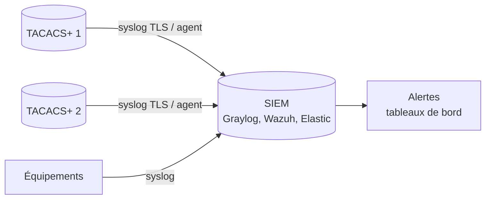

La **comptabilité** est souvent la vraie raison d'être de TACACS+ : savoir **qui** a tapé **quelle commande**, **sur quel équipement**, **quand**, et depuis **quelle adresse**. Elle sert à l'analyse d'incident, à l'audit et à la conformité.

## Ce qui est journalisé

| Événement | Source | Contenu |
| --- | --- | --- |
| Tentative d'authentification | Journal d'authentification du serveur | Utilisateur, équipement, adresse de l'administrateur, succès ou échec et motif |
| Décision d'autorisation | Journal d'autorisation | Commande demandée, profil appliqué, autorisé ou refusé |
| Ouverture et fermeture de session | Comptabilité (`exec` START/STOP) | Durée, ligne (vty, console) |
| Commande exécutée | Comptabilité (`commands`) | Commande complète, niveau de privilège |
| Redémarrage de l'équipement | Comptabilité (`system`) | Événement système |

> [!IMPORTANT]
> La comptabilité des commandes dépend de la configuration de l'**équipement** (`aaa accounting commands …` sur Cisco, `set system accounting events interactive-commands` sur Junos). Le serveur ne reçoit que ce que l'équipement envoie.

## Formats

### tac_plus-ng

Chaque type a son fichier (voir [[04-tacacs/06-tac-plus-ng|tac_plus-ng]]). Les champs sont séparés par des tabulations, dans un ordre configurable :

```text
2026-11-03 10:42:17 +0100  10.0.10.5  alice  vty0  10.0.5.20  stop  task_id=118  service=shell  priv-lvl=15  cmd=interface GigabitEthernet1/0/1 <cr>
```

tac_plus-ng peut aussi écrire directement vers **syslog** (`destination = syslog` dans un bloc `log`) ou vers un programme, et adapter le format (JSON selon les versions) pour faciliter l'analyse.

```tacplus
log acctsyslog {
    destination = syslog
    syslog facility = LOCAL6
    syslog ident = tac_plus-ng
}
accounting log = acctlog
accounting log = acctsyslog       # fichier local et syslog en parallèle
```

### tac_plus (Shrubbery)

```text
Nov  3 10:42:17  10.0.10.5  alice  tty2  10.0.5.20  stop  task_id=118  timezone=UTC  service=shell  priv-lvl=15  cmd=shutdown <cr>
```

## Centraliser vers un SIEM



- **Les deux serveurs** envoient leurs journaux : chaque serveur ne voit que les requêtes qu'il a reçues.
- Envoyer via **rsyslog en TCP/TLS** ou un agent (Filebeat, Wazuh agent) pour ne pas perdre d'événements.
- **Croiser** avec les journaux syslog des équipements (changements de configuration, `%SYS-5-CONFIG_I` chez Cisco) et ceux du bastion SSH.

Exemple rsyslog sur le serveur TACACS+ :

```text /etc/rsyslog.d/50-tacacs.conf
# Lire les fichiers de tac_plus-ng et les transmettre au SIEM
module(load="imfile")
input(type="imfile" File="/var/log/tac_plus-ng/acct-*.log"  Tag="tacacs-acct:"  Severity="info" Facility="local6")
input(type="imfile" File="/var/log/tac_plus-ng/authc-*.log" Tag="tacacs-authc:" Severity="info" Facility="local6")
input(type="imfile" File="/var/log/tac_plus-ng/authz-*.log" Tag="tacacs-authz:" Severity="info" Facility="local6")
local6.* @@siem.exemple.lan:6514
```

## Conservation

- Durée selon la politique de l'entreprise et les obligations (souvent 1 an minimum pour les traces d'administration).
- Rotation locale : fichiers datés (`%Y%m%d` dans tac_plus-ng) + suppression des anciens par `find … -mtime +30 -delete` ou `logrotate`.
- Journaux **en écriture seule** pour les administrateurs réseau : ceux qui sont tracés ne doivent pas pouvoir effacer leurs traces.

## Recherches utiles

| Question | Recherche |
| --- | --- |
| Qui a modifié cet équipement hier ? | équipement = X, type = `stop`, `cmd` contient `configure` ou une commande de configuration |
| Qui a redémarré un équipement ? | `cmd=reload` |
| Échecs de connexion répétés | journal d'authentification, échecs par utilisateur ou par adresse source |
| Utilisation du compte de secours | journaux syslog de l'équipement (authentification locale), car TACACS+ n'a pas vu la connexion |
| Commandes refusées | journal d'autorisation, décision `deny` |

## Alertes recommandées

- Plusieurs échecs d'authentification pour un même compte ou une même source en peu de temps.
- Commandes sensibles exécutées : `reload`, `write erase`, `aaa`, `username`, `crypto key`.
- Connexion d'un compte de service depuis une adresse inattendue.
- Connexion avec le compte local de secours (signe que TACACS+ est indisponible ou contourné).
- Absence de journaux d'un serveur TACACS+ pendant une durée anormale.

## Superviser les serveurs

| Contrôle | Méthode |
| --- | --- |
| Port ouvert | Sonde TCP sur 49 (et 300) depuis le réseau de gestion |
| Service fonctionnel | Authentification de test périodique avec un compte dédié (`tacacs_client`, sonde personnalisée) |
| Processus | Service systemd actif, redémarrages |
| Annuaire | Disponibilité LDAPS du point de vue du serveur TACACS+ |
| Côté équipements | `show aaa servers` (état UP/DEAD) ; alerte syslog `%TAC+-…` ou `%AAA-…` quand un serveur passe à DEAD |

Voir les pages de supervision du wiki (Zabbix, Prometheus) pour intégrer ces contrôles.
