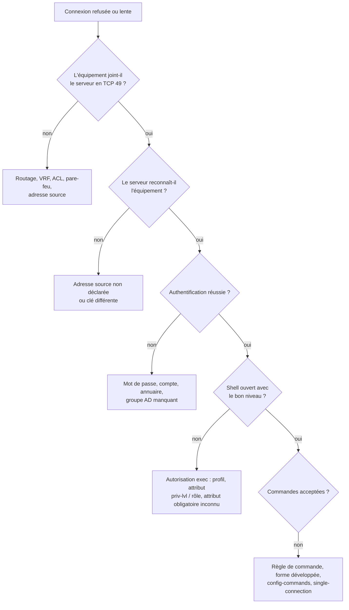

## Faiblesses connues

La RFC 8907 reconnaît elle-même les limites de TACACS+ classique :

| Faiblesse | Conséquence | Atténuation |
| --- | --- | --- |
| Masquage par **MD5** et clé partagée | Une capture permet une attaque par dictionnaire hors ligne sur la clé ; une clé trouvée révèle tous les mots de passe capturés | Clés longues et aléatoires (32 caractères ou plus), différentes par groupe d'équipements ; **TLS** (RFC 9887) |
| Pas d'**intégrité** ni de protection contre le **rejeu** | Modification ou rejeu de paquets par un attaquant placé sur le chemin | Réseau de gestion isolé, TLS |
| Pas d'authentification forte du serveur | Un faux serveur connaissant la clé peut accepter n'importe qui | Protéger les clés, TLS avec certificats |
| Flag `UNENCRYPTED` accepté par certains serveurs | Échanges en clair | Refuser les paquets non masqués hors TLS (comportement par défaut des serveurs récents) |
| `FOLLOW` (renvoi vers un autre serveur) | Détournement vers un serveur hostile | Désactivé ou ignoré par la plupart des équipements |

## Durcissement

1. **Réseau de gestion** : TACACS+ circule dans une VRF ou un VLAN de gestion, jamais sur Internet ni sur les réseaux utilisateurs.
2. **Filtrage** : le serveur n'accepte le port 49 (et 300) que depuis les réseaux d'équipements ; les équipements n'acceptent SSH que depuis le bastion.
3. **Clés** : une par groupe d'équipements, générées aléatoirement (`openssl rand -base64 33`), stockées dans un coffre, changées périodiquement et après chaque départ d'un administrateur qui y avait accès.
4. **TLS** dès que les équipements le permettent ([[04-tacacs/04-tacacs-plus-tls|TACACS+ sur TLS]]).
5. **MFA** : le serveur peut exiger un second facteur (OTP via le dialogue ASCII, RADIUS vers un serveur MFA en back-end, ISE avec un fournisseur MFA).
6. **Annuaire** : LDAPS uniquement, compte de service en lecture seule, groupes dédiés.
7. **Comptes locaux** : un seul compte de secours par équipement (voir [[04-tacacs/10-politiques-autorisation|Politiques d'autorisation]]).
8. **Serveur durci** : système à jour, accès SSH restreint, configuration en Git, journaux exportés.

## Méthode de dépannage



## Commandes de débogage

### Cisco IOS / IOS XE

```cisco
show aaa servers                       ! UP/DEAD, compteurs, temps de réponse
show tacacs
test aaa group TACACS alice MotDePasse new-code
terminal monitor
debug tacacs
debug tacacs packet
debug aaa authentication
debug aaa authorization
debug aaa accounting
! ne pas oublier :
undebug all
```

### NX-OS, Junos, Comware

```text
NX-OS   : test aaa group TACACS alice MotDePasse ; debug tacacs+ all ; show tacacs-server statistics 10.0.1.10
Junos   : show log messages | match -i tacplus ; traceoptions sous system tacplus-options (selon version)
Comware : display hwtacacs scheme TACACS statistics ; debugging hwtacacs all ; terminal debugging
```

### Serveur

```bash
# tac_plus-ng : vérifier la configuration, puis déboguer au premier plan
sudo tac_plus-ng -P /usr/local/etc/tac_plus-ng.cfg
# (ajouter "debug = PACKET AUTHEN AUTHOR MAVIS" dans le bloc tac_plus-ng)

# tac_plus (Shrubbery) : débogage authentification + autorisation, au premier plan
sudo tac_plus -C /etc/tac_plus.conf -G -d 24

# Le trafic arrive-t-il ?
sudo tcpdump -ni any 'tcp port 49'

# Test depuis le serveur lui-même (déclarer 127.0.0.1 comme équipement)
tacacs_client -H 127.0.0.1 -k 'Cle' -u alice authenticate
```

### Wireshark

Filtre `tacplus`. Pour lire le contenu, indiquer la clé dans **Préférences → Protocols → TACPLUS → TACACS+ Encryption Key**. Si les champs restent illisibles avec la bonne clé, l'équipement et le serveur n'utilisent pas la même clé.

## Erreurs courantes

| Symptôme | Cause probable | Correction |
| --- | --- | --- |
| `show aaa servers` indique **DEAD**, délai de connexion long | Port 49 filtré, mauvaise VRF, serveur arrêté | Tester `telnet 10.0.1.10 49` depuis l'équipement (avec la VRF), vérifier `source-interface` et `vrf` |
| Le serveur journalise « unknown device » / connexion fermée aussitôt | Adresse source de l'équipement non déclarée | Déclarer l'adresse réellement utilisée (`ip tacacs source-interface`) |
| « Bad secret », « invalid packet », champs illisibles dans Wireshark | **Clé différente** des deux côtés (caractère spécial, espace final, clé chiffrée recopiée en clair) | Ressaisir la clé en clair des deux côtés (`key 0 …` sur Cisco) |
| Authentification refusée pour un compte AD valide | Utilisateur hors des groupes `tacacs-*`, compte de service LDAP expiré, certificat LDAPS non approuvé | Débogage MAVIS, vérifier les groupes et la connexion LDAPS |
| Connexion acceptée mais niveau 1 au lieu de 15 | `aaa authorization exec` absent sur l'équipement, ou profil sans `priv-lvl` | Ajouter `aaa authorization exec default group …` ; vérifier le profil |
| Shell refusé juste après l'authentification | Attribut **obligatoire** inconnu de l'équipement (ex. `shell:roles` envoyé à un IOS) | Rendre l'attribut facultatif ou séparer les profils par type d'équipement |
| Toutes les commandes refusées sauf `exit` | Règles écrites sur la forme abrégée, ou `deny` implicite en fin de profil | Écrire les expressions sur la commande développée, consulter le journal d'autorisation |
| Commandes de configuration non contrôlées | `aaa authorization config-commands` absent (IOS) | L'ajouter |
| Console bloquée après le déploiement | `aaa authorization console` sans méthode `local` | Toujours `local` en secours sur la console ; récupération par redémarrage en mode de récupération du mot de passe sinon |
| Lenteur à chaque commande | Nouvelle connexion TCP par commande, serveur lent ou annuaire lent | `single-connection` des deux côtés ; cache des groupes côté serveur |
| Le compte local fonctionne alors que le serveur est joignable (Junos) | `authentication-order [ tacplus password ]` essaie aussi le local après un refus | Limiter les comptes locaux au compte de secours |
| Rien dans la comptabilité | `aaa accounting` non configuré sur l'équipement, ou journal mal déclaré sur le serveur | Configurer la comptabilité exec et commandes ; vérifier `accounting log` |
