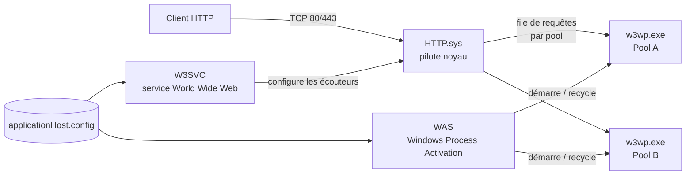

**Internet Information Services (IIS)** est le serveur web intégré à Windows et Windows Server. Il héberge des sites statiques, des applications ASP.NET / ASP.NET Core, PHP (via FastCGI), sert de **reverse proxy** (avec URL Rewrite + ARR), de serveur **FTP/FTPS**, et expose des services comme WebDAV, Web Deploy ou les points de terminaison de certains rôles Windows (WSUS, RDS Web Access, Exchange OWA, ADCS Web Enrollment…).

## Versions

| Version IIS | Système | Points marquants |
| --- | --- | --- |
| 7.0 | Windows Server 2008 / Vista | Architecture modulaire, pipeline intégré, `applicationHost.config` |
| 7.5 | 2008 R2 / 7 | Module PowerShell `WebAdministration`, FTP 7.5 intégré |
| 8.0 / 8.5 | 2012 / 2012 R2 | SNI, Central Certificate Store, Application Initialization, Dynamic IP Restrictions |
| **10.0** | 2016, 2019, 2022, 2025 / Windows 10-11 | HTTP/2, module `IISAdministration`, HSTS natif (1709+), HTTP/3 et TLS 1.3 (2022+) |

> [!NOTE]
> Toutes les versions de Windows Server depuis 2016 annoncent « IIS 10.0 », mais les fonctionnalités évoluent avec le système : HTTP/3 (QUIC) et TLS 1.3 n'existent que sur **Windows Server 2022 et ultérieurs**.

## Architecture interne



| Composant | Rôle |
| --- | --- |
| **HTTP.sys** | Pilote en mode noyau qui écoute sur les ports TCP, gère le TLS (via Schannel), la mise en cache noyau, la file d'attente par pool et les délais (timeouts). Il renvoie lui-même certaines erreurs (503, 400) consignées dans `HTTPERR`. |
| **W3SVC** | Service *World Wide Web Publishing* : lit la configuration des sites et configure HTTP.sys (liaisons, URL réservées). |
| **WAS** | *Windows Process Activation Service* : gère le cycle de vie des processus de travail (démarrage, recyclage, arrêt, protection contre les échecs rapides). Utilisé aussi pour l'activation non-HTTP (net.tcp, MSMQ). |
| **w3wp.exe** | Processus de travail (*worker process*) : un ou plusieurs par pool d'applications. Il exécute le pipeline de modules et le code applicatif. |
| **Modules** | Composants natifs (`StaticFileModule`, `DefaultDocumentModule`, `UrlRewriteModule`, `AspNetCoreModuleV2`…) ou managés (.NET) qui traitent chaque étape de la requête. |
| **Handlers** | Associent une extension/un chemin à un traitement (`StaticFile`, `PHP_via_FastCGI`, `aspNetCore`, `ExtensionlessUrlHandler`…). |

### Pipeline de traitement d'une requête

1. HTTP.sys reçoit la requête, vérifie la liaison (IP:port:nom d'hôte) et la place dans la file du pool correspondant.
2. Si aucun processus n'est actif, WAS démarre un `w3wp.exe` avec l'identité du pool.
3. Le processus de travail fait passer la requête par les **événements du pipeline** : `BeginRequest` → `AuthenticateRequest` → `AuthorizeRequest` → `ResolveRequestCache` → `MapRequestHandler` → `ExecuteRequestHandler` → `UpdateRequestCache` → `LogRequest` → `EndRequest`.
4. Le handler génère la réponse, renvoyée à HTTP.sys qui la transmet au client (et peut la mettre en cache noyau).

## Vocabulaire

| Terme | Définition |
| --- | --- |
| **Site** | Ensemble identifié par un nom, un ID et une ou plusieurs **liaisons** (protocole, IP, port, nom d'hôte). Contient au moins l'application racine `/`. |
| **Liaison (binding)** | Triplet `IP:port:hostheader` (+ certificat pour HTTPS). Plusieurs sites peuvent partager IP et port s'ils ont des en-têtes d'hôte différents. |
| **Application** | Sous-arborescence d'un site associée à un pool d'applications (frontière d'exécution). |
| **Répertoire virtuel** | Alias d'URL qui pointe vers un dossier physique (local ou UNC), sans être une application. |
| **Pool d'applications** | Groupe de processus `w3wp` avec une identité, une version du CLR, un mode de pipeline et des règles de recyclage. Isole les applications entre elles. |
| **Identité de pool** | Compte sous lequel tourne le pool : par défaut `ApplicationPoolIdentity` (compte virtuel `IIS AppPool\NomDuPool`). |

## Fichiers de configuration

La configuration est **hiérarchique** et en XML. Chaque niveau hérite du précédent et peut le surcharger si la section est déverrouillée :

```text
%windir%\Microsoft.NET\Framework64\v4.0.30319\Config\machine.config     (.NET, machine)
%windir%\Microsoft.NET\Framework64\v4.0.30319\Config\web.config         (.NET, racine)
%windir%\System32\inetsrv\config\applicationHost.config                 (IIS, serveur)
C:\inetpub\wwwroot\web.config                                           (site)
C:\inetpub\wwwroot\app1\web.config                                      (application / dossier)
```

| Fichier | Contenu |
| --- | --- |
| `applicationHost.config` | Sites, liaisons, pools, modules globaux, sections verrouillées, valeurs par défaut. |
| `administration.config` | Configuration du Gestionnaire IIS (délégation de fonctionnalités, extensions). |
| `redirection.config` | Redirection vers une configuration partagée (*Shared Configuration*). |
| `web.config` | Paramètres par site, application ou dossier (sections `system.webServer`, `system.web`). |

> [!TIP]
> Les balises `<location path="Site/app">` dans `applicationHost.config` permettent de centraliser la configuration d'un site sans toucher à ses fichiers `web.config` — pratique quand le contenu est déployé par une équipe de développement.

### Verrouillage des sections

Une section dont `overrideModeDefault="Deny"` ne peut pas être modifiée dans un `web.config` (erreur **500.19**). Pour la déverrouiller :

```powershell
# Autoriser la surcharge de l'authentification Windows au niveau des sites
& "$env:windir\system32\inetsrv\appcmd.exe" unlock config -section:system.webServer/security/authentication/windowsAuthentication
```

## Ports et flux

| Port | Usage |
| --- | --- |
| TCP 80 | HTTP |
| TCP 443 | HTTPS (TLS) |
| UDP 443 | HTTP/3 (QUIC), Windows Server 2022+ |
| TCP 21 / 990 | FTP (contrôle) / FTPS implicite |
| Plage TCP passive | FTP mode passif (à définir, ex. 50000-50100) |
| TCP 8172 | Service de gestion à distance (WMSvc) et Web Deploy |

## Outils d'administration

- **Gestionnaire des services Internet** (`inetmgr.exe`) — interface graphique, connexion à distance possible via WMSvc.
- **PowerShell** — modules `WebAdministration` (lecteur `IIS:\`) et `IISAdministration` (plus récent, plus rapide).
- **appcmd.exe** — `%windir%\system32\inetsrv\appcmd.exe`, ligne de commande historique, idéale pour les scripts batch.
- **Éditeur de configuration** (dans le Gestionnaire IIS) — accès à toutes les sections, génération de scripts (C#, JavaScript, appcmd, PowerShell).
- **Web Deploy (msdeploy)** — synchronisation et publication de sites entre serveurs.

## Suite du parcours

1. [[02-installation|Installation du rôle et des extensions]]
2. [[03-sites-liaisons-pools|Sites, liaisons et pools d'applications]]
3. [[04-https-certificats|HTTPS et certificats]]
4. [[05-authentification-autorisation|Authentification et autorisation]]
5. [[06-url-rewrite-arr|URL Rewrite et reverse proxy ARR]]
6. [[07-applications-aspnet-php|Héberger ASP.NET, ASP.NET Core et PHP]]
7. [[08-performances-cache|Performances, compression et cache]]
8. [[09-securite-durcissement|Sécurité et durcissement]]
9. [[10-ftp|Serveur FTP / FTPS]]
10. [[11-logs-depannage|Journaux, supervision et dépannage]]
11. [[12-memo-powershell-appcmd|Mémo PowerShell et appcmd]]
