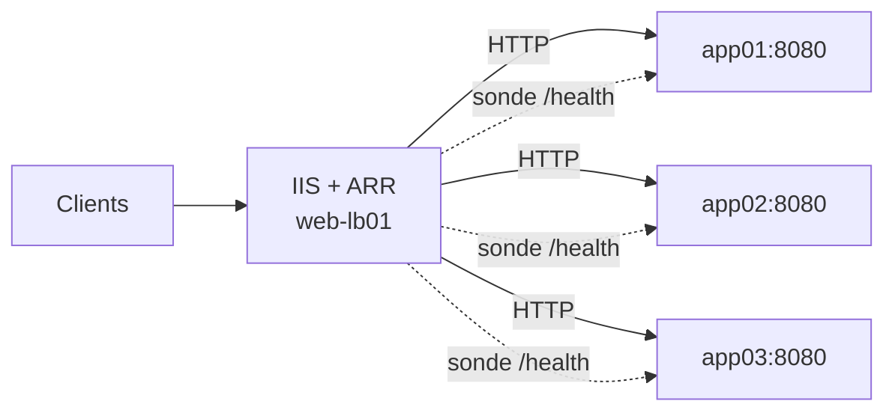

## Installation

1. **URL Rewrite 2.1** (module `RewriteModule`).
2. **Application Request Routing 3.0** (ARR) — uniquement pour le reverse proxy et les fermes.
3. Activer le proxy au niveau serveur : Gestionnaire IIS → nœud serveur → *Application Request Routing Cache* → *Server Proxy Settings* → **Enable proxy**.

```powershell
Set-WebConfigurationProperty -PSPath 'MACHINE/WEBROOT/APPHOST' -Filter "system.webServer/proxy" -Name "enabled" -Value $true
Set-WebConfigurationProperty -PSPath 'MACHINE/WEBROOT/APPHOST' -Filter "system.webServer/proxy" -Name "preserveHostHeader" -Value $true
Set-WebConfigurationProperty -PSPath 'MACHINE/WEBROOT/APPHOST' -Filter "system.webServer/proxy" -Name "reverseRewriteHostInResponseHeaders" -Value $false
Set-WebConfigurationProperty -PSPath 'MACHINE/WEBROOT/APPHOST' -Filter "system.webServer/proxy" -Name "timeout" -Value "00:02:00"
```

## Anatomie d'une règle

```xml
<rule name="Nom unique" stopProcessing="true" enabled="true">
  <match url="^produits/([0-9]+)/?$" ignoreCase="true" negate="false" />
  <conditions logicalGrouping="MatchAll" trackAllCaptures="false">
    <add input="{REQUEST_FILENAME}" matchType="IsFile" negate="true" />
  </conditions>
  <serverVariables>
    <set name="HTTP_X_ORIGINAL_URL" value="{REQUEST_URI}" />
  </serverVariables>
  <action type="Rewrite" url="produit.aspx?id={R:1}" appendQueryString="true" />
</rule>
```

| Élément | Rôle |
| --- | --- |
| `match url` | Expression régulière appliquée au **chemin sans le `/` initial ni la chaîne de requête** |
| `{R:n}` | Captures de `match` ; `{C:n}` captures de la dernière condition |
| `conditions` | Tests supplémentaires (`MatchAll` = ET, `MatchAny` = OU) sur des variables serveur |
| `matchType` | `Pattern` (regex), `IsFile`, `IsDirectory` |
| `action type` | `Rewrite` (interne, invisible), `Redirect` (301/302/307/308), `CustomResponse`, `AbortRequest`, `None` |
| `stopProcessing` | N'évalue pas les règles suivantes si celle-ci s'applique |

### Variables serveur utiles

| Variable | Exemple de valeur |
| --- | --- |
| `{HTTP_HOST}` | `www.exemple.fr` |
| `{HTTPS}` | `on` / `off` |
| `{REQUEST_URI}` | `/produits/42?x=1` |
| `{QUERY_STRING}` | `x=1` |
| `{REMOTE_ADDR}` | `203.0.113.10` |
| `{HTTP_USER_AGENT}`, `{HTTP_REFERER}` | En-têtes de la requête (préfixe `HTTP_` + nom en majuscules, `-` → `_`) |
| `{REQUEST_FILENAME}` | Chemin physique demandé |
| `{CACHE_URL}` | URL complète avec schéma |

## Recettes courantes

### Forcer le www et le HTTPS

```xml
<rule name="Canonique https://www" stopProcessing="true">
  <match url="(.*)" />
  <conditions logicalGrouping="MatchAny">
    <add input="{HTTP_HOST}" pattern="^exemple\.fr$" />
    <add input="{HTTPS}" pattern="^OFF$" />
  </conditions>
  <action type="Redirect" url="https://www.exemple.fr/{R:1}" redirectType="Permanent" />
</rule>
```

### Supprimer la barre oblique finale / mettre en minuscules

```xml
<rule name="Sans slash final" stopProcessing="true">
  <match url="(.*)/$" />
  <conditions>
    <add input="{REQUEST_FILENAME}" matchType="IsDirectory" negate="true" />
  </conditions>
  <action type="Redirect" url="{R:1}" />
</rule>
<rule name="Minuscules" stopProcessing="true">
  <match url=".*[A-Z].*" ignoreCase="false" />
  <action type="Redirect" url="{ToLower:{URL}}" />
</rule>
```

### Application monopage (SPA : Angular, React, Vue)

```xml
<rule name="SPA fallback" stopProcessing="true">
  <match url=".*" />
  <conditions logicalGrouping="MatchAll">
    <add input="{REQUEST_FILENAME}" matchType="IsFile" negate="true" />
    <add input="{REQUEST_FILENAME}" matchType="IsDirectory" negate="true" />
    <add input="{REQUEST_URI}" pattern="^/api/" negate="true" />
  </conditions>
  <action type="Rewrite" url="/index.html" />
</rule>
```

### Bloquer un agent ou une IP

```xml
<rule name="Bloquer scanners" stopProcessing="true">
  <match url=".*" />
  <conditions logicalGrouping="MatchAny">
    <add input="{HTTP_USER_AGENT}" pattern="(sqlmap|nikto|masscan)" />
    <add input="{REQUEST_URI}" pattern="(wp-login\.php|\.env|\.git/)" />
  </conditions>
  <action type="CustomResponse" statusCode="403" statusReason="Forbidden" statusDescription="Accès refusé" />
</rule>
```

### Cartes de réécriture (rewrite maps)

Pour des centaines de redirections (migration de site) :

```xml
<rewrite>
  <rewriteMaps>
    <rewriteMap name="Anciennes URL">
      <add key="/ancien/contact.php" value="/contact" />
      <add key="/ancien/tarifs.php" value="/offres" />
    </rewriteMap>
  </rewriteMaps>
  <rules>
    <rule name="Redirections migration" stopProcessing="true">
      <match url=".*" />
      <conditions>
        <add input="{Anciennes URL:{REQUEST_URI}}" pattern="(.+)" />
      </conditions>
      <action type="Redirect" url="{C:1}" redirectType="Permanent" />
    </rule>
  </rules>
</rewrite>
```

> [!TIP]
> Les règles peuvent vivre dans un fichier séparé : `<rewriteMaps configSource="rewritemaps.config" />`.

## Reverse proxy vers une application interne

Exemple : publier une application Node.js/Java écoutant sur `http://127.0.0.1:3000` sous `https://app.exemple.fr`.

```xml
<system.webServer>
  <rewrite>
    <rules>
      <rule name="Proxy vers app" stopProcessing="true">
        <match url="(.*)" />
        <serverVariables>
          <set name="HTTP_X_FORWARDED_PROTO" value="https" />
          <set name="HTTP_X_FORWARDED_HOST" value="{HTTP_HOST}" />
          <set name="HTTP_X_REAL_IP" value="{REMOTE_ADDR}" />
        </serverVariables>
        <action type="Rewrite" url="http://127.0.0.1:3000/{R:1}" />
      </rule>
    </rules>
    <outboundRules>
      <!-- Réécrire les redirections Location: http://127.0.0.1:3000/... envoyées par le backend -->
      <rule name="Location" preCondition="EstRedirection">
        <match serverVariable="RESPONSE_Location" pattern="^http://127\.0\.0\.1:3000/(.*)" />
        <action type="Rewrite" value="https://{HTTP_HOST}/{R:1}" />
      </rule>
      <preConditions>
        <preCondition name="EstRedirection">
          <add input="{RESPONSE_STATUS}" pattern="3\d\d" />
        </preCondition>
      </preConditions>
    </outboundRules>
  </rewrite>
</system.webServer>
```

> [!IMPORTANT]
> Les variables serveur modifiées dans `<serverVariables>` doivent être **autorisées** au niveau serveur, sinon erreur 500.50 :
> ```powershell
> Add-WebConfigurationProperty -PSPath 'MACHINE/WEBROOT/APPHOST' -Filter "system.webServer/rewrite/allowedServerVariables" -Name "." -Value @{name='HTTP_X_FORWARDED_PROTO'}
> ```

ARR ajoute automatiquement l'en-tête `X-Forwarded-For` (désactivable dans *Server Proxy Settings*). Les réponses compressées par le backend empêchent les règles sortantes : définissez `HTTP_ACCEPT_ENCODING` à une valeur vide dans `serverVariables` si vous devez réécrire le contenu HTML.

### WebSockets

Installez `Web-WebSockets` sur le serveur IIS : ARR relaie alors les connexions `Upgrade: websocket` sans configuration supplémentaire. Désactivez le module WebSocket **dans l'application** proxifiée si c'est elle qui le gère (`<webSocket enabled="false" />` pour Node/iisnode).

## Fermes de serveurs ARR (répartition de charge)



```xml
<!-- applicationHost.config -->
<webFarms>
  <webFarm name="ferme-app" enabled="true">
    <server address="app01.corp.local" enabled="true">
      <applicationRequestRouting httpPort="8080" weight="100" />
    </server>
    <server address="app02.corp.local" enabled="true">
      <applicationRequestRouting httpPort="8080" weight="100" />
    </server>
    <applicationRequestRouting>
      <loadBalancing algorithm="WeightedRoundRobin" />
      <healthCheck url="http://ferme-app/health" interval="00:00:10" timeout="00:00:05" responseMatch="OK" />
      <affinity useCookie="true" cookieName="ARRAffinity" />
      <protocol timeout="00:01:00" reverseRewriteHostInResponseHeaders="false">
        <cache enabled="false" />
      </protocol>
    </applicationRequestRouting>
  </webFarm>
</webFarms>
```

Règle globale qui envoie le trafic vers la ferme :

```xml
<rule name="ARR_ferme-app" stopProcessing="true" patternSyntax="Wildcard">
  <match url="*" />
  <conditions><add input="{HTTP_HOST}" pattern="app.exemple.fr" /></conditions>
  <action type="Rewrite" url="http://ferme-app/{R:0}" />
</rule>
```

| Algorithme | Comportement |
| --- | --- |
| `WeightedRoundRobin` | Tourniquet pondéré (défaut) |
| `LeastRequests` | Serveur avec le moins de requêtes en cours |
| `LeastResponseTime` | Serveur le plus rapide |
| `WeightedTotalTraffic` | Équilibre le volume d'octets |
| `RequestHash` | Hachage de l'URL ou d'une variable (affinité de cache) |

### Opérations sur la ferme

Gestionnaire IIS → *Batteries de serveurs* → serveur → **Désactiver les nouvelles connexions** (drainage) avant maintenance, puis **Mettre hors connexion**. L'onglet *Surveillance et gestion* affiche l'état de santé, le nombre de requêtes et les réponses en erreur par serveur.

> [!WARNING]
> ARR est un point unique de défaillance : doublez-le (deux serveurs ARR avec NLB ou un répartiteur matériel en amont) et partagez la configuration (*Shared Configuration*).

## Déboguer les règles

- Activez le **suivi des demandes ayant échoué** (FREB) avec le fournisseur `Rewrite` : chaque règle évaluée, ses captures et le résultat apparaissent dans la trace (voir [[11-logs-depannage]]).
- Gestionnaire IIS → URL Rewrite → *Tester le modèle* pour valider une expression régulière.
- Ajoutez temporairement une action `CustomResponse` ou un en-tête de réponse de débogage.
